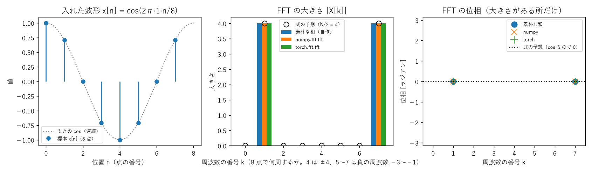
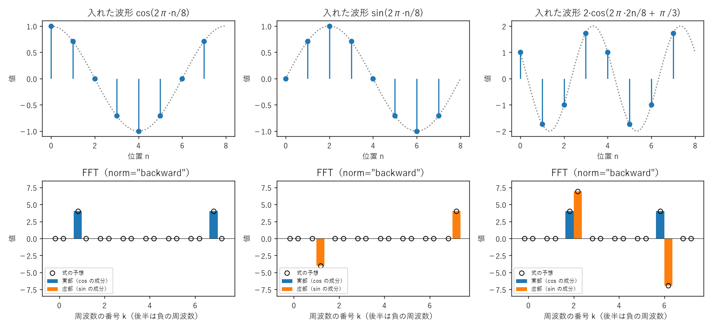
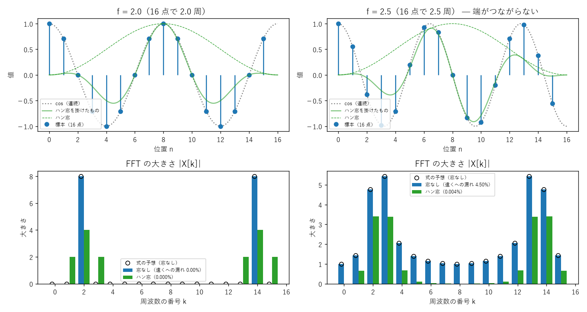
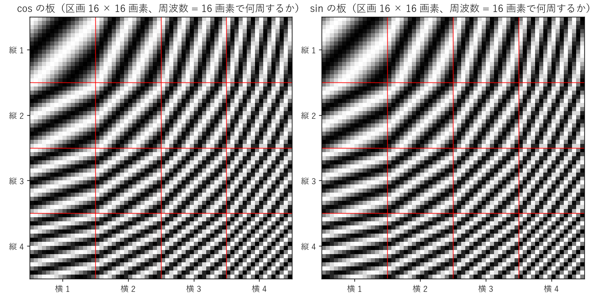
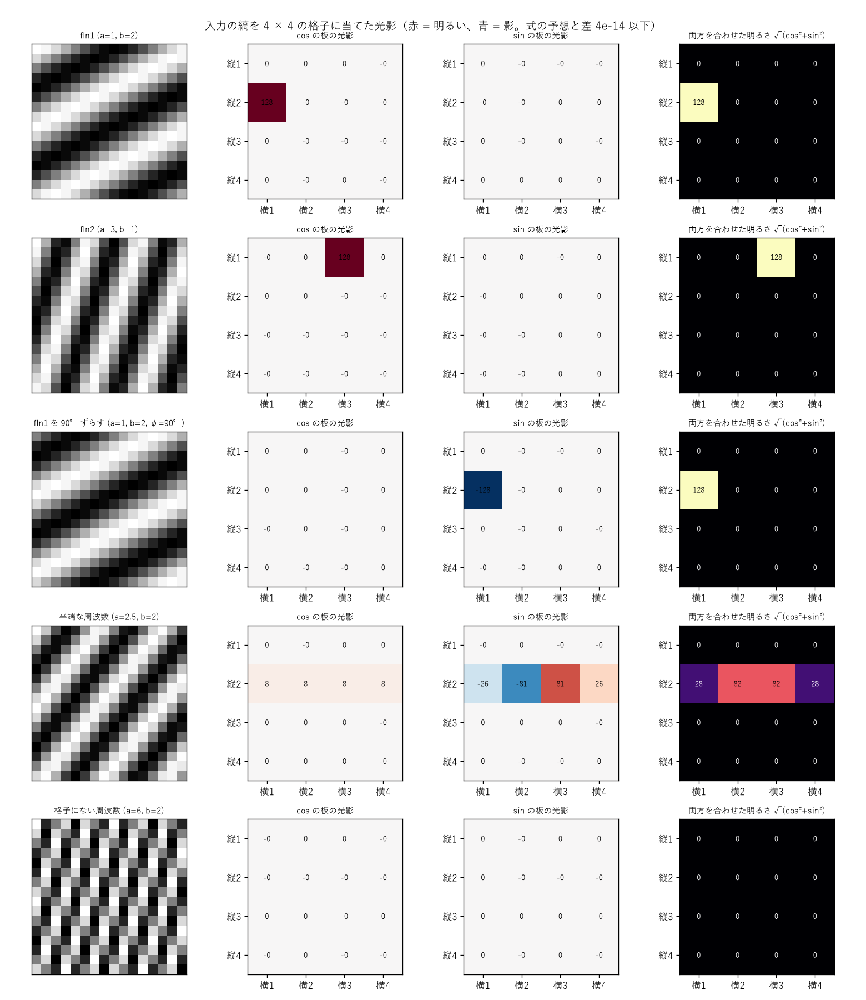
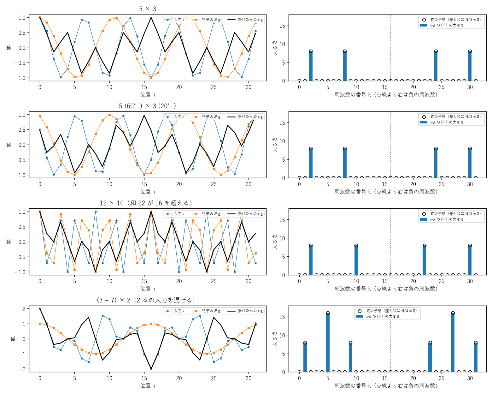
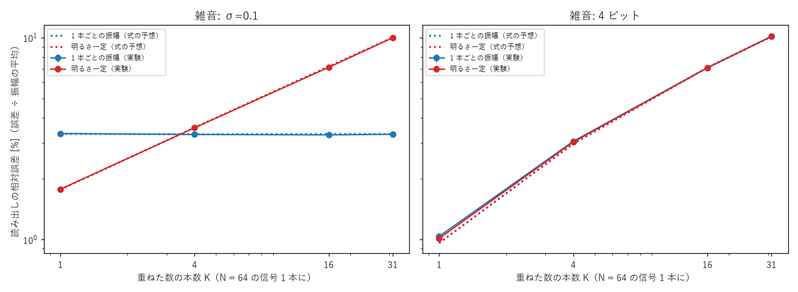

# Sin-CNN3 実験ノート

sin・cos とフーリエ変換による入出力と記憶を、小さなモデルから作り直し、なぜうまくいく・いかないのかを持ち主と一緒に理解する記録。数字の正本。

> ファイル配置（2026-10-27）: 一歩ごとの説明は `docs/lessons/NN_題.md`、ライブラリの確認表は `docs/library_check.md`。実験は `experiments/expNN_名前.py`、条件は `experiments/sweeps/sweepNN.sh`、結果は `results/expNN.txt`（1 回 = 1 行の JSON）、図は `tools/fig_*.py` から `docs/images/` に。自作の版は `src/`、確かめた約束は `tests/`。リポジトリ直下で実行する。

## 現時点のまとめ（2026-10-27 更新）

いまの理解: FFT の基本の約束（素朴な和との一致、norm の係数、往復、パーセバル、sin の符号、漏れ）は、numpy・torch とも式どおり（実験01〜03）。1 本の周波数に振幅と位相の 2 つの数を載せて、そのまま読み出せる。周波数の格子の板に波を当てると、同じ周波数の区画だけが光る（違う周波数は掛けて足すと打ち消し合う）。位相まで読むには cos と sin の板が両方要る（実験04）。前のプロジェクト（SN2-Parts-2D・Sin-CNN2）の要点を [docs/lessons/00_前のプロジェクトで分かったこと.md](docs/lessons/00_前のプロジェクトで分かったこと.md) にまとめ、最初の段（M0）の順番を持ち主と決めているところ。

| 目標 | 状況 |
|---|---|
| M0: ライブラリと計算の約束の確認（docs/library_check.md）。前のプロジェクトとの食い違いの有無 | 6 項目を確認、すべて式どおり（実験01〜03）。残り: rfft・循環の畳み込み・精度・複素数の勾配・回折 |
| M1: 入出力（sin・cos に載せて読み出す）の性質を、式と実験の両方で説明できる | 長さ 64 に 31 本（64 個の数）まで誤差 0。雑音の誤差 2σ/√N は本数によらない。明るさ一定なら相対誤差は √K 倍（実験06）。2 ビットの少ない本数だけ式より悪い |
| M2: 記憶（多数組の重ね書き）の容量の線を、式（HRR などの理論）と実験で突き合わせる | 未着手 |
| M3: 似た鍵・崩れた鍵、学習を入れる最小のモデル | 未着手 |
| M4: 前のプロジェクトの結果の見直しと、使える部品（sincnn3.py 1.0.0） | 未着手 |

**効いた**: （まだなし）
**効かなかった**: （まだなし）
**追記 (10/27)**: リポジトリを作った。長さ 8 の cos の FFT は、式の予想（k = 1, 7 に 4、ほか 0、位相 0）と 3 つの計算がすべて一致（実験01）。
**追記 (10/27)**: norm は割る場所の約束だけ（1・1/√N・1/N）で、ortho だけがエネルギーを保つ。半端な周波数は全番号に漏れ（遠くへ 4.5%）、ハン窓で 0.004% に減るが山は太る（実験02・03）。
**追記 (10/27)**: 4 × 4 の周波数の格子（持ち主の案）に縞を当てると、入力と同じ周波数の区画だけ ±128、ほかは 0（式と差 4e-14）。90° ずらすと cos の板は真っ暗、sin の板に出る。半端な周波数は隣へにじみ、格子にない周波数は見えない（実験04）。
**追記 (10/27)**: 波どうしを掛けると、差と和の周波数に N/4 ずつ移り、位相は引き算・足し算される。周波数の側では「ぐるっと回る畳み込み」（式と差 2e-15）。上限を超えた和は回り込み、2 本の入力はずれた先で重なりうる（実験05）。
**追記 (10/27)**: 長さ N の信号には N 個の数がちょうど入り、雑音がなければ全部読める。雑音の誤差は本数によらず 2σ/√N（式とほぼ一致）。光の量に上限があると相対誤差は √K 倍（実験06）。
**未解決**: 2 ビットに丸めて本数が少ないとき、誤差が式より 25〜30% 大きい（丸めの誤差がでたらめでなくなるためと見ている。未確認）
**一貫した教訓**: （まだなし）

**持ち主の疑問（まだ答えていないもの）**
- 前のプロジェクトで使ったライブラリや計算の約束が、実は合っていなかったのではないか（2026-10-27 持ち主の見立て）。M0 で確かめる

- 縦横それぞれ 4 軸の sin 周波数、又は cos 周波数の格子状のマップに、入力周波数 fIn1 を投影してできる光影と、fIn2 を投影してできる光影の違いを比較したい（2026-10-27 持ち主の案）。→ 実験04 で試した
- 小さな学習器のモデルで、入力 → 逆フーリエ変換 →（周波数格子 + 何か）× n → フーリエ変換（2026-10-27 持ち主の案）

**未決の質問（持ち主が決めること）**
- M0 の確認の順番（2026-10-27 に提案し、持ち主が OK。docs/library_check.md の表の順）
- どこまで自作し、どこからライブラリを使うか（M0 の結果を見てから）

## 目標

持ち主の依頼（2026-10-27）から:
- フーリエ変換を利用した sin・cos 関数による記憶と、入出力（情報を sin・cos に載せて入れ、読み出す）を、小さくシンプルなモデルから作り直す。
- 大きな構成から始めない。式で追える大きさ（数個〜数十個の sin・cos、長さ 8〜64 の信号）から始め、1 つずつ足す。
- 前のプロジェクトで使ったライブラリや計算の約束を、手計算・別の方法・式と突き合わせて 1 つずつ確かめる。ライブラリが信用できなければ自作から始める選択肢もある（素朴な離散フーリエ変換を基準にする）。
- 成功の基準は「動いた」より「なぜそうなるか説明できる」。そのうえで、記憶・入出力の性能を比較相手（デジタルの辞書、HRR・FHRR、ロジスティック回帰や小さな MLP、偶然の水準）と並べて測る。
- 一歩ずつ説明し、持ち主の返事を待ってから次へ進む。一歩ごとの説明は docs/lessons/ に残す。
- 将来はエッジ機器やアナログな装置（光・アナログ回路）で動かすことも視野にある。粗い精度・雑音・ずれへの強さも評価の軸に入れる。

## 環境とコードの出どころ

- Python 3.14.7、numpy 2.5.2、PyTorch 2.14.1+cu126、matplotlib 3.11.2、pytest 9.1.1（2026-10-27 時点）
- 計算はまず CPU（`CUDA_VISIBLE_DEVICES=` で GPU を見せない）。GPU（RTX 3060 × 2）は長い実験だけ、全プロジェクト共通の待ち行列で予約する
- コードはこのリポジトリで新しく書く。前のプロジェクトのコードを使うときは vendor/ に版番号付きで写し、書き換えない

## 実験01: 長さ 8 の cos を 1 本、FFT する (exp01_cos8.py)

M0 の最初の一歩（2026-10-27 持ち主の例）。答えが手計算で分かる信号で、自作の素朴な和・numpy・torch の FFT を突き合わせる。
条件: x[n] = cos(2π·n/8)、N = 8、float64、CPU。乱数なし。説明は [学び 01](docs/lessons/01_長さ8のcosをFFTする.md)。

| k | 式の予想 | 素朴な和 | numpy.fft.fft | torch.fft.fft |
|---|---|---|---|---|
| 1 | 4 | 4.0000 | 4.0000 | 4.0000 |
| 7 | 4 | 4.0000 | 4.0000 | 4.0000 |
| ほか | 0 | 0.0000 | 0.0000 | 0.0000 |
| 予想・素朴な和との差の最大値 | − | 4.6e-15（予想と） | 4.1e-15 | 4.1e-15（numpy と torch は差 0） |

- **3 つとも式の予想どおり**（norm="backward" で大きさ N/2、位相 0、負の周波数 −1 は k = 7 に出る）。差は 64 ビットの丸めの範囲。
- 次の一手: norm の 3 通り、sin の符号、ifft での往復、割り切れない周波数の漏れ。

## 実験02: norm の 3 通り・sin の符号・振幅と位相 (exp02_norm_sin.py)

学び 01 の残った疑問（2026-10-27 持ち主が OK）。N = 8 の cos・sin・2·cos(2π·2n/8 + π/3) を numpy・torch の fft に norm 3 通りで。乱数なし。説明は [学び 02](docs/lessons/02_normとsinの符号.md)。

| 信号 | backward | ortho | forward | 位相（正・負の周波数） |
|---|---|---|---|---|
| cos（k = 1, 7） | 4 | 1.414 | 0.5 | 0°, 0° |
| sin（k = 1, 7） | 4 | 1.414 | 0.5 | −90°, +90° |
| 2·cos(… + 60°)（k = 2, 6） | 8 | 2.828 | 1 | +60°, −60° |
| エネルギーの比 | 8 | 1 | 0.125 | |

- **すべて式の予想どおり**（素朴な和 × 1・1/√N・1/N と差 1e-14 以下、同じ norm の往復で差 4e-16 以下）。違う norm で往復すると 1/√8〜8 倍ずれる。
- A·cos(2πkn/N + φ) は X[k] = A·N/2·e^(iφ)。1 本の周波数に振幅と位相の 2 つの数が載り、そのまま読める。
- 次の一手: 漏れ（実験03）。

## 実験03: 割り切れない周波数の漏れと窓関数 (exp03_leak.py)

N = 16、cos(2π·f·n/N)、f = 2 と 2.5、窓なしとハン窓。式の予想は等比数列の和。乱数なし。説明は [学び 03](docs/lessons/03_割り切れない周波数の漏れ.md)。

| 信号 | 窓 | 山の大きさ | k = 8 の大きさ | 遠くへの漏れ（山から 3 番以上） |
|---|---|---|---|---|
| f = 2 | なし | 8 | 0 | 0% |
| f = 2 | ハン窓 | 4（隣に 2） | 0 | 0% |
| f = 2.5 | なし | 4.77, 5.44 | 1.00 | **4.50%** |
| f = 2.5 | ハン窓 | 3.41, 3.39 | 0.00 | **0.004%** |

- **半端な周波数は全番号に漏れる（式と差 2e-14 で一致）。ハン窓で遠くへの漏れは 1/1000 になるが、山は太り高さは半分**。
- 解釈: FFT は信号がぐるっと繰り返すと見なすので、半端な周波数は端に段差ができる。情報を載せるなら整数の周波数だけを使えば漏れはない。
- 次の一手: 格子マップの光影（実験04、持ち主の案）。

## 実験04: 周波数の格子マップの光影 (exp04_grid_shadow.py)

2026-10-27 持ち主の案「縦横 4 軸の sin・cos 周波数の格子マップに fIn1・fIn2 を投影した光影の違いを比べたい」。
条件: 4 × 4 区画（1 区画 16 × 16 画素）、区画 (縦 fy, 横 fx) に cos(2π(fx·x + fy·y)/16) と sin(…) の板。入力 cos(2π(a·x + b·y)/16 + φ) を全区画に掛けて合計。式の予想は等比数列の和。乱数なし。説明は [学び 04](docs/lessons/04_周波数の格子マップの光影.md)。

| 入力 | cos の板 | sin の板 | √(cos² + sin²) |
|---|---|---|---|
| fIn1（a = 1, b = 2） | (横 1, 縦 2) だけ +128 | 0 | 128 が 1 区画 |
| fIn2（a = 3, b = 1） | (横 3, 縦 1) だけ +128 | 0 | 128 が 1 区画 |
| fIn1、φ = 90° | 0 | (横 1, 縦 2) だけ −128 | 128 が 1 区画 |
| a = 2.5, b = 2 | 縦 2 の行に 8 | 縦 2 の行に −26, −81, +81, +26 | 28, 82, 82, 28 |
| a = 6, b = 2（格子にない） | 0 | 0 | 0 |

- **入力の周波数が光る区画の場所になる（板 1 枚で FFT と同じ仕分け）。式と差 4e-14 以下**。位相を読むには cos と sin の 2 枚が要る。
- 解釈: 掛け算で差と和の周波数の縞ができ、差が 0 の区画だけ打ち消し合わずに残る。半端な周波数は漏れ（実験03）として隣の区画へ。
- 次の一手: 掛け算で周波数がずれる（差と和）ことを処理として使う / 重ねた入力を何本まで読めるか。

## 実験05: 掛け算で周波数がずれる (exp05_mix.py)

実験04 の続き、持ち主の学習器の案の土台。N = 32、入力 x と格子の波 g を画素ごとに掛けて FFT。予想は積和の公式と、ぐるっと回る畳み込み（素朴な和）。乱数なし。説明は [学び 05](docs/lessons/05_掛け算で周波数がずれる.md)。

| 組み合わせ | 出た山（番号: 大きさ, 位相） | 予想 |
|---|---|---|
| 5 × 3 | 2: 8 / 8: 8 | 差・和に N/4 |
| 5 (60°) × 3 (20°) | 2: 8, 40° / 8: 8, 80° | 位相は差・和 |
| 12 × 10 | 2: 8 / 10: 8 | 和 22 → 32 − 22 = 10 に回り込む |
| (3 + 7) × 2 | 1: 8 / 5: 16 / 9: 8 | 5 で重なる |

- **すべて式どおり（畳み込みの式と差 2e-15 以下）。掛け算 = 周波数を格子の周波数ぶん上下にずらす。周波数の側ではぐるっと回る畳み込み**。
- 解釈: 持ち主の学習器の「逆 FFT → 格子と掛ける → FFT」は、スペクトルを格子のスペクトルでずらして重ねる計算。ずれた先での重なり（混ぜる）は処理の材料にも情報の消える原因にもなる。
- 次の一手: 重ねた入力を何本まで読めるか、雑音への強さ（M1）。

## 実験06: 何本まで重ねて読めるか（雑音・粗い精度） (exp06_capacity_noise.py)

M1 の中心。N = 64、複素数 K 個（振幅 0.5〜1、位相でたらめ）を周波数 1〜K に載せ、FFT で読む。雑音 σ / b ビットに丸める。約束 2 つ（1 本ごとの振幅 / 明るさ一定）。200 組 × 3 seed、平均 ± 標準誤差。説明は [学び 06](docs/lessons/06_何本まで重ねて読めるか.md)。

| 条件 | K = 1 | K = 4 | K = 16 | K = 31 |
|---|---|---|---|---|
| 雑音なし（誤差） | 0 | 0 | 0 | 0 |
| σ = 0.1（誤差、式 0.0250） | 0.0251 | 0.0249 | 0.0247 | 0.0249 |
| σ = 0.1・明るさ一定（相対誤差） | 1.8% | 3.6% | 7.1% | 10.0% |
| 4 ビット・明るさ一定（相対誤差） | 1.0% | 3.0% | 7.1% | 10.1% |
| 2 ビット・明るさ一定（誤差、カッコは式） | 0.085（0.068） | 0.135（0.104） | 0.125（0.124） | 0.127（0.126） |

標準誤差はどれも誤差の 2% 以下。

- **雑音なしなら N = 64 に 31 本（64 個の数）まで誤差 0。雑音の誤差は式 2σ/√N どおりで本数によらない。明るさ一定なら相対誤差は √K 倍**。
- **見立てが外れた所**: 2 ビットで K が小さいと、誤差が式より 25〜30% 大きい。丸めの誤差が信号の形にそろい、でたらめな雑音と見なせないためと考えられる。
- 解釈: 重ねること自体は混線を生まない。上限は信号の点の数 N。前のプロジェクトの記憶（4096 点の板に 200 組で 50% 前後）はこの上限よりずっと手前で崩れており、原因は「結び方」の側にあると考えられる（M2 で確かめる）。
- 次の一手: M0 の残り（ぐるっと回る畳み込み・相関とゼロ詰め）→ 記憶の結び付け（M2）。
