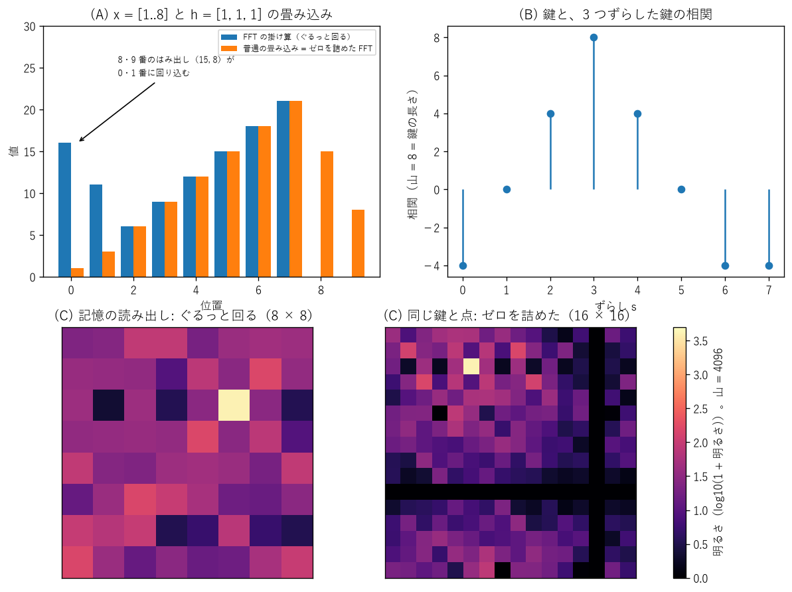
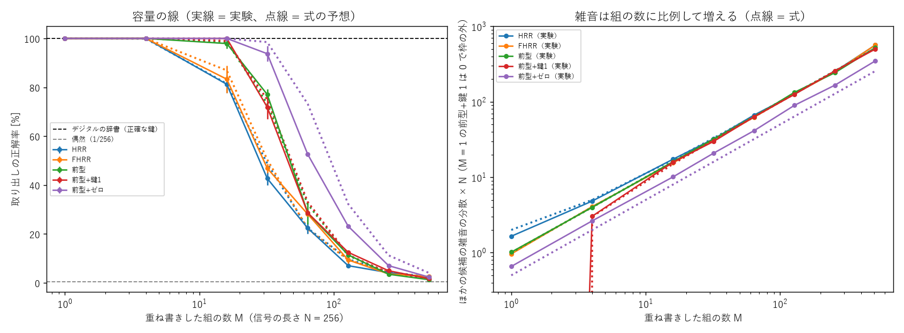
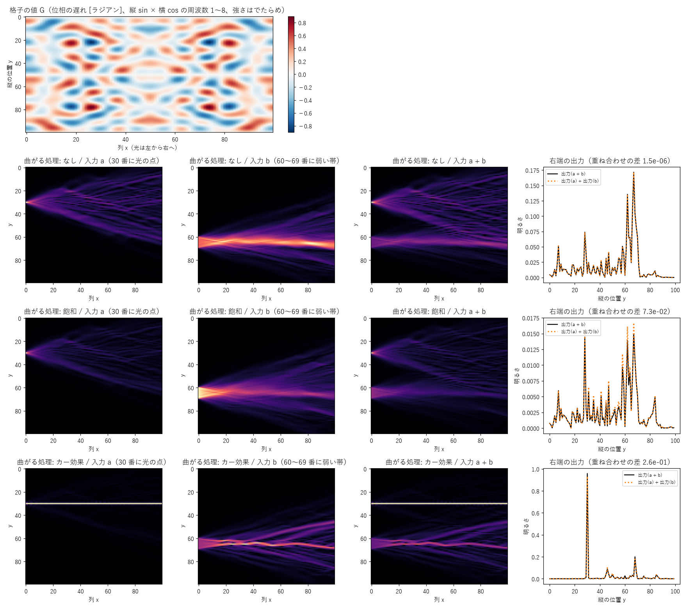
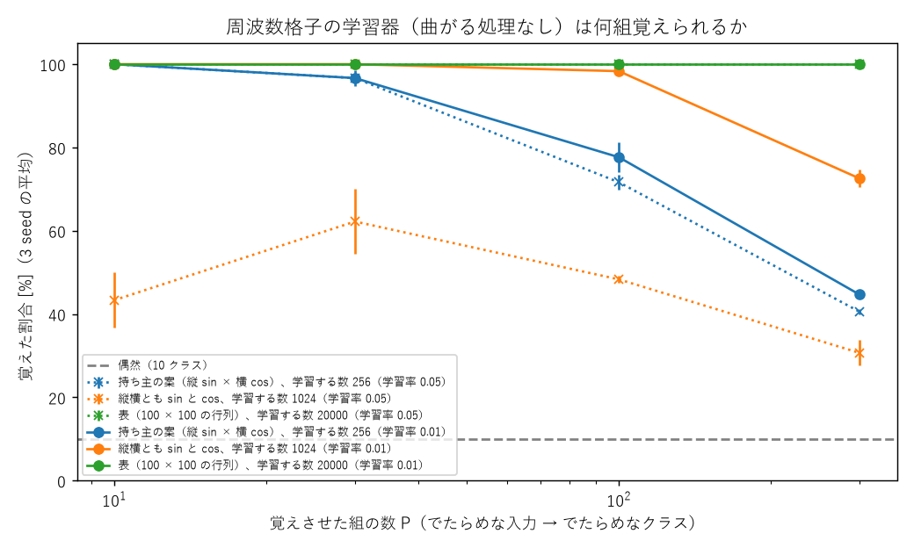
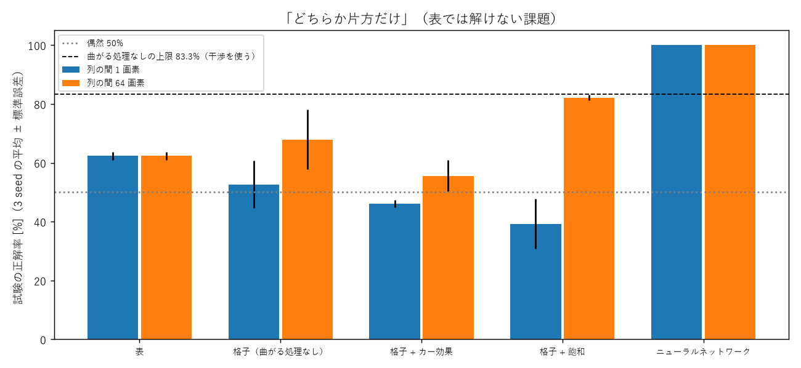

# Sin-CNN3 実験ノート

sin・cos とフーリエ変換による入出力と記憶を、小さなモデルから作り直し、なぜうまくいく・いかないのかを持ち主と一緒に理解する記録。数字の正本。

> ファイル配置（2026-10-27）: 一歩ごとの説明は `docs/lessons/NN_題.md`、ライブラリの確認表は `docs/library_check.md`。実験は `experiments/expNN_名前.py`、条件は `experiments/sweeps/sweepNN.sh`、結果は `results/expNN.txt`（1 回 = 1 行の JSON）、図は `tools/fig_*.py` から `docs/images/` に。自作の版は `src/`、確かめた約束は `tests/`。リポジトリ直下で実行する。

## 現時点のまとめ（2026-10-27 更新）

いまの理解: FFT の基本の約束（素朴な和との一致、norm の係数、往復、パーセバル、sin の符号、漏れ）は、numpy・torch とも式どおり（実験01〜03）。1 本の周波数に振幅と位相の 2 つの数を載せて、そのまま読み出せる。周波数の格子の板に波を当てると、同じ周波数の区画だけが光る（違う周波数は掛けて足すと打ち消し合う）。位相まで読むには cos と sin の板が両方要る（実験04）。前のプロジェクト（SN2-Parts-2D・Sin-CNN2）の要点を [docs/lessons/00_前のプロジェクトで分かったこと.md](docs/lessons/00_前のプロジェクトで分かったこと.md) にまとめ、最初の段（M0）の順番を持ち主と決めているところ。

| 目標 | 状況 |
|---|---|
| M0: ライブラリと計算の約束の確認（docs/library_check.md）。前のプロジェクトとの食い違いの有無 | 8 項目を確認（実験01〜03・07・10）。ぐるっと回る計算は前のプロジェクトでも約束どおりだが、装置とは雑音の出る場所が食い違う（容量への影響は M2 で）。残り: rfft・精度・回折 |
| M1: 入出力（sin・cos に載せて読み出す）の性質を、式と実験の両方で説明できる | 長さ 64 に 31 本（64 個の数）まで誤差 0。雑音の誤差 2σ/√N は本数によらない。明るさ一定なら相対誤差は √K 倍（実験06）。2 ビットの少ない本数だけ式より悪い |
| M2: 記憶（多数組の重ね書き）の容量の線を、式（HRR などの理論）と実験で突き合わせる | 容量の線は「雑音の分散 = M/N」の式とほぼ一致（4 つの作り方、前のプロジェクトの形を含む）。半分当たる組の数 ≈ N/(2 ln 候補の数)（実験08）。ゼロ詰めだけ式より悪い |
| M3: 似た鍵・崩れた鍵、学習を入れる最小のモデル | 未着手 |
| M4: 前のプロジェクトの結果の見直しと、使える部品（sincnn3.py 1.0.0） | 未着手 |

**効いた**: （まだなし）
**効かなかった**: （まだなし）
**追記 (10/27)**: リポジトリを作った。長さ 8 の cos の FFT は、式の予想（k = 1, 7 に 4、ほか 0、位相 0）と 3 つの計算がすべて一致（実験01）。
**追記 (10/27)**: norm は割る場所の約束だけ（1・1/√N・1/N）で、ortho だけがエネルギーを保つ。半端な周波数は全番号に漏れ（遠くへ 4.5%）、ハン窓で 0.004% に減るが山は太る（実験02・03）。
**追記 (10/27)**: 4 × 4 の周波数の格子（持ち主の案）に縞を当てると、入力と同じ周波数の区画だけ ±128、ほかは 0（式と差 4e-14）。90° ずらすと cos の板は真っ暗、sin の板に出る。半端な周波数は隣へにじみ、格子にない周波数は見えない（実験04）。
**追記 (10/27)**: 波どうしを掛けると、差と和の周波数に N/4 ずつ移り、位相は引き算・足し算される。周波数の側では「ぐるっと回る畳み込み」（式と差 2e-15）。上限を超えた和は回り込み、2 本の入力はずれた先で重なりうる（実験05）。
**追記 (10/27)**: 長さ N の信号には N 個の数がちょうど入り、雑音がなければ全部読める。雑音の誤差は本数によらず 2σ/√N（式とほぼ一致）。光の量に上限があると相対誤差は √K 倍（実験06）。
**追記 (10/27)**: 前のプロジェクトの記憶の読み出しは、鍵の自己相関（ぐるっと回る）を値の位置へずらしたものと一致（差 1.4e-14）。ゼロを詰めない約束は誤りではないが、実際の装置とは混線の雑音の出る場所が違う（実験07）。
**追記 (10/27)**: 結んで重ねる記憶の容量は、でたらめな鍵どうしの小さな重なり（分散 1/N）が組の数だけたまることで決まり、式どおり（実験08）。前のプロジェクトの「200 組で 50% 前後」も同じ桁（4096 点で予想 約 370 組）。鍵の作り方の疑い（周波数の大きさがまだら）は外れた。
**追記 (10/27)**: 持ち主の周波数格子の学習器の器を作った。曲がる処理なしでは重ね合わせが 1.5e-6 で成り立ち、全体は 1 枚の表と同じ。カー効果（明るいほど遅れる）を入れると、光の点が自分の通り道を作って細い筋のまま進む。縦 sin × 横 cos だけの格子は対称な模様しか作れない（実験09）。
**追記 (10/27)**: 周波数格子の学習器（曲がる処理なし）は、でたらめな入力 → クラスを覚えられる。256 個で約 130 組、sin と cos 両方の 1024 個で約 220 組（表 2 万個は 300 組すべて）。学習率 0.05 では sin と cos 両方の格子が学べなかった（0.01 で解決）（実験11）。
**追記 (10/27)**: 表では解けない課題「どちらか片方だけ」で、小さな MLP 100%、表 62%。光の格子は曲がる処理のあり・なしに関係なく学習そのものが進まず（訓練 44〜56%）、曲がる処理の効果はまだ測れていない（実験12、失敗）。
**追記 (10/27)**: 学べなかった原因は器の形（列の間 1 画素では光が横へ動けない）。傾きは左の列まで届いていた（実験13）。列の間 64 画素で「どちらか片方だけ」は格子 + 飽和 82.2 ± 0.9%、曲がる処理なし 67.9 ± 10.1%、カー効果 55.6%、表 62.3%、MLP 100%。曲がる処理なしの上限は 75% ではなく干渉を使う 83.3%（式の予想の訂正）。
**未解決**: 曲がる処理（飽和）が、干渉で届く上限 83.3% をはっきり超えるか。
**未解決（前から）**: ゼロを詰めた版の容量が式（雑音が均等に散る）より悪い（64 組で 52.6 対 73.2%）。HRR の自分の組の雑音の式（6/N）が実験より大きめ。
**未解決（前から）**: 2 ビットに丸めて本数が少ないとき、誤差が式より 25〜30% 大きい（丸めの誤差がでたらめでなくなるためと見ている。未確認）
**一貫した教訓**: （まだなし）

**持ち主の疑問（まだ答えていないもの）**
- 前のプロジェクトで使ったライブラリや計算の約束が、実は合っていなかったのではないか（2026-10-27 持ち主の見立て）。M0 で確かめる

- 縦横それぞれ 4 軸の sin 周波数、又は cos 周波数の格子状のマップに、入力周波数 fIn1 を投影してできる光影と、fIn2 を投影してできる光影の違いを比較したい（2026-10-27 持ち主の案）。→ 実験04 で試した
- 小さな学習器のモデルで、入力 → 逆フーリエ変換 →（周波数格子 + 何か）× n → フーリエ変換（2026-10-27 持ち主の案）

- 窓や符号化でうまく組み合わせれば記憶とその融合までうまくいくことは分かっている。でもそれはホログラム CD のようなもので、処理や思考の機能にはならない。最終的には記憶と処理を同時にできると思っている。その前に少しずつ試験をして、周波数処理でどういう思考が良いのかを見ていきたい。目指すは今のホログラフ表計算のようなマトリクスから、ニューラルネットワークのような変化さ。それをこのプロジェクトで研究する（2026-10-27 持ち主の方針）
- 小さな学習器の前段で、さらに小さな学習器を検討したい。ホログラフの原理は 3 次元だが、まず 2 次元で考える。入力は 1 次元の配列（幅 1 画素・縦 100 画素）。処理部は縦が sin 周波数 100 個、横が cos 周波数 100 個で作られる格子。画素は float32 など。光は 2 次元マップ（小さいうちは全部のマスを計算、大きくなったら周波数の列ごとに計算してメモリを浮かせる）として、左から入って右へ処理が進む。出力は 1 次元配列、拡散などを検討するときは複数列の厚みのある 2 次元配列として考えることもある（2026-10-27 持ち主の案）
- 明るさが曲がる処理を追加した実験も行いたい（2026-10-27 持ち主の案）
- 3-1 のライブラリや計算の疑いは、PyTorch などの勾配降下法が光式（周波数式）に合っていないのでは、という意味（2026-10-27 持ち主の疑問）
- 記録（記憶）では直交性の維持が重要だと思うが、曲がりを考えると角速度を乱すことが必要なのか？その場合 sin・cos は考えず sin 関数だけに戻る。振幅のみ変動になるのだろうか（2026-10-27 持ち主の案、検討中）
- 格子は縦横とも sin と cos の両方にしてよい（2026-10-27 持ち主の判断。縦 sin × 横 cos だけでは対称な模様しか作れないため）。ツッコミは docs/tsukkomi.md にまとめる（2026-10-27 持ち主の依頼）

**未決の質問（持ち主が決めること）**
- M0 の確認の順番（2026-10-27 に提案し、持ち主が OK。docs/library_check.md の表の順）
- どこまで自作し、どこからライブラリを使うか（M0 の結果を見てから）

## 目標

持ち主の依頼（2026-10-27）から:
- フーリエ変換を利用した sin・cos 関数による記憶と、入出力（情報を sin・cos に載せて入れ、読み出す）を、小さくシンプルなモデルから作り直す。
- 大きな構成から始めない。式で追える大きさ（数個〜数十個の sin・cos、長さ 8〜64 の信号）から始め、1 つずつ足す。
- 前のプロジェクトで使ったライブラリや計算の約束を、手計算・別の方法・式と突き合わせて 1 つずつ確かめる。ライブラリが信用できなければ自作から始める選択肢もある（素朴な離散フーリエ変換を基準にする）。
- 成功の基準は「動いた」より「なぜそうなるか説明できる」。そのうえで、記憶・入出力の性能を比較相手（デジタルの辞書、HRR・FHRR、ロジスティック回帰や小さな MLP、偶然の水準）と並べて測る。
- 一歩ずつ説明し、持ち主の返事を待ってから次へ進む。一歩ごとの説明は docs/lessons/ に残す。
- 将来はエッジ機器やアナログな装置（光・アナログ回路）で動かすことも視野にある。粗い精度・雑音・ずれへの強さも評価の軸に入れる。

## 環境とコードの出どころ

- Python 3.14.7、numpy 2.5.2、PyTorch 2.14.1+cu126、matplotlib 3.11.2、pytest 9.1.1（2026-10-27 時点）
- 計算はまず CPU（`CUDA_VISIBLE_DEVICES=` で GPU を見せない）。GPU（RTX 3060 × 2）は長い実験だけ、全プロジェクト共通の待ち行列で予約する
- コードはこのリポジトリで新しく書く。前のプロジェクトのコードを使うときは vendor/ に版番号付きで写し、書き換えない

## 実験01: 長さ 8 の cos を 1 本、FFT する (exp01_cos8.py)

M0 の最初の一歩（2026-10-27 持ち主の例）。答えが手計算で分かる信号で、自作の素朴な和・numpy・torch の FFT を突き合わせる。
条件: x[n] = cos(2π·n/8)、N = 8、float64、CPU。乱数なし。説明は [学び 01](docs/lessons/01_長さ8のcosをFFTする.md)。

| k | 式の予想 | 素朴な和 | numpy.fft.fft | torch.fft.fft |
|---|---|---|---|---|
| 1 | 4 | 4.0000 | 4.0000 | 4.0000 |
| 7 | 4 | 4.0000 | 4.0000 | 4.0000 |
| ほか | 0 | 0.0000 | 0.0000 | 0.0000 |
| 予想・素朴な和との差の最大値 | − | 4.6e-15（予想と） | 4.1e-15 | 4.1e-15（numpy と torch は差 0） |

- **3 つとも式の予想どおり**（norm="backward" で大きさ N/2、位相 0、負の周波数 −1 は k = 7 に出る）。差は 64 ビットの丸めの範囲。
- 次の一手: norm の 3 通り、sin の符号、ifft での往復、割り切れない周波数の漏れ。

## 実験02: norm の 3 通り・sin の符号・振幅と位相 (exp02_norm_sin.py)

学び 01 の残った疑問（2026-10-27 持ち主が OK）。N = 8 の cos・sin・2·cos(2π·2n/8 + π/3) を numpy・torch の fft に norm 3 通りで。乱数なし。説明は [学び 02](docs/lessons/02_normとsinの符号.md)。

| 信号 | backward | ortho | forward | 位相（正・負の周波数） |
|---|---|---|---|---|
| cos（k = 1, 7） | 4 | 1.414 | 0.5 | 0°, 0° |
| sin（k = 1, 7） | 4 | 1.414 | 0.5 | −90°, +90° |
| 2·cos(… + 60°)（k = 2, 6） | 8 | 2.828 | 1 | +60°, −60° |
| エネルギーの比 | 8 | 1 | 0.125 | |

- **すべて式の予想どおり**（素朴な和 × 1・1/√N・1/N と差 1e-14 以下、同じ norm の往復で差 4e-16 以下）。違う norm で往復すると 1/√8〜8 倍ずれる。
- A·cos(2πkn/N + φ) は X[k] = A·N/2·e^(iφ)。1 本の周波数に振幅と位相の 2 つの数が載り、そのまま読める。
- 次の一手: 漏れ（実験03）。

## 実験03: 割り切れない周波数の漏れと窓関数 (exp03_leak.py)

N = 16、cos(2π·f·n/N)、f = 2 と 2.5、窓なしとハン窓。式の予想は等比数列の和。乱数なし。説明は [学び 03](docs/lessons/03_割り切れない周波数の漏れ.md)。

| 信号 | 窓 | 山の大きさ | k = 8 の大きさ | 遠くへの漏れ（山から 3 番以上） |
|---|---|---|---|---|
| f = 2 | なし | 8 | 0 | 0% |
| f = 2 | ハン窓 | 4（隣に 2） | 0 | 0% |
| f = 2.5 | なし | 4.77, 5.44 | 1.00 | **4.50%** |
| f = 2.5 | ハン窓 | 3.41, 3.39 | 0.00 | **0.004%** |

- **半端な周波数は全番号に漏れる（式と差 2e-14 で一致）。ハン窓で遠くへの漏れは 1/1000 になるが、山は太り高さは半分**。
- 解釈: FFT は信号がぐるっと繰り返すと見なすので、半端な周波数は端に段差ができる。情報を載せるなら整数の周波数だけを使えば漏れはない。
- 次の一手: 格子マップの光影（実験04、持ち主の案）。

## 実験04: 周波数の格子マップの光影 (exp04_grid_shadow.py)

2026-10-27 持ち主の案「縦横 4 軸の sin・cos 周波数の格子マップに fIn1・fIn2 を投影した光影の違いを比べたい」。
条件: 4 × 4 区画（1 区画 16 × 16 画素）、区画 (縦 fy, 横 fx) に cos(2π(fx·x + fy·y)/16) と sin(…) の板。入力 cos(2π(a·x + b·y)/16 + φ) を全区画に掛けて合計。式の予想は等比数列の和。乱数なし。説明は [学び 04](docs/lessons/04_周波数の格子マップの光影.md)。

| 入力 | cos の板 | sin の板 | √(cos² + sin²) |
|---|---|---|---|
| fIn1（a = 1, b = 2） | (横 1, 縦 2) だけ +128 | 0 | 128 が 1 区画 |
| fIn2（a = 3, b = 1） | (横 3, 縦 1) だけ +128 | 0 | 128 が 1 区画 |
| fIn1、φ = 90° | 0 | (横 1, 縦 2) だけ −128 | 128 が 1 区画 |
| a = 2.5, b = 2 | 縦 2 の行に 8 | 縦 2 の行に −26, −81, +81, +26 | 28, 82, 82, 28 |
| a = 6, b = 2（格子にない） | 0 | 0 | 0 |

- **入力の周波数が光る区画の場所になる（板 1 枚で FFT と同じ仕分け）。式と差 4e-14 以下**。位相を読むには cos と sin の 2 枚が要る。
- 解釈: 掛け算で差と和の周波数の縞ができ、差が 0 の区画だけ打ち消し合わずに残る。半端な周波数は漏れ（実験03）として隣の区画へ。
- 次の一手: 掛け算で周波数がずれる（差と和）ことを処理として使う / 重ねた入力を何本まで読めるか。

## 実験05: 掛け算で周波数がずれる (exp05_mix.py)

実験04 の続き、持ち主の学習器の案の土台。N = 32、入力 x と格子の波 g を画素ごとに掛けて FFT。予想は積和の公式と、ぐるっと回る畳み込み（素朴な和）。乱数なし。説明は [学び 05](docs/lessons/05_掛け算で周波数がずれる.md)。

| 組み合わせ | 出た山（番号: 大きさ, 位相） | 予想 |
|---|---|---|
| 5 × 3 | 2: 8 / 8: 8 | 差・和に N/4 |
| 5 (60°) × 3 (20°) | 2: 8, 40° / 8: 8, 80° | 位相は差・和 |
| 12 × 10 | 2: 8 / 10: 8 | 和 22 → 32 − 22 = 10 に回り込む |
| (3 + 7) × 2 | 1: 8 / 5: 16 / 9: 8 | 5 で重なる |

- **すべて式どおり（畳み込みの式と差 2e-15 以下）。掛け算 = 周波数を格子の周波数ぶん上下にずらす。周波数の側ではぐるっと回る畳み込み**。
- 解釈: 持ち主の学習器の「逆 FFT → 格子と掛ける → FFT」は、スペクトルを格子のスペクトルでずらして重ねる計算。ずれた先での重なり（混ぜる）は処理の材料にも情報の消える原因にもなる。
- 次の一手: 重ねた入力を何本まで読めるか、雑音への強さ（M1）。

## 実験06: 何本まで重ねて読めるか（雑音・粗い精度） (exp06_capacity_noise.py)

M1 の中心。N = 64、複素数 K 個（振幅 0.5〜1、位相でたらめ）を周波数 1〜K に載せ、FFT で読む。雑音 σ / b ビットに丸める。約束 2 つ（1 本ごとの振幅 / 明るさ一定）。200 組 × 3 seed、平均 ± 標準誤差。説明は [学び 06](docs/lessons/06_何本まで重ねて読めるか.md)。

| 条件 | K = 1 | K = 4 | K = 16 | K = 31 |
|---|---|---|---|---|
| 雑音なし（誤差） | 0 | 0 | 0 | 0 |
| σ = 0.1（誤差、式 0.0250） | 0.0251 | 0.0249 | 0.0247 | 0.0249 |
| σ = 0.1・明るさ一定（相対誤差） | 1.8% | 3.6% | 7.1% | 10.0% |
| 4 ビット・明るさ一定（相対誤差） | 1.0% | 3.0% | 7.1% | 10.1% |
| 2 ビット・明るさ一定（誤差、カッコは式） | 0.085（0.068） | 0.135（0.104） | 0.125（0.124） | 0.127（0.126） |

標準誤差はどれも誤差の 2% 以下。

- **雑音なしなら N = 64 に 31 本（64 個の数）まで誤差 0。雑音の誤差は式 2σ/√N どおりで本数によらない。明るさ一定なら相対誤差は √K 倍**。
- **見立てが外れた所**: 2 ビットで K が小さいと、誤差が式より 25〜30% 大きい。丸めの誤差が信号の形にそろい、でたらめな雑音と見なせないためと考えられる。
- 解釈: 重ねること自体は混線を生まない。上限は信号の点の数 N。前のプロジェクトの記憶（4096 点の板に 200 組で 50% 前後）はこの上限よりずっと手前で崩れており、原因は「結び方」の側にあると考えられる（M2 で確かめる）。
- 次の一手: M0 の残り（ぐるっと回る畳み込み・相関とゼロ詰め）→ 記憶の結び付け（M2）。

## 実験07: ぐるっと回る畳み込み・相関とゼロ詰め (exp07_circular.py)

M0 の残り。(A) N = 8 の畳み込みを FFT・素朴な和・numpy.convolve・ゼロを詰めた FFT で。(B) ±1 の鍵の相関。(C) 前のプロジェクトの記憶の式（SN2-Parts-2D exp87 の形）を 8 × 8 で、ゼロを詰めた 16 × 16 と比べる。seed 0。説明は [学び 07](docs/lessons/07_ぐるっと回る畳み込みとゼロ詰め.md)。

| 計算 | 結果 |
|---|---|
| (A) FFT の掛け算 | [16, 11, 6, 9, 12, 15, 18, 21] = ぐるっと回る素朴な和 |
| (A) ゼロを詰めた FFT | [1, 3, 6, …, 21, 15, 8] = numpy.convolve |
| (B) 相関 | ずらした量 3 に山 8（FFT と素朴な和が一致） |
| (C) 記憶の読み出し | 鍵の自己相関を値の位置へずらしたものと差 1.4e-14。山 4096、山以外の平均 45（回る）対 15（ゼロ詰め、4 倍の広さに散る） |

- **FFT の掛け算はぐるっと回る畳み込み。ゼロを詰めれば普通の畳み込み。前のプロジェクトの記憶の読み出しは鍵の自己相関そのもの**。
- 解釈: 回る計算は「場が周期的に並ぶ」約束で、計算の誤りではない。実際の装置（回り込まない）とは、混線の雑音が窓の中に折り返されるかどうかが違う。容量への影響は未測定（seed 1 本の 1 組だけ）。
- 次の一手: 記憶の結び付け（M2）。組の数を増やした容量の線を、HRR の式・回る版・ゼロ詰め・鍵の作り方で比べる。

## 実験08: 結んで重ねる記憶の容量の線 (exp08_memory_capacity.py)

M2 の最初の一歩。N = 256、M 組を 記憶 = Σ 鍵 ⊛ 値（ぐるっと回る畳み込み）に重ね書き、相関で読み、候補 256 個から一番近いもの。5 つの作り方（HRR・FHRR・前型・前型+鍵 1・前型+ゼロ）。式の予想は雑音の分散（pred_var）からの正規分布の模型。3 seed の平均 ± 標準誤差。説明は [学び 08](docs/lessons/08_結んで重ねる記憶の容量.md)。

| M | HRR | FHRR | 前型 | 前型+鍵 1 | 前型+ゼロ（板 2 倍） |
|---|---|---|---|---|---|
| 16 | 81.2 ± 3.6（式 81.5） | 83.3 ± 5.5（86.9） | 97.9 ± 2.1（98.6） | 100（99.0） | 100（100） |
| 32 | 42.7 ± 2.8（48.9） | 46.9 ± 1.8（50.4） | 77.1 ± 2.1（73.3） | 71.9 ± 4.8（75.0） | 93.8 ± 3.1（98.5） |
| 64 | 22.4 ± 2.3（22.4） | 28.1 ± 0.9（22.0） | 28.6 ± 4.6（32.2） | 28.6 ± 1.4（33.1） | 52.6 ± 0.5（73.2） |
| 128 | 7.0 ± 0.5（9.7） | 9.4 ± 2.0（9.4） | 11.5 ± 0.5（11.2） | 12.5 ± 0.8（11.4） | 23.2 ± 0.7（32.3） |

比較相手: デジタルの辞書 100%（正確な鍵）、偶然 0.4%。M ≤ 4 はすべて 100%。

- **容量の線は「雑音の分散 = 組の数 / 信号の長さ」の式でほぼ説明できる（4 つの作り方で数点以内）。前のプロジェクトの形も同じ式に乗る**。半分当たるのは M ≈ N/(2 ln V)（N = 256・V = 256 で約 23〜32 組）。
- **見立て外れ 1**: 鍵の周波数の大きさをそろえても変わらない（64 組で 28.6 対 28.6%）。学び 00 の気になる所は容量の原因ではなかった。
- **見立て外れ 2**: ゼロを詰めると正解率は上がる（64 組で 28.6 → 52.6%、板 2 倍）が、雑音が均等に散るとした式（73.2%）より悪い。雑音が値の並ぶ前半に偏るためと考えられる（未確認）。
- 解釈: 前のプロジェクトの「1 枚に 200 組で 50% 前後」は、4096 点・候補 256 の式の予想（約 370 組）と同じ桁で、計算の誤りではなく結び方の限界と考えられる。前のプロジェクトは 2 × 2 の窓・明るさで読む・実際の言葉の値（偏り）なので、数字のぴったりの一致は求めていない。
- 次の一手: 崩れた鍵・似た鍵（M3）。式の雑音の項に「鍵の崩れ」を足して、前のプロジェクトで辞書に負けた理由を説明する。

## 実験09: 周波数格子の学習器の器（学習なし） (exp09_lightmap.py)

2026-10-27 持ち主の案（入力 = 縦 100 画素の列、処理部 = 縦 sin × 横 cos の周波数格子、光は左から右へ、明るさが曲がる処理）。
条件: 100 × 100、周波数 1〜8（強さ A_ij はでたらめ、seed 0）、格子 = 位相の遅れ、列ごとに 1 画素の回折（角スペクトル法、縦 2 倍にゼロ詰め、complex64）。曲がる処理 3 とおり。説明は [学び 09](docs/lessons/09_周波数格子の学習器の器.md)。

| 曲がる処理 | 重ね合わせの差（相対） | 入力 a の明るさ 1 → 出力 |
|---|---|---|
| なし | 1.5e-6 | 0.972 |
| 飽和 u/√(1 + \|u\|²) | 0.073 | 0.137 |
| カー効果 u·e^(2i\|u\|²) | 0.26 | 0.999 |

- **曲がる処理なしでは重ね合わせが成り立ち、全体は 1 枚の表（線形）。曲がる処理を入れると崩れる。カー効果では光の点が細い筋のまま進む（自分で通り道を作る）**。
- 解釈: 表計算から抜け出す入口は曲がる処理。飽和は光を多く失う（86%）。縦 sin × 横 cos だけの格子は左右対称・上下反対称の模様しか作れず、どんな模様でも作るには両方向に sin と cos が要る。
- 次の一手: 曲がる処理なしで学習 → 最小二乗の表と比べる。曲がる処理ありで、表では解けない課題を小さな MLP と並べる。

## 実験10: 複素数の勾配 (exp10_complex_grad.py)

M0 の残り。損失 |z|²・|w·z|²・|e^(iz)|²・Σ|FFT(z)|²（ortho）で、torch の z.grad を実部・虚部の版・差分・手計算と比べる。実数の位相 θ で持つ |Σ e^(iθ)|² も。64 ビット、seed 0。説明は [学び 10](docs/lessons/10_複素数の勾配.md)。

- **torch の複素数の勾配は ∂L/∂x + i·∂L/∂y（実部・虚部の版と差 0、式と差 1e-15 以下、差分と 2e-9 以下）。実数の位相で持つ版も式どおり（差 0）**。ふつうの勾配降下がそのまま使える。
- 前のプロジェクトも学習する数は実数で、食い違いなし。

## 実験11: 周波数格子の学習器を学習させる（曲がる処理なし） (exp11_grid_learn.py)

実験09 の器を学習。でたらめな光の列 P 個 → でたらめな 10 クラス、右端の窓 10 個で読む。周波数 1〜16、Adam 300 回、3 seed の平均 ± 標準誤差。比較相手: 表（100 × 100 の複素数の行列）、偶然 10%。説明は [学び 11](docs/lessons/11_周波数格子の学習器を学習させる.md)。

| 作り方（学習する数） | P = 10 | 30 | 100 | 300 |
|---|---|---|---|---|
| 持ち主の案 縦 sin × 横 cos（256） | 100 | 96.7 ± 1.9 | 77.7 ± 3.7 | 44.7 ± 0.7 |
| 縦横とも sin と cos（1024） | 100 | 100 | 98.3 ± 0.7 | 72.6 ± 2.1 |
| 表（20000） | 100 | 100 | 100 | 100 |
| （学習率 0.05）縦横とも sin と cos | 43.3 ± 6.7 | 62.2 ± 7.8 | 48.3 ± 0.9 | 30.7 ± 3.1 |

上 3 行は学習率 0.01。1 seed 5〜16 秒（CPU 2 本）。

- **曲がる処理なしの格子は覚えられる組の数が学習する数で決まり、表には届かない。sin と cos の両方で 77.7 → 98.3%（P = 100）**。
- **失敗も記録**: 学習率 0.05 では sin と cos 両方の格子が P = 10 でも 43%。4 組を足して格子の値が大きくなり、位相が何周も回ったためと考えられる（未確認）。0.01 で解決。
- 次の一手: 学習する数をそろえた比べ。曲がる処理ありで、表では解けない課題（小さな MLP と並べる）。

## 実験12: 「どちらか片方だけ」と曲がる処理（最初の試み、失敗） (exp12_xor_bend.py)

A（30 番）・B（70 番）・参照（50 番）のふくらみ、位相でたらめ・明るさ ±10%。答え = A と B のどちらか片方だけ。器は実験11 と同じ、窓 2 個。訓練 400・試験 400、Adam 0.01・400 回、3 seed。説明は [学び 12](docs/lessons/12_どちらか片方だけ_最初の試み.md)。

| 作り方 | 試験 | 訓練 | 学習する数 | 時間/seed |
|---|---|---|---|---|
| 表 | 62.3 ± 1.4 | 64.7 | 20000 | 2 秒 |
| 格子（なし） | 52.7 ± 8.0 | 56.4 | 1024 | 22 秒 |
| 格子 + カー効果（γ = 2） | 46.1 ± 1.3 | 43.8 | 1024 | 91 秒 |
| 格子 + 飽和 | 39.2 ± 8.5 | 44.8 | 1024 | 65 秒 |
| 小さな MLP（100 → 16 → 2） | **100.0** | 100.0 | 1650 | 1 秒未満 |

追加（seed 0）: 表 1500 回・学習率 0.05 で 65.5%。格子（なし）学習率 0.003 / 0.03 で訓練 42 / 45%。列を 10 に減らすと全部 38〜44%（results/exp12_diag.txt）。

- **光の格子は曲がる処理のあり・なしに関係なく学習が進まず（訓練でも当て推量並み）、曲がる処理の効果は測れていない。表は予想どおり 75% の上限より下（62〜66%）、MLP は 100%**。
- 解釈（未確認）: 入力がなめらかなふくらみで、器が光を遠くへ動かしにくく、初めの位相が小さい。学習率を上げると迷子になる。持ち主の疑問（勾配降下は光式に合うか）の最初の具体例。
- 次の一手: 列ごとの傾きの大きさを見る、器の配置（窓・初期の強さ・回折の強さ）を変える、勾配降下以外の学び方と比べる。

### 実験12 の続き・実験13: 学習の止まった所と、器の形 (exp13_grad_columns.py、exp12_xor_bend.py --dz)

- 実験13（seed 0）: 列ごとの傾きは「片方だけ」でも左 3.7e-1・真ん中 4.0e-1・右 1.7e-1 で、学べた「覚える」課題と同じ桁。**傾きは消えていない**。
- 「A があるか」（表なら 100%）でさえ列の間 1 画素の格子は 53.3%。列の間 10 / 64 画素で 100%（seed 0）。**原因は器の形（光を横へ動かせない）**。
- **式の予想の訂正**: 曲がる処理なしでも明るさの読み出し（2 乗）と干渉で、上限は 75% ではなく 5/6 = 83.3%。
- 列の間 64 画素・3 seed: 表 62.3 ± 1.4、格子（なし）67.9 ± 10.1、格子 + カー効果 55.6 ± 5.4、**格子 + 飽和 82.2 ± 0.9**、MLP 100.0。

- **飽和で上限 83.3% の近くに安定して届くが、はっきり超えてはいない。MLP との差は大きい**。
- 次の一手: 干渉では届かない課題（3 入力で「1 つだけ」など）、曲がる処理の強さを変えた比べ、勾配降下以外の学び方との比べ。
