# Sin-CNN3 実験ノート

sin・cos とフーリエ変換による入出力と記憶を、小さなモデルから作り直し、なぜうまくいく・いかないのかを持ち主と一緒に理解する記録。数字の正本。

> ファイル配置（2026-10-27）: 一歩ごとの説明は `docs/lessons/NN_題.md`、ライブラリの確認表は `docs/library_check.md`。実験は `experiments/expNN_名前.py`、条件は `experiments/sweeps/sweepNN.sh`、結果は `results/expNN.txt`（1 回 = 1 行の JSON）、図は `tools/fig_*.py` から `docs/images/` に。自作の版は `src/`、確かめた約束は `tests/`。リポジトリ直下で実行する。

## 現時点のまとめ（2026-10-27 更新）

いまの理解: FFT の基本の約束（素朴な和との一致、norm の係数、往復、パーセバル、sin の符号、漏れ）は、numpy・torch とも式どおり（実験01〜03）。1 本の周波数に振幅と位相の 2 つの数を載せて、そのまま読み出せる。周波数の格子の板に波を当てると、同じ周波数の区画だけが光る（違う周波数は掛けて足すと打ち消し合う）。位相まで読むには cos と sin の板が両方要る（実験04）。前のプロジェクト（SN2-Parts-2D・Sin-CNN2）の要点を [docs/lessons/00_前のプロジェクトで分かったこと.md](docs/lessons/00_前のプロジェクトで分かったこと.md) にまとめ、最初の段（M0）の順番を持ち主と決めているところ。

| 目標 | 状況 |
|---|---|
| M0: ライブラリと計算の約束の確認（docs/library_check.md）。前のプロジェクトとの食い違いの有無 | 8 項目を確認（実験01〜03・07・10）。ぐるっと回る計算は前のプロジェクトでも約束どおりだが、装置とは雑音の出る場所が食い違う（容量への影響は M2 で）。残り: rfft・精度・回折 |
| M1: 入出力（sin・cos に載せて読み出す）の性質を、式と実験の両方で説明できる | 長さ 64 に 31 本（64 個の数）まで誤差 0。雑音の誤差 2σ/√N は本数によらない。明るさ一定なら相対誤差は √K 倍（実験06）。2 ビットの少ない本数だけ式より悪い |
| M2: 記憶（多数組の重ね書き）の容量の線を、式（HRR などの理論）と実験で突き合わせる | 容量の線は「雑音の分散 = M/N」の式とほぼ一致（4 つの作り方、前のプロジェクトの形を含む）。半分当たる組の数 ≈ N/(2 ln 候補の数)（実験08）。ゼロ詰めだけ式より悪い |
| M3: 似た鍵・崩れた鍵、学習を入れる最小のモデル | 未着手 |
| M4: 前のプロジェクトの結果の見直しと、使える部品（sincnn3.py 1.0.0） | 未着手 |

**効いた**: （まだなし）
**効かなかった**: （まだなし）
**追記 (10/27)**: リポジトリを作った。長さ 8 の cos の FFT は、式の予想（k = 1, 7 に 4、ほか 0、位相 0）と 3 つの計算がすべて一致（実験01）。
**追記 (10/27)**: norm は割る場所の約束だけ（1・1/√N・1/N）で、ortho だけがエネルギーを保つ。半端な周波数は全番号に漏れ（遠くへ 4.5%）、ハン窓で 0.004% に減るが山は太る（実験02・03）。
**追記 (10/27)**: 4 × 4 の周波数の格子（持ち主の案）に縞を当てると、入力と同じ周波数の区画だけ ±128、ほかは 0（式と差 4e-14）。90° ずらすと cos の板は真っ暗、sin の板に出る。半端な周波数は隣へにじみ、格子にない周波数は見えない（実験04）。
**追記 (10/27)**: 波どうしを掛けると、差と和の周波数に N/4 ずつ移り、位相は引き算・足し算される。周波数の側では「ぐるっと回る畳み込み」（式と差 2e-15）。上限を超えた和は回り込み、2 本の入力はずれた先で重なりうる（実験05）。
**追記 (10/27)**: 長さ N の信号には N 個の数がちょうど入り、雑音がなければ全部読める。雑音の誤差は本数によらず 2σ/√N（式とほぼ一致）。光の量に上限があると相対誤差は √K 倍（実験06）。
**追記 (10/27)**: 前のプロジェクトの記憶の読み出しは、鍵の自己相関（ぐるっと回る）を値の位置へずらしたものと一致（差 1.4e-14）。ゼロを詰めない約束は誤りではないが、実際の装置とは混線の雑音の出る場所が違う（実験07）。
**追記 (10/27)**: 結んで重ねる記憶の容量は、でたらめな鍵どうしの小さな重なり（分散 1/N）が組の数だけたまることで決まり、式どおり（実験08）。前のプロジェクトの「200 組で 50% 前後」も同じ桁（4096 点で予想 約 370 組）。鍵の作り方の疑い（周波数の大きさがまだら）は外れた。
**追記 (10/27)**: 持ち主の周波数格子の学習器の器を作った。曲がる処理なしでは重ね合わせが 1.5e-6 で成り立ち、全体は 1 枚の表と同じ。カー効果（明るいほど遅れる）を入れると、光の点が自分の通り道を作って細い筋のまま進む。縦 sin × 横 cos だけの格子は対称な模様しか作れない（実験09）。
**追記 (10/27)**: 周波数格子の学習器（曲がる処理なし）は、でたらめな入力 → クラスを覚えられる。256 個で約 130 組、sin と cos 両方の 1024 個で約 220 組（表 2 万個は 300 組すべて）。学習率 0.05 では sin と cos 両方の格子が学べなかった（0.01 で解決）（実験11）。
**追記 (10/27)**: 表では解けない課題「どちらか片方だけ」で、小さな MLP 100%、表 62%。光の格子は曲がる処理のあり・なしに関係なく学習そのものが進まず（訓練 44〜56%）、曲がる処理の効果はまだ測れていない（実験12、失敗）。
**追記 (10/27)**: 学べなかった原因は器の形（列の間 1 画素では光が横へ動けない）。傾きは左の列まで届いていた（実験13）。列の間 64 画素で「どちらか片方だけ」は格子 + 飽和 82.2 ± 0.9%、曲がる処理なし 67.9 ± 10.1%、カー効果 55.6%、表 62.3%、MLP 100%。曲がる処理なしの上限は 75% ではなく干渉を使う 83.3%（式の予想の訂正）。
**追記 (10/27)**: 関係性概念（持ち主の依頼）。第 1 段階（A → B, C, D など）は光の格子で 3 seed とも 100%（光の 99.9% が答えの点へ）。第 2 段階（縦の周波数を δ ずらして A → G, H）は δ ≤ 2 でどっちつかず（50%）、δ = 8 で 100% だが出口に届く光は 6%。原因は、細い光の点はずらしでほとんど変わらず（重なり 0.999）、光の量を保つ器は重なりを保つため（実験15）。
**追記 (10/27)**: 記号を整数の周波数の波で表す（持ち主の「混ざらない周波数の光」）と、縦の周波数を 1 ずらすだけで A → B, C, D から A → G, H に切り替わった（3 seed とも 100%、入れた光の約 69% が答えへ。光の点では 50%・約 24%）。整数のずらしで入力の重なりが 0 になるため（実験16）。
**追記 (10/27)**: 1 回ぶんの対応だけを教えた器に、出口の光をそのまま 5 回通すと A → B → … → F とたどれた。枝分かれ（A → B, C）は重ね合わせのまま同時に進む。光は 1 回ごとに約 7% 減り、式 0.93^回 と一致（実験17）。
**追記 (10/27)**: **色を分けて干渉を使えなくした「どちらか片方だけ」で、カー効果（色をまたいで効く）を入れた光の格子が 3 seed とも 100%**（曲がる処理なし 48.7%、上限 75%、MLP 100%）。表計算では解けない課題を光の曲がる処理で解けた最初の結果（実験14）。
**追記 (10/27)**: 関係の容量: 記号 24 × 文脈 4 の 96 組を、光の格子（1024 個）でほぼ全部当てた（99.7%）。崩れ方は当たり外れより先に「答えに集まる光」が薄くなる形（81% → 19%）。表は 96 組で 75%（実験18）。
**追記 (10/27)**: 学習済みのカー効果の格子からカー効果だけを切ると 100% → 75.7%（線形の上限）。明るさが増えると光の行き先が 窓 0 → 1 → 0 と回る。光のマップに通り道は見えず、まだらな模様が明るさで組み替わる形（実験19）。
**追記 (10/27)**: 観点周波数（持ち主の案）: 物 5 × 観点 5 の属性を順引きで学習し、値の光を逆向きに通して逆引き（逆引き = 順引きの明るさ、差 1e-6 以下、式どおり）。観点ごとに掛け算すると「丸い赤い実をむしゃむしゃ食べた、酸っぱかった」→ トマト 70%・イチゴ 29%・リンゴ 0%（表の正解 72・28・0）。記憶（属性）と処理（推し量り）を同じ器で向きを変えるだけで行える（実験21）。
**追記 (10/27)**: 重なった 2 つの記号から明るい方だけを通す課題で、線形は式どおり鋭さ 0 点、飽和は +2.3〜4.2 点（3 seed とも 0 を越える）。カー効果は 1 色では学習が崩れた（実験20）。
**追記 (10/27)**: 記号の点の面（レンズの後）に光の部品を置いて何回も通すと、測って出し直す（2 乗）で勝者 73 → 100%（5 回）、可飽和吸収体で 97%、リミッタ（2 光子吸収）は 51% にならす（拡散の向き）。すべて式どおり（実験22）。存在しない属性は「拡散」で覚えると「分からない」（目の色が青い → 4 つとも約 25%）、「なし」で覚えると「ない物を外す」（猫 91%）（実験23）。
**追記 (10/27)**: 物当ては光の器 = デジタルの推し量り（差 1 点以内）、手がかり 1 個 46% → 5 個 90%。掛け算の前の明るさは 4 ビットで十分、2 ビットで崩れる（実験24）。青空文庫 4477 作品の「形容詞 + 物の名前」を数えて覚えさせると「白くて冷たい」→ 雪、「青くて大きい」→ 空。拡散（分からない）は少しだけ知っているものより有利になることがある（実験25）。
**追記 (10/27)**: 2 つの意味を持つ言葉（持ち主の案）: 「リンゴ」を果物 70%・人 30% の重ね合わせとして覚え、手がかりを掛け算すると「食べた」→ 果物 99%、「笑った」→ 人 96%、手がかりなし → 71 : 29 のまま。「優しい」で果物が勝つのは果物の性格を「分からない」にしたため（実験26）。
**追記 (10/27)**: 関係性の関係（持ち主の案）: 属性を仲間に持たせた 3 段の器で、「リンゴは楽しそうに手を振った」はたどった明るさが「太郎は〜」より 75〜340 倍暗い（驚き）。手がかりから仲間 = 人間 95〜100%。「未知 1 → 人間」を書き込むと、見せていない「リンゴが話した」も人間のリンゴ 97%（実験27）。
**追記 (10/27)**: 単語ごとに格子 1 枚（持ち主の案）: 1 KB の格子で表との差 0.06（共有の 1 枚は 0.13）、逆引きは 3 seed とも全問正解。融合は位相の平均ではなく、2 枚に光を分けて足すとちょうど平均になる（実験31）。
**追記 (10/27)**: Sin-CNN2 の実験35（並べ直し）を実験21 の器に当てはめた。使う周波数 37 個を詰めれば縦の幅 100 → 42 でも同じ正確さ。g を掛ける並べ直しは 1 対 1 なので重なりを減らさず、この器では効きも害もない（実験33）。
**追記 (10/27)**: 規模を広げると（名詞 80 × 観点 9）、周波数を絞った格子は学べず、画素ごとの板（回折の深層ネットワークと同じ）なら「雪は何色？」93%（一番多い値 70%）。次の文字は光の器 1 が 23.8%（2-gram 25.9%）、2 文字を重ねても 3-gram（33.9%）にならない。前 9 文字の観点を別々に合わせると数えた表でも 2-gram 並み（25.4%）→ 足りないのは語彙と観点どうしの組み合わせ（実験28〜30）。
**追記 (10/27)**: 道具の要素 × 単語の格子（持ち主の案）: 見せていない圧力鍋（圧力 + 熱）をリンゴの格子に入れると、ジュース 42〜48% + 煮る 35〜36%（プレス機と鍋の答えの重ね合わせ）。ジュースの逆引きで圧力 64% ・回転 22%。同じ要素の道具は区別できない（ホットプレート = 鍋）（実験32）。
**追記 (10/27)**: 融合の形（持ち主の依頼）: 板を混ぜる形（積み重ね・交互・位相の平均・複素数の板）は全部壊れる。2 枚に分けて明るさを足す・比率で足すはほぼぴったり、場で足すと干渉で少しゆがむ。差分は答えの違う所が明るくなる（相関 0.55）。位相の平均から 300 回学習し直すと 1 枚で 2 つの意味（差 0.05）（実験34）。実験31 の「2 枚に分けて足す」は明るさの足し算だった（訂正）。
**未解決**: 規模が大きいと周波数を絞った格子が学べない理由（周波数の範囲・初期値では説明できなかった）。
**未解決（前から）**: 曲がる処理（飽和）が、干渉で届く上限 83.3% をはっきり超えるか。
**未解決（前から）**: ゼロを詰めた版の容量が式（雑音が均等に散る）より悪い（64 組で 52.6 対 73.2%）。HRR の自分の組の雑音の式（6/N）が実験より大きめ。
**未解決（前から）**: 2 ビットに丸めて本数が少ないとき、誤差が式より 25〜30% 大きい（丸めの誤差がでたらめでなくなるためと見ている。未確認）
**一貫した教訓**: （まだなし）

**持ち主の疑問（まだ答えていないもの）**
- 前のプロジェクトで使ったライブラリや計算の約束が、実は合っていなかったのではないか（2026-10-27 持ち主の見立て）。M0 で確かめる

- 縦横それぞれ 4 軸の sin 周波数、又は cos 周波数の格子状のマップに、入力周波数 fIn1 を投影してできる光影と、fIn2 を投影してできる光影の違いを比較したい（2026-10-27 持ち主の案）。→ 実験04 で試した
- 小さな学習器のモデルで、入力 → 逆フーリエ変換 →（周波数格子 + 何か）× n → フーリエ変換（2026-10-27 持ち主の案）

- 窓や符号化でうまく組み合わせれば記憶とその融合までうまくいくことは分かっている。でもそれはホログラム CD のようなもので、処理や思考の機能にはならない。最終的には記憶と処理を同時にできると思っている。その前に少しずつ試験をして、周波数処理でどういう思考が良いのかを見ていきたい。目指すは今のホログラフ表計算のようなマトリクスから、ニューラルネットワークのような変化さ。それをこのプロジェクトで研究する（2026-10-27 持ち主の方針）
- 小さな学習器の前段で、さらに小さな学習器を検討したい。ホログラフの原理は 3 次元だが、まず 2 次元で考える。入力は 1 次元の配列（幅 1 画素・縦 100 画素）。処理部は縦が sin 周波数 100 個、横が cos 周波数 100 個で作られる格子。画素は float32 など。光は 2 次元マップ（小さいうちは全部のマスを計算、大きくなったら周波数の列ごとに計算してメモリを浮かせる）として、左から入って右へ処理が進む。出力は 1 次元配列、拡散などを検討するときは複数列の厚みのある 2 次元配列として考えることもある（2026-10-27 持ち主の案）
- 明るさが曲がる処理を追加した実験も行いたい（2026-10-27 持ち主の案）
- 3-1 のライブラリや計算の疑いは、PyTorch などの勾配降下法が光式（周波数式）に合っていないのでは、という意味（2026-10-27 持ち主の疑問）
- 記録（記憶）では直交性の維持が重要だと思うが、曲がりを考えると角速度を乱すことが必要なのか？その場合 sin・cos は考えず sin 関数だけに戻る。振幅のみ変動になるのだろうか（2026-10-27 持ち主の案、検討中）
- 格子は縦横とも sin と cos の両方にしてよい（2026-10-27 持ち主の判断。縦 sin × 横 cos だけでは対称な模様しか作れないため）。ツッコミは docs/tsukkomi.md にまとめる（2026-10-27 持ち主の依頼）

- 関係性概念とでもいうべきもの（ホログラムで、見る方向が変わると出てくる値が変わるのに似ている）。2 段階: (1) 1 つの入力に 1 個以上の対応する点を作る（A → B, C, D / B → C / D → A, E, F / X → Y, Z）。出力は光の点でも、混ざらない周波数の光（素数的な）でもよく、並べても拡散しても畳み込んでもよいが、入力と出力は同じ仕組みで可逆的に変換できることが望ましい。(2) 参照光に代わる何かを探す。今のところ縦軸の光の周波数を少しずらすことを考えている。これで A → G, H のように、異なる点に焦点を合わせる。第二段階は第一段階が複数内包されているイメージ。うまくいかなくても原因を教えてほしい（全体が動いてしまうから、など）。周波数の位相や角速度の調整で対応できる部分があるかも。うまくいけば、層の間の距離・非線形の関数の追加・ピクセル間を広げる / 粗にする、など計算に有効で見通しがありそうなものを優先。急がずゆっくり、入力例・処理層例・出力例（学習前と後）・学習のペースなど、なるべくデータを残す（2026-10-27 持ち主の依頼）

- 縦の周波数を「属性選択周波数」（文章なら関連度選択周波数？もっといい名前があれば決めてほしい）とし、属性ごとに意味を与えて入力に関連させたい。例: 入力「リンゴ」→ 色: 赤（点や周波数）、大きさ: 1×10⁻¹、形状: 丸い、味: 甘い・酸っぱい、触感: しゃきしゃき。光点は周囲の文脈や映像から学習する（例: 文章から色は赤 80%、緑 20%）。これを逆引き（光点から入力へ）する。トマト（色: 赤、大きさ 9×10⁻²、形状: 丸い、味: 酸っぱい、触感: むしゃむしゃ）もあると、属性は一部かぶるが、周波数をずらしながら属性を確認して入力光を掛け算すると、正解はどちらの可能性が高いかが出るのでは。周囲に関連する属性が十分になくても、「彼から受け取った丸い赤い実をむしゃむしゃたべた、酸っぱかった」→ 私はトマトのようなものを食べた、となる。記憶と処理を同時に行うことが可能かも？（2026-10-27 持ち主の案、次の実験の依頼）
- 名前: 概念実験の間は「観点周波数」と呼ぶ（2026-10-27 持ち主の判断。状況に合わせて、目的が分かりやすい別の名前も使える）

- 3 つ（鋭さを積み重ねる・観点の掛け算を光の中で・文の例から割合を学ぶ）とも進めてよい。鋭さを上げる手法はほかの案も試してよい。拡散については、存在しない属性のときに拡散か「存在しない」を選択しないといけない（例: リンゴの目の色の属性、サイズがまちまちの属性 = 船のサイズ感）。拡散にも意味を持たせたいので、無理にまとめなくてよい。後で融合の差分で使うかも。文章のファイルは他のプロジェクトから流用してよい（2026-10-27 持ち主の依頼・案）

- 文章中に同じ文字列で 2 つの意味を持つ単語に意味があるかも（果物のリンゴと人物のリンゴさん）。そうなると確率は掛け算かなぁ（2026-10-27 持ち主の案）

- 逆説的に、リンゴさんを知らなくても、既存の果物リンゴに合わないと分かれば、それが別の属性で作られたリンゴという何かと分かる。関係性の関係という考え方を追加すると、それがすぐに人間のリンゴさんと分かるのでは。例: 「リンゴは楽しそうに手を振った」→ 手を振る: 人間、楽しそう: 人間の確率高い、「は」: 周囲の関連性を上げる → リンゴは人間の属性を持つ（2026-10-27 持ち主の案）

- 違うものだと思っていても、同じものと分かった時点で融合してもいい。ちょっと大規模な調査と実験をしてみようか？まだチャットボットにはならないかもだけど、何が足りないかわかるから（2026-10-27 持ち主の案・依頼）

- 語順が次のヒントになりそう。関連性より前・後がわかるだけでもだいぶ違う。今のやり方だと前か後かを理解できていないので、文字列を出力する場合、一度出た文字は出現頻度を下げないとずっと同じ文言を繰り返すかも。大規模学習では属性を選定しないとちゃんとした結果が出ないかも（本来は色・形などが望ましいが、大規模な文章から抽出できるか）。試しに単語数が少ないのを逆手にとって、文字列 = 属性にしてみる？前後 10 単語くらいを関係性として持つ（2026-10-27 持ち主の案、練っている途中）

- 前後に観点周波数を持って、そこの反応率から次の文字を想定する。文字列 N の次の単語は、文字列 N−9 までの観点周波数「後ろ」の確率で想定できるのでは。N−1 より N−2 の方が少し確率比率を下げるなどの調整は必要かも（2026-10-27 持ち主の案）→ 実験30

- 今の格子でも 8 kB なら、単語ごとに格子を 1 つ作ることもできる。その場合、格子そのものが単語を表すので、入口側に単語を示す周波数を入れなくてもよくなる。入力（逆にすれば出力）:「何か」または「何か's」↔ 格子（単語）↔ 複数の要素 × 観点周波数、または 入力:「何か」× 観点周波数 A ↔ 格子（単語）↔ 複数の要素 × 観点周波数 A という形にできるかの試験（2026-10-27 持ち主の案・依頼）→ 実験31

- 「何か's」は「一つ以上の要素・属性」の意味（2026-10-27 持ち主の訂正。逆順にしたら複数の属性が割合で出てくる）。入側に「ミキサー」という要素・属性があり、それがリンゴの格子に入るとジュースの属性になる。「プレス機」でもジュースになる。包丁・ピーラーに関連する要素を持つ何かがあれば、リンゴの格子からは皮をむく・調理・食べる、といった要素が出る（2026-10-27 持ち主の案）→ 実験32

- 融合について、優先度低めの実験で、いろいろパターンを変えてやってみたい（2026-10-27 持ち主の依頼）→ 実験34（並べて足す・比率・差分・積み重ね・列ごとに交互・位相の平均・複素数の板・学習でまとめ直す）

- 語彙: 少ない資料での学習なら〈他〉をいったん抜いた文章でテストしてよい。少ない語彙は人名・地名でもあり得るので、人名の確率が高い → りんごさん → 第三者（No.nnn）: 属性〇〇、という形に。学習文章「遠くから大きな声でりんご（第三者）さんが挨拶してきた」→ りんごは人名、第三者 No.001。汎化文章「遠くにカレン（第三者）さんが見える、こちらと目が合うと、遠くから大きな声で（第三者）さんが挨拶してきた」→ カレンは第三者 No.002、関連するので次の第三者にカレンを入れる（2026-10-27 持ち主の案）

- 初期の格子は学習後もなんとなく形が残っている気がする。だから、ある種の最適化が逆に可能なのでは（万能初期乱数、もしくは光路の分岐が容易に起きる、みたいな）。最終的に融合に影響があるのかな。曲がる処理はどんどん取り入れてよい。不可逆に影響が出そうなら、また対策を考える（2026-10-27 持ち主の案・方針）→ 実験36

- 融合と差分は大きな柱。今後も改良していきたい。差分（引き算）の実験もお願い（2026-10-28 持ち主の依頼）
- 実験40 は、割合を単純比較ではなく softmax 関数のようなもので作ってもいいかも（2026-10-28 持ち主の案）
- 観点周波数に別の観点周波数（約数）を掛けて、さらに細かく層分けできるか試してほしい。観点周波数の層の限界と、それ以外の周波数の高低がどう影響するかも知りたい（2026-10-28 持ち主の依頼）
- これまでの観点周波数を 1D とすると、観点周波数 f1 × 観点周波数 f2 は 2D。f2 を AI 本体の現状に合わせたパラメータとして使いたい（喜怒哀楽・焦り・最短モード・睡眠対応など）。エッジデバイスや状況（バッテリー切れなど）によっては機能を制限した方がよいので、f2 にまとめる。観点周波数そのものも量子化のようなコンパクト化が可能か試してほしい（2026-10-28 持ち主の案・依頼）

- 今後も共通の板を使うことが増えるので、いくつかパターンを作っておくとよい。基準の一つは学習の速さ（それ以外では拡散しにくいなど）。例: 入側（左）の周波数軸を高めに、右へ行くほど低め、それも直線的ではなく反比例的に変える、横軸は完全にホワイトノイズのような散乱度にする、など。実験でいろいろ試す（2026-10-28 持ち主の案・依頼）→ 実験45
- 取り出しの非線形で容量を上げる（√ の代わりに 2 乗、板 → 回折 → 非線形の利得媒質 → 板へ戻す記憶ループ、実験22 を何回も通す）。ヘテロダイン・等価時間サンプリング・アンダーサンプリング、スーパーヘテロダイン型の多段の観点格子、バーニア効果、層より大きなレンズで外に逃げた光を拾う、焦点の位置ごとに別の像（2026-10-28 持ち主の案）→ 実験47・48、学び 47
- **【メモ・持ち主の方針】注意機構（attention）は、ひとまずトランスフォーマーの形を借りる（暫定）。いずれトランスフォーマーより良い注意機構を開発する（特に対人 AI では、もっと良い方法があると持ち主の直感）。そのため注意機構は部品（src/attention.py）にして、入れ替えやすく作る**（2026-10-28 持ち主の依頼）
  - 光学系での対応（持ち主の案）: 問いの光 = いま着目している単語や文脈を表す入力光の空間の位相・振幅の模様。鍵の光 = 過去の各位置（t−1, t−2, …）の単語を表す参照光の模様。内積 = 2 つの光の干渉・重なり積分（相関。波の形が一致するほど明るい）。重み付け = 相関の高い所のスパイク化、softmax など。値の加重平均 = スパイク光を励起光として過去の単語の模様 V を透過させ、レンズで集めて 1 つの光の場に足し合わせる。あとはトランスフォーマーの式
  - 持ち主の見立て: 間の語がどれだけ無関係な文で埋まっていても、干渉の直交性で無視できるので、文脈が長くなっても目的の情報が埋もれないかも
  - 比べたいこと: 過去の鍵・値を「空間の別の画素（番地）に並べて 4f 相関器で引く」か「別の空間周波数（搬送波）に多重化してホログラフィックに引き抜く」か。いくつかの条件で → 実験49
- 赤ちゃんが物を覚えるように、既存のグレイン（1D → 2D の処理 = 1 語の学習器。持ち主の仮の呼び名、よい名前を考える）と当てはまる量が少ない物に出会ったら、自動で新しいグレインを作り、周囲の属性から学び始める。種別の分別グレインと直交させる。文章（将来は画像も）→ グレイン → 観点周波数が出る → 融合して全グレインに当てる → 関連の高い物が一番反応。樹形図が作れればデジタル処理を減らせるかも、逆回しも。文中の語は周囲の語と属性でつながり、属性の掛け算で「そこに無い物」になる。助詞は次の語との関連度を強める（n × 1.2）。観点周波数にトークンを入れて属性のグレインを作るのも。トークンの選定に注意、ネットで良い分け方を参考に（2026-10-28 持ち主の案）→ 実験51・52、学び 51
- 【方針】量子化（計算の圧縮）は実験の段階ではあまりやらない（ほかの結果に埋もれる）。実験では必要以上に量子化せず、圧縮は大規模になってから（2026-10-28 持ち主）
- 【名前】汎用の学習器 = グレイン、言語に特化したグレイン = 語板（ごばん）（2026-10-28 持ち主が決定）
- 形態素解析器の導入 OK。最終的には形態素解析器そのものも学習して、形態素解析器のグレインを作りたい（2026-10-28 持ち主）
- カー効果での語順（実験35 の失敗）は、非線形のやり方の問題か。2D のときも平方根で悩んだ。同じ解決が難しいのは次元数によるのか（2026-10-28 持ち主の問い）→ 実験54
- 次は、物語の背景と会話を結び付けた何か（空気感の把握）を考えたい。まずは会話がうまくいってから。集めるデータは、もっと人がよく読むものに替えていく（30 条の 4 を基にする形で）（2026-10-29 持ち主）
- 【持ち主のアイディアまとめ 2026-10-29】
  - ① 自覚グレイン: 自分の状態を自覚するグレインを 1 つ作る（中身は自覚関数と仮定、出力はまだなくてよい、調整方法は後で）。各語板の出力地点の拡散などから、いろいろなパラメータを判断する。今は確信度・不確実性を反映する仕組みだけでよい。新しい文章・会話を出力するとき、総合的に「結論が間違っているかも」という自覚を内包する関数を作る（短期的にはハルシネーション予防。自覚関数の本質は別）。
  - ② 文体をまとめるグレイン: 1 行（前後数語）の各語板の属性を 1 枚の板（行板）に融合 → 章板 → 本板（1 文章単位）。その本が何を持っているかの属性の早見表になる。起点の 1 語は文章全体と関わるので、知りたい属性を強弱して探させると、どこから来たかの検索（記憶の引き出し）や推論ができるのでは。
  - ③ 相関から因果へ: 例「赤いリンゴ（赤・甘い・完熟）、青いリンゴ（緑・甘い・完熟）、赤いトマト（赤・甘い酸っぱい・完熟）、緑のトマト（緑・? 酸っぱい・未熟）」。緑のトマトは赤いトマトより酸っぱい、を相関し、緑のリンゴは赤いリンゴより酸っぱい、の不確実性を自覚すると、「緑 → 果物は酸っぱい」は妥当でないと判断できる。緑のトマト − 赤いトマト = −甘い + 未熟 の差分から、「未熟 → 酸っぱい」の語板、「果物の緑: 酸っぱい物も甘い物もある」、「完熟の果物」が得られる（緑と酸っぱいの相関は、原因が未熟の場合と理解する）。質問「赤いトマトを緑色に塗ったら酸っぱくなるか？」に「色は関係ないと思います、未熟でないなら甘酸っぱいかもしれません」と答えたい。板を並べて観点周波数を掃引し、一気に比較する（属性を 1 つずつデジタルの重みに変えない。かすかな光も重要な判断点かもしれない。計算量の削減も）。原始的だが相関推論から因果推論へ。自覚関数と因果推論は最初は粗いつながりでよい。
  → 計画: docs/plan_large_scale.md の「並行する研究の道筋」

**未決の質問（持ち主が決めること）**
- M0 の確認の順番（2026-10-27 に提案し、持ち主が OK。docs/library_check.md の表の順）
- どこまで自作し、どこからライブラリを使うか（M0 の結果を見てから）

## 作業の約束（2026-10-27 追記、全プロジェクト共通の決まり）

- プロジェクト間の掲示板 D:\AI_git\TmpFiles\BOARD.md: 作業を始めるとき、見出しの一覧（grep -n '^### ' D:/AI_git/TmpFiles/BOARD.md | tail -30）から前回より新しい投稿と関係する投稿だけを読む。【機材】【部品】【データ】（場所とライセンス、データ自体は書かない）【知見】【お願い】【連絡】を、「### YYYY-MM-DD 【種類】題 — Sin-CNN3」の見出しで末尾に >> で追記する（前の投稿は書き換えない、識別情報・秘密・データそのものは書かない、数字には出典）。ほかのプロジェクトのリポジトリは直接書き換えない
- GPU（RTX 3060 12GB × 2）は全プロジェクト共通の待ち行列 D:\AI_git\TmpFiles\gpu\queue.txt に 1 行足して予約する（"Sin-CNN3 <.sh のパス> any # メモ（見込みの時間と出典）"）。.sh の中で GPU の番号を指定しない。1 行は数時間まで、途中から再開できる形に。自前の待ち行列は作らない
- CPU だけで回す python は GPU を見せずに、優先度を下げ、スレッドを絞る: OMP_NUM_THREADS=4 MKL_NUM_THREADS=4 CUDA_VISIBLE_DEVICES= nice -n 10 python ...（プログラムの中は torch.set_num_threads を 2〜4）
- GPU のプログラムは割り込みを減らす（1 回の計算を大きく、毎ステップの .item()・print を減らす）

## 目標

持ち主の依頼（2026-10-27）から:
- フーリエ変換を利用した sin・cos 関数による記憶と、入出力（情報を sin・cos に載せて入れ、読み出す）を、小さくシンプルなモデルから作り直す。
- 大きな構成から始めない。式で追える大きさ（数個〜数十個の sin・cos、長さ 8〜64 の信号）から始め、1 つずつ足す。
- 前のプロジェクトで使ったライブラリや計算の約束を、手計算・別の方法・式と突き合わせて 1 つずつ確かめる。ライブラリが信用できなければ自作から始める選択肢もある（素朴な離散フーリエ変換を基準にする）。
- 成功の基準は「動いた」より「なぜそうなるか説明できる」。そのうえで、記憶・入出力の性能を比較相手（デジタルの辞書、HRR・FHRR、ロジスティック回帰や小さな MLP、偶然の水準）と並べて測る。
- 一歩ずつ説明し、持ち主の返事を待ってから次へ進む。一歩ごとの説明は docs/lessons/ に残す。
- 将来はエッジ機器やアナログな装置（光・アナログ回路）で動かすことも視野にある。粗い精度・雑音・ずれへの強さも評価の軸に入れる。

## 環境とコードの出どころ

- Python 3.14.7、numpy 2.5.2、PyTorch 2.14.1+cu126、matplotlib 3.11.2、pytest 9.1.1（2026-10-27 時点）
- 計算はまず CPU（`CUDA_VISIBLE_DEVICES=` で GPU を見せない）。GPU（RTX 3060 × 2）は長い実験だけ、全プロジェクト共通の待ち行列で予約する
- コードはこのリポジトリで新しく書く。前のプロジェクトのコードを使うときは vendor/ に版番号付きで写し、書き換えない

## 実験01: 長さ 8 の cos を 1 本、FFT する (exp01_cos8.py)

M0 の最初の一歩（2026-10-27 持ち主の例）。答えが手計算で分かる信号で、自作の素朴な和・numpy・torch の FFT を突き合わせる。
条件: x[n] = cos(2π·n/8)、N = 8、float64、CPU。乱数なし。説明は [学び 01](docs/lessons/01_長さ8のcosをFFTする.md)。

| k | 式の予想 | 素朴な和 | numpy.fft.fft | torch.fft.fft |
|---|---|---|---|---|
| 1 | 4 | 4.0000 | 4.0000 | 4.0000 |
| 7 | 4 | 4.0000 | 4.0000 | 4.0000 |
| ほか | 0 | 0.0000 | 0.0000 | 0.0000 |
| 予想・素朴な和との差の最大値 | − | 4.6e-15（予想と） | 4.1e-15 | 4.1e-15（numpy と torch は差 0） |

- **3 つとも式の予想どおり**（norm="backward" で大きさ N/2、位相 0、負の周波数 −1 は k = 7 に出る）。差は 64 ビットの丸めの範囲。
- 次の一手: norm の 3 通り、sin の符号、ifft での往復、割り切れない周波数の漏れ。

## 実験02: norm の 3 通り・sin の符号・振幅と位相 (exp02_norm_sin.py)

学び 01 の残った疑問（2026-10-27 持ち主が OK）。N = 8 の cos・sin・2·cos(2π·2n/8 + π/3) を numpy・torch の fft に norm 3 通りで。乱数なし。説明は [学び 02](docs/lessons/02_normとsinの符号.md)。

| 信号 | backward | ortho | forward | 位相（正・負の周波数） |
|---|---|---|---|---|
| cos（k = 1, 7） | 4 | 1.414 | 0.5 | 0°, 0° |
| sin（k = 1, 7） | 4 | 1.414 | 0.5 | −90°, +90° |
| 2·cos(… + 60°)（k = 2, 6） | 8 | 2.828 | 1 | +60°, −60° |
| エネルギーの比 | 8 | 1 | 0.125 | |

- **すべて式の予想どおり**（素朴な和 × 1・1/√N・1/N と差 1e-14 以下、同じ norm の往復で差 4e-16 以下）。違う norm で往復すると 1/√8〜8 倍ずれる。
- A·cos(2πkn/N + φ) は X[k] = A·N/2·e^(iφ)。1 本の周波数に振幅と位相の 2 つの数が載り、そのまま読める。
- 次の一手: 漏れ（実験03）。

## 実験03: 割り切れない周波数の漏れと窓関数 (exp03_leak.py)

N = 16、cos(2π·f·n/N)、f = 2 と 2.5、窓なしとハン窓。式の予想は等比数列の和。乱数なし。説明は [学び 03](docs/lessons/03_割り切れない周波数の漏れ.md)。

| 信号 | 窓 | 山の大きさ | k = 8 の大きさ | 遠くへの漏れ（山から 3 番以上） |
|---|---|---|---|---|
| f = 2 | なし | 8 | 0 | 0% |
| f = 2 | ハン窓 | 4（隣に 2） | 0 | 0% |
| f = 2.5 | なし | 4.77, 5.44 | 1.00 | **4.50%** |
| f = 2.5 | ハン窓 | 3.41, 3.39 | 0.00 | **0.004%** |

- **半端な周波数は全番号に漏れる（式と差 2e-14 で一致）。ハン窓で遠くへの漏れは 1/1000 になるが、山は太り高さは半分**。
- 解釈: FFT は信号がぐるっと繰り返すと見なすので、半端な周波数は端に段差ができる。情報を載せるなら整数の周波数だけを使えば漏れはない。
- 次の一手: 格子マップの光影（実験04、持ち主の案）。

## 実験04: 周波数の格子マップの光影 (exp04_grid_shadow.py)

2026-10-27 持ち主の案「縦横 4 軸の sin・cos 周波数の格子マップに fIn1・fIn2 を投影した光影の違いを比べたい」。
条件: 4 × 4 区画（1 区画 16 × 16 画素）、区画 (縦 fy, 横 fx) に cos(2π(fx·x + fy·y)/16) と sin(…) の板。入力 cos(2π(a·x + b·y)/16 + φ) を全区画に掛けて合計。式の予想は等比数列の和。乱数なし。説明は [学び 04](docs/lessons/04_周波数の格子マップの光影.md)。

| 入力 | cos の板 | sin の板 | √(cos² + sin²) |
|---|---|---|---|
| fIn1（a = 1, b = 2） | (横 1, 縦 2) だけ +128 | 0 | 128 が 1 区画 |
| fIn2（a = 3, b = 1） | (横 3, 縦 1) だけ +128 | 0 | 128 が 1 区画 |
| fIn1、φ = 90° | 0 | (横 1, 縦 2) だけ −128 | 128 が 1 区画 |
| a = 2.5, b = 2 | 縦 2 の行に 8 | 縦 2 の行に −26, −81, +81, +26 | 28, 82, 82, 28 |
| a = 6, b = 2（格子にない） | 0 | 0 | 0 |

- **入力の周波数が光る区画の場所になる（板 1 枚で FFT と同じ仕分け）。式と差 4e-14 以下**。位相を読むには cos と sin の 2 枚が要る。
- 解釈: 掛け算で差と和の周波数の縞ができ、差が 0 の区画だけ打ち消し合わずに残る。半端な周波数は漏れ（実験03）として隣の区画へ。
- 次の一手: 掛け算で周波数がずれる（差と和）ことを処理として使う / 重ねた入力を何本まで読めるか。

## 実験05: 掛け算で周波数がずれる (exp05_mix.py)

実験04 の続き、持ち主の学習器の案の土台。N = 32、入力 x と格子の波 g を画素ごとに掛けて FFT。予想は積和の公式と、ぐるっと回る畳み込み（素朴な和）。乱数なし。説明は [学び 05](docs/lessons/05_掛け算で周波数がずれる.md)。

| 組み合わせ | 出た山（番号: 大きさ, 位相） | 予想 |
|---|---|---|
| 5 × 3 | 2: 8 / 8: 8 | 差・和に N/4 |
| 5 (60°) × 3 (20°) | 2: 8, 40° / 8: 8, 80° | 位相は差・和 |
| 12 × 10 | 2: 8 / 10: 8 | 和 22 → 32 − 22 = 10 に回り込む |
| (3 + 7) × 2 | 1: 8 / 5: 16 / 9: 8 | 5 で重なる |

- **すべて式どおり（畳み込みの式と差 2e-15 以下）。掛け算 = 周波数を格子の周波数ぶん上下にずらす。周波数の側ではぐるっと回る畳み込み**。
- 解釈: 持ち主の学習器の「逆 FFT → 格子と掛ける → FFT」は、スペクトルを格子のスペクトルでずらして重ねる計算。ずれた先での重なり（混ぜる）は処理の材料にも情報の消える原因にもなる。
- 次の一手: 重ねた入力を何本まで読めるか、雑音への強さ（M1）。

## 実験06: 何本まで重ねて読めるか（雑音・粗い精度） (exp06_capacity_noise.py)

M1 の中心。N = 64、複素数 K 個（振幅 0.5〜1、位相でたらめ）を周波数 1〜K に載せ、FFT で読む。雑音 σ / b ビットに丸める。約束 2 つ（1 本ごとの振幅 / 明るさ一定）。200 組 × 3 seed、平均 ± 標準誤差。説明は [学び 06](docs/lessons/06_何本まで重ねて読めるか.md)。

| 条件 | K = 1 | K = 4 | K = 16 | K = 31 |
|---|---|---|---|---|
| 雑音なし（誤差） | 0 | 0 | 0 | 0 |
| σ = 0.1（誤差、式 0.0250） | 0.0251 | 0.0249 | 0.0247 | 0.0249 |
| σ = 0.1・明るさ一定（相対誤差） | 1.8% | 3.6% | 7.1% | 10.0% |
| 4 ビット・明るさ一定（相対誤差） | 1.0% | 3.0% | 7.1% | 10.1% |
| 2 ビット・明るさ一定（誤差、カッコは式） | 0.085（0.068） | 0.135（0.104） | 0.125（0.124） | 0.127（0.126） |

標準誤差はどれも誤差の 2% 以下。

- **雑音なしなら N = 64 に 31 本（64 個の数）まで誤差 0。雑音の誤差は式 2σ/√N どおりで本数によらない。明るさ一定なら相対誤差は √K 倍**。
- **見立てが外れた所**: 2 ビットで K が小さいと、誤差が式より 25〜30% 大きい。丸めの誤差が信号の形にそろい、でたらめな雑音と見なせないためと考えられる。
- 解釈: 重ねること自体は混線を生まない。上限は信号の点の数 N。前のプロジェクトの記憶（4096 点の板に 200 組で 50% 前後）はこの上限よりずっと手前で崩れており、原因は「結び方」の側にあると考えられる（M2 で確かめる）。
- 次の一手: M0 の残り（ぐるっと回る畳み込み・相関とゼロ詰め）→ 記憶の結び付け（M2）。

## 実験07: ぐるっと回る畳み込み・相関とゼロ詰め (exp07_circular.py)

M0 の残り。(A) N = 8 の畳み込みを FFT・素朴な和・numpy.convolve・ゼロを詰めた FFT で。(B) ±1 の鍵の相関。(C) 前のプロジェクトの記憶の式（SN2-Parts-2D exp87 の形）を 8 × 8 で、ゼロを詰めた 16 × 16 と比べる。seed 0。説明は [学び 07](docs/lessons/07_ぐるっと回る畳み込みとゼロ詰め.md)。

| 計算 | 結果 |
|---|---|
| (A) FFT の掛け算 | [16, 11, 6, 9, 12, 15, 18, 21] = ぐるっと回る素朴な和 |
| (A) ゼロを詰めた FFT | [1, 3, 6, …, 21, 15, 8] = numpy.convolve |
| (B) 相関 | ずらした量 3 に山 8（FFT と素朴な和が一致） |
| (C) 記憶の読み出し | 鍵の自己相関を値の位置へずらしたものと差 1.4e-14。山 4096、山以外の平均 45（回る）対 15（ゼロ詰め、4 倍の広さに散る） |

- **FFT の掛け算はぐるっと回る畳み込み。ゼロを詰めれば普通の畳み込み。前のプロジェクトの記憶の読み出しは鍵の自己相関そのもの**。
- 解釈: 回る計算は「場が周期的に並ぶ」約束で、計算の誤りではない。実際の装置（回り込まない）とは、混線の雑音が窓の中に折り返されるかどうかが違う。容量への影響は未測定（seed 1 本の 1 組だけ）。
- 次の一手: 記憶の結び付け（M2）。組の数を増やした容量の線を、HRR の式・回る版・ゼロ詰め・鍵の作り方で比べる。

## 実験08: 結んで重ねる記憶の容量の線 (exp08_memory_capacity.py)

M2 の最初の一歩。N = 256、M 組を 記憶 = Σ 鍵 ⊛ 値（ぐるっと回る畳み込み）に重ね書き、相関で読み、候補 256 個から一番近いもの。5 つの作り方（HRR・FHRR・前型・前型+鍵 1・前型+ゼロ）。式の予想は雑音の分散（pred_var）からの正規分布の模型。3 seed の平均 ± 標準誤差。説明は [学び 08](docs/lessons/08_結んで重ねる記憶の容量.md)。

| M | HRR | FHRR | 前型 | 前型+鍵 1 | 前型+ゼロ（板 2 倍） |
|---|---|---|---|---|---|
| 16 | 81.2 ± 3.6（式 81.5） | 83.3 ± 5.5（86.9） | 97.9 ± 2.1（98.6） | 100（99.0） | 100（100） |
| 32 | 42.7 ± 2.8（48.9） | 46.9 ± 1.8（50.4） | 77.1 ± 2.1（73.3） | 71.9 ± 4.8（75.0） | 93.8 ± 3.1（98.5） |
| 64 | 22.4 ± 2.3（22.4） | 28.1 ± 0.9（22.0） | 28.6 ± 4.6（32.2） | 28.6 ± 1.4（33.1） | 52.6 ± 0.5（73.2） |
| 128 | 7.0 ± 0.5（9.7） | 9.4 ± 2.0（9.4） | 11.5 ± 0.5（11.2） | 12.5 ± 0.8（11.4） | 23.2 ± 0.7（32.3） |

比較相手: デジタルの辞書 100%（正確な鍵）、偶然 0.4%。M ≤ 4 はすべて 100%。

- **容量の線は「雑音の分散 = 組の数 / 信号の長さ」の式でほぼ説明できる（4 つの作り方で数点以内）。前のプロジェクトの形も同じ式に乗る**。半分当たるのは M ≈ N/(2 ln V)（N = 256・V = 256 で約 23〜32 組）。
- **見立て外れ 1**: 鍵の周波数の大きさをそろえても変わらない（64 組で 28.6 対 28.6%）。学び 00 の気になる所は容量の原因ではなかった。
- **見立て外れ 2**: ゼロを詰めると正解率は上がる（64 組で 28.6 → 52.6%、板 2 倍）が、雑音が均等に散るとした式（73.2%）より悪い。雑音が値の並ぶ前半に偏るためと考えられる（未確認）。
- 解釈: 前のプロジェクトの「1 枚に 200 組で 50% 前後」は、4096 点・候補 256 の式の予想（約 370 組）と同じ桁で、計算の誤りではなく結び方の限界と考えられる。前のプロジェクトは 2 × 2 の窓・明るさで読む・実際の言葉の値（偏り）なので、数字のぴったりの一致は求めていない。
- 次の一手: 崩れた鍵・似た鍵（M3）。式の雑音の項に「鍵の崩れ」を足して、前のプロジェクトで辞書に負けた理由を説明する。

## 実験09: 周波数格子の学習器の器（学習なし） (exp09_lightmap.py)

2026-10-27 持ち主の案（入力 = 縦 100 画素の列、処理部 = 縦 sin × 横 cos の周波数格子、光は左から右へ、明るさが曲がる処理）。
条件: 100 × 100、周波数 1〜8（強さ A_ij はでたらめ、seed 0）、格子 = 位相の遅れ、列ごとに 1 画素の回折（角スペクトル法、縦 2 倍にゼロ詰め、complex64）。曲がる処理 3 とおり。説明は [学び 09](docs/lessons/09_周波数格子の学習器の器.md)。

| 曲がる処理 | 重ね合わせの差（相対） | 入力 a の明るさ 1 → 出力 |
|---|---|---|
| なし | 1.5e-6 | 0.972 |
| 飽和 u/√(1 + \|u\|²) | 0.073 | 0.137 |
| カー効果 u·e^(2i\|u\|²) | 0.26 | 0.999 |

- **曲がる処理なしでは重ね合わせが成り立ち、全体は 1 枚の表（線形）。曲がる処理を入れると崩れる。カー効果では光の点が細い筋のまま進む（自分で通り道を作る）**。
- 解釈: 表計算から抜け出す入口は曲がる処理。飽和は光を多く失う（86%）。縦 sin × 横 cos だけの格子は左右対称・上下反対称の模様しか作れず、どんな模様でも作るには両方向に sin と cos が要る。
- 次の一手: 曲がる処理なしで学習 → 最小二乗の表と比べる。曲がる処理ありで、表では解けない課題を小さな MLP と並べる。

## 実験10: 複素数の勾配 (exp10_complex_grad.py)

M0 の残り。損失 |z|²・|w·z|²・|e^(iz)|²・Σ|FFT(z)|²（ortho）で、torch の z.grad を実部・虚部の版・差分・手計算と比べる。実数の位相 θ で持つ |Σ e^(iθ)|² も。64 ビット、seed 0。説明は [学び 10](docs/lessons/10_複素数の勾配.md)。

- **torch の複素数の勾配は ∂L/∂x + i·∂L/∂y（実部・虚部の版と差 0、式と差 1e-15 以下、差分と 2e-9 以下）。実数の位相で持つ版も式どおり（差 0）**。ふつうの勾配降下がそのまま使える。
- 前のプロジェクトも学習する数は実数で、食い違いなし。

## 実験11: 周波数格子の学習器を学習させる（曲がる処理なし） (exp11_grid_learn.py)

実験09 の器を学習。でたらめな光の列 P 個 → でたらめな 10 クラス、右端の窓 10 個で読む。周波数 1〜16、Adam 300 回、3 seed の平均 ± 標準誤差。比較相手: 表（100 × 100 の複素数の行列）、偶然 10%。説明は [学び 11](docs/lessons/11_周波数格子の学習器を学習させる.md)。

| 作り方（学習する数） | P = 10 | 30 | 100 | 300 |
|---|---|---|---|---|
| 持ち主の案 縦 sin × 横 cos（256） | 100 | 96.7 ± 1.9 | 77.7 ± 3.7 | 44.7 ± 0.7 |
| 縦横とも sin と cos（1024） | 100 | 100 | 98.3 ± 0.7 | 72.6 ± 2.1 |
| 表（20000） | 100 | 100 | 100 | 100 |
| （学習率 0.05）縦横とも sin と cos | 43.3 ± 6.7 | 62.2 ± 7.8 | 48.3 ± 0.9 | 30.7 ± 3.1 |

上 3 行は学習率 0.01。1 seed 5〜16 秒（CPU 2 本）。

- **曲がる処理なしの格子は覚えられる組の数が学習する数で決まり、表には届かない。sin と cos の両方で 77.7 → 98.3%（P = 100）**。
- **失敗も記録**: 学習率 0.05 では sin と cos 両方の格子が P = 10 でも 43%。4 組を足して格子の値が大きくなり、位相が何周も回ったためと考えられる（未確認）。0.01 で解決。
- 次の一手: 学習する数をそろえた比べ。曲がる処理ありで、表では解けない課題（小さな MLP と並べる）。

## 実験12: 「どちらか片方だけ」と曲がる処理（最初の試み、失敗） (exp12_xor_bend.py)

A（30 番）・B（70 番）・参照（50 番）のふくらみ、位相でたらめ・明るさ ±10%。答え = A と B のどちらか片方だけ。器は実験11 と同じ、窓 2 個。訓練 400・試験 400、Adam 0.01・400 回、3 seed。説明は [学び 12](docs/lessons/12_どちらか片方だけ_最初の試み.md)。

| 作り方 | 試験 | 訓練 | 学習する数 | 時間/seed |
|---|---|---|---|---|
| 表 | 62.3 ± 1.4 | 64.7 | 20000 | 2 秒 |
| 格子（なし） | 52.7 ± 8.0 | 56.4 | 1024 | 22 秒 |
| 格子 + カー効果（γ = 2） | 46.1 ± 1.3 | 43.8 | 1024 | 91 秒 |
| 格子 + 飽和 | 39.2 ± 8.5 | 44.8 | 1024 | 65 秒 |
| 小さな MLP（100 → 16 → 2） | **100.0** | 100.0 | 1650 | 1 秒未満 |

追加（seed 0）: 表 1500 回・学習率 0.05 で 65.5%。格子（なし）学習率 0.003 / 0.03 で訓練 42 / 45%。列を 10 に減らすと全部 38〜44%（results/exp12_diag.txt）。

- **光の格子は曲がる処理のあり・なしに関係なく学習が進まず（訓練でも当て推量並み）、曲がる処理の効果は測れていない。表は予想どおり 75% の上限より下（62〜66%）、MLP は 100%**。
- 解釈（未確認）: 入力がなめらかなふくらみで、器が光を遠くへ動かしにくく、初めの位相が小さい。学習率を上げると迷子になる。持ち主の疑問（勾配降下は光式に合うか）の最初の具体例。
- 次の一手: 列ごとの傾きの大きさを見る、器の配置（窓・初期の強さ・回折の強さ）を変える、勾配降下以外の学び方と比べる。

### 実験12 の続き・実験13: 学習の止まった所と、器の形 (exp13_grad_columns.py、exp12_xor_bend.py --dz)

- 実験13（seed 0）: 列ごとの傾きは「片方だけ」でも左 3.7e-1・真ん中 4.0e-1・右 1.7e-1 で、学べた「覚える」課題と同じ桁。**傾きは消えていない**。
- 「A があるか」（表なら 100%）でさえ列の間 1 画素の格子は 53.3%。列の間 10 / 64 画素で 100%（seed 0）。**原因は器の形（光を横へ動かせない）**。
- **式の予想の訂正**: 曲がる処理なしでも明るさの読み出し（2 乗）と干渉で、上限は 75% ではなく 5/6 = 83.3%。
- 列の間 64 画素・3 seed: 表 62.3 ± 1.4、格子（なし）67.9 ± 10.1、格子 + カー効果 55.6 ± 5.4、**格子 + 飽和 82.2 ± 0.9**、MLP 100.0。

- **飽和で上限 83.3% の近くに安定して届くが、はっきり超えてはいない。MLP との差は大きい**。
- 次の一手: 干渉では届かない課題（3 入力で「1 つだけ」など）、曲がる処理の強さを変えた比べ、勾配降下以外の学び方との比べ。

## 実験15: 関係性概念 — 1 つの入力に複数の点、ずらして別の点へ (exp15_relations.py)

2026-10-27 持ち主の依頼。器は実験12〜14 と同じ（列の間 64 画素、曲がる処理なし）。記号 11 個を縦に約 8 画素おき、入力 = 光の点（幅 1.5 画素）、出力 = 同じ位置の窓。第 1 段階 A → B, C, D / B → C / D → A, E, F / X → Y, Z。第 2 段階は入力に e^(i2πδy/100) を掛け A → G, H / B → F / D → B, C / X → E, F, G（A 以外は私の例）。Adam 0.01・1500 回、3 seed。学習前後のマップは results/exp15_maps/。説明は [学び 15](docs/lessons/15_関係性概念_2段階.md)。

| δ | 組がぴったり | 答えの窓に入った割合 | 出口に届いた光（seed 0） | 入力の重なり（式） |
|---|---|---|---|---|
| 0（第 1 段階のみ） | **100** | **99.9** | 70% | − |
| 0.25 | 50 | 49 | 63% | 0.9999 |
| 1 | 50 | 45 | 53% | 0.9989 |
| 2 | 63 | 52 | 48% | 0.996 |
| 4 | 75 | 60 | 37% | 0.982 |
| 8 | **100** | 89 | **6%** | 0.93 |

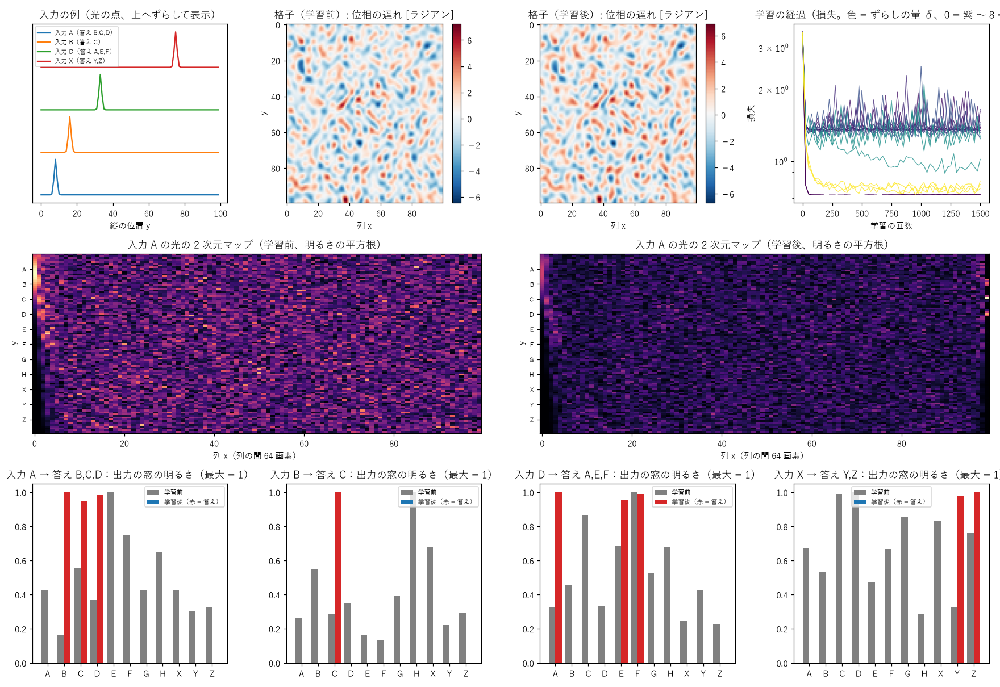
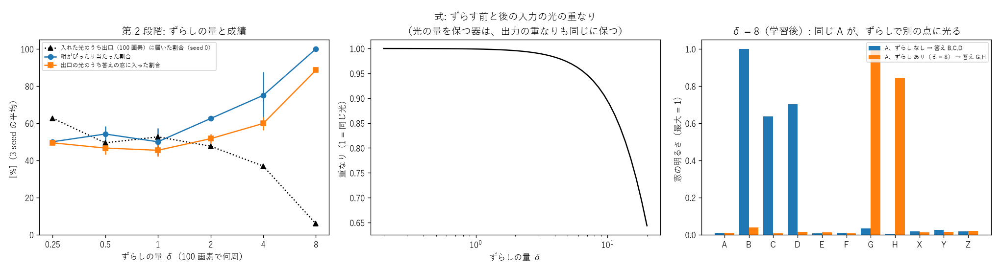

- **第 1 段階は完全に成功。第 2 段階は少しのずらしではどっちつかず、大きいずらしで成功するが光の 94% を捨てる**。
- 解釈（式）: 幅 1.5 画素の点は周波数が約 20 周ぶん広がっていて、δ ずらしても光はほとんど変わらない（重なり 0.999）。光の量を保つ器は 2 つの入力の重なりを保つので、出力もほぼ同じにしかできない。δ = 8 では共通部分を出口の外に捨てて見分けた。
- 次の一手: 記号を全体に広がる整数の周波数の波で表し（持ち主の「混ざらない周波数の光」）、整数のずらしで重なり 0 にして切り替える（実験16）。

## 実験16: 関係性概念を「混ざらない周波数の光」で (exp16_relations_freq.py)

実験15 の続き（持ち主の案）。記号 11 個に周波数 −10, −8, …, 10 の波を割り当て、出力は右端の列を FFT して記号の周波数で読む。ずらし δ（奇数なら記号と重ならない）。関係・器・学習は実験15 と同じ、3 seed。説明は [学び 16](docs/lessons/16_関係性概念を周波数の光で.md)。

| δ | 入力の重なり（式） | 組がぴったり | 答えの周波数に入った割合 | 出口に届いた割合 |
|---|---|---|---|---|
| 0 | − | 100 | 94.7 | 98.5 |
| 0.25 | 0.900 | 75 | 59.2 | 94.6 |
| 0.5 | 0.637 | 100 | 70.8 | 89.9 |
| 1 | 0 | **100** | **80.3** | 85.3 |
| 3 | 0 | 100 | 80.4 | 85.2 |

列の間 64 画素。8 画素でもほぼ同じ（δ = 1 で 100 / 80.6 / 90.2）。

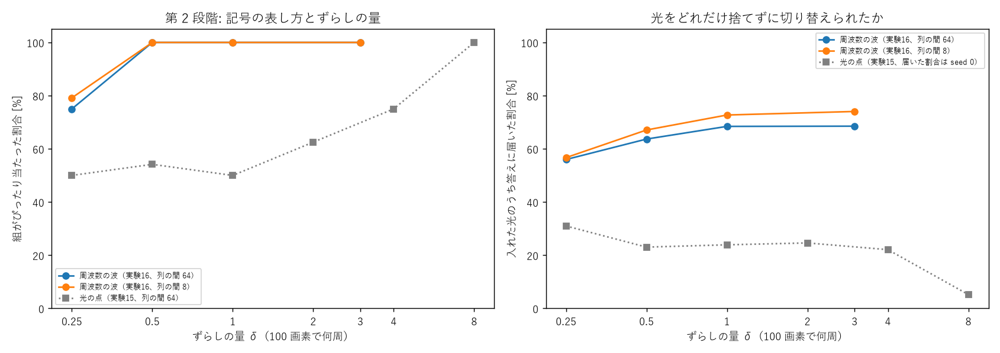

- **記号を整数の周波数の波で表すと、δ = 1 で第 2 段階が完全に成功し、光もあまり捨てない（入れた光の約 69% が答えへ。光の点では 50%・約 24%）**。
- 解釈: 整数のずらしで入力の重なりが 0 になる（式どおり）。重なりが残る δ = 0.25・0.5 では、重なりに応じて答えに入る光が減る。
- 次の一手: 出力を次の入力にしてつなげる、関係の数を増やした容量、曲がる処理の追加。

## 実験17: 関係をつなげる (exp17_chain.py)

実験16 の表し方で、1 回ぶんの対応（一本道 A → B → … → F / 枝分かれ A → B, C、B → D、C → E、D → F、E → G）を教え、A を入れて出口の光をそのまま 5 回通す。3 seed。説明は [学び 17](docs/lessons/17_関係をつなげる.md)。

| | 1 回目 | 2 回目 | 3 回目 | 4 回目 | 5 回目 |
|---|---|---|---|---|---|
| 一本道（3 seed すべて当たり） | B | C | D | E | F |
| 答えに入った光（seed 0、式 0.93^回） | 0.93（0.93） | 0.88（0.86） | 0.81（0.80） | 0.75（0.75） | 0.70（0.70） |
| 枝分かれ（3 seed すべて当たり） | B, C | D, E | F, G | − | − |

- **1 回ぶんの対応だけで、光を戻して何段もたどれる。枝分かれは重ね合わせのまま同時に進む。光の減り方は式どおり**。
- 次の一手: 関係の容量、曲がる処理で強い道だけ残す、文脈（ずらし）で道を変える。

## 実験14: 色を分けた「どちらか片方だけ」 (exp14_xor_colors.py)

実験12 の続き。A・B・参照を別々の色（干渉しない）にし、曲がる処理は 3 色の明るさの合計で効かせる。窓で 3 色の明るさを足して読む。器は列の間 64 画素、訓練 400・試験 400、400 回、3 seed。説明は [学び 14](docs/lessons/14_色を分けたどちらか片方だけ.md)。

| 曲がる処理 | 試験 | 各 seed |
|---|---|---|
| なし | 48.7 ± 3.0 | 53.0, 43.0, 50.2 |
| 飽和 s = 0.3 / 1 / 3 | 82.8 ± 8.6 / 66.8 ± 5.4 / 61.3 ± 3.2 | 100・73.8・74.5 / 72.0・72.3・56.0 / 57.0・67.5・59.5 |
| **カー効果 γ = 0.5 / 2** | **100.0 / 100.0** | すべて 100 |
| 小さな MLP | 100.0 | すべて 100 |

上限（曲がる処理なし）75%、偶然 50%。1 seed: なし 62 秒、曲がる処理あり約 200 秒。

- **カー効果を入れると 3 seed とも 100%。曲がる処理なしの上限 75% をはっきり越え、MLP と並んだ**。飽和は強いほど良いが不安定。
- 解釈（未確認）: カー効果で、ある色の通り道がほかの色の明るさで曲がり（相互位相変調）、A と B が両方あると互いを窓から外す。同じ色（実験12）でカー効果が悪かったのは、でたらめな位相の干渉が効き方を毎回変えるためと考えられる。
- 次の一手: 4 通りの入力の光の 2 次元マップを見る、関係性概念にカー効果を入れる。

## 実験18: 関係の容量 (exp18_relation_capacity.py)

記号 24（周波数 −48〜44、4 の倍数）× 文脈 4（ずらし 0〜3）から P 組、答えは 1〜3 個でたらめ。格子 F = 16（1024）・F = 32（4096）、表（20000）。曲がる処理なし、1500 回、3 seed。説明は [学び 18](docs/lessons/18_関係の容量.md)。

| P | 格子 F=16 当たり / 答えの光 | 格子 F=32 | 表 |
|---|---|---|---|
| 8 | 100 / 80.9 | 100 / 89.1 | 100 / 95.5 |
| 32 | 100 / 41.8 | 100 / 70.6 | 100 / 87.2 |
| 64 | 100 / 25.7 | 100 / 49.4 | 100 / 80.1 |
| 96 | 99.7 / 18.6 | 68.4 ± 31.6 / 26.3 | 100 / 74.5 |

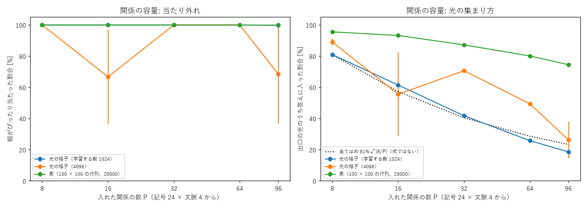

- **96 組でもほぼ全部当たり、崩れ方は「答えに集まる光が薄くなる」形（当てはめ 81%·√(8/P)、式ではない）**。F = 32 は光がよく集まるが seed により学習に失敗。
- 次の一手: 雑音を足したときの容量、カー効果の曲げ合いを見る、関係性概念にカー効果。

## 実験19: カー効果の光のマップ (exp19_kerr_maps.py)

実験14 の器（カー効果 γ = 2、seed 0）を学習し直し、4 通りの入力（位相をそろえた代表例）の光のマップと窓の明るさを記録。同じ格子でカー効果を切った版も。説明は [学び 19](docs/lessons/19_カー効果の光のマップ.md)。

| 入力（正しい答え） | カー効果あり（窓 0, 1） | 切る（窓 0, 1） |
|---|---|---|
| なし（0） | 0.86, 0.01 | 0.21, 0.06 |
| A だけ（1） | 0.01, 2.22 | 0.46, 0.64 |
| B だけ（1） | 0.01, 2.20 | 0.39, 0.77 |
| A と B（0） | 5.12, 0.04 | 0.65, 1.36 |

試験: あり 100%、同じ格子で切ると 75.7%。

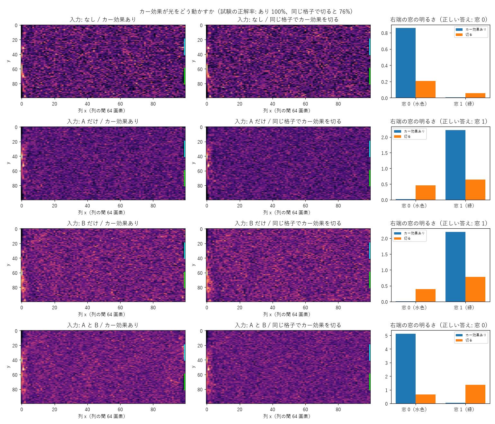

- **答えを決めているのはカー効果そのもの（切ると線形の上限まで落ちる）。明るさが増えると行き先が 窓 0 → 1 → 0 と回る**。
- 見立ての修正: はっきりした通り道は見えず、光は全体に散らばったまだらな模様になり、カー効果がその模様を明るさで組み替えていると考えられる（未確認）。

## 実験21: 観点周波数 — リンゴとトマト (exp21_viewpoint.py)

2026-10-27 持ち主の案。記号 17（物 5・値 12）を周波数 −48〜48（6 の倍数）の波、観点 5（色 1・大きさ 2・形 3・味 4・触感 5 のずらし）。順引きを表 TABLE（私が決めた割合）で学習、値の光を逆向きに通して逆引き、観点ごとに掛け算。器は実験16 と同じ、1500 回、3 seed。説明は [学び 21](docs/lessons/21_観点周波数_リンゴとトマト.md)。

| 手がかり | 光の器（3 seed の平均） | 表の正解 |
|---|---|---|
| 丸い・赤い・むしゃむしゃ・酸っぱい | トマト 70、イチゴ 29、リンゴ 0 | 72、28、0 |
| 赤くて丸い | トマト 36、イチゴ 33、リンゴ 31 | 36、32、32 |
| 黄色くて細長い | バナナ 81、レモン 19 | 79、21 |
| 赤くてしゃきしゃき、甘い | リンゴ 98 | 100 |

逆引き − 順引き: 最大 9e-7。順引きの分布と表の差 0.13、値に入った光 32%。

- **持ち主の例はトマト（3 seed とも）。点数は表の正解と数点以内。逆引きは式どおり順引きと同じ明るさ**。
- 解釈: 光の器で、手がかりごとの確からしさを掛け算する推し量り（ナイーブベイズ）をしている。掛け算はまだ計算機の側。
- 次の一手: 掛け算を光の中で（順に通す / カー効果）、文の例から割合を学ぶ。

## 実験20: 強い道だけを残す (exp20_winner.py)

記号 6 個（周波数の波）の 2 つを重ねた入力（勝者 55〜90%、位相でたらめ）→ 勝者だけを出口で光らせる。器は実験16 と同じ、訓練 400・試験 400、600 回、3 seed。説明は [学び 20](docs/lessons/20_強い道だけを残す.md)。

| 曲がる処理 | 鋭さの増え方（点） | 勝者が一番明るい |
|---|---|---|
| なし | −0.1 ± 0.0 | 100% |
| カー効果 γ = 30 / 100 | −21.7 ± 0.7 / −21.8 ± 1.3 | 18%（学習が崩れた） |
| カー効果 γ = 300 | 発散 | − |
| 飽和 s = 0.01 / 0.003 | **+2.3 ± 0.4 / +4.2 ± 0.3** | 99.9 / 99.8% |

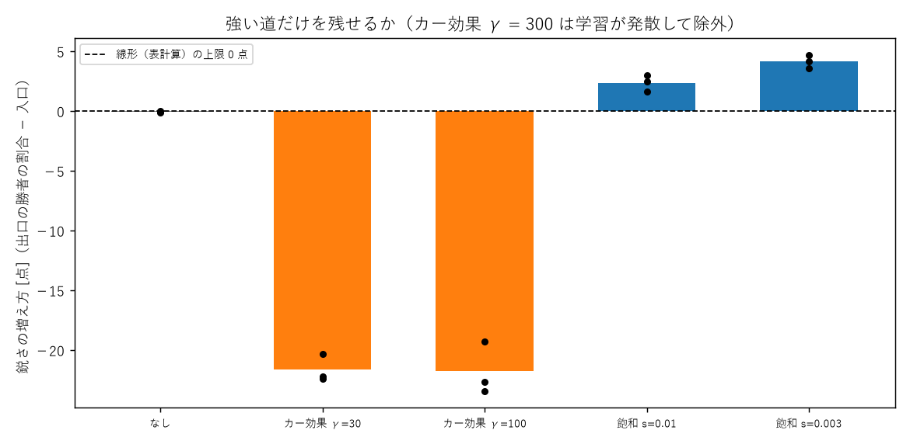

- **線形は式どおり 0 点。飽和は 3 seed とも 0 を越えるが小さい。カー効果は 1 色では学習が崩れる（実験12 と同じ）**。
- 次の一手: 飽和の器を何回も通して鋭さを積み重ねる、色を分けてカー効果。

## 実験22: 鋭さを上げる方法の比べ (exp22_sharpen.py)

2 つの記号の重なり（勝者 55〜90%）を、レンズ → 点の面の部品 → 逆のレンズ → 増幅、で 5 回通す。3 seed。説明は [学び 22](docs/lessons/22_鋭さを上げる方法の比べ.md)。

| 部品 | 入口 | 1 回 | 3 回 | 5 回 | 式との差 |
|---|---|---|---|---|---|
| 測って出し直す（2 乗） | 72.6 | 84.8 | 98.5 | **100.0** | 8e-7 |
| 可飽和吸収体（明るいほど通る） | 72.6 | 78.9 | 90.3 | 97.0 | 8e-7 |
| リミッタ・2 光子吸収（明るいほど通らない） | 72.6 | 63.6 | 53.8 | 51.0 | 2e-7 |
| 学習した格子 + リミッタ（実験20） | 72.6 | 76.8 | 82.2 | 85.2 | − |

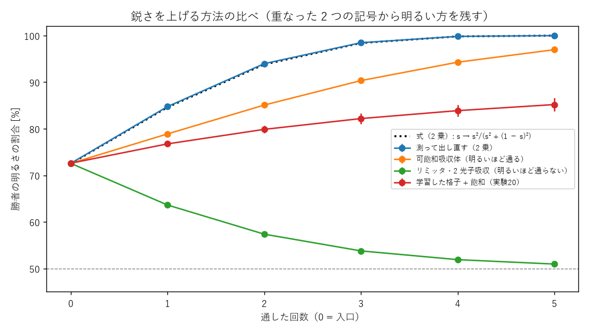

- **2 乗（測って出し直す）が最強で式どおり。リミッタは逆にならす（拡散の向き）**。鋭くする部品・ならす部品の両方が光の回路で作れる。

## 実験23: 存在しない属性（拡散となし）とまちまちな属性 (exp23_absent.py)

2026-10-27 持ち主の案。観点周波数の器（縦 128、記号 19、観点 6、物 リンゴ・トマト・猫・船）。存在しない属性を「拡散」（値に均等）または「なし」の記号で学習。1500 回、3 seed。説明は [学び 23](docs/lessons/23_存在しない属性_拡散となし.md)。

| 問い合わせ | 拡散 | なし | 表の正解（なし） |
|---|---|---|---|
| 目の色が青い | リンゴ 25・トマト 27・猫 23・船 25 | 猫 91 | 猫 100 |
| 赤くて目の色が黄色 | リンゴ 30・トマト 40・猫 16・船 13 | 猫 92 | 猫 100 |
| 赤くて丸い | トマト 51・リンゴ 43・猫 6 | トマト 54・リンゴ 41・猫 5 | トマト 49・リンゴ 44・猫 7 |
| 大きくて細長い | 船 99 | 船 99 | 船 100 |

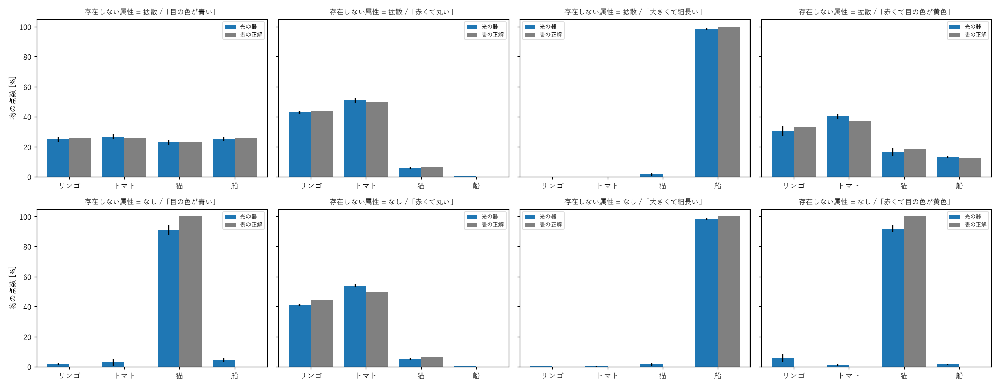

- **拡散 = 「分からない・関係ない」（候補を外さない）、なし = 「ない」（候補を外す）。覚え方で推し量りの性格が変わる**。表の正解と数点以内。

## 実験24: 手がかりの数と物当て (exp24_infer_clues.py)

実験21 の器で、物 1 つ・観点 k 個・表に従って値を引いた手がかりから物当て。各 2000 問、3 seed。掛け算の前の明るさを b ビットに丸める / 相対雑音。説明は [学び 24](docs/lessons/24_手がかりの数と物当て.md)。

| 手がかり | 表 | 光の器 | 4 ビット | 2 ビット | 雑音 30% |
|---|---|---|---|---|---|
| 1 | 45.5 | 45.9 | 45.2 | 42.9 | 43.3 |
| 3 | 74.3 | 73.9 | 74.0 | 66.6 | 70.9 |
| 5 | 90.1 | 90.1 | 90.1 | 79.7 | 88.3 |

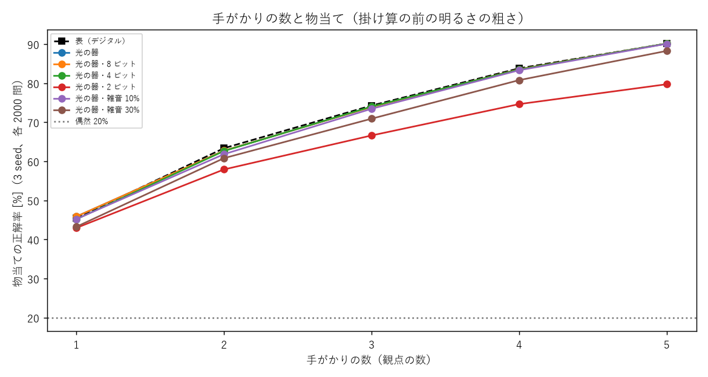

- **光の器 = デジタルの推し量り（差 1 点以内）。4 ビットで十分、2 ビットは手がかりが多いほど崩れる（小さい明るさが 0 に丸められる）**。偶然 20%。

## 実験25: 青空文庫から属性の割合を学ぶ (exp25_aozora_attr.py、tools/aozora_pairs.py)

青空文庫 4477 作品（Project_Kotoyui が取得、著作権切れ）で物 12 の直前の形容詞を数え（results/aozora_pairs.json）、観点 4（色・大きさ・温度・味）の割合として学習。数 3 未満は拡散（17 個）。1500 回、3 seed。説明は [学び 25](docs/lessons/25_青空文庫から属性を学ぶ.md)。

| 問い合わせ | 光の器 | 数えた割合 |
|---|---|---|
| 白くて冷たい | 雪 37・月 21・花 15 | 雪 42・月 19・花 15 |
| 赤くて熱い | 血 32・林檎 26・船 23 | 血 32・林檎 26・船 25 |
| 青くて大きい | 空 31・蜜柑 20・海 19 | 空 32・海 22・蜜柑 20 |

表との差 0.31。一番の答えは 18 問中 14 問で数えた割合と同じ。

- **文から数えた割合で推し量れる。拡散（分からない）にした物が、少しだけ知っている物（熱い火 4 回）より上に来ることがある**。

## 実験26: 2 つの意味を持つ言葉 (exp26_homonym.py)

2026-10-27 持ち主の案（果物のリンゴと人物のリンゴさん）。1 つの器に、ずらし 0 で 文字列 → 意味（リンゴ = 果物 70%・人 30%）、ずらし 1〜3 で 意味 → 行い・味・性格を学習。推し量り = 順向きの意味の明るさ × 手がかりの逆引きの掛け算。1500 回、3 seed。説明は [学び 26](docs/lessons/26_2つの意味を持つ言葉.md)。

| 文 | 光の器 果物・人 | 表 果物・人 |
|---|---|---|
| リンゴ（手がかりなし） | 71・29 | 70・30 |
| リンゴを食べた | 99・0 | 100・0 |
| リンゴが笑った | 3・96 | 0・100 |
| リンゴは優しい | 64・36 | 62・38 |
| リンゴが歩いた、元気だ | 3・90 | 0・100 |

- **重ね合わせで両方の意味を持ち、手がかりの掛け算で 1 つに決まる（持ち主の見立てどおり）**。「分からない」にした観点は否定に使えない。

## 実験27: 関係性の関係 — 知らない意味に気づく (exp27_unknown_sense.py)

2026-10-27 持ち主の案（リンゴさんを知らなくても分かる）。3 段の関係（文字列 → 物、物 → 仲間、仲間 → 行い・様子・味）を 1 つの器に。驚き = 文をたどった明るさ、仲間当て = 手がかりの逆引きの掛け算、書き込み = 「リンゴ」→ 未知 1、未知 1 → 当てた仲間 を足して 200 回学習し直す。3 seed。説明は [学び 27](docs/lessons/27_知らない意味に気づく.md)。

| | 結果（3 seed） |
|---|---|
| たどった明るさ: リンゴは楽しそうに手を振った / 太郎は楽しそうに手を振った / リンゴを食べた | 1.4〜7.1e-5 / 4.7〜5.5e-3 / 2.6〜3.1e-2 |
| 仲間当て「楽しそうに手を振った」 | 人間 95〜100% |
| 書き込み後「リンゴが話した」（書き込みに使っていない手がかり） | 未知 1（人間）97% |
| 書き込み後「リンゴを食べた」 | 果物のリンゴ 98% |
| 前の関係の表との差 | 0.10 → 0.11 |

- **合わない文は 75〜340 倍暗い（驚き）。属性を仲間に持たせると手がかりから仲間が分かり、書き込んだ新しい意味は仲間の属性を受け継ぐ**。
- 次の一手: 学習なしの重ね書きでの書き込み、「は」の重み、驚きのしきい値。

## 単語（文字）ごとの 2D マップ (tools/word_maps.py、持ち主の依頼)

2026-10-27 持ち主の依頼「適当な文章を選んで、単語ごとの 2D マップを保存してくれる？見ただけでは意味が無いけど、なにか発見があるかも」。
実験30 の器（F = 32、格子を results/exp30_grid_F32.npz に保存）に、『吾輩は猫である』冒頭（青空文庫）の 1 文字ずつを観点「1 文字後ろ」で通し、
光の 2 次元マップ（縦 1024 × 列 20）を results/word_maps.npz と docs/images/word_maps.png・word_maps_detail.png に保存。

- **発見: 吾・輩・猫・名・無・当 のマップと次の文字の候補がまったく同じ**。よく出る文字 100 個に入らないので、すべて同じ記号〈他〉になっているため。**記号の数（語彙）が足りない**ことが、マップで目に見えた。
- 注意: この器（F = 32、学習する数 4096）は次の文字の当たりが 1.1% で、1-gram（18.5%）より悪い（学習がうまくいっていない。表との差 0.63）。記号 101 × 観点 9 の関係を入れるには器が小さすぎるか、学習が足りないと考えられる（実験30 の F = 64 の結果を待つ）。マップはその器のもの。

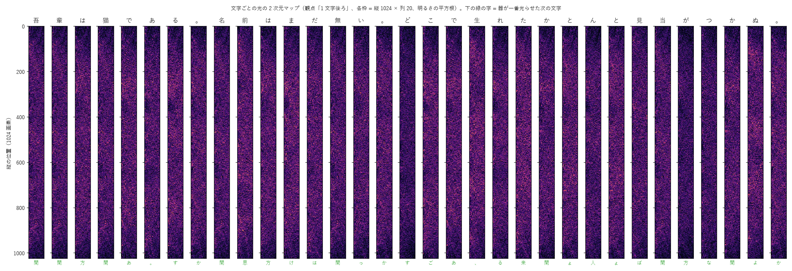

## 実験31: 単語ごとに格子 1 枚 (exp31_word_grids.py)

2026-10-27 持ち主の案。実験21 の表で、物ごとに小さな格子（入口 = 「何か」× 観点）。形 1（出口は値）・形 2（出口は値 + 観点）、1 単語 256 バイト・1 KB、3 seed。説明は [学び 31](docs/lessons/31_単語ごとに格子1枚.md)。

| 1 単語 | 形 1 表との差 | 形 2 表との差 | 逆引き（12 問） | 融合: 位相の平均 / 2 枚で足す |
|---|---|---|---|---|
| 256 バイト | 0.34〜0.39 | 0.46〜0.50 | 8〜9 | 0.46〜0.69 / 0.009〜0.037 |
| 1 KB | **0.06** | **0.08** | **12** | 0.71〜0.86 / **0.006〜0.014** |

比べ: 共有の格子 1 枚（実験21、4 KB）表との差 0.13、11/12。

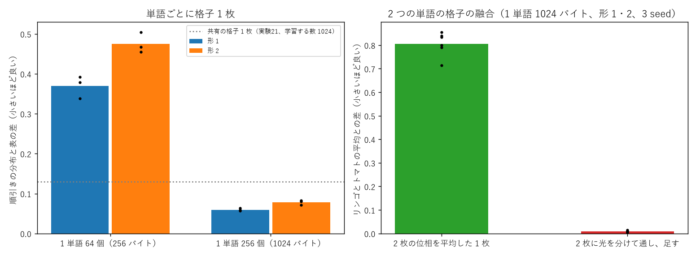

- **格子 = 単語の形で、共有の 1 枚より正確。融合は並べて光を足す（位相を混ぜると壊れる）**。

## 実験33: 周波数の並べ直し（Sin-CNN2 の実験35 を当てはめる） (exp33_renumber.py)

2026-10-27 持ち主の依頼。実験21 の器、使う周波数 37 個。置き方 3 つ（そのまま mod N / 詰める / 詰めて g を掛ける）× N = 100・64・48・42、列 100、3 seed。説明は [学び 33](docs/lessons/33_周波数の並べ直し.md)。

| N | そのまま（重なり） | 詰める | 詰めて並べ直す |
|---|---|---|---|
| 100 | 0.081（0%） | 0.082 | 0.082 |
| 64 | 0.083（13.5%） | 0.081 | 0.086 |
| 48 | 0.317（10.8%） | 0.081 | 0.084 |
| 42 | 0.416（13.5%） | 0.084 | 0.081 |

（順引きの表との差、3 seed の平均。問い合わせは詰める・並べ直すで N ≤ 64 なら 12/12）

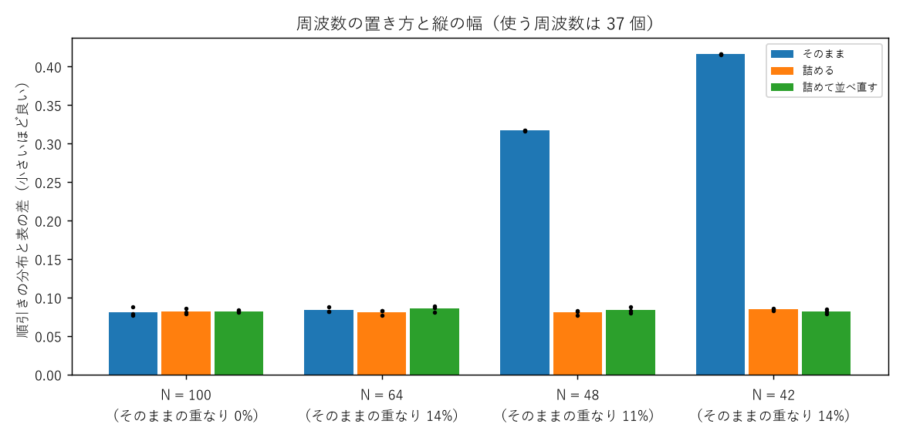

- **必要な幅 = 使う（記号, 観点）の数。詰めれば 42% の幅で同じ正確さ。g の並べ直しは 1 対 1 なので重なりを減らさない（式）、効きも害もなし**。

## 実験28〜30: 規模を広げる・次の文字（大規模実験 B-1〜B-3） (exp28_scale_nouns.py・exp29_next_char.py・exp30_offset_views.py)

2026-10-27 持ち主の依頼（大規模な調査と実験）。説明・表は [学び 28〜30](docs/lessons/28_規模を広げると足りないもの.md)。seed 0。

| 実験 | 結果 |
|---|---|
| 28 名詞 80 × 観点 9（縦 1040・列 20） | 画素ごとの板: 雪は何色？ 92.9%、白いものは？ 66.4%。格子 F = 32: 80.9 / 20.0。F = 64（初期値 1/F）: 43.2 / 9.1。F = 170: 46.5 / 11.8。比べ: 一番多い値 70.3% |
| 29 次の文字（100 字 + 〈他〉） | 1-gram 19.8、2-gram 25.9、3-gram 33.9、光の器 1 23.8、光の器 2（2 文字を重ねる）21.7、+ カー効果 約 1% |
| 28（追加）F = 170・初期値 1/F | 雪は何色？ 43.9%、白いものは？ 6.4%（直らず） |
| 30 前 9 文字の観点（持ち主の案） | 数えた表で掛け算・足し算 25.4%（2-gram 24.9、3-gram 33.1）。光の器（格子 F = 32・64）約 1% |

- **規模を広げるには画素ごとの板。足りないのは語彙と、観点どうしの組み合わせ（語順）**。
- 見立て外れ: 「格子の周波数の範囲が狭い」は、F = 170 でも直らなかった。初期値の大きさも原因ではなかった。
- 実験28 の最初の実行（results/exp28.txt）は「雪は何色？」の測り方に誤りがあった（名詞の記号も含めて一番を選んでいた）。直した後は results/exp28b.txt・exp28c.txt。

## 実験32: 道具の要素 × 単語の格子 (exp32_tools.py)

2026-10-27 持ち主の案。要素 5（刃・回転・圧力・熱・薄く）の重ね合わせで道具を表し、単語ごとの格子（リンゴ・ニンジン・肉、1 KB）が結果 7 つを返すよう学習。見せていない道具（フードプロセッサ = 刃 + 回転、圧力鍋 = 圧力 + 熱、ホットプレート = 熱）、ジュースの逆引き。3 seed。説明は [学び 32](docs/lessons/32_道具の要素と単語の格子.md)。

| | 結果（3 seed の範囲、%） |
|---|---|
| リンゴ × 圧力鍋（見せていない組み合わせ） | ジュース 42〜48・煮る 35〜36 |
| リンゴ × フードプロセッサ | ジュース 35〜41・細かい 21〜25 |
| リンゴ × ホットプレート | 煮る 63〜71（鍋と同じ） |
| ジュースの逆引き（リンゴ） | 圧力 64〜65・回転 18〜25・刃 11〜14・熱 0 |

- **見せていない道具は要素ごとの答えの重ね合わせになる。逆引きで「何を使えばジュースか」が出る。要素が同じ道具は区別できない**。

## 実験34: 融合のいろいろな形 (exp34_fusion.py)

2026-10-27 持ち主の依頼（優先度低め）。実験31 の単語ごとの格子（リンゴ・トマト、1 KB）を 8 つの形で合わせる。3 seed。説明は [学び 34](docs/lessons/34_融合のいろいろな形.md)。

| 形 | 目標との差 | 値に届いた光 |
|---|---|---|
| 1a 並べて明るさを足す | 0.006〜0.014 | 47〜50% |
| 1b 並べて場を足す（干渉） | 0.07〜0.15 | 51〜63% |
| 2 比率 80 : 20 | 0.004〜0.009 | 48〜51% |
| 3 差分（半周ずらす） | 0.17〜0.18（差との相関 0.54〜0.59） | 38〜43% |
| 4 積み重ね / 5 交互 / 6 位相の平均 / 7 複素数の板 | 0.72〜0.92 | 0〜8% |
| 8 学習し直す（300 回） | 0.044〜0.063 | 44〜48% |

- **板を混ぜると壊れる。並べて明るさを足す（比率も効く）か、少しだけ学習し直して 1 枚にする**。
- 訂正: 実験31 の「2 枚に分けて足す」は明るさの足し算（干渉しない）だった。

## 実験35: 組み合わせ（語順）— 直前 2 文字を別々の色 + カー効果 (exp35_order_colors.py)

実験29・30 の続き。よく出る 30 文字 + 〈他〉、直前の文字 = 色 1、2 つ前 = 色 2、同じ格子（F = 16、縦 64、列 100）、出口で 2 色の明るさを足す。カー効果は 2 色の明るさの合計で（色をまたぐ）。3-gram の分布 600 組で学習、800 回、seed 0。

| 方法 | 当たり | 交差エントロピー（ビット/文字） |
|---|---|---|
| 1-gram / 2-gram / 3-gram（数える） | 41.8 / 42.5 / 45.9 | 3.79 / 3.35 / 3.11 |
| 光の器（曲がる処理なし） | 41.6 | 3.56 |
| + カー効果 γ = 0.3 / 1 / 3 | 2.8 / 15.3 / 3.7 | 5.37 / 5.20 / 発散 |

- **失敗**: カー効果を入れると学習が崩れた（どの強さでも）。曲がる処理なしは 1-gram と 2-gram の間。
- 30 文字では〈他〉が多く、1-gram でも 41.8% 当たる（比べにくい課題だった）。交差エントロピーで見ると 2-gram と 3-gram の差は 0.24 ビット。
- 実験14（場所で表した入力・窓 2 つ）ではカー効果で表計算を越えたが、周波数で表した記号・答え 31 個では学習できなかった。カー効果の強さの付け方（γ × N × 明るさ）か、答えの数が多いことが原因と考えられる（未確認）。
- 次の一手: カー効果の代わりに、2 乗の部品（実験22）や画素ごとの板、少ない答えで試す。

## 実験36: 同じ初期の格子から学習する（共通の出発点）と、万能初期乱数の下見 (exp36_shared_init.py)

2026-10-27 持ち主の案（初期の格子の形が学習後も残る。最適化できるのでは、融合に影響するのでは）。実験34 の器、リンゴとトマトを同じ初期 / 別々の初期から 1500 回。初期の強さ 0.03・0.1・0.3、3 seed。

| 初期の強さ | 学習による変化の大きさ（|A − A0| / |A0|） | 表との差 0.15 を切った回 | 位相の平均で融合: 共通 / 別々 | 変化の和（共通） | 明るさを足す |
|---|---|---|---|---|---|
| 0.03 | 2.4〜3.1 | 50〜100 | 0.80〜0.83 / 0.80〜0.92 | 0.77〜0.88 | 0.05 |
| 0.1 | 0.63〜0.83 | 50 | 0.73〜0.79 / 0.77〜0.90 | 0.84〜0.90 | 0.06 |
| 0.3 | **0.19〜0.23** | 25〜50 | **0.59〜0.78** / 0.84〜0.91 | 0.85〜0.88 | 0.06〜0.07 |

（融合の数字は目標 = 2 つの平均との差、小さいほど良い。試しの 60 回学習では、初期 0.1 の共通・平均が 0.43）

- **持ち主の見立てどおり、初期の格子が強いほど、学習後も形が残る**（初期 0.3 では変化が 2 割）。初期が強い方が少し速く覚える。
- **共通の出発点は位相の平均による融合を少しだけ良くする**（初期 0.3 で 0.59〜0.78 対 0.84〜0.91）が、明るさを足す（0.06）にはまだ遠い。学習が長いほど板が離れ、差は小さくなる（60 回では 0.43）。
- 変化の和（Sin-CNN2 の実験23 の形）は効かなかった。
- 次の一手: 変化を小さく保つ学習（回数を減らす・変化に罰をつける）で、融合しやすい板を作れるか。

## 実験37: 融合しやすい板を作る（ほかのプロジェクトの知見と突き合わせ） (exp37_fusion_friendly.py)

2026-10-27 持ち主「融合については、他のプロジェクトの成果や研究結果から、原因と解決方法を推敲してもいいかも」。
掲示板の知見: 共通の出発点 + 差分の足し算は 2 次元で壊れる（SN2-Parts-2D 実験09・Metasequoia 実験09）、並列の光路を明るさで足す融合の崩れは「担当の取り違え」で担当なしの学習で直る（Metasequoia 実験10・12）。
実験36 の続き（初期の強さ 0.3、単語ごとの格子 1 KB）。罰つき = 変化 |A − A0|² に罰 λ、派生 = 2 つの平均の答えで 1 枚を学習してから各単語へ 300 回。融合 = 2 枚の位相の平均 1 枚。3 seed。

| 作り方 | 融合 1 枚の目標との差 | 元の 2 枚の表との差 | 変化の大きさ |
|---|---|---|---|
| 罰なし（λ = 0） | 0.59〜0.78 | 0.06〜0.08 | 0.20〜0.22 |
| λ = 0.01 / 0.1 | 0.56〜0.66 / 0.66〜0.71 | 0.05〜0.08 | 0.17〜0.22 |
| λ = 1 | 0.32〜0.47 | 0.07〜0.11 | 0.12〜0.14 |
| **派生（両方を知る出発点から 300 回）** | **0.13〜0.27** | **0.05〜0.08** | 0.09〜0.14 |

- **両方を知る出発点から派生させると、位相を平均した 1 枚でも 2 つの意味をかなり保てる（差 0.13〜0.27）。元の 2 枚の覚え方も落ちない**。罰（λ = 1）も効くが、派生ほどではない。
- 解釈: 位相の平均が壊れるのは、2 枚が別々の「谷」に落ちているから。両方の答えを知る 1 枚から少しだけ動かすと、2 枚が同じ谷の中にいて、平均しても谷から出ない（考え方は Sin-CNN2 の「共通の出発点」と同じで、出発点が「両方を知っている」ことが要る）。
- 実験34 の「学習し直す」（差 0.04〜0.06）にはまだ及ばない。並べて明るさを足す（0.01）が最も確実。

## 実験40: 「圧力 + 熱だからこそ柔らかくなる」— 2 段の器 (exp40_combo_answer.py)

docs/explain_20261027.md の説明（曲がる処理なしでは、どちらの道具にもない答えは出ない）を確かめる。実験32 の作りでリンゴの格子だけ、圧力鍋（圧力 + 熱）→ 柔らかい 80%・煮る 20% を教える（プレス機・鍋だけでは柔らかいは 0%）。1 段 = 格子 1 枚、2 段 = 格子 → 明るさを測って √ で出し直す → 格子。1500 回、3 seed。

| 器 | 柔らかいの割合: 圧力鍋（80% にしたい） | プレス機（0% にしたい） | 鍋（0% にしたい） |
|---|---|---|---|
| 1 段（曲がる処理なし） | 39〜47% | 22〜33% | 23〜29% |
| **2 段（明るさを測って出し直す）** | **42〜49%** | **4〜5%** | **11〜15%** |

- **1 段では、圧力鍋だけを柔らかくできず、プレス機や鍋にも柔らかいが 2〜3 割漏れる**（説明どおり: 圧力鍋で柔らかいを光らせるには、圧力だけ・熱だけにも柔らかいへ光を送るしかない。干渉で圧力鍋の方を少し強くできるだけ）。
- **2 段にすると、柔らかいは圧力鍋に寄り、プレス機では 4〜5% に下がった**。明るさを測って出し直す段が、2 つの要素の組み合わせを作っている。ただし圧力鍋でも 42〜49%（目標 80%）、鍋に 11〜15% 残り、まだ不完全。

## 実験38: 語順の組み合わせを 2 段の器で (exp38_two_stage_order.py)

実験29・35 の続き。直前の文字 + 2 つ前の文字（ずらし 1）を同じ色で重ねて入れる。画素ごとの板（縦 256、列 20）。2 段 = 板 → 明るさを測る → √明るさ（または明るさ）で出し直す → 板。3-gram の分布 3000 組で 1500 回、seed 0。

| 方法 | 当たり | 交差エントロピー |
|---|---|---|
| 1-gram / 2-gram / 3-gram（数える） | 19.8 / 25.9 / 33.9 | 5.49 / 4.54 / 4.04 |
| 光の器・1 段（画素ごとの板） | 23.0 | 5.04 |
| **光の器・2 段（明るさ）** | **27.4** | 4.70 |
| 光の器・2 段（明るさの 2 乗） | 26.9 | 4.65 |

- **2 段（明るさを測って出し直す）で、初めて 2-gram（25.9%）を越えた（27.4%）**。2 つの文字の光の干渉の項（組み合わせ）が、測って出し直す段で次の板に渡ったと考えられる。3-gram（33.9%）にはまだ遠く、確率の付け方（交差エントロピー）は 2-gram より粗い。

## 実験41: 観点 f1 × f2（f2 = AI の状態のモード） (exp41_mode_views.py)

2026-10-28 持ち主の案（f1 × f2 の 2D の観点周波数、f2 を AI の状態に、エッジでは f2 を制限）。f1 × f2 = 「f1 + 6·f2 だけずらす」（桁を分ける置き方）。実験21 の表、モード M = 2・4・8（ふつう・最短・考え中・睡眠・温度 0.5・2・3・0.25）。画素ごとの板（列 20）、縦 N = 30M + 16 以上。3 seed。

| M（縦） | ふつう | 最短 | 考え中 | 睡眠（値に届いた光） | 温度 0.5 / 2 / 3 / 0.25 | ふつうで値に届いた光 |
|---|---|---|---|---|---|---|
| 2（100） | 0.10 | 0.06〜0.07 | − | − | − | 20〜21% |
| 4（136） | 0.09〜0.10 | 0.06 | 0.12〜0.13 | 0.09（1〜2%） | − | 13% |
| 8（256） | 0.09〜0.10 | 0.06〜0.07 | 0.14 | 0.09（1%） | 0.07〜0.08 / 0.10〜0.11 / 0.10〜0.11 / 0.06〜0.07 | 6% |

（数字は各モードの目標の分布との差、3 seed の範囲）

- **1 つの器で、同じ物・同じ観点でも f2 のモードごとに答え方を変えられた（8 モードまで、差 0.06〜0.14）**。睡眠モードは光をほぼ出さない（値に届く光 1〜2%）。f2 = 0 が「ふつう」なので、エッジでは f2 を固定するだけで機能を制限できる。
- モードを増やすと、答えに届く光が減る（21% → 13% → 6%）。覚え方の正確さは保ったまま、明るさ（確信度）で払う形（実験18 と同じ崩れ方）。

## 実験42・43: 周波数の高低の影響と、観点の波の量子化 (exp42_band_quant.py)

2026-10-28 持ち主の依頼（観点周波数の層の限界と、周波数の高低の影響、観点周波数の量子化によるコンパクト化）。実験21 の表、使う周波数 37 個を詰めて置く、画素ごとの板（縦 256、列 20）。1500 回、3 seed。

| 条件 | 表との差 | 値に届いた光 | 問い合わせ（12 問） |
|---|---|---|---|
| 実験42 低い（0〜41） | 0.070〜0.074 | 38〜41% | 12 |
| 中くらい（60〜101） | 0.069〜0.070 | 41〜42% | 12 |
| 高い（86〜127、上限 128 の近く） | 0.067〜0.069 | 42% | 12 |
| 散らす（× 97 mod 256） | **0.059〜0.063** | 37〜38% | 12 |
| 実験43 位相 3 ビット（8 段） | 0.070〜0.075 | 41〜42% | 11 |
| 位相 2 ビット（4 段） | 0.082〜0.086 | 41〜42% | 12 |
| 位相 1 ビット（0 か π の白黒の縞） | 0.083〜0.087 | 42〜45% | 9 |

- **周波数の高低は、画素ごとの板ではほとんど影響しなかった**（上限の近くでも同じ）。散らして置くと少しだけ良い（実験33 の格子では差がなかった）。
- **観点の波は 2 ビット（4 段の位相）でもほぼ崩れない**。1 ビット（白黒の縞）でも表との差 0.085、問い合わせは 12 問中 9 問。観点の波は安い板（2 値・4 値）で作れる。
- 層の限界は、周波数の位置ではなく「使う組の数」と「器の覚えられる量」で決まる（実験16・18・33・41 と合わせて）。

## 実験45: 共通の板（初期の板）の型の比べ (exp45_common_plates.py)

2026-10-28 持ち主の案（共通の板の型をいくつか作っておく。基準は学習の速さ・拡散しにくさ。左ほど高い周波数を直線・反比例で、横は白色雑音、など）。実験42 の課題（低い所に詰める）、画素ごとの板（縦 128、列 20）、600 回、3 seed。

| 初期の板の型 | 表との差 0.15 を切った回 | 600 回後の表との差 | 値に届いた光 |
|---|---|---|---|
| 平ら（0） | 250 | 0.080 | 30% |
| 白色雑音 0.1 | 150 | 0.067〜0.072 | 35% |
| 白色雑音 1 | 75〜100 | 0.063〜0.067 | 35〜37% |
| **白色雑音 ±π（一様）** | **50〜100** | 0.064〜0.066 | 36〜38% |
| 左ほど高い（直線、40 → 2 周） | 100 | 0.062〜0.065 | 37% |
| 左ほど高い（反比例） | 100 | 0.067〜0.068 | 37% |
| 左ほど低い（直線） | 75〜100 | 0.064〜0.067 | 36〜37% |
| 縦なめらか・横ばらばら | 125〜175 | 0.072〜0.075 | 34〜37% |
| レンズ（2 次の位相） | 100〜150 | 0.063〜0.075 | 35〜38% |

- **平らな板が一番遅く（250 回）、光も答えに集まりにくい（30%）。強くばらばらな板（白色雑音 ±π）が一番速い（50〜100 回）**。持ち主の縞の型（左ほど高い・反比例）は 100 回で、強い白色雑音とほぼ同じ速さ。
- 最後の正確さはどの型もほぼ同じ（0.06〜0.08）。この易しい課題では差は「速さ」と「光の集まり方」に出た。光を最初によく散らす板ほど、学習が速い（持ち主の「横はホワイトノイズのような散乱度」の考えと合う）。
- 融合のしやすさとの関係は、まだ測っていない。

## 実験44: 差分（引き算） (exp44_difference.py)

2026-10-28 持ち主の依頼（融合と差分は大きな柱、引き算の実験）。実験37 の作り（単語ごとの格子、初期 0.3）。別々 / 派生（両方を知る 1 枚から 300 回）。3 seed。
A. 違いを取り出す（目標 = |リンゴの答え − トマトの答え|、相関）: 明るさの引き算 0.99〜1.00、場の引き算（半周ずらす）0.50〜0.78、位相の引き算 1 枚 −0.18〜0.38。
B. 融合からリンゴを引いてトマトに戻す（トマトの答えとの差）: 明るさの引き算 0.05〜0.07、学習で引く（100 回）0.07〜0.10、位相の引き算（派生のとき）0.26〜0.82（seed でばらつく）。比べ: 融合した 1 枚そのまま 0.19〜0.20（派生）。
（別々のときの「位相: 2·A_m − A_リンゴ」は A_m を 2 枚の平均にしたので恒等的に戻るだけで、意味がない）

- **引き算も足し算と同じで、2 枚を並べて明るさで引くのが確実（違いの取り出しはほぼ完全、片方を引いて戻すのも差 0.05〜0.07）。板の位相で引くのはうまくいかない**。派生（同じ谷）なら位相の引き算で少し戻る seed もある。1 枚にまとめた板から片方を消したいなら、100 回ほど学習し直すのが確実。

## 実験46: 初期の板の型 15 種と学習の経過（GPU） (exp46_plate_patterns.py)

実験45 の続き（持ち主「板のパターンは多くなるかもだけど、データ取り（学習回数と結果とか）も」）。画素ごとの板（列 20）、易しい課題 = 実験21 の表（縦 128、600 回）、重い課題 = 名詞 80 × 観点 9（縦 1040、1500 回）。3 seed、経過の曲線は results/exp46_*.txt。

| 初期の板の型 | 易しい: 0.15 を切った回 | 易しい: 100 回目の表との差 | 重い: 500 回目の表との差 | 重い: 最後（1500 回） |
|---|---|---|---|---|
| 平ら（0） | 250 | 0.281 | 0.380 | **0.240（最も悪い）** |
| 白色雑音 0.1 | 150 | 0.19〜0.20 | 0.22〜0.23 | 0.173〜0.174 |
| 白色雑音 1 | 75〜100 | 0.10〜0.13 | 0.20 | 0.163〜0.165 |
| 白色雑音 ±π | 50〜100 | 0.09〜0.12 | 0.20〜0.22 | 0.162〜0.173 |
| **2 値（0 か π）** | **75** | **0.10** | **0.19〜0.20** | **0.163〜0.165** |
| 縞 左ほど高い（直線 / 反比例） | 100 / 100 | 0.12〜0.15 | 0.24〜0.25 / 0.21〜0.22 | 0.18 / 0.17 |
| 縞 左ほど低い（直線） | 75〜100 | 0.11〜0.13 | 0.23〜0.24 | 0.18 |
| 縞 全部の列で 20 周 | 100 | 0.13〜0.14 | 0.26〜0.28 | 0.187〜0.192 |
| 縦の低い周波数だけの乱数（1〜8） | 125〜175 | 0.16〜0.24 | 0.21〜0.24 | 0.17〜0.18 |
| 縦の高い周波数だけの乱数（32〜64） | 75〜100 | 0.11〜0.13 | 0.19〜0.20 | 0.164〜0.167 |
| 入口側の半分だけ ±π | 75〜100 | 0.10〜0.11 | 0.20〜0.21 | 0.165〜0.171 |
| 出口側の半分だけ ±π | 100 | 0.13〜0.14 | 0.19〜0.20 | 0.163〜0.165 |
| レンズ（2 次の位相）+ 雑音 0.1 | 100〜150 | 0.14〜0.20 | 0.22〜0.23 | 0.17〜0.18 |
| チャープ（縦の位置で周波数が上がる） | 75〜125 | 0.11〜0.17 | 0.20〜0.22 | 0.16〜0.17 |

（重い課題は「0.85 を切った回」がすべて 50 で、目安として粗すぎた。途中の表との差で比べる。値に届いた光は重い課題ではどの型も 2.7〜2.9% と少ない）

- **重い課題でも、平らな板は最後まで遅れたまま（0.240、ほかは 0.16〜0.19）**。易しい課題では最後に追いつくが、重い課題では 1500 回で追いつかない。
- **いちばん安く速いのは 2 値（0 か π）の板**。白色雑音 ±π と同じ速さで、作るのも簡単（実験43 の「観点の波は 1〜2 ビットで作れる」と合わせて、安い板で足りる）。
- 縞（左ほど高い等）は白色雑音より少し遅い。縦の高い周波数（細かい模様）を持つ板ほど速い。低い周波数だけの乱数は遅い。**光を最初に細かく散らす板ほど速い**（実験45 の解釈と同じ）。

## 実験47: 取り出しの非線形（べき p）とループで、記憶の容量は増えるか (exp47_readout_nonlinear.py)

2026-10-28 持ち主の案（1. √ の代わりに 2 乗などで取り出す、2. 記憶ループ（板 → 回折 → 非線形 → 板へ戻す）、3. 実験22 を何回も通す）。実験08 の続き。鍵 = 位相がでたらめな複素数、値の候補 16、3 seed、問い 256。説明は [学び 47](docs/lessons/47_取り出しの非線形とループ.md)。

| 作り | 正解率 50% 前後になる組の数 M | 
|---|---|
| 1 段（1 枚の板に 鍵 → 値 を重ねる、N = 256） | 約 100（M = 64 で 64〜77%、128 で 32〜39%） |
| 2 段・重ね（1 枚目に 鍵 → 鍵ごとの点を重ね、明るさ^p で 2 枚目へ）p = 1 / 2 / ∞ | 約 50〜64（M = 64 で 41〜43% / 49〜55% / 50〜54%）。**1 段より悪い** |
| 2 段・別々（鍵ごとに別の記憶。大きさ M × N）N = 16、p = 1 | 約 700（M = 1024 で 22〜46%）。式の予想の桁 740 |
| 同 p = 2 | 約 16000（M = 16384 で 45〜54%）。式の予想の桁 9500 |
| 同 p = 3 / 4 | M = 65536 で 84〜89% / 100% |

ループ（自己連想、雑音の入った鍵から始めて組み直す。重なり 0.25 から）:
- 別々の記憶（N = 256）: **p ≥ 2 なら 5 回で正しい鍵との重なりが 0.25 → 1.00 に戻る（M = 16384 まで）**。p = 1 は混ざった平均に引かれて崩れる（M = 16384 で重なり 0.04）。
- いちばん明るい鍵を当てる正解率そのものは、1 回目と変わらない（1 回目の「一番明るい」が最良の判定なので）。ループが増やすのは「答えの正確さ」ではなく「出てくる光（鍵）のきれいさ」。
- 重ねた 1 枚の板では、ループは効かない（回すほど悪くなる）。

式の予想（学び 47）: 重ねた板の相関面の雑音は分散 M/N で、重ねた時点で混ざっている。あとから非線形をかけても雑音は分けられない。
別々の記憶では外れの明るさ |<k_i,k_j>|² が平均 1/N の指数分布で、べき p をかけると外れのゆれが N^p 分の 1 に縮む。崩れ始める M ≈ V·N^{2p}/((2p)! − (p!)²)/(2 ln V)。

- **取り出しの非線形が容量を増やすのは、記憶が「鍵ごとに別々に呼べる」ときだけ（p を 1 上げるごとに約 N² 倍）。1 枚に重ねた板（数 N 個）の容量は、非線形でもループでも増えない**（情報の量の上限 ≈ N × log(1 + 信号と雑音の比) を越えられない）。
- これは密な連想記憶（Krotov・Hopfield 2016、容量 ∝ N^{p−1}）・現代のホップフィールド網（2020、= 注意機構）と同じ仕組み。光では 1980 年代の「相関面で非線形をかけるホログラム連想記憶」（Owechko ら 1987、位相共役鏡のループ）にあたる。
- 光の器で「別々に呼べる記憶」= 体積ホログラム（角度・波長の多重）、単語ごとの格子（実験31）、並べた板（実験34 の融合）。**非線形のループは、実験17 の「関係をたどるたびに光が 7% ずつ減って濁る」を、たどるたびにきれいに戻す部品として使える**。

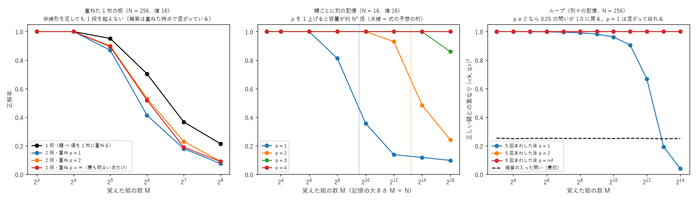

## 実験48: 層より大きなレンズで、外に逃げた光も拾う (exp48_big_lens.py)

2026-10-28 持ち主の案 4。実験46 の易しい課題、白色雑音 ±π から 600 回、3 seed。

| 作り | 表との差 | 値に届いた光 | 出口で板の幅の外にある光（学習前 → 後） |
|---|---|---|---|
| レンズ N（これまで。板の幅の光だけ） | 0.064〜0.066 | 36〜38% | 45〜46% → **29〜30%（捨てていた）** |
| レンズ 2N（大きなレンズ、外の光も入れる） | 0.063〜0.066 | 34〜37% | 45〜46% → 44〜45% |
| 板 2N + レンズ 2N（層も大きくする） | 0.073〜0.075 | **45%** | 46% → 47〜48% |

- **これまで出口の光の約 3 割を捨てていた**。ただし学習が「光を板の幅の中へ戻す」ように板を作っていた（46% → 30%）。
- 大きなレンズで外の光を拾っても、値に届く光は増えなかった。大きなレンズは周波数を 2 倍細かく分けるので、拾った光が値と値の「間」の番号にも落ちる。**大きなレンズで増えるのは明るさではなく「読み分けられる点の数」（2 倍）**。高い角度の光 = 細かい模様の情報、という持ち主の見立てどおりで、使うには出口の答えの点を 2 倍細かく置く必要がある。
- 層も大きくすると、値に届く光は 37% → 45% に増えた（表との差は少し悪い）。

## 持ち主の案 3-2・3-3・5 の整理（2026-10-28、式で上限を確かめる。実験はまだ）

- **3-2 スーパーヘテロダイン・多段の観点格子**: 波を掛けると差の周波数ができる（実験05）ので、1 段目で大分類、2 段目で掛け合わせて差（モアレ）を低い周波数の窓で読む、は組める。ただし **1.1 と 1.2 を読み分けられるかは、窓の長さ T で決まる（分けられる周波数の差 ≈ 1/T、実験03 の漏れ）。ヘテロダインは周波数を「動かす」だけで、この限界は変えない**。等価時間・アンダーサンプリングは「同じ信号を何回も測れる」ときに、回数（時間）と引き換えに細かさを得る方法。器に同じ光を何回も通す（ループ）なら当てはまる。
- **3-3 バーニア効果**: 少しだけ周期の違う 2 つの目盛り（周波数 f と f + δ）を重ねると、片方のわずかなずれ ε が、モアレの山の位置では ε/δ 倍に拡大されて見える。感情のような連続の量を「山の位置」で読む使い方はできる。ただし雑音も同じ倍率で拡大されるので、**読める細かさ（ビット数）は信号と雑音の比で決まり、バーニアで増えるのは「読みやすさ」**。
- **5 焦点の位置ごとに別の像**: 自由空間の伝わり方は情報を失わない変換（ユニタリ）なので、z = 50 の場が決まれば z = 100 の場も決まる。**焦点面を増やしても、記憶できる量の上限（面の幅 × 角度の広さ = 点の数）は増えない**。増えるのは、明るさしか測れない検出器で「位相の情報」も読めること（最大 2 倍）。z ごとに別の答えを置くのは、点の数を z で分け合う形になる（回折ネットワークの多重化と同じ）。
- まとめ: 記号の数（辞書の単語数）も、1 つの記号の深さ（細かさ）も、**合計の情報量 ≈ 点の数 × log(1 + 信号と雑音の比) で上限が決まる**。上限を上げるには、点の数（板の大きさ・レンズの広さ・体積の多重）か、信号と雑音の比（光の量）を増やす。非線形とループは、上限に近づける・出口の光をきれいにする役（実験47）。

## 実験49: 光の注意機構 — 鍵と値の置き方・重み付け・文脈の長さ (exp49_attention_store.py、部品 src/attention.py)

2026-10-28 持ち主の案（問いの光と鍵の光の重なりで前の語を足し合わせる。番地に並べて 4f 相関器で引くか、周波数に多重化してホログラフィックに引き抜くか）。
注意機構は差し替えできる部品 src/attention.py にした（置き方 address・band・holo × 重み付け softmax・power・spike、名前で選ぶ）。
課題 = 連想の呼び出し（文脈 T 個の (鍵, 値) から、問いの鍵の値を答える。値の語彙 64）。鍵 = でたらめな位相 / 直交（位置ごとに別の整数の周波数）。3 seed、問い 256。説明は [学び 49](docs/lessons/49_光の注意機構.md)。

正解率（でたらめな鍵、雑音なし、3 seed の平均）:

| 置き方 | N = 64: T = 16 / 64 / 256 / 4096 | N = 256: T = 16 / 64 / 256 / 4096 |
|---|---|---|
| **address（番地に並べる、記憶 T × N）** スパイク・p = 2・softmax β = 32 | **1.00 / 1.00 / 1.00 / 1.00** | **1.00 / 1.00 / 1.00 / 1.00** |
| band（1 つの場を周波数の帯に分ける） スパイク | 1.00 / 0.04 / 0.02 / 0.01 | 1.00 / 1.00 / 0.02 / 0.02 |
| holo（1 枚の板に重ねる） スパイク | 0.69 / 0.11 / 0.02 / 0.01 | 1.00 / 0.52 / 0.06 / 0.01 |
| 比べ: トランスフォーマー（実数の内積 / √N の softmax） | 1.00 / 1.00 / 1.00 / 0.97 | 1.00 / 1.00 / 1.00 / 1.00 |

正しい位置の重み（address、softmax β = 8、雑音なし）: でたらめな鍵 N = 256 で T = 256 / 1024 / 4096 → 0.92 / 0.74 / 0.41。直交した鍵 T = 256 → 0.92。
式 e^β/(e^β + T − 1) = 0.92 / 0.74 / 0.42 と一致。べき p = 2・スパイクでは、直交した鍵の外れの重みは 0（正しい位置の重み 1.00、T = 256 まで）。
問いに雑音（重なり 約 0.37）があるとき: address のスパイク・β = 32 は T = 4096 でも 1.00、β = 8 は T = 1024 で 0.75、β = 2 は T = 16 で 0.48〜0.62。

- **長い文脈に効くのは「番地に並べる」置き方だけ**（N = 64 でも T = 4096 まで 100%）。トランスフォーマーの「過去の鍵・値をすべて取っておく」（KV キャッシュ）と同じで、記憶は文脈の長さに比例して増える。
- **周波数の帯に分ける・1 枚に重ねる置き方は、1 つの場（点 N 個）を文脈全体で分け合うので、T が N の 1/4〜1 くらいで崩れる**（実験47 の「重ねた板の容量は増えない」と同じ理由）。
- 持ち主の見立て「間の語がどれだけ無関係でも、直交性で無視できる」は、**重み付けがべき・スパイクなら成り立つ**（直交した外れの重みは 0）。**softmax では成り立たない**: 重なり 0 の外れにも e^0 = 1 の重みがつき、正しい位置の重みは e^β/(e^β + T − 1) に薄まる。トランスフォーマーの softmax が長い文脈で薄まる理由もこれ。
- 失敗の記録: 整数の周波数 1 本の鍵（直交）は、holo（相関面の点で読む）では読めなかった（T = 4 でも 24〜34%）。1 本の周波数の自己相関は山にならず、どの点でも同じ明るさになるため（情報は位相にあり、明るさに出ない）。周波数で表した鍵はレンズで周波数の位置に集めて読む必要がある。
- band の作りは粗い（鍵を帯の幅 N/T に切る）。帯の中の鍵の作り方を工夫しても、帯の幅 = 鍵の長さ N/T という制約は残る。

## 実験50: 非線形のループで、関係を何段たどっても濁らないか (exp50_chain_cleanup.py)

実験17・47 の続き（持ち主の案 2「記憶ループ」の、関係のたどりへの当てはめ）。N = 64 の鍵 256 個のひと回りの鎖（番地に並べる、src/attention.py）。
1 段ごとに位相の雑音 σ と光の減り × 0.93 を入れて 30 段たどる。次の問い = Σ 重み × 次の鍵、明るさを 1 に戻す（利得）。3 seed、出発点 256。説明は [学び 50](docs/lessons/50_ループで関係をたどっても濁らない.md)。

| 重み付け | σ = 0.6: 1 / 10 / 30 段後の正しい鍵との重なり | σ = 1.0: 1 / 10 / 30 段後 |
|---|---|---|
| 線形（1 枚に重ねた行列、M > N） | 0.16〜0.17 / 0.02 / 0.02 | 0.10〜0.11 / 0.02 / 0.02 |
| 明るさの 1 乗 | 0.80 / 0.30〜0.39 / 0.03〜0.07 | 0.53〜0.54 / 0.02 / 0.02 |
| **明るさの 2 乗** | **1.00 / 1.00 / 1.00** | **0.98 / 0.97 / 0.97** |
| 明るさの 4 乗・スパイク | 1.00 / 1.00 / 1.00 | 1.00 / 1.00 / 1.00 |

- **明るさを 2 乗以上して組み直すと、毎段雑音と光の減りが入っても、30 段たどって濁らない（正解率も 100%）**。1 乗は濁りが積み重なり 10 段で重なり 0.3。
- 外れの明るさ（約 1/N）が p 乗で 1/N^p に縮み、毎段きれいな鍵から出発し直せるため（デジタルの「0 か 1 に戻す」と同じ）。光の減りは利得で補う。
- 残り: 枝分かれ（同時に 2 つたどる）は p 乗で片方に決まってしまう。

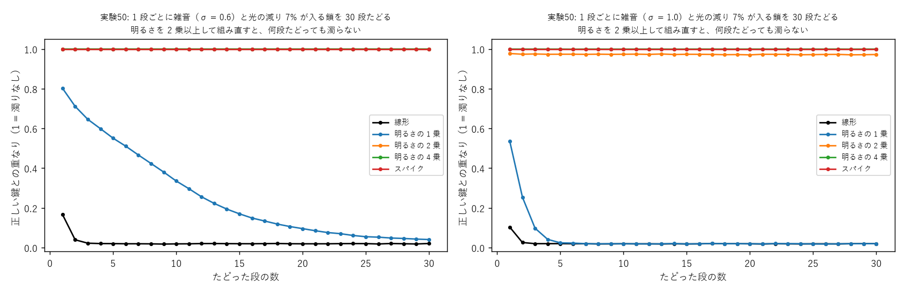

## 実験51・52: 知らない物で新しいグレインを作る・周りの語の属性で語を当てる (exp51_new_grain.py・exp52_cloze_product.py、部品 src/grain.py)

2026-10-28 持ち主の案（赤ちゃんのように、合わない物に出会ったら自動で学習器（グレイン）を作り、周囲の属性から学び始める。種別のグレインと直交させる。
文中の語は周りの語と属性でつながり、属性の掛け算で「そこに無い物」も当てられる。助詞は隣との関連を × 1.2 で強める。逆回しも。名前を考えて。トークンの分け方に注意）。
説明は [学び 51](docs/lessons/51_知らない物で新しいグレインを作る.md)。グレインの名前の案: **語板（ごばん）**・言の葉・意味の粒。

実験51（3 seed）:
- A. 合う率（観察した値の割合の幾何平均）: 知っている物 リンゴ 0.85〜0.87・青リンゴ 0.50〜0.54・トマト 0.68〜0.69、知らない物 ナス 0.23〜0.32・バナナ 0.21〜0.25・ピーマン 0.19〜0.21。**しきい値 0.4 で 3 seed ともきれいに分かれる**（適応共鳴理論 ART の警戒しきい値と同じ形）。
- B. ナスの学び始め（見ていない観点の、本当のナスとの差）: 4 観点を見たとき、近い = キュウリ、写すだけで 0.13〜0.15（まっさら 0.89〜0.97）。3 観点ではトマトと取り違え、0.89。全部見せた学習は「写して見た観点だけ学ぶ」が最速（25 回）、写すだけは 75〜175 回でまっさら（25〜150 回）より遅いこともある。
- C. 共有の板にナスを足してナスだけ学習 → 古い 4 物の表との差 0.17〜0.20 → 0.73〜0.77（忘却）。全部をもう一度見せれば 0.20〜0.22。**別々のグレインは古い物が 0.04 のまま（直交）**。

実験52（7 物のグレイン、手で作った語 → 属性の手がかり、3 seed）: 掛け算は確信度 80〜100%（足し算 27〜53%）。遠くに別の話がある文（赤い ○○ を 蒸し器 で 煮た。昨日 の デザート は 甘い 果物 だった）は、
重み 1 でリンゴ（×）、**近い語を 1.2・離れるごとに × 0.7 の重みでトマト 89〜93%（○）**、足し算はリンゴ（×）。リンゴとイチゴを区別できない手がかりの文 2 つは問題の作りの限界。
光一発で行う形: 手がかりごとの割合を順に通す吸収板の透過率、重み = 板の厚さ（T^w、ベール・ランベルト）。

トークンの分け方（調べた結果）: 日本語は形態素解析器で単語に分けてからサブワード（BPE・Unigram）が良く、WordPiece は避ける（Fujii ら 2023、arXiv 2306.09572）。Sudachi が辞書の語に最も近い（arXiv 2412.17361）。
このプロジェクトは 1 語 = 1 グレインなので、辞書の語に近い形態素（Sudachi など）を基本にし、まれな語は Unigram のサブワードにする方針がよさそう（形態素解析器はまだ入れていない）。

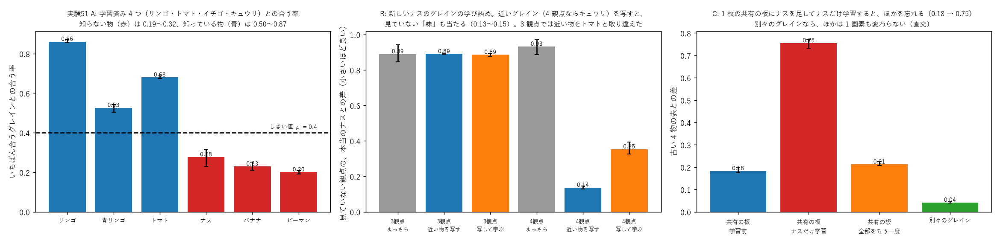
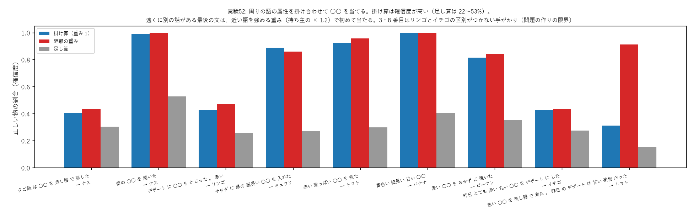

## 実験53: 「〜ではない」の表し方 (exp53_negation.py)

2026-10-28 持ち主「〇〇ではない、を表す方法は結構難しい。問題は範囲の広さなので、0 − 特徴や属性でマイナス差分がいいのかなぁ」。実験52 の 7 物のグレイン、否定を含む文 5 つ × 3 seed。説明は [学び 53](docs/lessons/53_ではないの表し方.md)。

| 否定の手がかりの扱い方 | 正解 | 正しい物の割合 |
|---|---|---|
| 無視 / 読み落とす（肯定として掛ける） | 9 / 15・4 / 15 | − |
| 割り算（p^{−1}） | 7 / 15 | p ≈ 0 の関係ない物が爆発して勝つ |
| **0 − 特徴（持ち主の案、足し算の点数から p を引く）** | **15 / 15** | 24〜40%（1 文だけ 93〜96%） |
| **1 − p（補い = その値に行かなかった残りの光の割合を掛ける）** | **15 / 15** | **54〜95%** |

- **否定は「残りの光の割合 1 − p」を掛ければ、範囲の広さに関係なく表せる**。持ち主の「0 − 特徴」を、基準を全体の明るさ 1 にして掛け算の中に入れた形。光では値の出口と「それ以外」の出口を別々に受ければ作れる。
- 割り算（マイナスのべき）は範囲の広い否定で不安定。

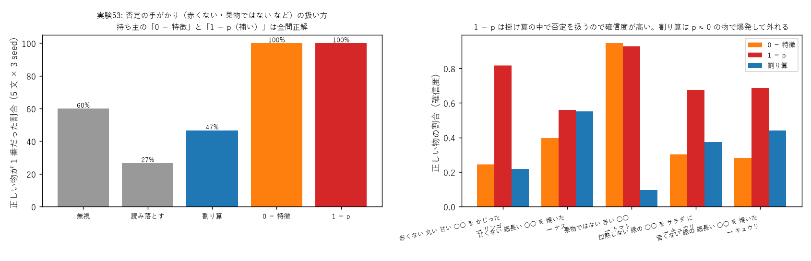

## 実験54: カー効果をどこでかけるか — 場の面と焦点面 (exp54_kerr_focal.py、GPU)

2026-10-28 持ち主の問い（カー効果の語順の失敗は非線形のやり方の問題か、次元数によるのか）。実験38 の課題、段と段の間の非線形を変える。カーの強さは γ × 明るさ / 明るさの平均。3 seed。説明は [学び 54](docs/lessons/54_カー効果を焦点面で.md)。

| 段と段の間 | 当たり | 交差エントロピー |
|---|---|---|
| 1 段（なし） | 22.2〜25.1% | 5.02〜5.04 |
| 明るさを測って出し直す | 26.2〜27.5% | **4.71〜4.72** |
| カー・場の面 γ = 1 / 3 | 25.7〜26.1 / 21.8〜25.3% | 5.07〜5.11 / 5.38〜5.44 |
| **カー・焦点面 γ = 1 / 3** | **26.3〜26.8** / 25.6〜26.6% | 4.99〜5.04 / 5.06〜5.13 |

（2-gram 25.9%・4.54、3-gram 33.9%・4.04）
- **強さを明るさの平均でそろえると、カー効果でも崩れない**（実験35 は 3〜15%）。焦点面（記号が光の点になる所）の方が場の面より少し良く、γ = 1 で 3 seed とも 2-gram 越え。原因は次元数ではなく、記号の表し方（明るさが一様な波）と強さのそろえ方。
- 確率の付け方は「測って出し直す」が最良。3-gram にはまだ遠い。
- 注意: 1 段の器は GPU では 22.2〜25.1%（実験38 の CPU は 23.0%）。seed による差が 3 点ある。
- 実験38b（CPU、文脈 8000 組・3000 回）: 2 段（明るさ）24.8%（実験38 の 3000 組では 27.4%）。3・4 段は計算中。

形態素解析器: Sudachi（SudachiPy 0.7.0・辞書 core、Apache 2.0）を入れた（持ち主 OK）。会話データを語に分けた（非公開フォルダ、延べ約 1600 万語・約 9.4 万種類）。

## 実験55: 会話データから語板を作る（最初の一歩） (exp55_goban_corpus.py、取り出しは非公開フォルダ)

2026-10-28 持ち主「語板作成始めようか」。会話データ 3 つ（Sudachi で語に分けた、非公開）から、名詞ごとに 5 観点（どんな = 形容詞 + 名詞、を・が・で・に = 名詞 + 助詞 + 動詞・形容詞）の値を数える。
対話の番号で 9 割学習・1 割確かめ。上位 400 名詞（形式名詞を除く）、観点ごとの値 47 + その他。語板 = 画素の板 8 列（縦 64）を 400 枚まとめて 600 回、3 seed。説明は [学び 55](docs/lessons/55_会話データから語板.md)。

| 方法 | 交差エントロピー | 上位 1 / 5 | ○○ 当て（18,738 問）上位 1 / 10 |
|---|---|---|---|
| 名詞を見ない | 3.99 | 0.31 / 0.63 | よく出る順だけ 0.04 / 0.18 |
| **語板（3 seed）** | **2.69** | **0.49 / 0.85** | **0.12 / 0.40** |
| 数えた表 | 2.53 | 0.52 / 0.87 | 0.13 / 0.43 |

- **語板は、学習に使っていない会話で数えた表にほぼ追いつく**（名詞を見ないから表までの差の約 9 割）。値に届く光 83〜84%。
- 逆引き: が 降る → 雨・雪、を 食べる → ラーメン・アイス・パン・御飯、を 見る → 動画・映画・アニメ、に 乗る → 電車・調子（調子に乗る）、で 買う → お金・スーパー。
- 語板 1 枚（512 個の位相）はまだ表（240 個）より大きい。圧縮は大規模になってから。

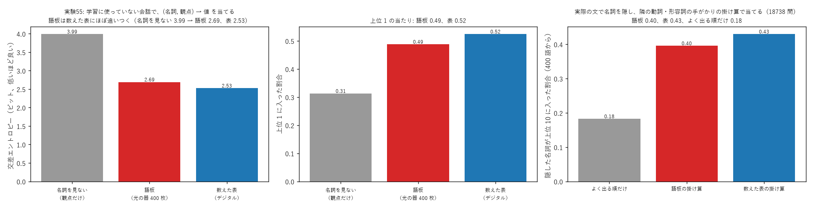

## 実験56: 語板を広げる — まれな名詞・動詞の語板・たどる (exp56_goban_grow.py、部品 src/goban_batch.py)

実験55 の続き。名詞 1200 語（401〜1200 番目 = まれな語、学習用の出現 52〜154 回）、動詞 300 語（観点 = を・が・で・に の名詞、名詞の表を裏返す）。3 seed。説明は [学び 56](docs/lessons/56_語板を広げる.md)。

**途中で見つけた器の上限**: 動詞の観点の値は「その他」（上位 47 個以外）が平均 81%。光の量を保つ器では直交した入口から同じ出口へ届く明るさの和は 1 以下（Σ_v |<e, U u_v>|² ≤ 1）なので、
4 観点すべてで 81% は不可能。語板は 33〜35% しか送れず、2.14 ビットで動詞を見ない 2.00 より悪かった。**「その他」を観点ごとに別の出口にすると 1.51（表 1.47）**。名詞も 2.69 → 2.57（表 2.54）。

| まれな名詞 | ビット |
|---|---|
| 名詞を見ない / 数えた表（+0.5） | 3.74 / 3.02 |
| 語板 まっさら 100 回 / 600 回 | 3.03 / 2.77〜2.78 |
| **語板 近い語板を写して 100 回** | **2.70〜2.71** |
| 表を観点の割合へ寄せて平らに k = 2 / 5 | 2.61 / **2.55** |

- 近い語板を写すと、6 分の 1 の学習でまっさら 600 回より良い。素朴な表には勝つが、**昔からの平滑化（観点の割合へ寄せる）をした表には負ける**（持ち主への途中報告「まれな語では表に勝った」は弱い比べ相手に対してだったので訂正）。
- 動詞: 語板 1.51・表 1.47・平らにした表 1.41・動詞を見ない 2.00。
- たどる（名詞 →を→ 動詞 → 2 乗して組み直す → 動詞 →で→ 名詞）: ラーメン → 食べる → 家・御店、映画 → 見る → テレビ・映画館、服 → 着る・買う → 家・部屋・スーパー、本 → 読む・買う → スマホ・ネット。

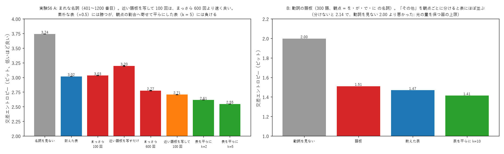

## 実験57・58: 語板を平らにした表に追いつかせる（大規模な計画の段階 1） (exp57_goban_smooth.py・exp58_goban_tuned.py)

実験56 の続き。説明は [学び 57](docs/lessons/57_語板を表に追いつかせる.md)。3 seed。

| | よく出る名詞 | まれな名詞 | 動詞 |
|---|---|---|---|
| 実験56（平らにしない） | 2.57 | 2.70〜2.71 | 1.51 |
| 実験57（目標を平らに k = 5） | 2.56 | 2.64 | 1.50〜1.51 |
| **実験58（+ 値の出口を観点ごとにずらす (r + 9v) mod 47 + 2000 回・学習率 0.03）** | **2.48** | **2.55〜2.56** | **1.45** |
| 平らにした表 | 2.46 | 2.55 | 1.41 |

- **段階 1 の条件（まれな名詞で平らにした表との差 0.05 以内）を満たした**（差 0.01）。よく出る名詞 0.02、動詞 0.03。
- 実験57 では、よく出る名詞が目標にも 0.14 ビット届いていなかった。原因はどの観点でも多い値が同じ出口（番号 0）にあり、光の量を保つ器の上限（同じ出口に集められる光の和 ≤ 1）で取り合っていたこと。出口をずらすと解消（試しで 2.562 → 2.535）。
- まれな名詞は近い語板を写して 300 回で、まっさら 2000 回と同じ。
- 設計の決まり: 目標を平らにしてから学ぶ。多い値を同じ出口に置かない。

材料（非公開フォルダ、MANIFEST に記録）: 青空文庫の本文全体（4,477 作品・約 1.1 億文字、観点の出現 324 万）、Tatoeba 日本語（約 24.9 万文、CC BY 2.0 FR、観点の出現 16 万）、
日本語版ウィキペディア 2023-11（約 139 万記事・約 27 億文字、CC BY-SA 3.0・GFDL）を取得。ウィキペディアは観点を数えている途中。

## 実験59: 語板を数万語に（名詞 2 万・動詞 3000、GPU） (exp59_goban_large.py)

段階 3。材料 = 会話（青空文庫の会話文を除く）・青空文庫の本文全体・Tatoeba・ウィキペディア（観点の出現 約 3900 万、非公開）。実験58 の決まりで、5000 枚ずつ GPU で 2000 回。seed 0・1 を GPU 0・1 で同時に、1 本 9 分。
説明は [学び 59](docs/lessons/59_語板を数万語に.md)。

| | 語板 | 平らにした表 | 語を見ない |
|---|---|---|---|
| 名詞 全部 / 会話の確かめ用 | **2.28 / 2.46** | 2.23 / 2.42 | 3.67 / 3.68 |
| 動詞 全部 / 会話 | **0.84 / 0.94** | 0.79 / 0.90 | 1.15 / 1.17 |

- 2 万語でも語板は表との差 0.03〜0.05。光 94〜95%。○○ 当て（会話の文 13,700 問、2 万語から）上位 10 に 11%（表 11%、よく出る順だけ 3.9%）。
- 逆引きが「まれな言い回し」に引っ張られる（を 見る → 日の目・憂き目、に 乗る → 玉の輿）。語板の明るさは P(値 | 名詞) なので、多い名詞を出すには P(名詞) を掛ける（ベイズ）。
- 会話の確かめ用では、会話だけで数えた表（1.97）が全部まとめた表（2.42）よりずっと良い（分野の偏り）。→ 実験60。

## 実験60: 材料の混ぜ方（分野の偏り、表だけ） (exp60_domain_mix.py)

値の置き方は全部の材料で固定（混ぜ方ごとに決め直すと「その他」の中身が変わって比べられない。最初そうして間違えた）。平らに k = 20。

| 混ぜ方 | 会話の確かめ用 | 全部の確かめ用 |
|---|---|---|
| 会話だけ（k = 5） | 1.97 | 4.63 |
| 全部（重み 1） | 2.41 | 2.22 |
| 会話 × 10 / × 30 / × 100 + ほか | 2.17 / 2.06 / **2.00** | 2.23 / 2.24 / 2.29 |

- **会話の重みを 30〜100 にすると、会話の当たりを会話だけの表に近づけつつ、全部の当たりもほぼ保てる**。
- Web 小説（持ち主が取得、30 条の 4 の範囲で研究のみ、年齢制限つきを除く）は数えている途中。数え終わったら混ぜ方に入れる。

## 実験61: 会話に強い語板（会話 × 100 + ほか、Web 小説を含む、研究のみ） (exp61_goban_mix.py、GPU 2 枚)

実験60 の混ぜ方で名詞 2 万語の語板。値の置き方は全部の材料で固定（実験60 と同じ）。seed 0・1 を GPU 0・1 で同時に（表づくり 47 分 + 学習 3 分）。

| | 語板（会話 × 100） | 混ぜた表（会話 × 100） | 全部重み 1 の表 |
|---|---|---|---|
| 会話の確かめ用 | **2.21** | 2.16 | 2.47 |
| 全部の確かめ用 | 2.16 | 2.10 | **2.07** |

- **会話の確かめ用で、全部重み 1 の表より 0.27 ビット良い語板になった**（混ぜた表との差 0.05）。全体の当たりは 0.08 だけ下がる。
- 逆引きに名詞の多さを掛ける（P(名詞 | 値) ∝ P(値 | 名詞) P(名詞)）と、まれな言い回しに引っ張られなくなった: を 見る → 様子・姿・顔・夢・映画・動画、
  に 乗る → 調子・車・肩・話・勢い・相談・タクシー・電車、どんな 優しい → 手・言葉・声・人・心・笑顔。
- Web 小説を含むので、この語板は研究・確かめ専用（公開しない）。

## 実験62: 自覚グレインの第一歩（確信度の較正） (exp62_self_awareness.py)

持ち主のアイディア ①。会話の ○○ 当て（400 語、18,738 問、正解率 13%）で、自覚の手がかりが当たり・外れを見分ける力（AUROC）:
1 番の割合 0.77、2 組の語板の一致 0.75、候補の広がり 0.74、1 番と 2 番の差 0.70、手がかりの明るさ 0.52。
自信の高い 10% / 20% / 50% だけ答えると正解率 43% / 33% / 22%（全部 13%）。2 組の語板は 96% の問題で一致（個性が小さい）。説明は [学び 62](docs/lessons/62_自覚と因果の第一歩.md)。

## 実験63: 相関から因果へ（緑のトマトと色を塗ったトマト） (exp63_correlation_to_cause.py)

持ち主のアイディア ③。8 つの状態のグレイン（リンゴ・トマト・イチゴ・バナナ × 完熟 / 未熟、青いリンゴは緑でも完熟）、3 seed。
- 4 組の差分（明るさの引き算）で、味の差と一緒に変わる度合い: 色 0.84〜0.85、熟し具合 0.96〜0.97（トマトだけでは 0.95〜0.98 対 0.99〜1.00 で区別できない）。不確実さ: 色 0.61〜0.64、熟し具合 0.26〜0.28。
- 最小二乗（Δ味 ≈ a·Δ色 + b·Δ熟）: **色 0.01〜0.05、熟し具合 0.61〜0.67**。リンゴの組（色だけ変わり味は同じ）が色の効き目を打ち消す（交絡の除去）。
- 「赤いトマトを緑に塗ったら？」（介入）: **甘い 0.46〜0.50・酸っぱい 0.50〜0.53（もとの赤いトマト 0.50・0.50）**。相関だけ（緑のトマトの味）は酸っぱい 0.80〜0.81。
- 最小二乗の計算はデジタル。光でやる形は次の課題。
