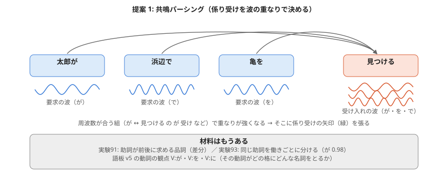
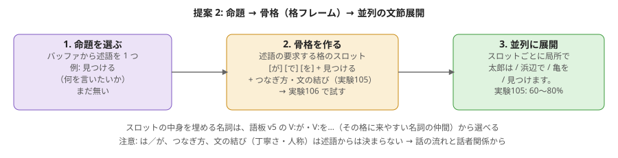
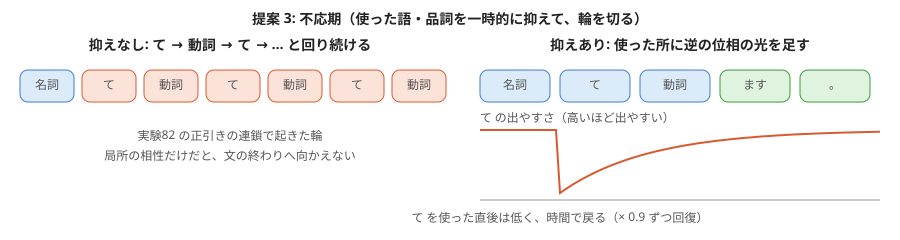
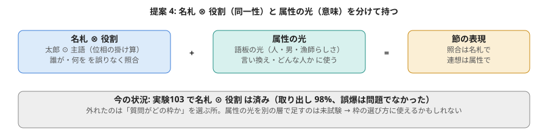
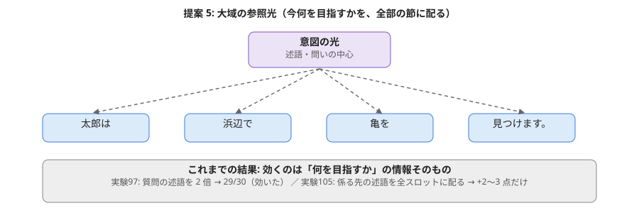
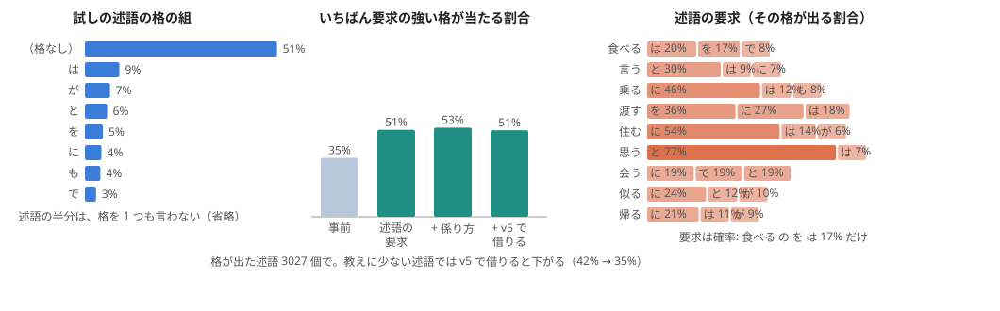

# 別の AI の助言（2026-11-02）を読み解く: 5 つの提案と、これまでの実験との対応

持ち主が別の AI に NOTES.md と実験の文書を読ませて得た助言を、図にして整理する。各提案について「何をするのか」「これまでの実験で分かっていること」「次に試すこと」を書く。
図の作り方: tools/fig_advice_review.py。

## 助言が指摘した急所（5 つ）

| 急所 | 当たっているか | 根拠 |
|---|---|---|
| 1. 文の木を GiNZA に頼っていて、光の器で木を組む仕組みが無い | 当たっている | 実験87〜102 の文章樹はすべて GiNZA の文節の木の上に作っている。実験90・92 は「係り方の種類」を当てるだけで、矢印は張れない |
| 2. 品詞の列をそのまま次へつなぐ（マルコフ連鎖）だけでは文法にならない | 当たっている | 実験84（前の行の品詞 → 次の行の品詞）は「何も見ない」予想にも届かなかった |
| 3. 属性の光（意味の近さ）と名札（同じ語かどうか）が混ざる | 半分 | 実験81 で属性の光の融合は名札のキャッシュに大きく負けた。ただし実験103 では名札 ⊙ 役割 を掛け算で分けて持ち、取り出しは 98% 正しかった |
| 4. 生成で同じ所を回り続ける・下からの探索が迷う | 当たっている | 実験82 の正引きの連鎖で「て → 動詞 → て …」の輪。実験89 の「下から」は 10/30 |
| 5. 骨格（述語と格）を作る 1 段目が無い | 当たっている | 実験105 は骨格を「正解から」与えていた。骨格を作る仕組みはまだ無い |

## 提案 1: 共鳴パーシング（GiNZA を外す）

- **何をするか**: 助詞の付いた名詞は「右の述語へ、この格で係りたい」という**要求の波**を出す。動詞は「が・を・に…を受け入れる」という**受け入れの波**を出す。左から並べた語の間で、波の周波数が合う組が強く重なる。そこに係り受けの矢印を張る。決まりの分岐ではなく、重なりの強さで木ができる。
- **材料**: 実験91 で、助詞が前後に何を求めるかを差分として取り出せた。実験93 で、同じ助詞を働きで分けられる（が 0.98・から 0.90・の 0.90）。語板 v5 の動詞の観点 V:が・V:を… は、その動詞がどの格を受けるかを持っている。
- **見立て**: GiNZA を外す本命。測り方ははっきりしている（GiNZA の係り先と同じ所に矢印を張れた割合）。難しいのは、1 つの述語に同じ格が 2 つ来ないようにすることと、連体修飾（「いじめられている亀」）のように名詞へ係る節。
- **次**: 実験107 の候補。

## 提案 2: 命題 → 骨格 → 並列の展開

- **何をするか**: (1) 言いたい述語をバッファから 1 つ選ぶ。(2) その述語が要求する格のスロット（[が] [を] + 食べる）を骨格にする。(3) 各スロットを実験105 の方法で局所的・並列に文節へ展開する。
- **見立て**: 実験84 の「品詞の列を直接つなぐ」失敗を迂回できる良い筋。ただし実験105 で分かったとおり、骨格には格だけでなく「つなぎ方（て・ので…）」と「文の結び（ます・た・か…）」が要る。は／が の選び分けは述語からは決まらず、話の流れで決まる。文の結びは、言結いの最初の目標の話者関係（人称・丁寧さ）が決める情報。
- **次**: 実験106（骨格生成器のミニ実験）。述語 1 つから、どの格のスロットを作るかを決め、実際の文と比べる。結果は下に書く。

## 提案 3: 不応期（輪を切る）

- **何をするか**: 一度使った語・品詞に、逆の位相の光（または 1 − p の補光、実験53）を足して、しばらく出にくくする。時間とともに戻す。生き物の神経の「不応期」と同じ考え。同じ所へ戻る輪が消え、文の終わりへ向かう流れが強くなる。
- **見立て**: 軽い工夫で、実験82 の輪をすぐ試せる。実験81 の「キャッシュ中に出た語ほど出やすくなる」（持ち主の非線形の案）とは逆向きの働き。両方を、語の種類で使い分ける形になりそう（内容語は覚えて出やすく、機能語は使ったら抑える）。
- **次**: 実験82 の連鎖に入れて、輪が切れるか・文の終わりまで行くかを数える。

## 提案 4: 名札 ⊗ 役割 と 属性の光 を分けて持つ

- **何をするか**: 節の表現 =（語の名札 ⊙ 役割）+ 属性の光。誰が・何を の照合は名札で、言い換え・どんな人か は属性の光で、と役割を分ける。
- **見立て**: 前半は実験103 で済んでいる（取り出し 98%）。助言は「これで誤爆が無くなる」と言うが、実験103・104 で外れたのは誤爆ではなく「質問がどの枠か」を選ぶ所だった。属性の光を別の層として足し、枠の選び方（質問と枠の重なり）にだけ使うのは、まだ試していない。

## 提案 5: 大域の参照光

- **何をするか**: 「この文で何が起きるか（述語の意図）」の光を、すべての節に背景として配る。途中の名詞や修飾の節がそれと干渉して、文全体の筋を保つ。
- **見立て**: 実験96（木の側に固定の重み → 悪化）と実験97（質問の側で述語を 2 倍 → 29/30）の読み方は、助言のとおり。ただし実験105 で係る先の述語を全スロットに配っても +2〜3 点だった。効くのは「何を目指すか」という情報そのもので、光で配るという方法ではなさそう。提案 2 の 1 段目（命題を選ぶ）と同じ話になる。

## 順番

1. 実験106: 骨格生成器（提案 2 の 2 段目）。
2. 実験107: 共鳴パーシング（提案 1）。
3. 不応期を実験82 の連鎖に入れる（提案 3）。

## 実験106 の結果: 骨格生成器（述語 → 格のスロット）

作り方: experiments/exp106_skeleton_generator.py。材料: 会話と青空文庫 4 万文を GiNZA で解析した述語 6.2 万（Web 小説は使わない）。

- **述語の半分（51%）は、格を 1 つも言わない。** 会話では主語も目的語もよく省かれる。「格フレームで骨格が 1 発で決まる」とはいかない。
- **要求は「必ず」ではなく「割合」。** 食べる の を は 17%、乗る の に は 46%、思う の と は 77%。はっきりした要求を持つ述語と、持たない述語がある。
- いちばん要求の強い格が、実際に出た格に入る割合（格が出た 3027 述語）: 事前 35% → 述語の要求 51% → + 係り方 53%。述語の要求は効く。
- 格の組が丸ごと一致: 事前 51% → 最良 55%（天井の目安 74%）。省略が多いので、ほとんど「格なし」を当てている。
- 教えに少ない述語を、語板 v5 の動詞の光が近い語から借りると、かえって下がった（42% → 35%）。近い語は 嵌める → 着る・履く・巻く のように良いものもあるが、撫でる → 組む・悩む のように外れるものも多い。v5 の動詞の光は「どんな名詞をとるか」は持っていても、「その格を言うか」は持っていない。

**分かったこと:** 骨格の 1 段目は、述語の格要求だけでは決まらない。どの格を言うか（省略するか）は、話の流れ（もう話題に出た人や物は言わない）で決まる。これは実験81 のキャッシュ（話に出た語の名札）と組み合わせる所。
また、この格の割合も GiNZA の解析から数えている（手の部品）。共鳴パーシング（実験107）が自分で係り受けを張れれば、ここも自分の解析から数え直せる。
