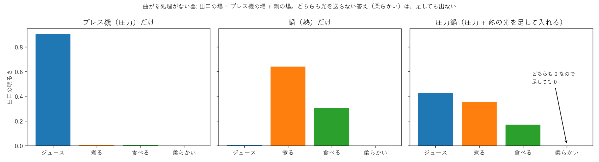
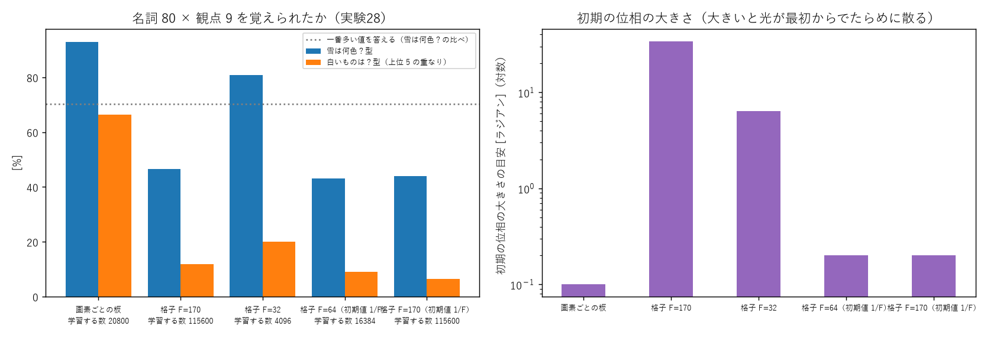

# 説明: 重ね合わせの限界と、規模を広げたときの板（2026-10-27、持ち主の依頼）

持ち主「これの説明を詳しくしてくれる？」「可能なら図付で説明を乗せたほうが後々の人が楽できるかも」。学び 32 と学び 28〜30 で短く書いた 2 点を、図と小さな例で説明する。

## 1. 曲がる処理のない器は、答えを「足し合わせる」ことしかできない

### 何が起きるか

曲がる処理のない光の器（位相の板 + 回折）は、**線形**（重ね合わせが成り立つ）である（学び 09 で、重ね合わせの差が 10⁻⁶ と確かめた）。
道具を要素の光の重ね合わせで入れると（学び 32: 圧力鍋 = 圧力の光 + 熱の光）、出口の光の場も、

> 出口の場（圧力鍋）= 出口の場（圧力だけ）+ 出口の場（熱だけ）

になる。出口の各答え（ジュース・煮る・…）の明るさは、この場の大きさの 2 乗。

### だから、どちらも出さない答えは出ない

「柔らかい」の所の場が、圧力だけでも 0、熱だけでも 0 なら、足しても 0 のまま。明るさも 0。
つまり、**圧力鍋の答えは「プレス機の答え」と「鍋の答え」の中からしか選べない**。学び 32 で、圧力鍋 × リンゴが「ジュース 46% + 煮る 36%」になったのは、このため。

（図は小さな例。器を 4 つの答えへの複素数の表として作り、プレス機はジュースへ、鍋は煮る・食べるへ光を送る。柔らかいへは誰も送らない。圧力鍋の出口は、ジュース・煮る・食べるに分かれ、柔らかいは 0。）

細かく言うと、場の足し算なので干渉の分（2 つの場が同じ答えに少しずつ光を送っていると、強め合ったり弱め合ったりする）はある。それでも「どちらも 0 の所は 0」は変わらない。

### 「圧力 + 熱だからこそ柔らかくなる」には

これは、2 つの要素が**同時にあるときだけ**出る答え。表計算（線形）で書けない「組み合わせ」で、学び 12・14 の「どちらか片方だけ」や、学び 29・30 の「この 2 文字の組のあと」と同じ種類の問題。

- 曲がる処理（カー効果など）を入れると、明るさに応じて光の向きが変わる。2 つの要素の光がそろって明るいときだけ、光の行き先が変わる、ということが起きうる（学び 14 で、色を分けた入力をカー効果で混ぜて「どちらか片方だけ」を 100% 解いた）。
- 周波数で見ると、曲がる処理は「差と和の周波数」を新しく作る（学び 05）。2 つの要素の周波数の和の所に、どちらにもない答えを置ける。

次の一手の候補: 道具の要素を別々の色で入れ、カー効果で混ぜて、「圧力 + 熱 → 柔らかい」を覚えさせる。

## 2. 規模を広げたときは、画素ごとの板

### 何が起きたか（実験28: 名詞 80 × 観点 9、縦 1040 画素・列 20）

| 板の作り方 | 学習する数 | 初期の位相の大きさ（目安） | 雪は何色？型 | 白いものは？型 |
|---|---|---|---|---|
| **画素ごとの板**（1 画素ごとに自由な位相。回折の深層ネットワークと同じ） | 20,800 | 0.1 ラジアン | **92.9%** | **66.4%** |
| 格子 F = 32（縦横の sin・cos の周波数 32 まで） | 4,096 | 約 6 ラジアン | 80.9% | 20.0% |
| 格子 F = 170 | 115,600 | 約 34 ラジアン | 46.5% | 11.8% |
| 格子 F = 64（初期値を 1/F に） | 16,384 | 0.2 ラジアン | 43.2% | 9.1% |
| 格子 F = 170（初期値を 1/F に） | 115,600 | 0.2 ラジアン | 43.9% | 6.4% |
| 比べ: 観点ごとに一番多い値を答える | − | − | 70.3% | − |

### 試した見立てと、その結果

1. **見立て 1「格子の周波数の範囲が、場に対して狭すぎる」**: F = 32 では、縦 1040 画素のうちの周波数 32 まで（場の約 3%）しか模様を作れない。小規模（学び 21: 縦 100 に周波数 16 = 16%）ではうまくいっていた。→ F = 170（場の 16%）にしても良くならなかった。**外れ**。
2. **見立て 2「初期の位相が大きすぎる」**: 格子の値は 4F² 個の強さを足して作るので、初期値 0.1 でも F が大きいと位相が数十ラジアンになり、光が最初からでたらめに散る。→ 初期値を 1/F にして位相を 0.2 ラジアン程度にそろえても、F = 64・170 は良くならなかった。しかも、初期の位相が約 6 ラジアンと大きい F = 32 の方が、まだ良かった。**外れ**（初期値の大きさは主な原因ではない）。
3. 残る見立て（未確認）: 格子は、縦の sin・cos の周波数 × 横の sin・cos の周波数の掛け算の形しか作れない（縦と横が分かれた形の重ね合わせ）。画素ごとの板は、どんな形でも作れる。大きな課題では、この形の自由が足りないのかもしれない。また、F を大きくすると学習する数が増えて学習率に敏感になる（学び 11 の失敗と同じ）可能性もある。

### 結論（いまのところ）

- 規模を広げるときは、**画素ごとの板**（回折の深層ネットワークと同じ作り方）を使う。学習する数は「縦の画素 × 列の数」で、今回 2 万 800 個（80 KB）。
- 小規模では、周波数の格子（持ち主の最初の案）でもよく、学習する数が少なくて済む。
- なぜ格子が大きな課題で学べないのかは、まだ分かっていない。
