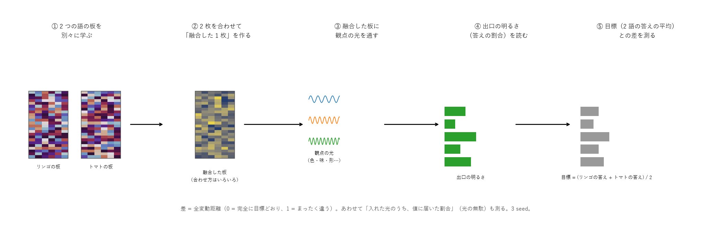
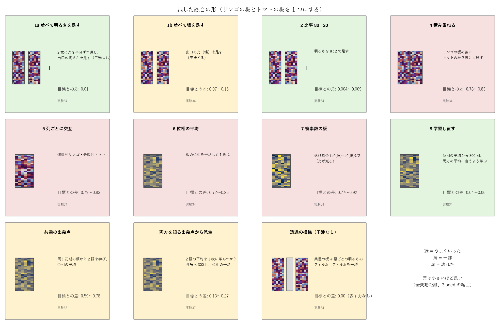

# 融合の試験 — どういう手順で、何を試して、何が分かったか

2026-10-29 作成。持ち主「融合って今どういう手順で試験してた？細かく順番に、図入りで説明してくれる？」への答え。
関係する実験: 31・34・36・37・44・64（数字の正本は NOTES.md）。

## 1. そもそも「融合」とは

**2 つの語板（例: リンゴの板とトマトの板）を、1 つにまとめること**。
まとめた板に光を通すと、2 つの語の答えを合わせた答え（例: リンゴとトマトの「間」の物の属性）が出てほしい。

なぜ大事か:
- 似た語をまとめて、板の数（記憶の量・計算）を減らせる。
- 「リンゴっぽくて、少しトマトっぽい物」のような新しい物を、学習なしで作れる。
- 逆に、まとめた板から片方を引けば「違い」が取り出せる（差分、実験44）。

## 2. 試験の手順（どの実験も同じ流れ）

1. **2 つの語の板を別々に学ぶ**。小さな表（実験21: 物 × 観点 × 値、例「リンゴ・色 → 赤 70%・緑 20%・黄 10%」）を使い、リンゴの板とトマトの板を、それぞれの答えが出るように学習する（1500 回）。
   板は「単語ごとの格子」（実験31、1 枚 1 KB）。
2. **2 枚を合わせて「融合した 1 枚」を作る**。合わせ方はいろいろ（下の 3 章）。ここでは学習しない（形 8 だけは少し学習し直す）。
3. **融合した板に観点の光を通す**。観点（色・味・形・食べ方・分類）ごとに、その観点の周波数の光を入れる。
4. **出口の明るさを読む**。値（赤・甘い・丸い…）の場所の明るさを、割合に直す（= 融合した板の答え）。
5. **目標と比べる**。目標 = 2 つの語の答えの平均（比率の形では 80 : 20 の重み付き平均）。
   差は全変動距離（2 つの割合の違いの大きさ。0 = 完全に目標どおり、1 = まったく違う）。あわせて「入れた光のうち値に届いた割合」（光の無駄）も測る。
6. これを **3 seed**（初期の板のでたらめさを変えて 3 回）で繰り返し、範囲を出す。

## 3. 試した形と結果

| 形 | どう合わせるか | 目標との差 | 実験 |
|---|---|---|---|
| 1a 並べて明るさを足す | 2 枚を並べ、光を半分ずつ通して、出口の**明るさ**を足す（干渉しない） | **0.006〜0.014** | 34 |
| 1b 並べて場を足す | 出口の**光そのもの（場）**を足す（干渉する） | 0.07〜0.15 | 34 |
| 2 比率 80 : 20 | 明るさを 8 : 2 で足す | **0.004〜0.009** | 34 |
| 3 差分 | トマトの側の光を半周ずらして足す（引き算） | 差との相関 0.54〜0.59 | 34 |
| 4 積み重ねる | リンゴの板の列のあとに、トマトの板の列を続けて通す | 0.78〜0.83 | 34 |
| 5 列ごとに交互 | 偶数列はリンゴ、奇数列はトマト | 0.79〜0.83 | 34 |
| 6 位相の平均 | 2 枚の板の位相（光を遅らせる量）を平均して 1 枚に | 0.72〜0.86 | 34 |
| 7 複素数の板 | 透け具合を (e^{iA} + e^{iB}) / 2 にする（光が減る） | 0.77〜0.92 | 34 |
| 8 学習し直す | 位相の平均から始めて、2 語の平均に合うよう 300 回だけ学習 | **0.04〜0.06** | 34 |
| 共通の出発点 | 同じ初期の板から 2 語を学び、位相の平均 | 0.59〜0.78 | 36 |
| 両方を知る出発点から派生 | まず 2 語の平均を 1 枚に学び、そこから各語へ 300 回。位相の平均 | 0.13〜0.27 | 37 |
| 透過の模様（干渉なし） | 共通の板 + 語ごとの明るさのフィルム。フィルムを平均 | **0.00**（ただし表す力がほぼない） | 64 |

（形 1〜8・共通・派生はリンゴとトマトの 2 語、3 seed。透過の模様は会話の名詞 400 語のうち 300 組、2 seed）

引き算（実験44）も同じ流れで、目標を「リンゴの答え − トマトの答え」や「融合からリンゴを引いてトマトに戻す」にして試した。
明るさで引くのは確実（相関 0.99〜1.00、戻す差 0.05〜0.07）、板の位相で引くのは失敗。

## 4. 何が分かったか

1. **板を 1 枚に混ぜる形（4〜7）は、どれも壊れる**。光の器の答えは、板の位相に対して足し算になっていない（位相は e^{iφ} の形で効き、何列も重なって通る）ので、
   板を混ぜても答えは混ざらない。
2. **出口の明るさで足す形（1a・2）は確実**。明るさは足し算の世界なので、答えがそのまま足される。比率もそのまま効く。
   場で足す（1b）と干渉で少しゆがむ。並べるときは干渉させない（別の色・別々に受ける）。
3. **2 枚が「同じ谷」にいれば、位相の平均でも少し保てる**（派生 0.13〜0.27）。学習は板の位相の空間で「答えが合う谷」を探す動きで、
   別々に学んだ 2 枚は別の谷に落ちる。両方を知る 1 枚から少しだけ動かせば、2 枚は同じ谷の中にいて、平均しても谷から出ない。
4. **混ぜやすさ（足し算）と表す力（干渉）は、同じ所で両立しにくい**（実験64）。語の知識を明るさのフィルムに置くと、混ぜるのは完全になるが、
   干渉で光を 1 か所に集められず、鋭い答えが作れない。

**今の基本の形: 「干渉で表し（語ごとの位相の板）、明るさで混ぜる（出口で足す）」**。板は別々に持ち、使うときに光で混ぜる。
1 枚にまとめたいときは、少しだけ学習し直す（形 8）か、両方を知る出発点から派生させておく。

## 5. 残っている問い（持ち主の案を待っているところ）

- 1 枚の板のまま混ぜても壊れない非線形・置き方はあるか（SN2-Parts-2D に掲示板で相談中、2026-10-29）。
- 何枚まで「派生 + 位相の平均」で混ぜられるか（3 枚以上）。
- 知性樹の節の「融合した板」（明るさの平均）を、1 枚の位相の板として持てるか。
