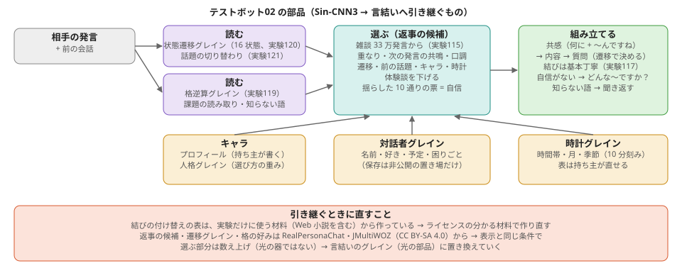

# 成果のまとめと、言結い（Project_Kotoyui）への引き継ぎ（2026-11-02）

持ち主: 「プロジェクトの内容が学習器の研究から少し外れつつあるから、いったん現状の成果をまとめて、言結いにバトンタッチしようか？」
ここでは Sin-CNN3 の 2026-11-02 までの成果（主に実験99〜121 とテストボット02）をまとめ、言結いに渡すものと、渡すときに直すことを書く。
それより前のまとめは [一時まとめ（実験55〜77）](summary_20261031.md)、数字の正本は [NOTES.md](../NOTES.md)。

## 1. 何が分かったか（研究として）

| 分かったこと | 実験 | 文書 |
|---|---|---|
| 構造と時の順は、ホログラフィックに 1 枚の光に畳める（取り出し 98%、次の出来事 19/19）。弱いのは「質問がどの枠か」を選ぶ所 | 103・104 | [holographic_story_103.md](holographic_story_103.md)・[holographic_select_104.md](holographic_select_104.md) |
| 骨格 → 文節の展開は局所で足りる。骨格には格・つなぎ方・文の結びが要る | 105 | [skeleton_expand_105.md](skeleton_expand_105.md) |
| 述語の半分は格を省略する。骨格は述語だけでは決まらない | 106 | [advice_review_20261102.md](advice_review_20261102.md) |
| GiNZA の木を正解にした自己学習は、自分の癖を強め合って育たない | 107・108 | [resonance_parser_107.md](resonance_parser_107.md) |
| **物差しを「何が当たるようになるか」に変えた**。穴埋めで学ぶと人の木なしで差の 45% を埋める | 109・110 | [task_yardstick.md](task_yardstick.md) |
| 往復（混ぜた語を元に戻す）で語順を学べる。英語でも同じように働く。区切りも文字だけから学べる（英語 F1 0.79） | 111〜114 | [reverse_use.md](reverse_use.md) |
| 返事を 10 択で選ぶ物差しで、数え上げの共鳴だけで 66%。同じ会話の中の流れは語の袋では見えない | 115・116 | [testbot02.md](testbot02.md) |
| 結びの付け替え（丁寧 ↔ くだけた）、見えない会話（滑り出し）、格逆算（消した格を 46%）、状態遷移グレイン（ラベルなしで 16 状態）、話題の切り替わり（AUC 0.83） | 117〜121 | [testbot02.md](testbot02.md) |

いちばん大きいのは、**「構造は、それで何が当たるようになるかで測る」**という物差しに変えたこと。
穴埋め・往復・返事選びは、答えが材料そのものなので、自分の癖を強め合わずに育ち、言語にも依らない。

## 2. 言結いに渡すもの（テストボット02 の部品）

| 部品 | 中身 | 置き場 | 材料とライセンス |
|---|---|---|---|
| 返事の候補と選び方 | 雑談の発言 33 万、語の重なり・次の発言の共鳴（PMI）・口調 | tools/testbot02.py、experiments/exp115 | RealPersonaChat（CC BY-SA 4.0）|
| 状態遷移グレイン | 発言の形 → 16 状態、状態 → 次の状態 | experiments/exp120、非公開 models/transition_grain_120.pt | RealPersonaChat・JMultiWOZ（CC BY-SA 4.0）|
| 格逆算グレイン | 動詞の格の好み P(名詞 \| 動詞, 格) | experiments/exp119、非公開 models/case_frames_119.pkl | 同上 |
| 話題の切り替わり | 前の話題とのつながりが弱い → 切る | experiments/exp121 | 同上（共鳴の表）|
| 結びの付け替え | 中身 + 尾、印を保って丁寧さだけ替える | experiments/exp117 | **実験だけに使う材料（Web 小説を含む）** |
| キャラクタ | プロフィール（事実・自己紹介）と人格グレイン（選び方の重み） | data/characters/ | 持ち主が書いたもの（重みの初期値は Claude） |
| 対話者グレイン | 相手の名前・好き・予定・困りごと・口調 | tools/testbot02.py（Interlocutor） | 相手の発言 = 個人の情報。**非公開の置き場だけ** |
| 時計グレイン | 10 分刻み → 時間帯・月・季節 | tools/clock_grain.json | Claude が置いた表（持ち主が直せる）|

動かし方: `python tools/testbot02.py --chat --user=名前`（`--now=2026-12-24T21:30` で時刻を決めて試せる）。

## 3. 渡すときに直すこと
1. **結びの付け替えの表を、ライセンスの分かる材料で作り直す**（今は実験だけに使う材料から）。
2. 返事の候補・遷移グレイン・格の好みは CC BY-SA 4.0 の会話から作っている。配るときは表示と同じ条件での再配布。
3. 選ぶ部分は数え上げ（光の器ではない）。言結いのグレイン（光の部品）に 1 つずつ置き換えていく。物差し（10 択の返事選び・穴埋め・往復）はそのまま使える。
4. 時計グレインの表・人格グレインの重みの初期値は Claude が置いたもの。持ち主が直すか、日付つきの文章・会話の差分から学んで置き換える。

## 4. 残っている課題
- 返事の中身が「別の人の体験談」になりやすい（決まりの一覧で下げているが、すり抜ける）。状態遷移グレインの「自分の話」の状態で見分けたい。
- 同じ会話の中の流れ（38%）。問いの種類 → 答えの種類の対応が要る。
- 前の困りごとを中身だけ取り出して聞く（今は発言の引用）。
- 人格グレインを会話の差分（どの返事で会話が続いたか・👍👎）で少しずつ動かす。
- 天気（ネット）はまだ。苗を配る（サーバー・👍👎・同意）の準備。

## 5. Sin-CNN3 に残る研究
語板（v3〜v5）、物差しを変えた後の構造の育て方（穴埋め・往復・区切り）、ホログラフィックな物語の光。言結いの部品を作るときの土台として、ここで続ける。
