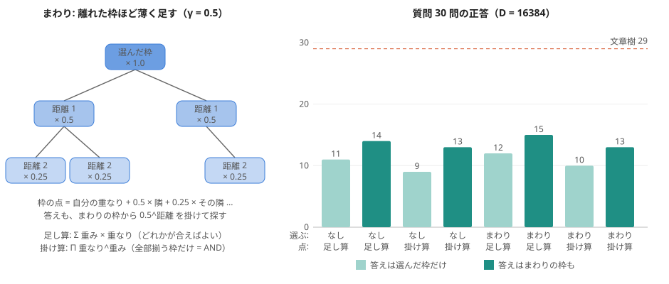

# ホログラフィックな物語の光で「どの枠か」を選ぶ: まわりと掛け算（実験104、浦島太郎）

作り方: experiments/exp104_holographic_select.py（実験103 の光をそのまま使う）。図: [figs/holographic_select_104.svg](figs/holographic_select_104.svg)

## 何をしたか（持ち主「バッファと品詞の重み付けで同じ様に掛け算と離れるほど重みを下げるやり方はどうかな」2026-11-02）
- 手がかりの語ごとに、80 枠それぞれとの重なり m[枠, 語] を出す（物語 ⊙ 鍵^-1 と 手がかりの光。全部の枠を同時に計算できる）。
- **まわり**: 枠の点に、同じ文の木で隣の枠を 0.5 倍、その隣を 0.25 倍…と足す（ほかの文は 文の差 × 3 段の距離）。文章樹の「まわりの光」と同じ考え。
- **点の付け方**: 足し算 = Σ 重み × 重なり、掛け算 = Π 重なり^重み（全部の手がかりが揃う枠だけが勝つ = AND）。重みは 述語 2・ほか 1（実験97）。
- **答えを探す枠**: 選んだ枠だけ / まわりの枠も（距離 2 まで、0.5^距離 を掛ける）。

## 結果（質問 20 + 使っていない 10）

| D | 選ぶ: まわり | 点 | 答え: 選んだ枠だけ | 答え: まわりも |
|---|---|---|---|---|
| 4096 | �Ȃ� | �����Z | 7 + 3 = 10 | 8 + 5 = 13 |
| 4096 | �Ȃ� | �|���Z | 5 + 1 = 6 | 5 + 4 = 9 |
| 4096 | ���� | �����Z | 6 + 4 = 10 | 8 + 5 = 13 |
| 4096 | ���� | �|���Z | 5 + 3 = 8 | 8 + 4 = 12 |
| 16384 | �Ȃ� | �����Z | 8 + 3 = 11 | 10 + 4 = 14 |
| 16384 | �Ȃ� | �|���Z | 7 + 2 = 9 | 9 + 4 = 13 |
| 16384 | ���� | �����Z | 8 + 4 = 12 | 11 + 4 = 15 |
| 16384 | ���� | �|���Z | 7 + 3 = 10 | 9 + 4 = 13 |

## 分かったこと
1. いちばん良いのは「まわりあり・足し算・答えもまわりから」で 15/30（実験103 は 12）。少し良くなったが、文章樹（29/30）にはまだ遠い。
2. **掛け算（AND）は足し算より悪い。** 質問の手がかりの語が、物語の同じ枠に全部は入っていないため（「太郎は浜辺で何を見つけた」の 浜辺 は、GiNZA の木では「いじめられている」の枠にある）。1 つでも欠けた枠は点が 0 近くになり、正しい枠が落ちる。
3. 答えが「選んだ枠」に入っていたのは 30 問中 16〜17、距離 1 以内まで広げると 23〜24、物語のどこかには 28。まわりから答えを探すのは効く。
4. 残りの外れは、ホログラフィックかどうかより、質問の手がかりと枠の役割の合わせ方（受け身・「〜のは誰」・「どんな N」）の問題。文章樹ではここを手の決まりと学んだフィルターで補っていた。
