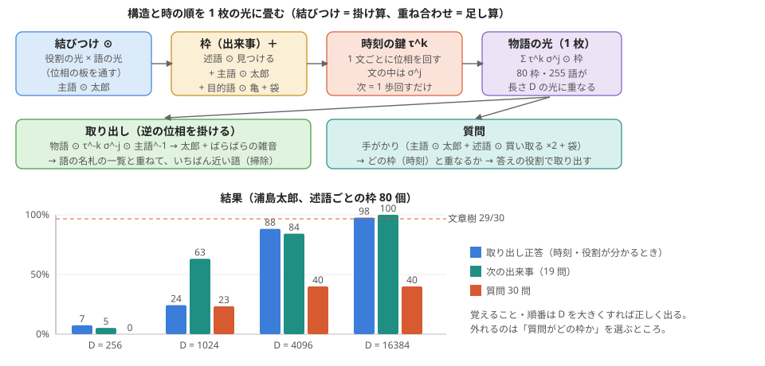

# 構造と時の順をホログラフィックに 1 枚の光に畳む（実験103、浦島太郎）

作り方: experiments/exp103_holographic_story.py。図: [figs/holographic_story_103.svg](figs/holographic_story_103.svg)

## 考え（持ち主の問い「構造や時系列をホログラフィックな処理で行う手段のアイディアがない」2026-11-02）

木を枝ごとに別々に持つ代わりに、**構造そのものを 1 枚の光に重ねる**。
- 語・役割・時刻を、長さ D の「位相だけの光」で表す（各点の明るさは 1、位相がでたらめ = 位相の板そのもの）。
- **結びつけ**: 役割 ⊙ 語（点ごとの掛け算 = 位相の足し算 = 板を通すこと）。主語 ⊙ 太郎 は、主語とも太郎とも似ていない新しい光になる。
- **枠（出来事）**: 子を持つ節ごとに 1 枠。中心の語を 述語 ⊙、子の節を 役割 ⊙、親の節を 係り先 ⊙ で結び、足し合わせる。役割なしの「袋 ⊙ 語」も足す。
- **時の順**: 文 k の鍵 τ^k、文の中の j 番目の枠の鍵 σ^j を掛けてから足す。物語 = Σ τ^k σ^j ⊙ 枠。「次」は位相を 1 歩回すだけ。
- **取り出し**: 物語 ⊙ τ^-k σ^-j ⊙ 役割^-1（逆の位相）で、その語 + ばらばらの雑音が出る。語の名札の一覧と重ねて掃除する。
- 並列: どの操作も点ごとの掛け算・足し算と重なり（内積）だけなので、全部の枠・全部の時刻を同時に調べられる。

## 分かったこと

1. **覚えることと順番は、ホログラフィックにできる。** 255 語（80 枠）を 1 枚の光に重ねても、時刻と役割が分かれば D = 16384 で 98%、D = 4096 で 88% を、約 500 語の中から正しく取り出せた。
   「次の出来事」は位相を 1 歩回すだけで 19/19（D = 16384）。木を辿らずに時の順が扱える。
2. **質問の答えは 12/30 で、文章樹（29/30）にずっと届かない。** 外れのほとんどは「質問がどの枠か」を選ぶところ（枠を別々に持って重ねても、同じ所で外れた = 重ねたせいではない）。
   文章樹は、枝葉の光・まわりの光・介入（役割の合い）で、この選び方を細かく作り込んでいた。ここではまだ素朴な重なりだけ。
3. 文の枠（1 文 = 1 出来事）は、同じ役割が 2 つある文（持ち主が 2 つ）で取り出しが混ざり、84% で止まる。枠を述語ごとに分けると直る。
4. D が小さいと（256・1024）雑音で崩れる。必要な D は、重ねる語の数の 20〜60 倍ほど。

## 次の手（候補）
- 枠の選び方を、文章樹の「まわりの光」と同じ考えで作る（枠の光に、親の枠・根の枠の光を薄めて足す）。
- 時刻の鍵を、語板の観点周波数のように「周波数のずれ」で作り、光学の板の上で試す（今は計算だけ）。
- 長い文章では、重ねる語が増えるので、段落ごとの光 + 段落の鍵 の 2 段にする。

## 結果

| 出来事の作り方 | 光の長さ D | 質問 20 | 使っていない 10 | 次の出来事（19） | 時刻と役割が分かったときの取り出し正答 | 取り出しの重なり（正しい語 / ほかの語の最大） |
|---|---|---|---|---|---|---|
| 文（20 個） | 256 | 1 | 3 | 8 | 35%（114 語） | 0.097 / 0.119 |
| 文（20 個） | 1024 | 7 | 4 | 17 | 80%（114 語） | 0.095 / 0.072 |
| 文（20 個） | 4096 | 6 | 6 | 17 | 84%（114 語） | 0.094 / 0.050 |
| 文（20 個） | 16384 | 9 | 3 | 17 | 84%（114 語） | 0.094 / 0.039 |
| 枠（80 個） | 256 | 0 | 0 | 1 | 7%（255 語） | 0.048 / 0.116 |
| 枠（80 個） | 1024 | 5 | 2 | 12 | 24%（255 語） | 0.043 / 0.058 |
| 枠（80 個） | 4096 | 9 | 3 | 16 | 88%（255 語） | 0.044 / 0.030 |
| 枠（80 個） | 16384 | 8 | 4 | 19 | 98%（255 語） | 0.045 / 0.016 |

## 枠の光の中身（D = 16384、述語ごと）

- 1 文目: 述語 ⊙ 漁師、係り先 ⊙ 暮らす、名前 ⊙ 浦島太郎、様子 ⊙ 優しい
- 1 文目: 述語 ⊙ 暮らす、ほか ⊙ 昔々、主語 ⊙ 漁師
- 2 文目: 述語 ⊙ 苛める、係り先 ⊙ 亀、場所 ⊙ 浜辺、行き先 ⊙ 子供達
- 2 文目: 述語 ⊙ 亀、係り先 ⊙ 見付ける、様子 ⊙ 苛める
- 2 文目: 述語 ⊙ 見付ける、ほか ⊙ 日、主語 ⊙ 太郎、目的語 ⊙ 亀
- 3 文目: 述語 ⊙ 思う、係り先 ⊙ 太郎、ほか ⊙ 可哀想
- 3 文目: 述語 ⊙ 太郎、係り先 ⊙ 上げる、様子 ⊙ 思う
- 3 文目: 述語 ⊙ 買い取る、係り先 ⊙ 上げる、目的語 ⊙ 亀
- 3 文目: 述語 ⊙ 逃がす、係り先 ⊙ 上げる、行き先 ⊙ 海
- 3 文目: 述語 ⊙ 上げる、主語 ⊙ 太郎、ほか ⊙ 買い取る、ほか ⊙ 逃がす
- 4 文目: 述語 ⊙ 亀、係り先 ⊙ 現す、持ち主 ⊙ 時
- 4 文目: 述語 ⊙ 現す、主語 ⊙ 亀、目的語 ⊙ 姿
- 5 文目: 述語 ⊙ 有る、係り先 ⊙ 太郎、持ち主 ⊙ 命
- 5 文目: 述語 ⊙ 太郎、係り先 ⊙ 招待、様子 ⊙ 有る
- 5 文目: 述語 ⊙ 世界、係り先 ⊙ 招待、持ち主 ⊙ 海
- 5 文目: 述語 ⊙ 招待、係り先 ⊙ 言う、目的語 ⊙ 太郎、行き先 ⊙ 世界
- 5 文目: 述語 ⊙ 言う、主語 ⊙ 亀、言った中身 ⊙ 招待
- 6 文目: 述語 ⊙ 背中、係り先 ⊙ 乗る、持ち主 ⊙ 亀
- 6 文目: 述語 ⊙ 乗る、係り先 ⊙ 潜る、主語 ⊙ 太郎、行き先 ⊙ 背中
- 6 文目: 述語 ⊙ 潜る、係り先 ⊙ 到着、言った中身 ⊙ 乗る、目的語 ⊙ 海、様子 ⊙ 深い
- 6 文目: 述語 ⊙ 竜、係り先 ⊙ 到着、様子 ⊙ 煌びやか
- 6 文目: 述語 ⊙ 到着、ほか ⊙ 潜る、行き先 ⊙ 竜
- 7 文目: 述語 ⊙ 美しい、係り先 ⊙ 乙姫、場所 ⊙ 城
- 7 文目: 述語 ⊙ 乙姫、係り先 ⊙ 歓迎、様子 ⊙ 美しい
- 7 文目: 述語 ⊙ 歓迎、主語 ⊙ 乙姫、目的語 ⊙ 太郎、ほか ⊙ 盛大
- 8 文目: 述語 ⊙ 鮃、係り先 ⊙ 踊り、ほか ⊙ 鯛
- 8 文目: 述語 ⊙ 踊り、係り先 ⊙ 御馳走、持ち主 ⊙ 鮃、様子 ⊙ 見事
- 8 文目: 述語 ⊙ 贅、係り先 ⊙ 尽くす、持ち主 ⊙ 山海
- 8 文目: 述語 ⊙ 尽くす、係り先 ⊙ 御馳走、目的語 ⊙ 贅
- 8 文目: 述語 ⊙ 御馳走、係り先 ⊙ 振る舞う、相手 ⊙ 踊り、様子 ⊙ 尽くす
- 8 文目: 述語 ⊙ 振る舞う、主語 ⊙ 御馳走
- 9 文目: 述語 ⊙ よう、係り先 ⊙ 日々、持ち主 ⊙ 夢
- 9 文目: 述語 ⊙ 日々、係り先 ⊙ 忘れる、様子 ⊙ よう、様子 ⊙ 楽しい
- 9 文目: 述語 ⊙ 経つ、係り先 ⊙ 忘れる、持ち主 ⊙ 時間
- 9 文目: 述語 ⊙ 忘れる、行き先 ⊙ 日々、主語 ⊙ 太郎、主語 ⊙ 経つ
- 10 文目: 述語 ⊙ 母親、係り先 ⊙ こと、持ち主 ⊙ 故郷
- 10 文目: 述語 ⊙ こと、持ち主 ⊙ 母親
- 10 文目: 述語 ⊙ こと、係り先 ⊙ 決意、様子 ⊙ 帰る
- 10 文目: 述語 ⊙ 決意、目的語 ⊙ こと
- 11 文目: 述語 ⊙ 引き止める、係り先 ⊙ 受け入れる、主語 ⊙ 乙姫
- 11 文目: 述語 ⊙ 意志、係り先 ⊙ 固い、持ち主 ⊙ 太郎
- 11 文目: 述語 ⊙ 固い、係り先 ⊙ 知る、主語 ⊙ 意志
- 11 文目: 述語 ⊙ 知る、係り先 ⊙ 受け入れる、相手 ⊙ 固い
- 11 文目: 述語 ⊙ 受け入れる、主語 ⊙ 引き止める、言った中身 ⊙ 知る、目的語 ⊙ 別れ
- 12 文目: 述語 ⊙ 渡す、ほか ⊙ 別れ際、主語 ⊙ 乙姫、言った中身 ⊙ 開ける、目的語 ⊙ 玉手箱
- 13 文目: 述語 ⊙ 背、係り先 ⊙ 乗る、持ち主 ⊙ 亀
- 13 文目: 述語 ⊙ 乗る、係り先 ⊙ 来る、行き先 ⊙ 背
- 13 文目: 述語 ⊙ 元、係り先 ⊙ 浜辺、様子 ⊙ 慣れる
- 13 文目: 述語 ⊙ 浜辺、係り先 ⊙ 戻る、持ち主 ⊙ 元
- 13 文目: 述語 ⊙ 戻る、係り先 ⊙ 来る、行き先 ⊙ 浜辺
- 13 文目: 述語 ⊙ 来る、ほか ⊙ 乗る、主語 ⊙ 太郎、ほか ⊙ 戻る
- 14 文目: 述語 ⊙ 景色、係り先 ⊙ 一変、持ち主 ⊙ 周囲
- 14 文目: 述語 ⊙ 一変、主語 ⊙ 景色
- 14 文目: 述語 ⊙ 有る、係り先 ⊙ 人、持ち主 ⊙ 見覚え
- 14 文目: 述語 ⊙ 人、様子 ⊙ 有る
- 15 文目: 述語 ⊙ 有る、係り先 ⊙ 場所、主語 ⊙ 我が家
- 15 文目: 述語 ⊙ 場所、係り先 ⊙ 訪ねる、様子 ⊙ 有る
- 15 文目: 述語 ⊙ 訪ねる、係り先 ⊙ 無い、目的語 ⊙ 場所
- 15 文目: 述語 ⊙ 無い、係り先 ⊙ 有る、主語 ⊙ 訪ねる、主語 ⊙ 家
- 15 文目: 述語 ⊙ 姿、係り先 ⊙ 有る、持ち主 ⊙ 母
- 15 文目: 述語 ⊙ 有る、ほか ⊙ 無い、主語 ⊙ 姿
- 16 文目: 述語 ⊙ 数日間、係り先 ⊙ 間、持ち主 ⊙ 竜
- 16 文目: 述語 ⊙ 間、係り先 ⊙ 流れる、持ち主 ⊙ 数日間
- 16 文目: 述語 ⊙ 歳月、係り先 ⊙ 流れる、持ち主 ⊙ 数百
- 16 文目: 述語 ⊙ 流れる、主語 ⊙ 実、行き先 ⊙ 間、場所 ⊙ 地上、主語 ⊙ 歳月
- 17 文目: 述語 ⊙ 太郎、係り先 ⊙ 佇む、様子 ⊙ 絶望
- 17 文目: 述語 ⊙ 暮れる、係り先 ⊙ 佇む、行き先 ⊙ 途方
- 17 文目: 述語 ⊙ 佇む、主語 ⊙ 太郎、ほか ⊙ 暮れる、行き先 ⊙ 浜辺
- 18 文目: 述語 ⊙ 悲しみ、係り先 ⊙ 余り、相手 ⊙ 寂しい
- 18 文目: 述語 ⊙ 余り、係り先 ⊙ 開ける、持ち主 ⊙ 悲しみ
- 18 文目: 述語 ⊙ 玉手箱、係り先 ⊙ 開ける、様子 ⊙ 禁じる
- 18 文目: 述語 ⊙ 開ける、ほか ⊙ 余り、主語 ⊙ 太郎、目的語 ⊙ 玉手箱
- 19 文目: 述語 ⊙ 煙、係り先 ⊙ 包み込む、様子 ⊙ 白い
- 19 文目: 述語 ⊙ 太郎、係り先 ⊙ 包み込む、ほか ⊙ 立ち上る
- 19 文目: 述語 ⊙ 包み込む、起点 ⊙ 箱、主語 ⊙ 煙、目的語 ⊙ 太郎
- 20 文目: 述語 ⊙ 晴れる、係り先 ⊙ 若い、主語 ⊙ 煙
- 20 文目: 述語 ⊙ 若い、係り先 ⊙ 太郎、言った中身 ⊙ 晴れる
- 20 文目: 述語 ⊙ 太郎、様子 ⊙ 若い
- 20 文目: 述語 ⊙ 髭、主語 ⊙ 髪
- 20 文目: 述語 ⊙ 爺、様子 ⊙ 真っ白

## 質問の答え（D = 16384）

| 質問 | 答え | 時刻（文） | |
|---|---|---|---|
| 漁師の名前は何ですか。 | 浦島太郎という | 1 | ○ |
| 太郎はどんな漁師ですか。 | 忘れてしまいました。 | 9 | × |
| 太郎は浜辺で何を見つけましたか。 | 亀を | 2 | ○ |
| 亀をいじめていたのは誰ですか。 | 子供たちに | 2 | ○ |
| 太郎は亀をどこへ逃がしましたか。 | 買い取って | 3 | × |
| 亀は太郎をどこへ招待しましたか。 | 世界へ | 5 | × |
| 太郎は何に乗りましたか。 | 背中に | 6 | × |
| 太郎はどこへ到着しましたか。 | 竜宮城へ | 6 | ○ |
| 太郎を歓迎したのは誰ですか。 | 乙姫様が、 | 7 | ○ |
| 乙姫様はどんな人ですか。 | 受け入れました。 | 11 | × |
| 太郎は何を忘れましたか。 | 日々に、 | 9 | × |
| 太郎は何が心配になりましたか。 | 経つのも | 9 | × |
| 乙姫様は何を渡しましたか。 | 玉手箱を | 12 | ○ |
| 乙姫様は何と言いましたか。 | 招待したいと | 5 | × |
| 太郎はどこへ戻ってきましたか。 | 乗って、 | 13 | × |
| 地上では何が流れていましたか。 | 実は、 | 16 | × |
| 太郎は何を開けましたか。 | 玉手箱を | 18 | ○ |
| 箱から何が立ち上りましたか。 | 煙が | 19 | ○ |
| 太郎は何になりましたか。 | 日々に、 | 9 | × |
| 浦島太郎は最後に何になりましたか。 | 日々に、 | 9 | × |
| 太郎は何を買い取りましたか。 | 逃がして | 3 | × |
| 太郎は海で何をしていましたか。 | 忘れてしまいました。 | 9 | × |
| 乙姫様は何を受け入れましたか。 | 別れを | 11 | ○ |
| 竜宮城では何が振る舞われましたか。 | ごちそうが | 8 | ○ |
| 太郎は何を決意しましたか。 | ことを | 10 | × |
| 白い煙は誰を包み込みましたか。 | 太郎を | 19 | ○ |
| 太郎は誰の背中に乗りましたか。 | 潜り、 | 6 | × |
| 絶望した太郎はどこに佇みましたか。 | （なし） | 17 | × |
| おじいさんはどんなおじいさんですか。 | 真っ白な | 20 | ○ |
| 太郎は誰に招待されましたか。 | 世界へ | 5 | × |
