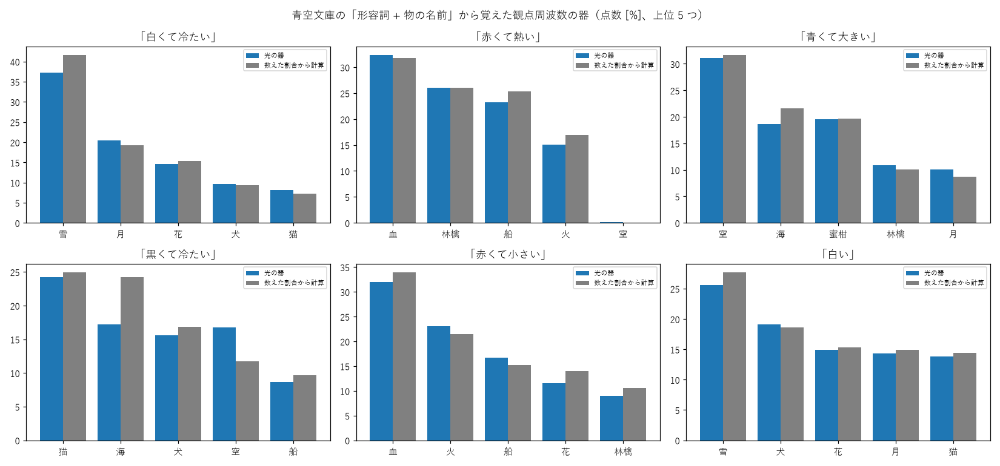

# 学び 25: 文の例から属性の割合を学ぶ — 青空文庫の「形容詞 + 物の名前」

2026-10-27。実験25（experiments/exp25_aozora_attr.py、tools/aozora_pairs.py）。持ち主の案「光点は周囲の文脈や映像などからそれを学習する（文章から色は赤 80%、緑 20% みたいな）」、「文章のファイルは他のプロジェクトから流用 OK」（2026-10-27）。

## 何をしたか

- 言結（Project_Kotoyui）が取得した**青空文庫 4477 作品**（著作権の切れた作品、自由に複製・再配布できる）から、物の名前（猫・犬・船・花・雪・月・林檎・蜜柑・空・海・血・火）の**すぐ前の形容詞**を数えた（「白い雪」「赤い血」「大きな船」「冷たい月」など）。「空気」「火鉢」のような長い言葉は数えない。文章そのものはリポジトリに置かず、数えた結果だけを results/aozora_pairs.json に置いた。
- 観点 4 つ（色・大きさ・温度・味）の割合 = 数えた数の割合。数えた数が 3 未満の観点（猫の温度、ほとんどの物の味など 17 個）は**拡散**（学び 23 の「分からない」）とした。
- 器・学習・逆引き・掛け算は学び 23 と同じ（記号 25 個）。1500 回、3 seed。

数えた例: 雪の色 = 白 74・赤 2・黒 1、血の温度 = 熱い 30・温かい 22・冷たい 7、空の色 = 青 237・黒 24・赤 22・白 17・黄 7。

## 結果

| 問い合わせ | 光の器（3 seed の平均の上位） | 数えた割合から計算した点数 |
|---|---|---|
| 白くて冷たい | 雪 37・月 21・花 15 | 雪 42・月 19・花 15 |
| 赤くて熱い | 血 32・林檎 26・船 23 | 血 32・林檎 26・船 25 |
| 青くて大きい | 空 31・蜜柑 20・海 19 | 空 32・海 22・蜜柑 20 |
| 黒くて冷たい | 猫 24・海 17・空 17 | 猫 25・海 24・犬 17 |
| 赤くて小さい | 血 32・火 23・船 17 | 血 34・火 22・船 15 |
| 白い | 雪 26・犬 19・花 15 | 雪 28・犬 19・花 15 |

順引きの分布と表の差（全変動距離）は 0.31（学び 21 の 0.13 より粗い。物と記号が多いため）。一番の答えは、18 問中 14 問で数えた割合と同じ（赤くて熱い・黒くて冷たいで seed によって入れ替わる。もともと僅差）。

## 分かったこと

- **文から数えた割合をそのまま光の器に覚えさせ、「白くて冷たい」→ 雪、「青くて大きい」→ 空、と推し量れた**。点数は数えた割合からの計算とおおむね同じ。
- **「赤くて熱い」で、火より林檎・船が上に来る**。林檎・船の温度は数えた数が少なく「拡散（分からない）」にしたので、熱いことを否定されない。一方、火は「熱い火」が 4 回しかなく、温度の割合では熱い 27% にとどまる。**拡散（分からない）は、少しだけ知っているものより有利になることがある**。持ち主の「拡散にも意味を持たせたい」を考えるうえで、大事な性質（「知らない」をどれだけ信じるかの重みが要る）。
- 青空文庫は古い文章なので、林檎・蜜柑の例が少ない。現代の文章（言結の会話データなど）なら別の割合になる。
