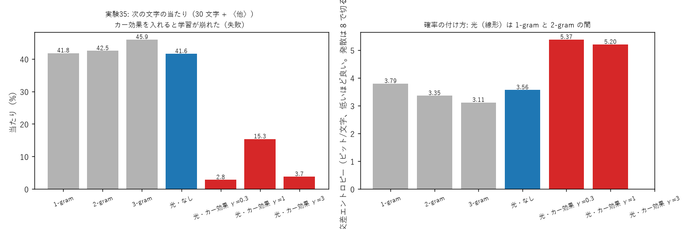

# 学び 35: 語順の組み合わせを、色を分けたカー効果で作れるか（実験35、失敗の記録）

2026-10-27。実験35（experiments/exp35_order_colors.py）。

## 目的

次の文字を当てるには、「直前の 1 文字」だけでなく「直前の 2 文字の組み合わせ」が要る。
例: 「ありが」のあとは「と」だが、「が」だけ見ると「の・は・…」もありうる。
数えて作る表で言えば、2-gram（直前 1 文字）から 3-gram（直前 2 文字）に進むこと。

これまでの光の器（実験29・30）は、直前の文字ごとの予想を足し合わせるだけで、2-gram 止まりだった。
足し算では「この 2 文字がそろったときだけ」という組み合わせは作れない（実験12・14 の「どちらか片方だけ」と同じ理由）。

## なぜこの方法を選んだか

実験14 では、2 つの入力を別々の色にして、明るさで光の進み方が曲がるカー効果を入れると、「どちらか片方だけ」を 100% 解けた。
カー効果は 2 つの光の明るさの和で位相が変わるので、2 つの入力の掛け算（組み合わせ）の項が生まれる。
同じ形を、文字の予測に当てはめた。

- 直前の文字 = 色 1、2 つ前の文字 = 色 2 にして、同じ格子を通す
- カー効果は、2 色の明るさの合計で位相を曲げる（色をまたいで効く）
- 出口で 2 色の明るさを足して、答えの文字を読む

## 結果

| 方法 | 当たり | 交差エントロピー（ビット/文字） |
|---|---|---|
| 1-gram / 2-gram / 3-gram（数える） | 41.8 / 42.5 / 45.9% | 3.79 / 3.35 / 3.11 |
| 光の器（曲がる処理なし） | 41.6% | 3.56 |
| + カー効果 γ = 0.3 / 1 / 3 | 2.8 / 15.3 / 3.7% | 5.37 / 5.20 / 発散 |

- **カー効果を入れると、どの強さでも学習が崩れた**。曲がる処理なしの器は、1-gram と 2-gram の間だった。
- この課題は 30 文字 + 〈他〉で、〈他〉が多いため 1-gram でも 41.8% 当たる。当たりでは差が見えにくい。交差エントロピーで見ると、2-gram と 3-gram の差は 0.24 ビット。

## なぜそうなったか（いまの考え）

実験14 と違う点が 2 つある。

1. **答えの数**: 実験14 は答え 2 個、ここは 31 個。カー効果で位相が曲がると、光の行き先が答え全体に散らばる。答えが多いと、正しい答えに光を集める板の調整が難しくなる。
2. **記号の表し方**: 実験14 は場所（光の点）で表した入力、ここは周波数で表した記号。周波数の記号は縦いっぱいに広がる波なので、明るさがどこでも同じくらいになる。
   カー効果の強さ（γ × N × 明るさ）の付け方がそのままでは合わず、位相が大きく回りすぎた可能性がある。

どちらが原因かは、まだ確かめていない。

## 分かったこと

- 「カー効果を入れれば組み合わせが作れる」は、答えが少なく、場所で表した入力のときに限って確かめられた。周波数の記号・多くの答えにはそのまま使えない。
- 次の手として、カー効果の代わりに「明るさを測って出し直す」2 段の器を試した → 実験38（2-gram を越えた）。

## 残った疑問

- カー効果の強さを、明るさの平均で割ってそろえれば学習できるか。
- 答えを少なくした課題（例: 母音・子音だけ）なら、カー効果で 3-gram に近づけるか。
