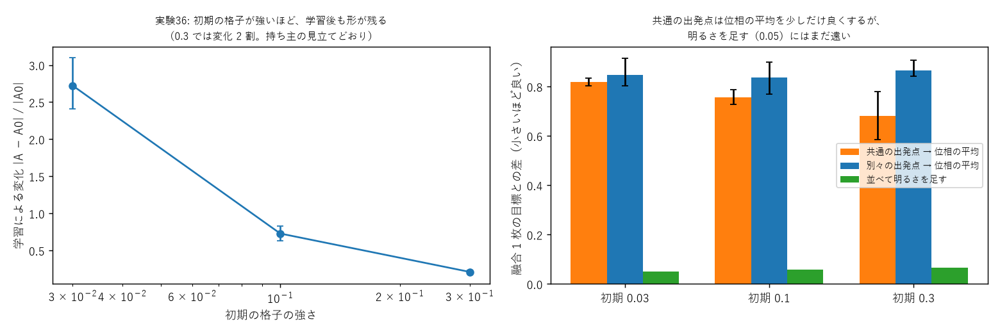
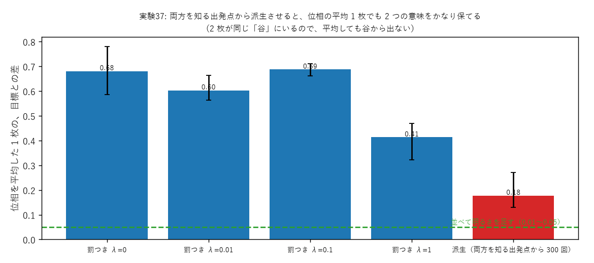

# 学び 36: 初期の格子の形は学習後も残るか、融合しやすい板は作れるか（実験36・37）

2026-10-27。実験36（experiments/exp36_shared_init.py）、実験37（experiments/exp37_fusion_friendly.py）。

## 目的

学び 34 で、2 枚の板（リンゴの格子・トマトの格子）の位相を平均して 1 枚にすると、答えが壊れると分かった（目標との差 0.72〜0.86）。
並べて明るさを足せば融合できる（差 0.01）が、板は 2 枚要る。**1 枚にまとめたまま融合できる板を作れないか**が目的。

持ち主の見立て（2026-10-27）: 「初期の格子は、学習後もなんとなく形が残っている。万能な初期乱数を作れるのでは。融合にも影響するのでは」。

## 理由（なぜ位相の平均は壊れるのか）

光の器の答えは、板の位相に対して線形ではない（位相は e^{iφ} の形で効き、何列も重ねて通る）。
だから 2 枚の板の位相を平均しても、2 つの答えの平均にはならない。

ただし、2 枚の板がもともとよく似ていれば（違いが小さければ）、平均した板は 2 枚の「間」にあり、答えも 2 つの間に近くなるはず。
2 枚を似せる方法として、次の 2 つを試した。

- **同じ出発点から学習する**（実験36）: 初期の格子を共通にする。初期が強いほど、学習で動く量が相対的に小さく、2 枚が似たまま残るはず。
- **両方を知る出発点から派生させる**（実験37）: まず「リンゴとトマトの平均の答え」を 1 枚に学習し、そこから各単語へ少しだけ学習する。

## 結果

### 実験36: 初期の強さと、残る形

| 初期の強さ | 学習による変化 |A − A0| / |A0| | 位相の平均で融合（共通の出発点 / 別々） |
|---|---|---|
| 0.03 | 2.4〜3.1（初期の形はほぼ消える） | 0.80〜0.83 / 0.80〜0.92 |
| 0.1 | 0.63〜0.83 | 0.73〜0.79 / 0.77〜0.90 |
| 0.3 | **0.19〜0.23（形が 8 割残る）** | **0.59〜0.78** / 0.84〜0.91 |

- **持ち主の見立てどおり、初期の格子が強いほど学習後も形が残る**。初期が強い方が、少し速く覚えた。
- 共通の出発点は、位相の平均による融合を少しだけ良くした。それでも明るさを足す形（0.05）にはまだ遠い。

### 実験37: 融合しやすい板

| 作り方 | 融合 1 枚の目標との差 | 元の 2 枚の表との差 |
|---|---|---|
| 罰なし | 0.59〜0.78 | 0.06〜0.08 |
| 変化に罰（λ = 1） | 0.32〜0.47 | 0.07〜0.11 |
| **両方を知る出発点から派生（300 回）** | **0.13〜0.27** | **0.05〜0.08** |

- **両方を知る出発点から派生させると、位相を平均した 1 枚でも 2 つの意味をかなり保てた**。元の 2 枚の覚え方も落ちなかった。

## なぜそうなったか

学習は、板の位相の空間で「表との差が小さい谷」を探す動き。
別々に学習した 2 枚は、たいてい別々の谷に落ちる。2 つの谷の真ん中（平均）は、谷と谷の間の山の上なので、答えが壊れる。

両方を知る 1 枚から少しだけ動かすと、2 枚は同じ谷の中の近い場所にいる。平均しても谷から出ないので、答えも 2 つの間に収まる。
共通の出発点だけでは足りないのは、出発点が「どちらも知らない」場所だと、学習で別々の谷へ離れていくため。
これは Sin-CNN2 の「共通の出発点 + 差分の足し算」と同じ考えで、**出発点が両方を知っていること**が要る。

## 分かったこと

- 初期の板の形は、強く入れるほど学習後も残る（持ち主の見立てが当たった）。
- 1 枚のまま融合したいなら、「両方を知る出発点から派生」させる。それでも、並べて明るさを足す形（0.01）や、学習し直す形（0.04〜0.06）が最も確実。

## 残った疑問

- 3 つ以上の単語でも、派生 + 平均が効くか。
- 「両方を知る出発点」を、全単語の共通の板（万能初期板）として 1 枚用意できるか（実験45・46 の板の型と合わせて）。
