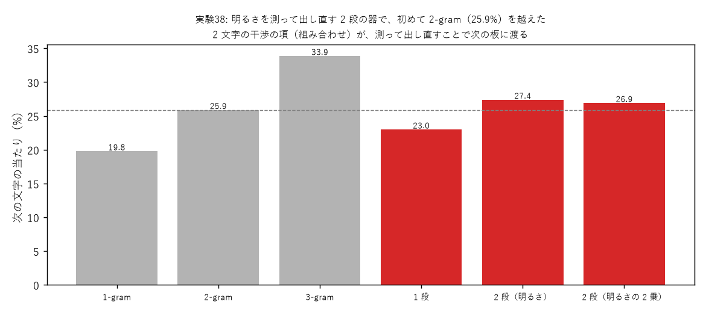
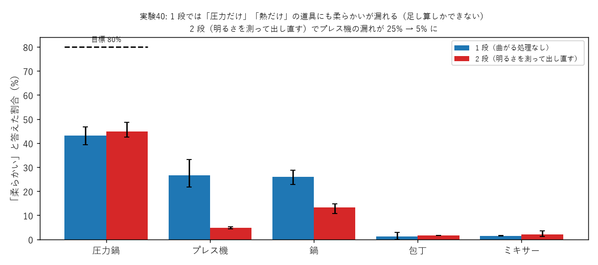

# 学び 38: 明るさを測って出し直す 2 段の器 — 組み合わせを作る（実験38・40）

2026-10-27〜28。実験38（experiments/exp38_two_stage_order.py）、実験40（experiments/exp40_combo_answer.py）。

## 目的

光の器（曲がる処理なし）は、入力の足し算しかできない。
- 文字の予測では、直前の文字ごとの予想を足すだけになり、2-gram 止まり（実験29・30）。
- 道具の推し量りでは、「圧力 + 熱だからこそ柔らかくなる」のような、**両方そろったときだけの答え**が出せない（docs/explain_20261027.md）。

カー効果で組み合わせを作る方法は、周波数の記号では学習が崩れた（実験35）。別の曲がる処理を探した。

## 理由（なぜ「測って出し直す」なのか）

2 つの光 a と b を同じ色で重ねて明るさを測ると、

|a + b|² = |a|² + |b|² + 2·Re(a·b*)

になる。最後の項は **a と b の掛け算**（干渉の項）で、2 つが同時にあるときだけ現れる。これが組み合わせの素。
1 段の器では、この明るさを最後に読むだけなので、干渉の項は「答えの読み出し」にしか使われない。

測った明るさを光として出し直し（√明るさ、または明るさ）、2 段目の器に通すと、干渉の項が次の板の入力になる。
2 段目の板は、「a と b がそろったとき」に光る所を答えへ送るように学習できる。
前のプロジェクトの「測って出し直す」非線形や、実験22 の 2 乗の部品と同じ、光の部品で作れる処理。

## 方法

- **実験38**: よく出る 100 文字 + 〈他〉。入口 = 直前の文字の波 + 2 つ前の文字の波（縦の周波数を 1 ずらす）。画素ごとの板 20 列。
  1 段 / 2 段（√明るさで出し直す）/ 2 段（明るさのまま出し直す）を比べる。3-gram の分布 3000 組で 1500 回。
- **実験40**: 実験32 の道具の器で、圧力鍋（圧力 + 熱）→ 柔らかい 80%・煮る 20% を教える。プレス機（圧力だけ）・鍋（熱だけ）では柔らかいは 0%。

## 結果

| 方法 | 当たり | 交差エントロピー |
|---|---|---|
| 1-gram / 2-gram / 3-gram（数える） | 19.8 / 25.9 / 33.9% | 5.49 / 4.54 / 4.04 |
| 光の器・1 段 | 23.0% | 5.04 |
| **光の器・2 段（√明るさ）** | **27.4%** | 4.70 |
| 光の器・2 段（明るさ） | 26.9% | 4.65 |

**2 段にして、初めて 2-gram（25.9%）を越えた**。

| 器 | 圧力鍋（80% にしたい） | プレス機（0% に） | 鍋（0% に） |
|---|---|---|---|
| 1 段 | 39〜47% | 22〜33% | 23〜29% |
| **2 段** | 42〜49% | **4〜5%** | **11〜15%** |

**2 段にすると、圧力だけ・熱だけの道具への「柔らかい」の漏れが大きく減った**。

## なぜそうなったか

- 1 段の器で圧力鍋に「柔らかい」を光らせるには、圧力の光と熱の光の両方を「柔らかい」へ送るしかない。
  するとプレス機（圧力だけ）でも、圧力の光が「柔らかい」へ届いてしまう。干渉で圧力鍋の方を少し強くできるだけ（説明どおり 2〜3 割漏れる）。
- 2 段の器では、1 段目の出口で「圧力と熱の干渉の項」が明るさとして現れる。2 段目は、その項があるときだけ「柔らかい」へ送れる。
  プレス機だけでは干渉の項が出ないので、柔らかいは光らない。

## 分かったこと

- **組み合わせ（「両方そろったときだけ」「この 2 文字の後」）は、明るさを測って出し直す段で作れる**。カー効果よりも学習が安定する。
- ただし、まだ不完全。圧力鍋の「柔らかい」は 42〜49%（目標 80%）、文字の予測は 3-gram（33.9%）に遠い。

## 残った疑問

- 3 段・4 段にすると 3-gram に近づくか（実験38b として回している）。
- 出し直す光の形（√明るさ・明るさ・明るさの p 乗）で、組み合わせの作りやすさがどう変わるか（実験47 の p 乗と合わせて）。
