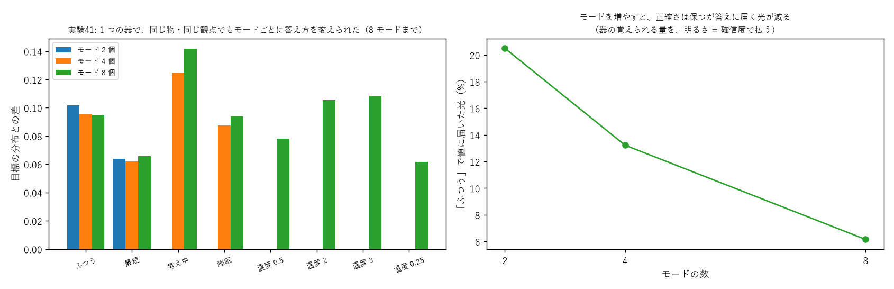

# 学び 41: 観点 f1 × f2 — AI の状態（モード）で答え方を切り替える（実験41）

2026-10-28。実験41（experiments/exp41_mode_views.py）。

## 目的

持ち主の案（2026-10-28）:

> これまでの観点周波数を 1D とすると、観点周波数 f1 × 観点周波数 f2 は 2D。f2 を AI 本体の現状に合わせたパラメータとして使いたい（喜怒哀楽・焦り・最短モード・睡眠対応など）。
> エッジデバイスや状況（バッテリー切れなど）によっては機能を制限した方がよいので、f2 にまとめる。

確かめたいのは、**1 つの器で、同じ物・同じ観点の問いに、モードごとに違う答え方をさせられるか**、何モードまで持てるか。

## 理由（なぜ f1 × f2 が「ずらしの足し算」になるのか）

光の波どうしを掛けると、周波数は足し算になる（実験05: e^{i·f1·x} × e^{i·f2·x} = e^{i·(f1+f2)·x}）。
だから f1 と f2 を掛けた観点は、「物の波を f1 + f2 だけずらす」ことと同じ。

ずらしが重ならないように、f2 を 6 おき（f2 = 0, 6, 12, …）、f1 を 1〜5 にする。
すると f1 + f2 はどの組でも別の整数になり、整数のずらしは直交する（実験16）ので、混ざらない。10 進数の桁と同じ考え方（桁を分ける置き方）。

f2 = 0 を「ふつう」にしておけば、エッジでは f2 を使わない（0 に固定する）だけで、ほかのモードを止められる。

## 方法

実験21 の表（物 5・観点 f1 5・値 12）。モード f2 を 2・4・8 個用意し、それぞれ違う答え方を教える。

| モード | 答え方 |
|---|---|
| ふつう | 表の割合のまま |
| 最短 | 割合を 4 乗して鋭く（いちばんの答えに寄せる） |
| 考え中 | 割合をならす（0.4 乗、ほかの候補も残す） |
| 睡眠 | 光の 90% を出口の外へ（反応を弱く） |
| 温度 0.5・2・3・0.25 | 割合の 1/温度 乗 |

画素ごとの板（列 20）、縦は 30M + 16 以上。1500 回、3 seed。

## 結果

- **8 モードまで、どのモードでも目標の答え方との差 0.06〜0.14 で答えられた**。最短モードがいちばん正確（0.06）、考え中がいちばん粗い（0.12〜0.14）。
- 睡眠モードは、値に届く光が 1〜2% にまで下がった（反応がほぼない）。
- モードを増やすと、「ふつう」で値に届く光が 21% → 13% → 6% に減った。

## なぜそうなったか

- モードごとの問いは直交した波なので、器は混ざらずに別々の答えを覚えられる（実験16 の関係性概念と同じ）。
- 光が減るのは、器が覚える組（物 × 観点 × モード）が増えるほど、板が光を配る先が増えるため。
  器は光の量を保つ（ユニタリ）ので、組が増えると 1 組あたりの光は減る。
  **正確さ（割合の形）は保ったまま、明るさ（確信度）で払う**崩れ方で、実験18（関係の容量）と同じ。
- 考え中モードが粗いのは、ならした割合（多くの値に少しずつ光を配る）の方が、細かい調整が要るため。

## 分かったこと

- f2 を「AI の状態」にする持ち主の案は、光の器でそのまま作れる。睡眠のような「答えない」モードも、光を外へ逃がすだけで作れる。
- エッジでは f2 を固定すれば機能を制限できる。
- モードの数の上限は、周波数の置き場所ではなく、器の覚えられる量と光の量で決まる（実験42 も同じ結論）。

## 残った疑問

- モードを連続の量（感情の強さなど）にできるか。f2 を整数でなく、少しずつずらす（バーニア効果、学び 47）。
- モードの切り替えを、器の外から学習なしで足せるか（新しいモードを後から書き込む）。
