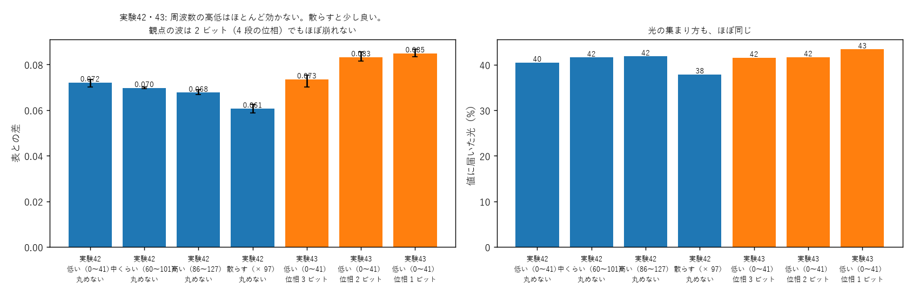

# 学び 42: 周波数の高低の影響と、観点の波の量子化（実験42・43）

2026-10-28。実験42・43（experiments/exp42_band_quant.py）。

## 目的

持ち主の依頼（2026-10-28）:
- 観点周波数の層の限界と、周波数の高低がどう影響するかを知りたい。
- 観点周波数そのものも、量子化のようなコンパクト化ができるか試してほしい。

確かめたことは 2 つ。
1. 記号や観点を「低い周波数」「中くらい」「高い周波数（上限の近く）」に置いたとき、器の覚え方は変わるか。
2. 観点の波（入口の位相の模様）を、3 ビット・2 ビット・1 ビットの粗い位相に丸めても、答えは崩れないか。

## 理由（なぜ違いが出るかもしれないと考えたか）

- 高い周波数の波は、縦の画素ごとに位相が大きく回る。回折で横へ動く角度も大きいので、板の外へ逃げやすい（実験48）かもしれない。
- 量子化については、実験24 で「板を 4 ビットに丸めても推し量りが崩れない」と分かっていた。入口の観点の波も、同じように粗くできるかもしれない。
  1 ビットまで丸められれば、観点の波は白黒の縞（安い板）で作れる。

## 方法

実験21 の表（使う周波数 37 個）。画素ごとの板（縦 256、列 20）、1500 回、3 seed。
- 実験42: 37 個の周波数を、低い所（0〜41）・中くらい（60〜101）・高い所（86〜127）に詰めて置く、または散らす（× 97 で並べ替え）。
- 実験43: 低い所に置き、観点の波の位相を 3・2・1 ビットに丸める。

## 結果

| 条件 | 表との差 | 値に届いた光 | 問い合わせ（12 問） |
|---|---|---|---|
| 低い（0〜41） | 0.070〜0.074 | 38〜41% | 12 |
| 中くらい（60〜101） | 0.069〜0.070 | 41〜42% | 12 |
| 高い（86〜127） | 0.067〜0.069 | 42% | 12 |
| 散らす | **0.059〜0.063** | 37〜38% | 12 |
| 位相 3 ビット | 0.070〜0.075 | 41〜42% | 11 |
| 位相 2 ビット | 0.082〜0.086 | 41〜42% | 12 |
| 位相 1 ビット（白黒の縞） | 0.083〜0.087 | 42〜45% | 9 |

- **周波数の高低は、ほとんど影響しなかった**（上限の近くでも同じ）。散らして置くと少しだけ良い。
- **観点の波は 2 ビット（4 段の位相）でもほぼ崩れない**。1 ビットでも表との差 0.085、問い合わせは 12 問中 9 問。

## なぜそうなったか

- 画素ごとの板は、どの周波数の波にも同じように位相を足せる。周波数の位置は、板から見れば「縦の模様の細かさ」の違いだけで、覚え方には効かない。
  逃げる光も、学習が板で中へ戻すように作る（実験48）。
- 散らすと少し良いのは、隣り合う記号の波が似ていない方が、板が区別しやすいためと考えられる（実験33 の格子では差がなかった）。
- 量子化に強いのは、波の直交性が「位相の大まかな回り方」で決まるから。位相を 4 段に丸めても、波が何周回るかは変わらないので、ほかの波との重なりはほぼ 0 のまま。
  1 ビットでは波の形が矩形波になり、高い周波数の成分（高調波）が混ざるので、少し崩れる。

## 分かったこと

- 観点周波数の層の限界は、周波数の位置ではなく、「使う組の数」と「器の覚えられる量」で決まる（実験16・18・33・41 と合わせて）。
- 観点の波は、2 値・4 値の安い板で作れる。

## 残った疑問

- 1 ビットで崩れる分を、高調波が重ならない置き方（奇数の周波数だけを使うなど）で避けられるか。
