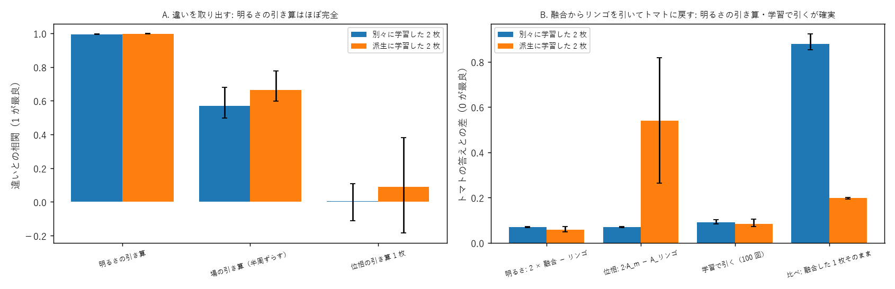

# 学び 44: 差分（引き算）— 違いを取り出す、片方を消す（実験44）

2026-10-28。実験44（experiments/exp44_difference.py）。

## 目的

持ち主（2026-10-28）: 「融合と差分は大きな柱。差分（引き算）の実験もお願い」。

融合（足し算）は、並べて明るさを足すのが確実だった（学び 34）。引き算でも同じことが言えるかを確かめる。
2 つの使い方を考えた。

- **A. 違いを取り出す**: リンゴとトマトの答えの違い（|リンゴの答え − トマトの答え|）を光らせる。「何が違うか」を知る処理。
- **B. 融合から片方を消す**: リンゴとトマトを融合した状態から、リンゴを引いてトマトに戻す。「忘れる」「除く」処理。

## 理由（どの引き算がうまくいきそうか）

光の器で引き算をする場所は 3 つある。

1. **明るさで引く**: 2 枚を並べて通し、出口で明るさを引く。干渉しないので、答えがそのまま引かれるはず。
2. **場で引く**: 片方の光を半周（π）ずらして重ねる。干渉で同じ所は打ち消し合う。ただし明るさは場の 2 乗なので、きれいな引き算にはならないはず。
3. **板の位相で引く**: 板の位相を引き算した 1 枚を作る。足し算（位相の平均）が壊れたので、引き算も壊れるはず。
   ただし、両方を知る出発点から派生させた 2 枚（学び 36）なら、少し戻るかもしれない。

## 方法

実験37 の作り（単語ごとの格子、初期 0.3）で、リンゴとトマトの格子を「別々に」「派生で」学習。3 seed。
A は違いとの相関（1 が最良）、B はトマトの答えとの差（0 が最良）で測った。

## 結果

**A. 違いを取り出す**（相関）: 明るさの引き算 0.99〜1.00、場の引き算 0.50〜0.78、位相の引き算 −0.18〜0.38。

**B. 融合からリンゴを引いてトマトに戻す**（差）: 明るさの引き算 0.05〜0.07、学習で引く（100 回）0.07〜0.10、位相の引き算（派生のとき）0.26〜0.82（seed でばらつく）。
比べ: 融合した 1 枚そのまま 0.19〜0.20（派生）。

注意: 「別々」のときの位相の引き算 2·A_m − A_リンゴ は、融合 A_m を 2 枚の位相の平均にしたので、計算上トマトの板に戻るだけで意味がない（図 B の青い 2 本目）。

## なぜそうなったか

- 明るさは、並べた 2 枚の答えの和なので、引けば片方の答えがそのまま残る（線形の世界の引き算）。
- 場の引き算は、明るさ = |a − b|² = |a|² + |b|² − 2·Re(a·b*) なので、違いだけでなく、それぞれの明るさも残る。相関が 0.5〜0.8 止まり。
- 位相の引き算は、足し算（位相の平均）と同じ理由で壊れる。答えは位相に対して線形ではない。
  派生させた 2 枚は同じ谷の中にいるので、引いても谷の近くに残り、少し戻る seed もある。

## 分かったこと

- **引き算も足し算と同じで、2 枚を並べて明るさで引くのが確実**。板の位相で引くのはうまくいかない。
- 1 枚にまとめた板から片方を消したいなら、100 回ほど学習し直す（差 0.07〜0.10）。
- 融合と差分は、どちらも「板は混ぜず、光（明るさ）で足し引きする」が基本になる。

## 残った疑問

- 明るさの引き算は負の値を作れない（光の明るさは 0 以上）。違いの「向き」（リンゴの方が赤い、など）を残すには、2 つの受光素子の差を取る形（差動の検出）が要る。
- 何枚もの融合から 1 枚だけ消す（忘却）を、学習なしで行えるか。
