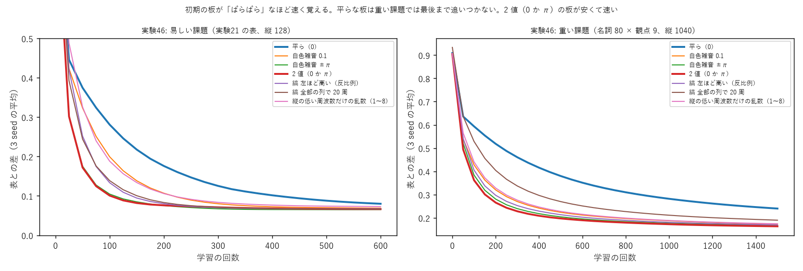

# 学び 45: 初期の板（共通の板）の型と学習の速さ（実験45・46）

2026-10-28。実験45（experiments/exp45_common_plates.py）、実験46（experiments/exp46_plate_patterns.py、GPU）。

## 目的

持ち主の案（2026-10-28）:

> 今後も共通の板を使うことが増えるので、いくつかパターンを作っておくとよい。基準の一つは学習の速さ（それ以外では拡散しにくいなど）。
> 例: 入側（左）の周波数軸を高めに、右へ行くほど低め、それも直線的ではなく反比例的に変える、横軸は完全にホワイトノイズのような散乱度にする、など。

さらに「板のパターンは多くなるかもだけど、データ取り（学習回数と結果とか）も」とのことで、型を 15 種に増やし、学習の経過をすべて記録した。

## 理由（なぜ初期の板で速さが変わると考えたか）

学習は、出口の答えと表の差から、板の各画素の位相をどちらへ動かすか（勾配）を計算して進む。
勾配が板の画素に届くには、光がその画素を通っている必要がある。

- **平らな板**（位相 0）: 光はほとんど広がらずにまっすぐ進む。縦の多くの画素を光が通らず、勾配が届かない画素が多い。
- **ばらばらな板**（白色雑音）: 光が最初から縦に広く散らばる。どの画素にも光が通り、勾配が全体に届く。

持ち主の「横はホワイトノイズのような散乱度」の考えも、この「最初によく散らす」にあたる。

## 方法

画素ごとの板（列 20、列の間 64 画素）、Adam（0.01）、3 seed。課題 2 つ:
- 易しい: 実験21 の表（縦 128）、600 回
- 重い: 名詞 80 × 観点 9（青空文庫の形容詞、縦 1040）、1500 回

型は 15 種: 平ら、白色雑音（0.1・1・±π）、2 値（0 か π）、縞（左ほど高い直線・反比例、左ほど低い、全部 20 周）、縦の低い周波数だけ・高い周波数だけの乱数、入口側半分・出口側半分だけ雑音、レンズ + 雑音、チャープ。

## 結果

| 型（抜粋） | 易しい: 0.15 を切った回 | 重い: 500 回目 | 重い: 最後 |
|---|---|---|---|
| 平ら | 250 | 0.380 | **0.240** |
| 白色雑音 0.1 | 150 | 0.22 | 0.17 |
| 白色雑音 ±π | 50〜100 | 0.20〜0.22 | 0.16〜0.17 |
| **2 値（0 か π）** | **75** | **0.19〜0.20** | **0.16** |
| 縞 左ほど高い（反比例） | 100 | 0.21〜0.22 | 0.17 |
| 縞 全部 20 周 | 100 | 0.26〜0.28 | 0.19 |
| 縦の低い周波数だけの乱数 | 125〜175 | 0.21〜0.24 | 0.17〜0.18 |
| 縦の高い周波数だけの乱数 | 75〜100 | 0.19〜0.20 | 0.16 |

（全 15 種の数字は NOTES.md の実験46 の節）

- **平らな板がいちばん遅い**。易しい課題では最後に追いつくが、重い課題では 1500 回でも追いつかなかった（0.240、ほかは 0.16〜0.19）。
- **ばらばらな板ほど速い**。中でも 2 値（0 か π）は白色雑音 ±π と同じ速さで、作るのがいちばん簡単。
- 持ち主の縞の型（左ほど高い・反比例）は、白色雑音より少し遅いが、平らよりはずっと速い。
- 縦の細かい模様（高い周波数）を持つ板は速く、なめらかな板（低い周波数だけ）は遅い。

## なぜそうなったか

予想どおり、**最初に光を細かく散らす板ほど、勾配がすべての画素に届いて速く覚える**。
- 2 値の板は、画素ごとに位相が 0 か π のどちらかで、隣どうしがばらばら。光を最もよく散らす。
- 縞は、決まった周波数の方向へ光を曲げるだけで、散らし方が偏る。全部の列で同じ 20 周の縞は、いちばん偏るので遅い。
- 重い課題では、記号が 1040 画素の縦いっぱいに広がっているので、勾配の届かない画素が多いと差が大きくなる。

最後の正確さ（易しい課題で 0.06〜0.08）は型によらずほぼ同じ。差は「速さ」と「重い課題での到達点」に出た。

## 分かったこと

- 共通の板の型としては、**2 値（0 か π）のばらばらな板**が、速く・安く・作りやすい（実験43 の「観点の波は 1〜2 ビットで作れる」とも合う）。
- 「拡散しにくさ」のもう 1 つの基準（融合しやすさ）とどう両立するかは、まだ測っていない。

## 残った疑問

- ばらばらな初期板は、融合（学び 36 の「同じ谷」）にとって良いのか悪いのか。
- 学習の終わりの板に、初期の型の形がどれくらい残るか（実験36 と同じ測り方で）。
