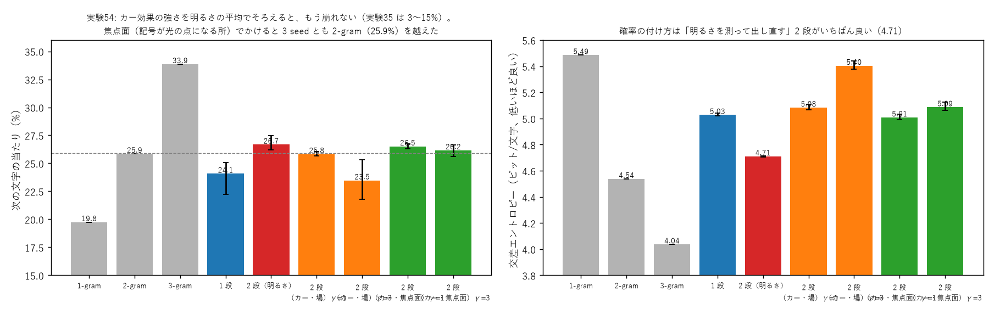

# 学び 54: カー効果をどこでかけるか — 場の面と焦点面（実験54）

2026-10-28。実験54（experiments/exp54_kerr_focal.py、GPU）。

## 目的

持ち主の問い（2026-10-28）:

> カー効果での語順（実験35 の失敗）って、非線形のやり方に問題があるってことかな？ 平方根を使うとかで 2D の時は悩んだね。同じ解決が難しいのは次元数によるんだろうか。

実験35 では、直前 2 文字を別々の色にしてカー効果を入れると、学習が崩れた（当たり 3〜15%）。原因を確かめる。

## 理由（いまの仮説）

次元数ではなく、**記号の表し方と、カー効果の強さの付け方**の問題だと考えた。

1. **記号の表し方**: 周波数で表した記号は、縦いっぱいに広がる波。1 本の波の明るさは、どこでも同じ（|e^{ikx}|² = 1）。
   カー効果は「明るい所ほど位相が遅れる」なので、明るさが一様だと、全体を同じだけずらすだけで、何も曲がらない。
   うまくいった実験14 は、光の点（場所）で表した入力だった。
   **レンズの焦点面（FFT の後）では、周波数の記号は光の点になる**。そこでカー効果をかければ、記号ごとに位相が曲がり、
   2 つの記号の光が重なった所（組み合わせ）だけ特別な曲がり方をするはず。
2. **強さの付け方**: 実験35 では γ × N × 明るさ にしていた。明るさの大きさは課題によって大きく変わるので、位相が回りすぎた疑いがある。
   今回は γ × 明るさ / 明るさの平均 にそろえた。

2D で √ に悩んだのも、「明るさのそろい方（規模）」が根にあった点で、2 つ目と近い。

## 方法

実験38 と同じ課題（よく出る 100 文字 + 〈他〉、直前 + 2 つ前の文字、画素ごとの板 20 列 × 段、3-gram の分布 3000 組、1500 回）。段と段の間の非線形を変えた。3 seed。

## 結果

| 段と段の間 | 当たり（3 seed） | 交差エントロピー |
|---|---|---|
| 1-gram / 2-gram / 3-gram（数える） | 19.8 / 25.9 / 33.9% | 5.49 / 4.54 / 4.04 |
| 1 段（なし） | 22.2〜25.1% | 5.02〜5.04 |
| 明るさを測って出し直す | 26.2〜27.5% | **4.71〜4.72** |
| カー・場の面 γ = 1 / 3 | 25.7〜26.1% / 21.8〜25.3% | 5.07〜5.11 / 5.38〜5.44 |
| **カー・焦点面 γ = 1** | **26.3〜26.8%（3 seed とも 2-gram 越え）** | 4.99〜5.04 |
| カー・焦点面 γ = 3 | 25.6〜26.6% | 5.06〜5.13 |

## なぜそうなったか

- **強さを明るさの平均でそろえると、カー効果でももう崩れない**（実験35 は 3〜15%）。崩れた主な原因は、強さの付け方だった。
- **焦点面でかける方が、場の面より少し良い**（γ = 1 で 26.3〜26.8% 対 25.7〜26.1%、強くしても崩れにくい）。記号が光の点になる所でかけると、記号ごとに曲がるという仮説と合う向き。ただし差は 1 点以内で小さい。
- 当たりは「明るさを測って出し直す」と同じくらい。確率の付け方（交差エントロピー）は、測って出し直す方が良い（4.71 対 5.0）。
  カー効果は位相を曲げるだけで光の量を変えないので、答えの割合の細かい調整が苦手なのかもしれない（未確認）。

## 分かったこと

- **次元数の問題ではなく、記号の表し方（明るさが一様な波）と、強さのそろえ方の問題だった**。強さを明るさの平均でそろえ、記号が光の点になる焦点面でかけるのがよい。
- 2D の √ の悩みと同じく、「非線形は、明るさの規模をそろえてからかける」が共通の教訓になりそう。
- 3-gram（33.9%）にはまだ遠い。カー効果も、測って出し直すのも、1 回の非線形では 2 文字の組み合わせを十分に作れていない。

## 残った疑問

- 焦点面のカー効果と、測って出し直すのを両方入れる（3 段）。
- 実験38b（文脈 8000 組・3000 回）では、2 段（明るさ）が 24.8% と、実験38（27.4%）より悪かった。組を増やすと 1 枚の器では覚えきれない可能性（3・4 段は計算中）。
