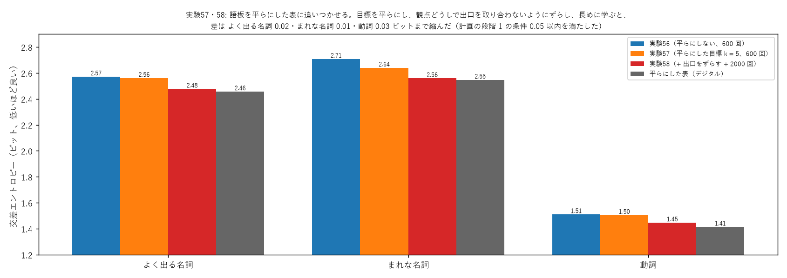

# 学び 57: 語板を表に追いつかせる — 平らにした目標と、出口のずらし（実験57・58）

2026-10-28。実験57（experiments/exp57_goban_smooth.py）、実験58（experiments/exp58_goban_tuned.py）。大規模な学習の計画（docs/plan_large_scale.md）の段階 1。

## 目的

実験56 で、語板は「平らにした表」（数の少ない語ほど全体の割合に寄せる、昔からの平滑化）に負けていた（まれな名詞 2.70 対 2.55 ビット）。
段階 1 の条件「まれな名詞で、平らにした表との差 0.05 ビット以内」を満たす学び方を探す。

## 理由と試したこと

1. **目標を平らにする（実験57）**: 語板は学ぶ目標の表をまねる。目標そのものを平らにした表にすれば、平滑化の良さも写せるはず。
   → まれな名詞は 2.70 → 2.64 に良くなったが、よく出る名詞は 2.56 のまま（表は 2.46）。
2. **器が表を写しきれていないことに気づく**: 学習に使った目標に対しても、語板は 0.14 ビット届いていなかった。
   原因の候補は、実験56 で見つけた器の上限。どの観点でも「いちばん多い値」（為る・有る・成る・良い…）が同じ出口（番号 0）に置かれていた。
   光の量を保つ器では、直交した入口（5 つの観点）から同じ出口へ集められる明るさの和は 1 以下なので、観点どうしで出口を取り合う。
3. **出口をずらす（実験58）**: 観点 v の r 番目の値を、出口 (r + 9v) mod 47 に置く。多い値どうしが別の出口になる。あわせて、学習を 2000 回・学習率 0.03 に。

## 結果（3 seed）

| | よく出る名詞 | まれな名詞 | 動詞 |
|---|---|---|---|
| 実験56（平らにしない） | 2.57 | 2.70〜2.71 | 1.51 |
| 実験57（平らにした目標 k = 5） | 2.56 | 2.64 | 1.50〜1.51 |
| **実験58（+ 出口をずらす + 2000 回）** | **2.48** | **2.55〜2.56** | **1.45** |
| 平らにした表（デジタル） | 2.46 | 2.55 | 1.41 |

- **差は、よく出る名詞 0.02、まれな名詞 0.01、動詞 0.03 ビットまで縮んだ。段階 1 の条件（0.05 以内）を満たした**。
- まれな名詞は、近い語板を写して 300 回でも、まっさら 2000 回と同じ（2.56）。学習は 7 分の 1 で済む。
- 試し（seed 0、よく出る名詞）での内訳: 出口をずらすだけで 2.562 → 2.535、2000 回にして 2.485、学習率 0.03 で 2.476。

## なぜそうなったか

- 平らにした目標は、まれな語の「当てにならない数」を全体の割合で補う。語板はそれをそのまま写すので、平滑化の良さを受け継ぐ。
- 出口のずらしは、器の上限（同じ出口に集められる光の和 ≤ 1）を避ける。多い値どうしが別の出口にあれば、観点ごとに自由に光を集められる。
  これは実験56 の「その他」を観点ごとに分けたのと同じ考えを、すべての値に広げたもの。
- 残りの差（0.01〜0.03）は、器の大きさ（位相 512 個）と学習の回数で決まる部分と考えられる。

## 分かったこと

- **語板は、平らにした表とほぼ同じ当たりを出せる**。光の器の設計の決まりとして、
  1. 目標は平らにしてから学ぶ、
  2. 観点どうしで出口を取り合わないよう、値の出口をずらす（多い値を同じ出口に置かない）、
  の 2 つを守る。
- これで計画の段階 2（材料を増やす）へ進める。材料は、青空文庫の本文全体（観点の出現 324 万）、Tatoeba（16 万）を数え終わり、ウィキペディア（約 27 億文字）を数えている。

## 残った疑問

- 出口のずらし方の最適な形（いまは 9 ずつ）。観点の数が増えたときに、出口をどう割り当てるか。
- 語板の位相を減らしても（圧縮）、この当たりを保てるか（大規模になってから）。
