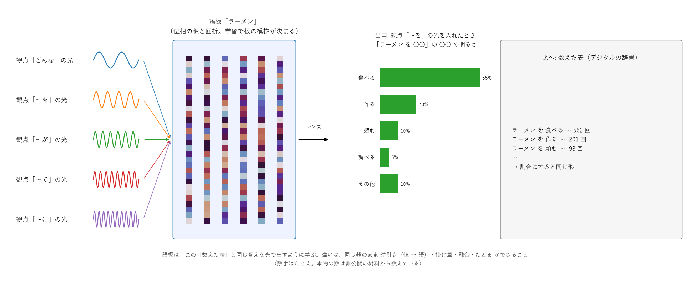
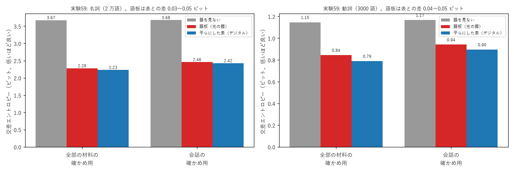
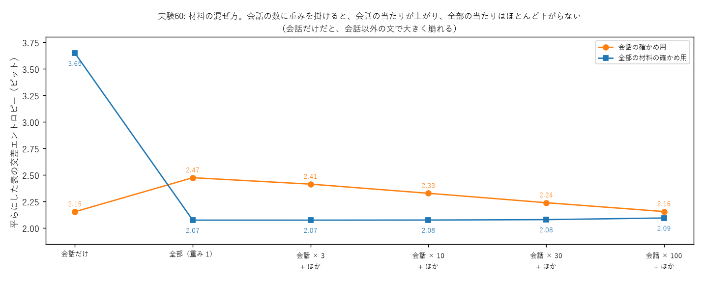

# 学び 59: 光の器で 2 万語の「ことばの使われ方」を覚えた — 語板（ごばん）を数万語に

2026-10-29。実験59（experiments/exp59_goban_large.py）、実験60（experiments/exp60_domain_mix.py）。
大規模な学習の計画（docs/plan_large_scale.md）の段階 3。**パソコンや AI にくわしくない人にも読めるように書いた**。

## この記事で言いたいこと（3 行）

1. **光が通る板（位相の板）を何枚か並べただけの器に、日本語の名詞 2 万語・動詞 3000 語の「使われ方」を覚えさせられた**。
2. その当たり具合は、ふつうのコンピュータで回数を数えて作った表（デジタルの辞書）とほぼ同じ（差はわずか 0.03〜0.05 ビット）。
3. 材料の選び方で、器の「性格」が変わる。会話に強くしたいなら、会話の材料を多めに混ぜる。

---

## 1. 「ことばの使われ方」とは

「ラーメン」という語は、文の中でよく次のように使われる。

- ラーメン **を** 食べる / 作る / 頼む
- **美味しい** ラーメン / 熱い ラーメン
- ラーメン **が** 好きだ / 美味しい

一方「電車」なら、電車 **に** 乗る、電車 **が** 来る、電車 **で** 行く。
**語の意味は、まわりにどんな語がよく来るかで、かなりの部分が分かる**。これは言語学で「分布意味論」と呼ばれる昔からある考え方（「言葉はその仲間で分かる」）。

このプロジェクトでは、名詞のまわりの形を 5 つの「観点」に分けた。日本語は助詞（を・が・で・に）が名詞の役割を表すので、助詞ごとに分けやすい。

| 観点 | 形 | 例 |
|---|---|---|
| どんな | 形容詞 + 名詞 | 美味しい ラーメン |
| 〜を | 名詞 + を + 動詞 | ラーメン を 食べる |
| 〜が | 名詞 + が + 動詞・形容詞 | 雨 が 降る |
| 〜で | 名詞 + で + 動詞 | お店 で 買う |
| 〜に | 名詞 + に + 動詞 | 電車 に 乗る |

## 2. 語板（ごばん）とは

**語板 = 1 語に 1 枚の、小さな光の器**。たとえるなら、語ごとに作った「模様入りのすりガラスを何枚も重ねたもの」。

- 入口から、観点ごとに違う「光の波」（縞の細かさが違う光）を入れる。例: 「〜を」の光。
- 光はすりガラス（位相の板）を通るたびに少しずつ向きを変えられ、広がる（回折）。
- 最後にレンズで集めると、出口の決まった場所が明るくなる。「食べる」の場所が 55%、「作る」が 20%… という具合。
- **明るさの割合 = その語の使われ方の割合**。「ラーメン を ○○」の ○○ に何が来やすいかを、光の明るさで答える。

板の模様は、たくさんの文から自動で決める（「学習」）。最初はでたらめな模様（0 か 180 度の 2 種類だけ。学び 45 で、これがいちばん速く覚えると分かった）から始めて、
答えの明るさが文の中の割合に近づくように、模様を少しずつ直していく。

比べる相手の「数えた表」は、ふつうのコンピュータで「ラーメン を 食べる は 552 回…」と数えて割合にしたもの（図の数字はたとえ）。
**語板は、この表と同じ答えを光で出すように学ぶ**。

## 3. 何をしたか

- **材料**（非公開フォルダ。公開リポジトリには文そのものは置いていない）: 実際の雑談（約 1.4 万の会話）、旅行の相談、青空文庫の本文全体（約 4500 作品）、
  Tatoeba の例文（約 25 万文）、日本語版ウィキペディア（約 139 万記事）。形態素解析器 Sudachi で語に分け、名詞のまわりの 5 つの形を数えた（合わせて約 3900 万回）。
- **語の数**: 名詞 2 万語（いちばんまれな語でも約 130 回出てくる）、動詞 3000 語（動詞の語板は「何を・何が・何で・何に」の名詞を答える）。
- **学習**: GPU（画像処理用の計算装置。同じ計算を大量に同時にするのが得意）で、5000 枚ずつまとめて学習した。
  持ち主の PC には GPU が 2 枚あるので、条件の違う 2 本（seed 0・1。でたらめな初期の模様を変えたもの）を同時に回した。**名詞 2 万枚の学習は 4 分弱、全部で 1 本 9 分**。

## 4. どう確かめたか

- **学習に使っていない文で確かめる**: 文書・会話の番号で、9 割を学習用、1 割を確かめ用に分けた。確かめ用は学習中に一度も見せていない。
  丸暗記ではなく、本当に使われ方を覚えたかが分かる。
- **ものさし = 交差エントロピー（ビット）**: 「答えの語を当てるのに、はい / いいえ の質問が平均で何回いるか」に近い数。**小さいほど良い**。
  例: 2 ビットなら「4 つに 1 つ」くらいまで絞れている感じ。1 ビット減ると、迷う候補が半分になる。
- **比べ相手**:
  - 語を見ない: 「〜を」の後に来やすい動詞の割合だけで当てる（名詞が何かを使わない）。下限の目安。
  - 平らにした表: 数えた表を、まれな語ほど全体の割合に寄せて平らにしたもの（昔からある平滑化）。デジタルの強い比べ相手。

## 5. 結果

| | 語板（光の器） | 平らにした表（デジタル） | 語を見ない |
|---|---|---|---|
| 名詞・全部の材料の確かめ用 | **2.28** | 2.23 | 3.67 |
| 名詞・会話の確かめ用 | **2.46** | 2.42 | 3.68 |
| 動詞・全部の材料の確かめ用 | **0.84** | 0.79 | 1.15 |
| 動詞・会話の確かめ用 | **0.94** | 0.90 | 1.17 |

- **語板は、語を見ないより 0.3〜1.4 ビット良く（名詞では迷う候補が 2〜3 分の 1 に減る）、デジタルの表との差は 0.03〜0.05 ビットだけ**。
- 条件の違う 2 本（seed 0・1）の差は 0.002 ビット以内。たまたまではない。
- 入れた光の 94〜95% が答えの場所に届いている（光をほとんど無駄にしていない）。
- ○○ 当て（会話の文で名詞を隠し、隣の動詞・形容詞だけで 2 万語から当てる、13,700 問）: 上位 10 に 11%（表も 11%、よく出る順だけなら 3.9%）。
  候補が 400 語から 2 万語に増えたので、実験55（400 語で 40%）より下がるのは当然。

## 6. 気づいたこと

### 6-1. 逆引きが「まれな言い回し」に引っ張られる

語板は逆向きにも使える（学び 21: 逆向きの明るさ = 順向きの明るさ）。「を 見る」の光を逆に通すと、「見る」とよく組む名詞が明るくなる。
400 語のとき（実験55）は「動画・映画・アニメ」だったが、2 万語にすると「**日の目・面倒・類・予知夢・憂き目**」が上に来た（「に 乗る」なら「玉の輿・ジェットコースター・調子」）。

理由: 語板の明るさは「その名詞が、その動詞とどれだけの割合で組むか」。「日の目」はほぼ「日の目を見る」としか使わないので、割合では 1 位になる。
「見るものとしてよく話題になる名詞」を出したいなら、**名詞そのものの多さを掛ける**必要がある（ベイズの定理: P(名詞 | 見る) ∝ P(見る | 名詞) × P(名詞)）。
光では、名詞ごとの明るさに「よく出る度合い」の吸収板を重ねれば、そのまま掛け算になる（学び 51）。→ 実験61 で直す。

これは失敗というより、**語板が「その語らしさ」をよく覚えている**ことの表れでもある。「日の目」「憂き目」は、たしかに「見る」がいちばんその語らしい使い方。

### 6-2. 材料の分野の偏り（実験60）

会話の確かめ用では、**会話だけで数えた表の方が、全部まとめた表よりずっと良かった**。
全部まとめると、材料の大半を占めるウィキペディア（説明文）や小説の使い方に引っ張られる。同じ「話」でも、説明文では「話を書く・紹介する」、会話では「話を聞く・する」が多い。
ただし会話だけだと、会話に出てこない語や使い方を知らず、会話以外の文では大きく崩れる。

そこで、**混ぜるときに会話の回数を 30〜100 倍に数える**（重みを掛ける）と、会話でも会話だけの表とほぼ同じ当たり、全体でもほぼ最良になった。

| 混ぜ方（Web 小説も含む、平らにした表） | 会話の確かめ用 | 全部の確かめ用 |
|---|---|---|
| 会話だけ | **2.15** | 3.65 |
| 全部（重み 1） | 2.47 | **2.07** |
| 会話 × 30 + ほか | 2.24 | 2.08 |
| 会話 × 100 + ほか | **2.16** | 2.10 |

失敗の記録: 最初は、混ぜ方ごとに「上位 47 個の値」を決め直していた。すると「その他」の中身が混ぜ方ごとに変わり、数字が比べられなかった。値の置き方を全部の材料で 1 回だけ決めて固定して直した。

## 7. 備考（気をつけて読むところ）

- **値は上位 47 個 + 「その他」だけ**。例えば「〜を」の後の動詞は、多い 47 個だけを別々に覚え、ほかは「その他」にまとめている（器の縦の大きさ 64 の限界）。
  もっと細かくするには器を大きくする（縦 256 など。計算は約 4〜5 倍）。
- **見ているのは「名詞 + 助詞 + 動詞」のすぐ隣の形だけ**。「ラーメンを、昨日、友だちと食べた」のように間に語が入る文は数えていない。
- **これはコンピュータの中での計算（シミュレーション）**。本物のレンズや板で作ったわけではない。計算は光の伝わり方の式（角スペクトル法）どおりなので、
  実際の光の器でも同じことが起きるはず。ただし、本物の板の作り方の誤差や雑音は、まだ入れていない。
- **材料のライセンス**: 公開してよい語板の材料（会話・青空文庫・Tatoeba・ウィキペディア）と、研究だけに使う材料（持ち主が取った Web 小説、著作権法 30 条の 4 の情報解析のみ）を分けている。
- **光の器の決まり**（学び 56・57）: 光の量を保つ器では、違う入口から同じ出口へ大量の光は集められない（足して 1 まで）。だから「その他」や多い値の出口を観点ごとにずらした。
  これがないと、2 万語では表に追いつけない。

## 8. 考察 — どこがすごくて、どこはまだ普通か

**新しいところ（このプロジェクトならでは）**

- **光の器だけで、数万語の「ことばの使われ方」を、デジタルの表とほぼ同じ精度で持てた**。回折の深層ネットワーク（D²NN、2018〜）は、主に画像の分類に使われてきた。
  語ごとに 1 枚の器を作って意味の辞書にする使い方は、調べた範囲では見当たらない。
- **同じ器のまま、逆引き・掛け算（推し量り）・融合・たどる（名詞 → 動詞 → 名詞）ができる**。デジタルの表なら、それぞれ別の計算が要る。
  光なら、光を逆に通す・吸収板を重ねる・光を足す、で済む。
- **光の器ならではの決まり**（同じ出口に集められる光の和は 1 まで）を見つけ、それに合わせた設計（出口のずらし）で表に追いついた。光で AI を作るときの設計の手がかりになる。
- 計算は軽い。2 万語の学習が GPU で 4 分。

**まだ普通なところ（正直に）**

- **当たりは「数えた表と同じ」であって、表を越えてはいない**。語板は表をまねて学ぶので、表にない知識は生まない。今の価値は「同じことを光でできる」こと。
- **1 枚の語板（位相 512 個）は、表（約 260 個の数）より大きい**。小さくする（圧縮）のは、大規模になってから（持ち主の方針）。
- **まだ文を作ったり、会話をしたりはできない**。語の使われ方の辞書ができた段階。
- 「まわりの語で意味が分かる」という考え自体は昔からある（word2vec など）。新しいのは、それを光の器で行い、逆引きや融合をそのままできる形にした点。

**なぜこれが大事か**: 光は、電気よりずっと少ないエネルギーで、たくさんの計算を同時にできる可能性がある（光の速さで伝わり、通すだけなら熱もほとんど出ない）。
「ことばの辞書を光の板として持ち、光を通すだけで引ける」ことが、数万語の規模で確かめられたのは、その方向への一歩になる。

## 9. 追記: 会話に強い語板（実験61）

会話 × 100 の混ぜ方で、名詞 2 万語の語板を作り直した（GPU 2 枚で同時に）。

| | 語板（会話 × 100） | 全部をそのまま混ぜた表 |
|---|---|---|
| 会話の確かめ用 | **2.21** | 2.47 |
| 全部の確かめ用 | 2.16 | **2.07** |

**会話では、そのまま混ぜた表より 0.27 ビット良い**（迷う候補が約 2 割減る）。全体の当たりは 0.08 だけ下がる。

逆引きに名詞の多さを掛けると、まれな言い回しに引っ張られなくなった。

| 値 | 明るい名詞（多さを掛けた後） |
|---|---|
| を 見る | 様子・姿・顔・夢・映画・動画 |
| に 乗る | 調子・車・肩・話・勢い・相談・タクシー・電車 |
| どんな 優しい | 手・言葉・声・人・心・笑顔 |

「調子に乗る」「話に乗る」「相談に乗る」「肩に乗る」のように、乗り物でない「乗る」もちゃんと入っている。これは会話の言い回しをよく覚えている表れ。
（この語板は Web 小説を含むので研究・確かめ専用で、公開しない）

## 10. 次の一歩

- Web 小説の年齢制限つき（R15・R18）は、持ち主の OK のもと、別々に数えて小さい重みで混ぜる（研究のみ）。
- 文の中で使う: 注意機構（学び 49）・否定（学び 53）・位置の重み（学び 51）を語板と組み合わせ、○○ 当てや次の語の予測へ。
- 持ち主の構想: 物語の背景と会話を結び付けた「空気感」。f2（AI の状態のモード、学び 41）を「場面のモード」に広げる。
  話す相手（赤ちゃん・大人、もしかすると犬や猫）に合わせた話し方も、同じ「モード」で表せるかもしれない。
