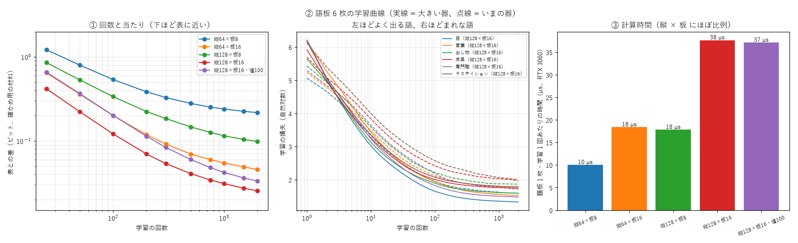

# 学び 75: 器を大きくする — 観点が増えたら、板の枚数を増やす（実験73〜75）

2026-10-30。実験73（語板 v2）・実験75（experiments/exp75_bigger_device.py）。持ち主「今後も情報は増えるから、先に器を大きくする試験をしてもいい」「学習の曲線図も語板の何枚かで取得して、学習ステップの想定に。計算量の把握も」。

## なぜ

語板 v2 で観点を 5 から 9 に増やした（〜の〜・〜と〜・〜は を足した）。すると、語板と「数えた表」の差が 0.03〜0.05 ビットから 0.2 ビットに広がった。
1 枚の器（縦 64 画素・位相の板 8 枚 = 512 個の位相）に、覚えることが多すぎると考えた。

## 方法

- 材料と目標は語板 v2 と同じ（観点 9、値 45 + その他、平らにした表）。名詞 3 万語から 5 語おきに 6000 語（よく出る語もまれな語も入る）。
- 器: 縦 64 / 128 × 板 8 / 16 枚。縦 128・板 16 では、値を 100 に増やした形も。
- 2000 回、途中で止めずに学ぶ。10 点で確かめ用の当たり、毎回の損失（全体と語板 6 枚）、1 回あたりの時間を記録した。

## 結果

| 器 | 表との差（2000 回） | 0.02 ビット以内に入る回数 | 語板 1 枚・1 回 | 3 万語を 500 回 |
|---|---|---|---|---|
| 縦 64 × 板 8（いま） | 0.22 | 1500 | 10 µs | 3 分 |
| 縦 128 × 板 8 | 0.10 | 1000 | 18 µs | 4 分 |
| 縦 64 × 板 16 | 0.05 | 750 | 18 µs | 5 分 |
| **縦 128 × 板 16** | **0.025** | **500** | 38 µs | 9 分 |
| 縦 128 × 板 16・値 100 | 0.033 | 750 | 37 µs | 9 分 |

（RTX 3060 1 枚、学習だけの時間。表づくりは別。）

## 分かったこと

- **板の枚数がいちばん効く**。同じ計算量（位相 1024 個）なら、縦を 2 倍にするより板を 2 倍にした方が表に近い（0.10 対 0.05）。
  板を通るたびに光が混ざり直すので、板の枚数は「何段の計算ができるか」に当たる。観点が増えると、観点ごとに光を分ける段が要る。
- 大きい器は**速く学ぶ**: 縦 128 × 板 16 は 500 回で十分（いまの器は 1500 回）。大きい器は 1 回の計算が重いが、回数が少なくて済む。
- 縦 128 × 板 16 なら、値を 45 から 100 に増やしても表との差は 0.03。材料が増えて値が増えても入る。
- 計算時間は 縦 × 板 にほぼ比例する。10 万語の語板でも、GPU 2 枚で 15 分ほどの見込み。

## 次の一歩

- 次の語板（v3）は 縦 128 × 板 16、500 回で作る。
- 観点や値がさらに増えたら、板を 24・32 枚にしたときの伸びを確かめる（章板の実験67 では、板を厚くするほど多くの語を重ねられた）。
