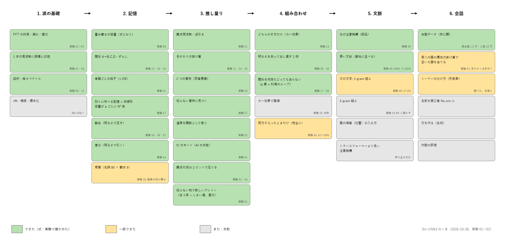
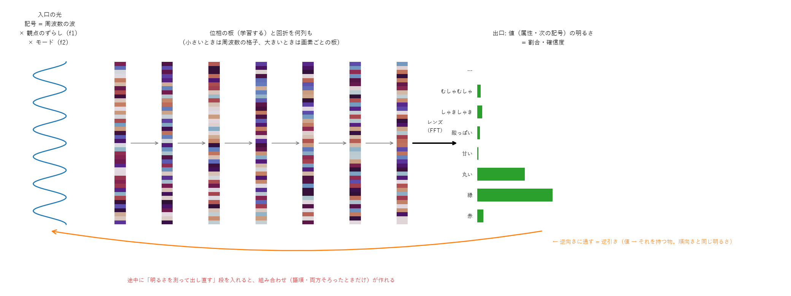
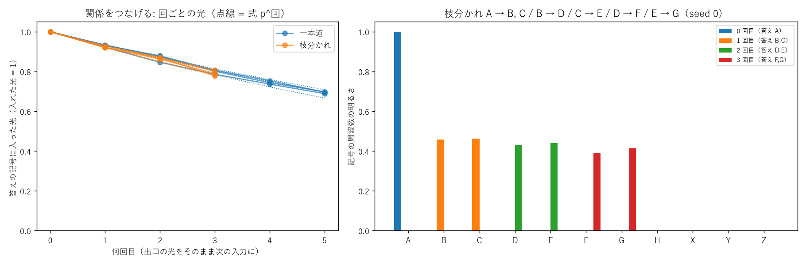
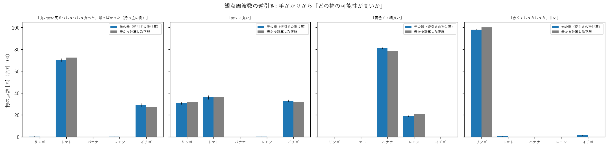
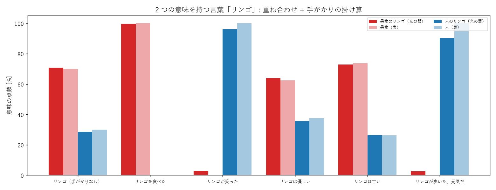
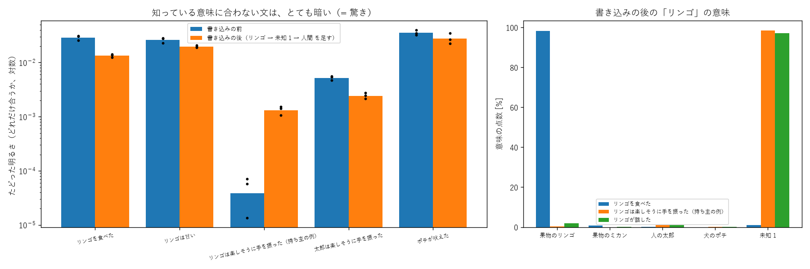
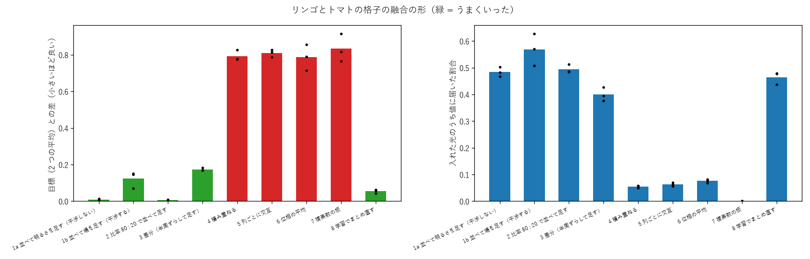
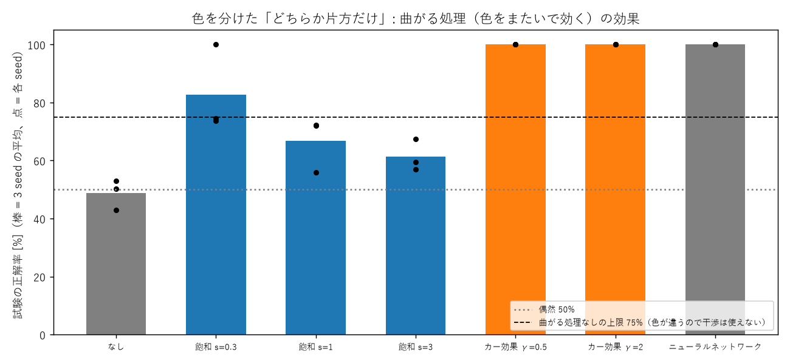
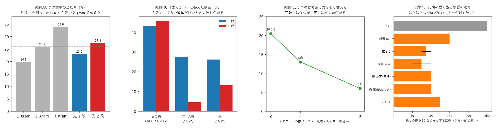

# Sin-CNN3 のいま（一目で分かるページ）

2026-10-28 時点。実験 01〜60。数字の正本は [NOTES.md](../NOTES.md)、一歩ずつの説明は [docs/lessons/](lessons/)。

**ひとことで**: 記号を「波の周波数」で表し、光の器（学習する位相の板 + 回折）に通して、出口の明るさで答えを読む。小さな模型から 1 つずつ作り、**なぜできるか・なぜできないか**を式と手計算で確かめている研究です。チャットボットはまだ作れていません。

## 0. 現状のマップ

左から右へ、「波の基礎 → 記憶 → 推し量り → 組み合わせ → 文脈 → 会話」と積み上げている。緑 = 式と実験で確かめた、黄 = 一部できた、灰 = まだ・失敗。
いまは「組み合わせ」と「文脈」の途中にいる。会話（チャットボット）に向けて足りないのは、語の順番の入れ方、3-gram を越える予測、文を作る部分。

## 1. 器のしくみ

- **入口**: 記号（リンゴ・「赤」など）は整数の周波数の波。何を聞くか（色・形・味…）は周波数を少し**ずらす**こと（観点周波数）で表す。整数ずらしの波どうしは直交するので混ざらない。
- **中**: 位相の板（学習する）と、板と板のあいだの回折。小さな課題では「縦の sin・cos × 横の sin・cos の格子」、大きな課題では画素ごとの板が要る。
- **出口**: レンズ（FFT）で周波数に分け、値の明るさを読む。明るさの割合 = 答えの割合・確信度。
- **逆向き**: 同じ器を逆に通すと逆引き（値 → それを持つ物）。順向きと同じ明るさになるので、手がかりの明るさを掛け算すると推し量り（素朴ベイズ）になる。

## 2. できたこと（特徴）と理由

| 機能 | 結果 | なぜできるか | 実験・図 |
|---|---|---|---|
| 関係を覚える・たどる | A → B,C,D と、ずらすと A → G,H を同時に 100%。出力をそのまま入力にして 5 段たどれる | ずらした波は直交するので、同じ板に別の関係を重ねても干渉しない | 16・17   |
| 観点周波数で属性を引く・逆引き | 「丸い・赤い・むしゃむしゃ・酸っぱい」→ トマト 70%・イチゴ 29%（デジタルの推し量りと差 1 点以内）。4 ビットに丸めても崩れない | 逆向きの明るさ = 順向きの明るさ（器はユニタリ）。手がかりごとの明るさを掛けると確率の掛け算になる | 21・24・25   |
| 2 つの意味を持つ言葉 | 果物のリンゴ / 人物のリンゴさんを重ねて持ち、手がかりで 1 つに決まる | 重ね合わせ（光の足し算）で両方を持ち、掛け算で片方が消える | 26   |
| 知らない意味に気づく | 「リンゴは楽しそうに手を振った」は光が 75〜340 倍暗い。仲間から「人間の何か」と当てて書き込める | 覚えた道に乗らない光は出口に集まらない（暗さ = 驚き） | 27   |
| 単語ごとの格子と融合 | 1 単語 = 格子 1 枚（1 KB）。2 枚を並べて明るさを足すと融合（差 0.01）、比率 80:20 も効く | 明るさの足し算は干渉しないので、2 つの答えがそのまま足される | 31・34   |
| 道具を関数として使う | 見せていない圧力鍋（圧力 + 熱）でも答えを推し量り、逆向きに「ジュースには圧力・回転」 | 道具を要素の光の重ね合わせで入れると、答えも要素ごとの答えの重ね合わせになる | 32 |
| 曲がる処理で表計算を越える | カー効果で「どちらか片方だけ」を 100%（線形は 75% が上限） | 線形の器は入力の足し算しかできない。明るさで位相が曲がると組み合わせの項が生まれる | 14   |

## 3. 最近の結果（実験38〜46）

| 結果 | 内容 | 理由（いまの解釈） |
|---|---|---|
| **2 段の器で、次の文字の当たりが初めて 2-gram を越えた**（27.4% 対 25.9%、3-gram は 33.9%） | 板 → 明るさを測って出し直す → 板 | 2 文字の光の干渉の項（組み合わせ）が、測って出し直すことで次の板に渡る（実験38） |
| 2 段にすると「両方そろったときだけ」の答えが作れる | 圧力鍋 → 柔らかい、プレス機だけの漏れは 25% → 5% | 1 段は足し算しかできないので、片方の道具にも答えが漏れる（実験40） |
| 1 つの器で答え方のモードを切り替えられる（8 モード） | 観点 f1 × f2（f2 = ふつう・最短・考え中・睡眠・温度…）。睡眠は光をほぼ出さない。エッジでは f2 を固定して機能を絞れる | f1 + 6·f2 のずらし（桁を分ける置き方）で直交が保たれる。ただし答えに届く光は 21% → 6% に減る（実験41） |
| 観点の波は 2 ビット（4 段の位相）で作れる | 1 ビット（白黒の縞）でも 12 問中 9 問。周波数の高低はほとんど効かない | 直交性は位相の粗さに強い。層の限界は周波数の位置ではなく、組の数と器の容量で決まる（実験42・43） |
| 初期の板は「ばらばら」ほど速く覚える | ±π の白色雑音 50〜100 回、平らな板 250 回。最後の正確さはほぼ同じ | 最初に光をよく散らす板ほど、勾配がすべての画素に届く（実験45・46。15 種では 2 値（0 か π）の板が安くて速い。重い課題では平らな板は最後まで遅れる） |
| 引き算も「明るさで」が確実 | 違いの取り出しは相関 0.99〜1.00、融合から片方を引いて戻すのも差 0.05〜0.07。板の位相で引くのは失敗 | 位相の平均・差は、2 枚が別々の「谷」にいると意味を失う。両方を知る出発点から派生させると少し戻る（実験37・44） |
| **取り出しの非線形が容量を増やすのは、記憶が「別々に呼べる」ときだけ** | 鍵ごとに別の記憶なら、明るさの p 乗で容量が p を 1 上げるごとに約 N² 倍（式の予想と同じ桁）。1 枚に重ねた板では増えない | 重ねた時点で雑音が混ざるので、あとの非線形では分けられない。ループは出てくる光をきれいにする（重なり 0.25 → 1.00）（実験47） |
| 大きなレンズで増えるのは「点の数」 | 出口の光の約 3 割を捨てていたが、拾っても値に届く光は増えず、読み分けられる点が 2 倍になる | 高い角度の光 = 細かい模様の情報（実験48） |
| 光の注意機構（部品 src/attention.py、入れ替えできる） | 過去の鍵を番地に並べると、文脈 4096 でも 100%。1 つの場に重ねる・帯に分けると、文脈が N に近づくと崩れる | softmax は無関係な語にも重み 1 を配るので長い文脈で薄まる（式 e^β/(e^β+T−1) と一致）。明るさの p 乗・スパイクなら直交した語は重み 0（実験49） |
| 非線形のループで、関係を何段たどっても濁らない | 毎段に雑音と光の減り 7% が入っても、明るさを 2 乗以上して組み直すと 30 段たどって正しい鍵との重なり 0.97〜1.00（1 乗では 10 段で 0.3） | 外れの明るさ 1/N が 1/N² 以下に縮み、毎段きれいな鍵から出発し直せる（デジタルの「0 か 1 に戻す」と同じ）（実験50） |
| 知らない物に出会ったら新しいグレイン（学習器）を作る | 合う率（属性の明るさの幾何平均）がしきい値 0.4 を下回る物を「知らない」と判定（3 seed とも正しく分かれた）。近い物を写すと見ていない属性も受け継ぐ。別々のグレインはほかを忘れない | 適応共鳴理論の「警戒しきい値」と同じ形。共有の板では新しい物だけ学ぶと古い物を忘れる（0.18 → 0.75）（実験51） |
| 周りの語の属性の掛け算で ○○ を当てる | 掛け算は確信度 80〜100%（足し算 27〜53%）。遠くに別の話がある文は、近い語を強める重み（× 1.2）で初めて当たる | 合わない候補が掛け算で 0 に近づく。位置の重みは注意機構と同じ役（実験52） |
| 「〜ではない」は残りの光（1 − p）で表す | 否定を含む文 15 問で全問正解・確信度 54〜95%。割り算は 7/15 | 「赤くない」は範囲が広く 1 つの値で表せない。その値に行かなかった光の割合なら範囲によらない（持ち主の「0 − 特徴」を明るさ 1 基準にした形）（実験53） |
| **会話データから語板（ごばん）を作った** | 名詞 400 語 × 5 観点（どんな・を・が・で・に）を本物の会話から学び、学習に使っていない会話で数えた表にほぼ追いつく（交差エントロピー 2.69 対 2.53）。逆引きも意味を持つ（を 食べる → ラーメン・パン・御飯） | 助詞が名詞と隣の語の関係を決めるので、助詞ごとに観点を分けられる（実験55） |
| 動詞の語板と、名詞 → 動詞 → 名詞のたどり | ラーメン →を→ 食べる →で→ 家・お店、映画 → 見る → テレビ・映画館。まれな語は近い語板を写すと学習 6 分の 1 | 光の量を保つ器では、違う入口から同じ出口に大量の光を集められない（和が 1 以下）ので、「その他」を観点ごとに分けた（実験56） |

## 4. まだできないこと・分かっていないこと

| 課題 | いまの状態 |
|---|---|
| 規模 | 名詞 80 × 観点 9 では、周波数の格子は学習できず画素ごとの板が要る（92.9%、多数決 70.3%）。格子が大規模で失敗する理由は未解明（初期の強さ・周波数の範囲は原因ではなかった） |
| 語順・文脈 | 2 段で 2-gram は越えたが 3-gram（33.9%）に遠い。カー効果は周波数で表した記号では学習が崩れる（実験20・29・35） |
| 板の融合 | 板の位相を混ぜると壊れる。確実なのは並べて明るさを足すことと、少し学習し直すこと |
| 容量の上限 | 記号の数も 1 つの記号の細かさも「点の数 × log(1 + 信号と雑音の比)」を分け合う。ヘテロダイン・バーニア・焦点面の多重もこの上限は越えない（[学び 47](lessons/47_取り出しの非線形とループ.md)） |
| 光の量 | 覚える量・モードを増やすと、正確さは保つが答えに届く光が減る（[重ね合わせの限界の説明](explain_20261027.md)） |
| 先行研究との関係 | 器の形は回折の深層ネットワーク（D²NN、2018）と同じ。違いは観点周波数・逆引き・単語ごとの格子など（[prior_art.md](prior_art.md)） |

チャットボットまでに足りないものの一覧は [prior_art.md](prior_art.md) の表、ツッコミ（疑問点）は [tsukkomi.md](tsukkomi.md)。

## 5. 実験ごとの図と説明（実験35〜50）

| 実験 | 何を確かめたか | 図 | 説明 |
|---|---|---|---|
| 35 | 語順の組み合わせを、色を分けたカー効果で（失敗） | [図](images/exp35_order_colors.png) | [学び 35](lessons/35_語順を色とカー効果で.md) |
| 36・37 | 初期の格子の形は残るか、融合しやすい板 | [図 36](images/exp36_shared_init.png)・[図 37](images/exp37_fusion_friendly.png) | [学び 36](lessons/36_初期の格子と融合しやすい板.md) |
| 38・40 | 明るさを測って出し直す 2 段の器（語順・両方そろったときだけ） | [図 38](images/exp38_two_stage.png)・[図 40](images/exp40_combo.png) | [学び 38](lessons/38_明るさを測って出し直す2段の器.md) |
| 41 | 観点 f1 × f2（AI の状態のモード） | [図](images/exp41_modes.png) | [学び 41](lessons/41_観点f1×f2とモード.md) |
| 42・43 | 周波数の高低と、観点の波の量子化 | [図](images/exp42_band_quant.png) | [学び 42](lessons/42_周波数の高低と観点の波の量子化.md) |
| 44 | 差分（引き算） | [図](images/exp44_difference.png) | [学び 44](lessons/44_差分_引き算.md) |
| 45・46 | 初期の板の型 15 種と学習の速さ | [図](images/exp46_plate_curves.png) | [学び 45](lessons/45_初期の板の型.md) |
| 47・48 | 取り出しの非線形とループの容量、大きなレンズ、案 3-2・3-3・5 | [図 47](images/exp47_readout_nonlinear.png)・[図 48](images/exp48_big_lens.png) | [学び 47](lessons/47_取り出しの非線形とループ.md) |
| 49 | 光の注意機構（鍵の置き方・重み付け・文脈の長さ） | [図](images/exp49_attention.png) | [学び 49](lessons/49_光の注意機構.md) |
| 51・52 | 知らない物で新しいグレインを作る、周りの語の属性の掛け算で空いた語を当てる | [図 51](images/exp51_new_grain.png)・[図 52](images/exp52_cloze.png) | [学び 51](lessons/51_知らない物で新しいグレインを作る.md) |
| 53 | 「〜ではない」の表し方（割り算・0 − 特徴・1 − p） | [図](images/exp53_negation.png) | [学び 53](lessons/53_ではないの表し方.md) |
| 54 | カー効果を焦点面でかけて語順（実験35 の失敗の原因） | [図](images/exp54_kerr_focal.png) | [学び 54](lessons/54_カー効果を焦点面で.md) |
| 55 | 会話データから語板（名詞 400 語、5 観点）を作る | [図](images/exp55_goban_corpus.png) | [学び 55](lessons/55_会話データから語板.md) |
| 56 | 語板を広げる（まれな名詞・動詞の語板・名詞 → 動詞 → 名詞） | [図](images/exp56_goban_grow.png) | [学び 56](lessons/56_語板を広げる.md) |
| 57・58 | 語板を平らにした表に追いつかせる（目標を平らに、値の出口をずらす） | [図](images/exp58_goban_tuned.png) | [学び 57](lessons/57_語板を表に追いつかせる.md) |
| 59・60 | 語板を数万語に（名詞 2 万・動詞 3000、GPU 2 枚）、材料の混ぜ方 | − | [学び 59](lessons/59_語板を数万語に.md) |
| 50 | 非線形のループで関係を何段たどっても濁らないか | [図](images/exp50_chain_cleanup.png) | [学び 50](lessons/50_ループで関係をたどっても濁らない.md) |

実験01〜34 は [docs/lessons/](lessons/) の番号順と、[初日のまとめ](summary_20261027.md)。

## 6. もっと読む

- [docs/plan_large_scale.md](plan_large_scale.md): 大規模な学習の計画（案）

- [docs/explain_20261027.md](explain_20261027.md): 重ね合わせの限界と、規模を広げたときの話（図つき）
- [docs/summary_20261027.md](summary_20261027.md): 初日（実験01〜26）のまとめ
- [docs/lessons/](lessons/): 一歩ずつの学びのノート
- [docs/library_check.md](library_check.md): FFT などのライブラリと計算の約束の確認表
