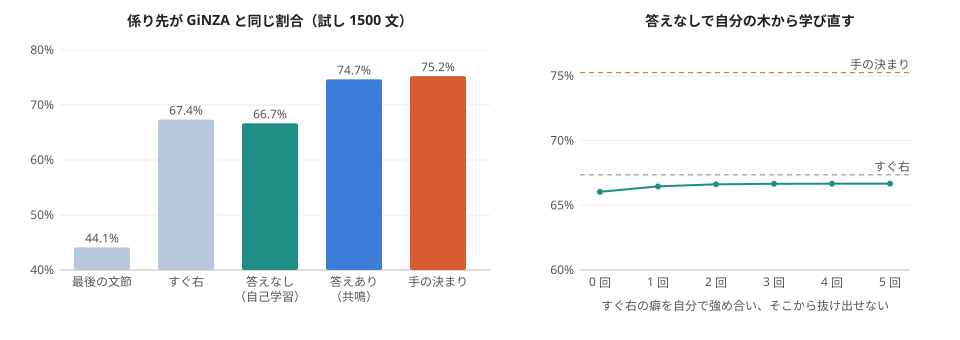
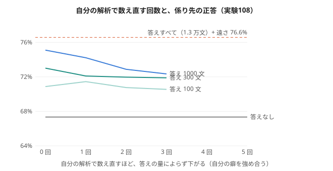

# 共鳴パーシング: GiNZA の係り先を使わずに、自分で係り受けを張る（実験107）

作り方: experiments/exp107_resonance_parser.py。材料: 会話・青空文庫 1.5 万文（Web 小説は使わない）。GiNZA の係り先は答え合わせにだけ使う。
図: [figs/resonance_parser_107.svg](figs/resonance_parser_107.svg)

## 何をしたか（別の AI の助言の提案 1。考え方の図は [advice_review_20261102.md](advice_review_20261102.md)）
- 文節 i の **尾**（最後の機能語: が・を・の・て…、無ければ中身の品詞）が「右のどんな文節に係りたいか」の要求。
- 文節 j の **型**（中身の品詞、細かい版は + j の尾）が受け入れ。要求と受け入れの合い具合（共鳴）を、数え上げた割合や PMI で表す。
- 日本語は係り先が右にあり、矢印は交わらない。i を右から順に、i+1 から辿れる「係り先の鎖」の上で、共鳴 − α log(鎖の何番目か) が最大の所へ係る。
- **答えなしの自己学習**: 最初は「すぐ右」か「同じ文で一緒に出る」だけで共鳴を数え、自分の共鳴で教えの文を解析し、自分が張った矢印だけで数え直す。これを 5 回繰り返す。
- **満ち**: 1 つの述語が同じ格（が・を…）を 2 つ受けないように、一度受けた格は弱める（提案 3 の不応期を、解析に使った形）。
- 文節の切り方は、まだ GiNZA のものを使っている（係り先は使わない）。

## 結果（試し 1500 文、最後の文節以外の文節の係り先）

| やり方 | 正答 |
|---|---|
| 最後の文節に係る | 44.1% |
| すぐ右に係る | 67.4% |
| 答えなし（同じ文で一緒に出る → 自分の木で数え直し 5 回） | 67.3% → 66.8% |
| 答えなし（すぐ右から → 自分の木で数え直し 5 回） | 66.0% → 66.7% |
| 答えあり（GiNZA の係り先で数えた共鳴、細かい型・PMI） | 70.9% |
| 答えあり（品詞だけ・割合） | 74.7% |
| 手の決まり（の・連体 → 名詞、ほか → 述語） | 75.2% |
| 満ちを足す（答えあり・手の決まり） | 74.5%・74.8%（変わらない） |

## 分かったこと
1. **答えなしの自己学習は、すぐ右（67%）から抜け出せなかった。** 自分の木で数え直すと、自分の癖（すぐ右に係る）を自分で強め合う。自己構造化の繰り返しは、それだけでは良くならない。
2. **学んだ共鳴そのものは筋が良い**（の → 名詞、を・に → 動詞、連体詞 → 名詞）。ただ、点ごとの共鳴（尾と型の 2 つだけ）では、答えありでも手の決まり（75%）を超えない。
   外れるのは「どの述語に係るか」（近い述語か、文末の述語か）で、尾と型だけでは区別できない。係り先の候補どうしの比べ（競争）と、読点・は の「遠くへ係る」性質を入れる必要がある。
3. 満ち（同じ格を 2 つ受けない）は効かなかった。この材料では、同じ格の重なりが外れの原因になっていなかった。

## 次の手
- 尾に「読点の有無・は／が」を入れ、遠くの述語へ係る強さを、鎖の何番目かで学ぶ（今は α で一律）。
- 自己学習の始まりを「すぐ右」ではなく、実験91 の差分（助詞が前後に求める品詞）にする。正しい方向の種があれば、繰り返しで育つかを見る。
- それでも自己学習が止まるなら、少しだけ答え（数百文）を混ぜる（半分教えあり）で、どこまで上がるかを測る。

## 続き: 実験108（遠さを学ぶ・やわらかい自己学習・少しだけ答え）

作り方: experiments/exp108_resonance_parser2.py。

- **遠さを尾ごとに数えて学ぶと、答えありで 74.7% → 76.6%。** 手の決まり（75.2%）を初めて超えた。学んだ遠さは筋が良い: の は 97% がすぐ右、が、 は 81% が 2 番目以降・文の最後、は、 は 69% が遠く、て、 は 2 番目以降が多い。
- **答えなしの自己学習は、遠さを足しても 67.3%（すぐ右と同じ）から動かない。** やわらかい自己学習（候補に見込みを配る）は 66.9% → 65.9% と下がった。
- **少しだけ答え（100・300・1000 文）+ 残りは自己学習: 数え直すほど下がる。** 1000 文では 75.1% → 72.3%。答えの量によらず、自分の解析で数え直すと自分の癖を強め合い、悪くなる。

**まとめ:** 「GiNZA の木に近づける」形の自己学習は、この作り方では育たない。持ち主の振り返り（2026-11-02）のとおり、物差しを「木が同じか」から「その構造で何が当たるようになるか（次の語・穴埋め・質問）」に変える。
