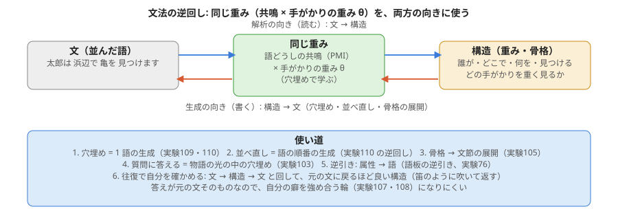
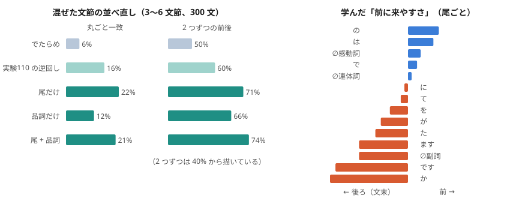

# 文法の逆回し: 解析と生成を同じ重みで（2026-11-02、持ち主「文法と逆回しの利用法も検討を始めてほしい」）

持ち主の以前の言葉:「文法解析は入力と出力を逆にした笛のようなもの」。読む（文 → 構造）と書く（構造 → 文）を、別々の仕組みにせず、**同じ重みを逆に回して使う**。

## 使い道
1. **穴埋め = 1 語の生成**（実験109・110）。読むための手がかりの重みが、そのまま「この場所に来る語」を書く重みになる。
2. **並べ直し = 語順の生成**（実験110 の逆回し）。混ぜた文節を、読む重みの合計が一番大きい並びに戻す。今は丸ごと 16%（でたらめ 5.6%）。
3. **骨格 → 文節の展開**（実験105）。解析で取り出した骨格（役割・格・印）を逆に展開すると文に戻る。
4. **質問に答える = 物語の中の穴埋め**（実験103）。質問は穴の空いた文なので、答えることは物語の光の中で穴を埋める生成。
5. **逆引き: 属性 → 語**（語板の逆引き、実験76）。
6. **往復で自分を確かめる（本命）**: 文 → 構造 → 文 と回して、元の文に戻るほど良い構造とする。
   - 答えが元の文そのものなので、実験107・108 のように自分の癖を強め合う輪になりにくい。
   - 言語に依らない（区切りが分かれば、どの言語でも同じ物差し）。

## 次の試し
- 実験111 の候補: 往復の試験。文の文節を混ぜた袋 → 並べ直し → 元の文と比べる、を物差しにして、並べ直しの重み（左右・遠さ・尾の組）を学ぶ。穴埋めの重みと同じものを共有するか、別に持つかで比べる。
- 穴埋めの重みのならし（似た尾を語板の光でまとめる）で、覚えすぎを抑える。

## 実験111: 往復（混ぜた袋 → 並べ直し）で並びの重みを学ぶ

作り方: experiments/exp111_round_trip_order.py。2 つの文節の「どちらが前か」の見込みを、尾の組・品詞の組の重みで持ち、教えの文の本当の並びから学ぶ。混ぜた文節を、見込みの合計が一番大きい並びに戻す。

| 並べ直し（3〜6 文節、300 文） | 丸ごと一致 | 2 つずつの前後 |
|---|---|---|
| でたらめ | 6% | 50% |
| 実験110 の逆回し（穴埋めの重み） | 16% | 60% |
| 尾だけ | 22% | 71% |
| 品詞だけ | 12% | 66% |
| 尾 + 品詞 | 21% | 74% |

- 並びは、往復（元の文に戻るか）を物差しにして直接学ぶと、穴埋めの重みの逆回しより良い。並びを決めているのは主に尾（機能語）。
- 学んだ「前に来やすさ」は筋が良い: の・は は前、です・か・ます・た は後ろ（文末）。人が決まりとして書かなくても、元の文に戻す物差しから出てきた。
- 丸ごと一致はまだ 2 割。中身の語どうしの関係（誰が・何を）や、文の結びの選び方は入っていない。次は、穴埋めの重み（実験110）と並びの重みを 1 つの器にまとめ、往復と穴埋めの両方の物差しで同時に学ぶ。
