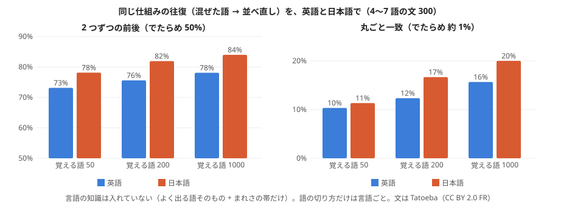
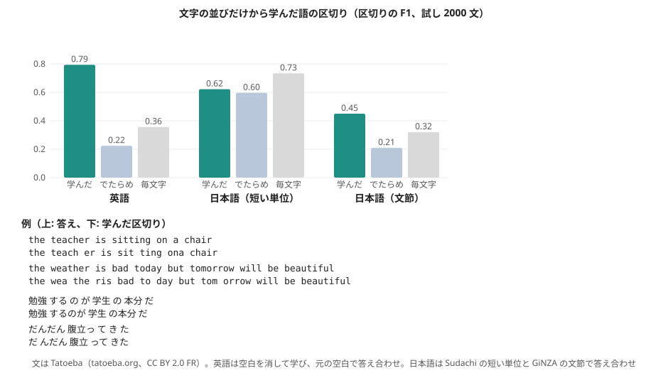
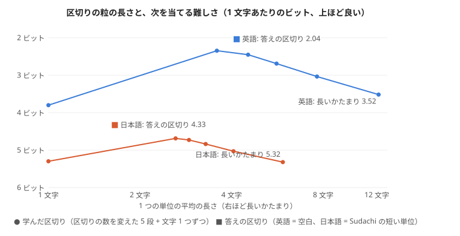

# 文法の逆回し: 解析と生成を同じ重みで（2026-11-02、持ち主「文法と逆回しの利用法も検討を始めてほしい」）

持ち主の以前の言葉:「文法解析は入力と出力を逆にした笛のようなもの」。読む（文 → 構造）と書く（構造 → 文）を、別々の仕組みにせず、**同じ重みを逆に回して使う**。

## 使い道
1. **穴埋め = 1 語の生成**（実験109・110）。読むための手がかりの重みが、そのまま「この場所に来る語」を書く重みになる。
2. **並べ直し = 語順の生成**（実験110 の逆回し）。混ぜた文節を、読む重みの合計が一番大きい並びに戻す。今は丸ごと 16%（でたらめ 5.6%）。
3. **骨格 → 文節の展開**（実験105）。解析で取り出した骨格（役割・格・印）を逆に展開すると文に戻る。
4. **質問に答える = 物語の中の穴埋め**（実験103）。質問は穴の空いた文なので、答えることは物語の光の中で穴を埋める生成。
5. **逆引き: 属性 → 語**（語板の逆引き、実験76）。
6. **往復で自分を確かめる（本命）**: 文 → 構造 → 文 と回して、元の文に戻るほど良い構造とする。
   - 答えが元の文そのものなので、実験107・108 のように自分の癖を強め合う輪になりにくい。
   - 言語に依らない（区切りが分かれば、どの言語でも同じ物差し）。

## 次の試し
- 実験111 の候補: 往復の試験。文の文節を混ぜた袋 → 並べ直し → 元の文と比べる、を物差しにして、並べ直しの重み（左右・遠さ・尾の組）を学ぶ。穴埋めの重みと同じものを共有するか、別に持つかで比べる。
- 穴埋めの重みのならし（似た尾を語板の光でまとめる）で、覚えすぎを抑える。

## 実験111: 往復（混ぜた袋 → 並べ直し）で並びの重みを学ぶ

作り方: experiments/exp111_round_trip_order.py。2 つの文節の「どちらが前か」の見込みを、尾の組・品詞の組の重みで持ち、教えの文の本当の並びから学ぶ。混ぜた文節を、見込みの合計が一番大きい並びに戻す。

| 並べ直し（3〜6 文節、300 文） | 丸ごと一致 | 2 つずつの前後 |
|---|---|---|
| でたらめ | 6% | 50% |
| 実験110 の逆回し（穴埋めの重み） | 16% | 60% |
| 尾だけ | 22% | 71% |
| 品詞だけ | 12% | 66% |
| 尾 + 品詞 | 21% | 74% |

- 並びは、往復（元の文に戻るか）を物差しにして直接学ぶと、穴埋めの重みの逆回しより良い。並びを決めているのは主に尾（機能語）。
- 学んだ「前に来やすさ」は筋が良い: の・は は前、です・か・ます・た は後ろ（文末）。人が決まりとして書かなくても、元の文に戻す物差しから出てきた。
- 丸ごと一致はまだ 2 割。中身の語どうしの関係（誰が・何を）や、文の結びの選び方は入っていない。次は、穴埋めの重み（実験110）と並びの重みを 1 つの器にまとめ、往復と穴埋めの両方の物差しで同時に学ぶ。

## 実験112: 往復は言語に依らないか（英語と日本語）

作り方: experiments/exp112_round_trip_multilingual.py。言語の知識は入れない: 単位は語、型は「よく出る K 語はその語、ほかはまれさの帯」、2 つずつの前後を元の文から学ぶ（実験111 と同じ）。語の切り方だけは言語ごと（英語は空白、日本語は Sudachi）。
文は Tatoeba（tatoeba.org、CC BY 2.0 FR）。英語 10 万文・日本語 10 万文で学び、4〜7 語の文 300 で試す（でたらめの丸ごと一致は約 1%）。

| 言語 | 覚える語 K | 丸ごと一致 | 2 つずつの前後 | 例（混ぜた → 並べ直した） |
|---|---|---|---|---|
| 英語 | 50 | 10.3% | 73.1% | in a apartment tom nice lived → tom a lived nice in apartment（元: tom lived in a nice apartment） |
| 英語 | 200 | 12.3% | 75.6% | permission here park get did to you → did you to get permission park here（元: did you get permission to park here） |
| 英語 | 1000 | 15.7% | 78.1% | illustrator she an is → she is an illustrator（元: she is an illustrator） |
| 日本語 | 50 | 11.3% | 78.1% | 行ける 距離 よ 歩い です て → 歩い 行ける 距離 て です よ（元: 歩い て 行ける 距離 です よ） |
| 日本語 | 200 | 16.7% | 81.9% | 記憶 を た トム 失っ は → トム は 失っ 記憶 を た（元: トム は 記憶 を 失っ た） |
| 日本語 | 1000 | 20.0% | 84.0% | そう トム 元気 は → トム は そう 元気（元: トム は 元気 そう） |

- **同じ仕組みが、英語でも日本語でも同じように働く。** 2 つずつの前後は英語 73〜78%、日本語 78〜84%（でたらめ 50%）。丸ごと一致は 10〜20%（でたらめ約 1%）。
- 覚える語を増やすほど良くなる（K = 50 → 1000）。日本語のほうが少し高いのは、助詞・助動詞が並びの手がかりになるため。
- 持ち主の言う「区切りが分かれば、どの言語でも」の最初の確かめ。次の段は、語の切り方そのもの（文字の並びから区切りを学ぶ）。

## 実験113: 語の区切りを、文字の並びだけから学ぶ

作り方: experiments/exp113_learn_segmentation.py。語の中では次の文字がよく決まり、語の境目では次の文字がばらける（Harris の考え）。前後 1〜4 文字のあとに来る文字のばらけが山になる所で区切る。言語の知識は入れない。文は Tatoeba（CC BY 2.0 FR）。

| 答え合わせ | 学んだ区切り F1 | でたらめ | 毎文字 |
|---|---|---|---|
| 英語（空白を消して学ぶ、元の空白で答え合わせ） | **0.79** | 0.22 | 0.36 |
| 日本語（Sudachi の短い単位） | 0.62 | 0.60 | 0.73 |
| 日本語（GiNZA の文節、別の材料の文） | **0.45** | 0.21 | 0.32 |

- **英語はよく区切れる（F1 0.79）。** 外れは「teach er」「sit ting」「ona chair」のように、語の中の切れ目（語尾）や、短い語どうしのくっつき。
- **日本語は「短い単位」で比べると、でたらめと同じ。** 日本語の短い単位（を・て・た も 1 語）は区切りがとても多く、でたらめや毎文字でも当たりやすいため。学んだ区切りは「勉強 するのが 学生 の本分 だ」「信じ られてい る」のように、**文節に近い、ひとかたまりの単位**を見つけている。文節で比べると F1 0.45（でたらめ 0.21）。
- 区切りの粒は言語によって違う単位に落ち着く。英語は語、日本語は文節に近いかたまり。持ち主の目標（区切りが分かればどの言語でも）にとって、日本語の「どの粒で区切るか」は、穴埋めや往復の物差しで選ぶのが筋（区切りを変えると、どれだけ当たるようになるか）。

## 実験114: 区切りの粒は長いほうが当たるか（持ち主の問い）

作り方: experiments/exp114_granularity.py。粒によらず公平な物差しとして「1 文字あたり何ビットで次を当てられるか」を使う（単位の 2 つ組で次の単位を当て、知らない単位はつづりを文字で当てる分を払う）。Tatoeba 英語・日本語（CC BY 2.0 FR）、教え 10 万文・試し 2000 文。

| 粒 | 英語（ビット / 文字） | 日本語（ビット / 文字） |
|---|---|---|
| 文字 1 つずつ | 3.80 | 5.30 |
| 学んだ区切り、長いかたまり（×0.25、英 12 文字・日 5.9 文字） | 3.52 | 5.32 |
| 学んだ区切り ×1.0 | 2.45 | 4.73 |
| 学んだ区切り、短め（×1.5、英 3.6 文字・日 2.6 文字） | 2.35 | 4.69 |
| 答えの区切り（英語 = 空白、日本語 = 短い単位 1.65 文字） | **2.04** | **4.33** |

- **長いかたまりほど当たる、ではなかった。** この材料の量（10 万文）では、語くらいの短い粒が一番よく当たる。長いかたまりは種類が増えすぎて（英 13 万種類・日 12 万種類）、同じかたまりが 2 度出ることが少なく、学べない。
- 文字 1 つずつも悪い（前の 1 文字だけでは次が決まらない）。**ちょうど良い粒は「語」くらい**で、英語の空白・日本語の短い単位がその辺りにある。
- 学んだ区切りは、細かくするほど答えの区切りに近づく（英 2.35 vs 2.04、日 4.69 vs 4.33）。まだ 0.3 ビットの差がある。
- ただし、長いかたまりでも「似たかたまりどうしで語板の属性を分け合う」なら話が変わる（食べた・食べる が同じ語板の光を持つなど）。今回は単位を記号として数えただけ。語板で分け合う形で、もう一度比べる価値がある。
