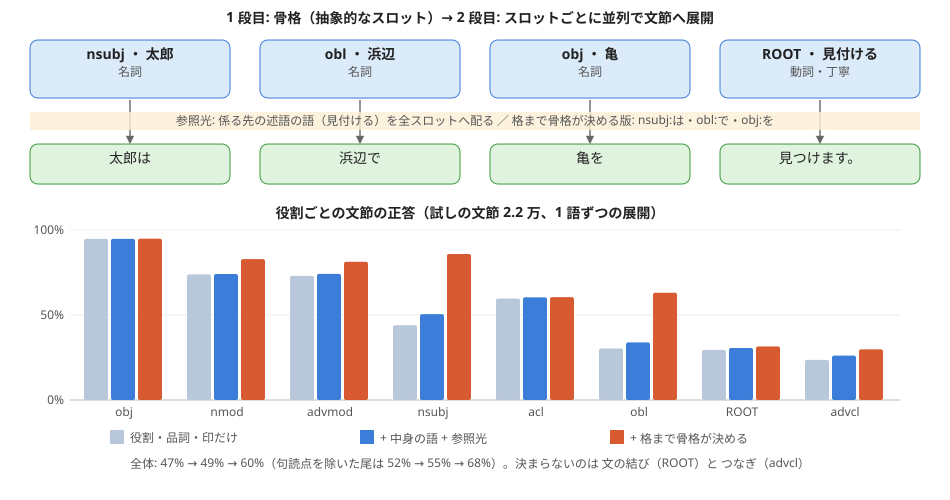

# 骨格生成 → 系列展開 の 2 段目を試す（実験105）

作り方: experiments/exp105_skeleton_expand.py。図: [figs/skeleton_expand_105.svg](figs/skeleton_expand_105.svg)

## 何をしたか（持ち主が見つけた案 2026-11-02: 骨格を作ってから、各スロットを局所的に並列展開する）
- 骨格のスロット = 役割（GiNZA の係り方 nsubj・obj・obl・advcl…）、中身の語の基本形、品詞、述語なら意味の印（過去・否定・丁寧・受け身・続き・望み）。
- 展開 = スロットごとに独立に、文節（中身の語の形 + 助詞・助動詞・句読点）を作る。尾は「まとめて 1 組で選ぶ」と「1 語ずつ、スロットの中の直前 2 語から（局所的な因果の畳み込み）」の 2 通り。
- 参照光 = 係る先の文節の中身の語（その述語）。全スロットに配る。
- 学び方は数え上げの表（教え 19.8 万文節）。数が 3 未満の表は信じず、一つ粗い表へ戻る。まずは「何の情報があれば展開できるか」を測るための上限の目安で、光の板ではまだない。
- 試し: 試しの文節 2.2 万（教えに無い文）と、浦島太郎 20 文の 161 文節。

## 結果

| 展開 | 骨格に入れるもの | 試し 文節 | 試し 尾 | 句読点を除いた尾 | 浦島 文節 | 浦島 句読点を除いた尾 |
|---|---|---|---|---|---|---|
| まとめて | 役割・品詞・印だけ | 47% | 49% | 53% | 42% | 61% |
| まとめて | + 中身の語 | 50% | 51% | 55% | 42% | 62% |
| まとめて | + 参照光（係る先の述語） | 48% | 50% | 54% | 44% | 63% |
| まとめて | + 中身の語 + 参照光 | 49% | 51% | 55% | 43% | 62% |
| まとめて | 格まで骨格が決める | 60% | 62% | 68% | 55% | 81% |
| まとめて | 格まで + 中身の語 + 参照光 | 60% | 62% | 68% | 55% | 81% |
| 1 語ずつ | 役割・品詞・印だけ | 47% | 49% | 52% | 43% | 61% |
| 1 語ずつ | + 中身の語 | 49% | 51% | 55% | 43% | 62% |
| 1 語ずつ | + 参照光（係る先の述語） | 48% | 49% | 53% | 45% | 63% |
| 1 語ずつ | + 中身の語 + 参照光 | 49% | 51% | 55% | 45% | 63% |
| 1 語ずつ | 格まで骨格が決める | 60% | 62% | 68% | 55% | 80% |
| 1 語ずつ | 格まで + 中身の語 + 参照光 | 60% | 62% | 68% | 54% | 79% |

役割ごとの文節の正答（試し、1 語ずつ）:

| 骨格 | obj | nmod | advmod | nsubj | acl | obl | ROOT | advcl |
|---|---|---|---|---|---|---|---|---|
| 役割・品詞・印だけ | 95% | 74% | 73% | 44% | 60% | 30% | 30% | 24% |
| + 中身の語 + 参照光 | 95% | 74% | 74% | 50% | 60% | 34% | 31% | 26% |
| 格まで + 中身の語 + 参照光 | 95% | 83% | 81% | 86% | 60% | 63% | 32% | 30% |

## 分かったこと
1. **展開そのものは局所でできる。** 1 語ずつ（スロットの中の直前 2 語だけを見る）でも、尾をまとめて選ぶのとほぼ同じ正答になった。スロットどうしを見なくても大きくは崩れない。
2. **参照光（係る先の述語）は少ししか効かない**（+2〜3 点。主語・obl で少し上がる）。「亀に乗る／亀を見る」の違いは、多くが役割（obl と obj）の時点で決まっていた。
3. **決め手は、骨格がどこまで持つか。** 格（が・は・に・で…）まで骨格が決めると 49% → 60%（句読点を除いた尾は 55% → 68%、浦島太郎は 80%）。主語は 51% → 86%、obl は 34% → 63%。「は／が」「に／へ／で」は、述語からは決まらない（話の流れ・意味の役割で決まる）。
4. 格まで決めても残るのは、**文の結び（ROOT 32%: ます・た・のだ・よ・か…）と つなぎ（advcl 30%: て・と・ので・が・ば…）**。これは文と文、節と節の関係の意味なので、骨格の側の情報（話し方・因果）として持つべきもの。
5. 中身の語の形の誤りもある（苛めるれている・買い取るて・見付けます）。語の活用を数え上げで覚えているだけなので、UniDic の活用表を使えば直せる見込み。

**まとめ:** 2 段に分ける案は筋が良い。展開は局所的・並列で足りる。難しいのは 1 段目で、骨格に「格・つなぎ方・文の結び（話し方）」まで入れる必要がある。言結いの最初の目標（話者関係: 人称と丁寧さ）は、ちょうど文の結びを決める情報なので、骨格の印に入れると噛み合う。

## 浦島太郎の展開（格まで + 中身の語 + 参照光、[ ] は外れ）

- 元: 昔々、浦島太郎という優しい漁師が暮らしていました。
  - 展開: [昔々][浦島太郎と]優しい漁師が暮らしていました。（3/5 文節）
- 元: ある日、太郎は浜辺で子供たちにいじめられている亀を見つけます。
  - 展開: [或る][日]太郎は浜辺で[子供達に][苛めるれている]亀を[見付けます。]（3/8 文節）
- 元: かわいそうに思った太郎は、亀を買い取って海へ逃がしてあげました。
  - 展開: [可哀想に]思った[太郎は]亀を[買い取るて]海へ逃がして[上げました。]（4/8 文節）
- 元: 数日後、太郎が海で釣りをしていると、あの時の亀が姿を現します。
  - 展開: [数日後]太郎が海で釣りを[為ているので、]あの時の亀が姿を現します。（8/10 文節）
- 元: 亀は命の恩人である太郎を、海の世界へ招待したいと言いました。
  - 展開: 亀は命の[恩人な][太郎を]海の世界へ[招待だと][言ってました。]（4/8 文節）
- 元: 太郎が亀の背中に乗ると、海を深く潜り、きらびやかな竜宮城へ到着します。
  - 展開: 太郎が亀の背中に[乗って]海を[深い][潜って][煌びやかな]竜宮城へ[到着です。]（5/10 文節）
- 元: 城では美しい乙姫様が、太郎を盛大に歓迎してくれました。
  - 展開: [城で]美しい[乙姫様が]太郎を盛大に[歓迎でした。]（3/6 文節）
- 元: 鯛や平目の見事な踊りと、山海の贅を尽くしたごちそうが振る舞われます。
  - 展開: [鯛、][鮃の]見事な[踊りと]山海の贅を尽くした[御馳走が][振る舞っれますか？]（4/9 文節）
- 元: 夢のような楽しい日々に、太郎は時間の経つのも忘れてしまいました。
  - 展開: 夢のような楽しい[日々に]太郎は時間の[経っても][忘れました。]（5/8 文節）
- 元: しかし、やがて故郷の母親のことが心配になり、帰ることを決意します。
  - 展開: [然し][軈て]故郷の母親のことが[心配して][成って]帰ることを[決意です。]（5/10 文節）
- 元: 乙姫様は引き止めますが、太郎の意志が固いと知ると別れを受け入れました。
  - 展開: 乙姫様は[引き止めるますが、]太郎の意志が[固くと][知って]別れを受け入れました。（5/8 文節）
- 元: 別れ際、乙姫様は「決して開けてはならない」と、玉手箱を渡します。
  - 展開: [別れ際して]乙姫様は[「そう][開けないのは]玉手箱を渡します。（3/6 文節）
- 元: 再び亀の背に乗って、太郎は住み慣れた元の浜辺へと戻ってきました。
  - 展開: 再び亀の背に[乗って]太郎は[住んた]元の[浜辺へ]戻って[来ました。]（6/10 文節）
- 元: しかし、周囲の景色は一変しており、見覚えのある人は誰もいません。
  - 展開: [然し][、私の]景色は[一変して]見覚えの[有る]人は誰も[居ません。]（4/9 文節）
- 元: 我が家があった場所を訪ねても、家はなく、母の姿もありませんでした。
  - 展開: 我が家が[有った]場所を[訪ねても]家は[無い]母の姿も[有ったんですよ。]（5/9 文節）
- 元: 実は、竜宮城の数日間の間に、地上では数百年の歳月が流れていたのです。
  - 展開: [実は]竜宮城の数日間の[間に][地上で]数百年の歳月が[流れていました。]（4/8 文節）
- 元: 絶望した太郎は、途方に暮れて浜辺に佇んでしまいました。
  - 展開: [絶望な][太郎は]途方に暮れて浜辺に[佇みました。]（3/6 文節）
- 元: 寂しさと悲しみのあまり、太郎は禁じられていた玉手箱を開けてしまいます。
  - 展開: 寂しさと悲しみの[余り]太郎は[禁じるれていた]玉手箱を[開けます。]（4/7 文節）
- 元: 箱から白い煙がモクモクと立ち上り、太郎を包み込みました。
  - 展開: 箱から白い煙が[もくもくと][立ち上っ、]太郎を[包み込むました。]（4/7 文節）
- 元: 煙が晴れると、若かった太郎は、髪も髭も真っ白なおじいさんになっていました。
  - 展開: 煙が[晴れて]若かった[太郎は]髪も髭も真っ白な[御爺さんに][成っていました。]（5/9 文節）

