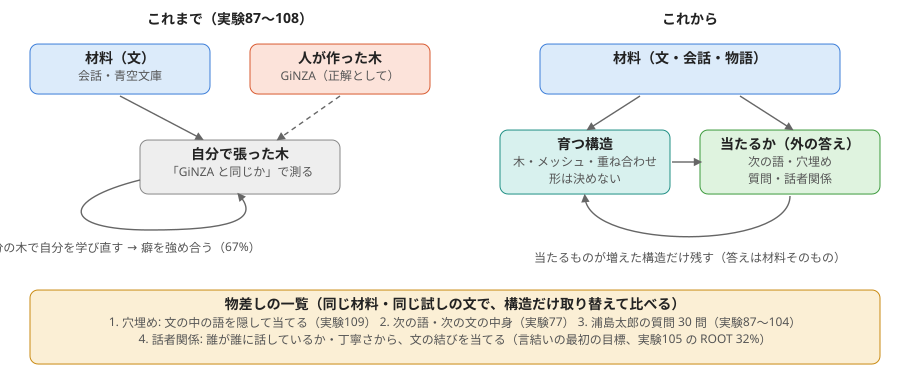
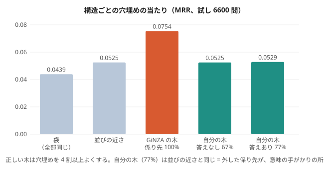

# 物差しを変える: 構造は「何が当たるようになるか」で測る（2026-11-02）

## なぜ変えるか
持ち主の振り返り「ここのところの文法解析というロジスティクスな解決法にも問題があった」。
- 実験87〜108 は、GiNZA の木（人が作った文法の木）を正解・土台にしていた。測る物差しそのものが外から与えた構造で、「材料から自分で構造ができる」目標と逆向きだった。
- 自分で張った木を自分で学び直すと、癖を強め合って悪くなった（実験107・108: すぐ右 67% から動かず、答えを混ぜても数え直すほど下がる）。
- うまくいったのは、役割で測ったもの: 実験82（品詞が前後の関係から自然に出た）、実験91・93（機能語の要求・働きが差分から分かれた）、実験97（質問に答えられた）。

## これからの決まり
1. 構造の形（木・メッシュ・重ね合わせ）は決めない。
2. 構造は、**同じ材料・同じ試しで、当たるものが増えた時だけ残す**。答えは材料そのもの（隠した語・次の文・物語の質問）で、人が作った木ではない。
3. GiNZA の木は「どこまで行けるかの目安」としてだけ並べる。

## 物差しの一覧
| 物差し | 中身 | これまでの実験 |
|---|---|---|
| 穴埋め | 文の中の語を 1 つ隠して、残りから当てる（MRR） | 実験85、実験109 |
| 次の語・次の文の中身 | 次の文に出る名詞の仲間を当てる | 実験77 |
| 物語の質問 | 浦島太郎 30 問 | 実験87〜104 |
| 話者関係 | 誰が誰に話すか・丁寧さから、文の結びを当てる（言結いの最初の目標） | 実験105 の ROOT 32% |

## 最初の試し: 実験109（構造ごとの穴埋め）

作り方: experiments/exp109_structure_by_cloze.py。会話・青空文庫 1.5 万文。穴埋めの仕組み（一緒に出る割合 PMI の重ね合わせ）は同じで、どの手がかりを重く見るかだけを構造が決める。

| 構造 | 穴埋め MRR | その木の係り先の正答 |
|---|---|---|
| 袋（全部同じ重み） | 0.0439 | |
| 並びの近さ | 0.0525 | |
| 自分の木（答えなしの自己学習） | 0.0525 | 67% |
| 自分の木（答えあり + 遠さ） | 0.0529 | 77% |
| GiNZA の木 | 0.0754 | （目安） |

- **正しい木は穴埋めを 4 割以上よくする**（0.0525 → 0.0754）。構造は役に立つ、ということはこの物差しで見える。
- **自分の木は 77% 当たっていても、並びの近さと同じ。** 外している 23% が、ちょうど意味の手がかりになる遠い係り（は → 文末の述語 など）だから。係り先の正答の数字より、どの係りを当てるかが大事。
- 注意: GiNZA は隠した語も見て木を作っているので、GiNZA の木の数字には少し「答えの漏れ」が入っている可能性がある。

## 次: 穴埋めが当たるように木を張る（実験110 の候補）
係り先を「機能語の尾と品詞」ではなく、**中身の語どうしの共鳴（一緒に出る強さ）**で選ぶ。穴埋めが当たるほど良い木、という物差しで自分を学び直す。答えは材料（隠した語）なので、自分の癖を強め合う輪にはなりにくい。
