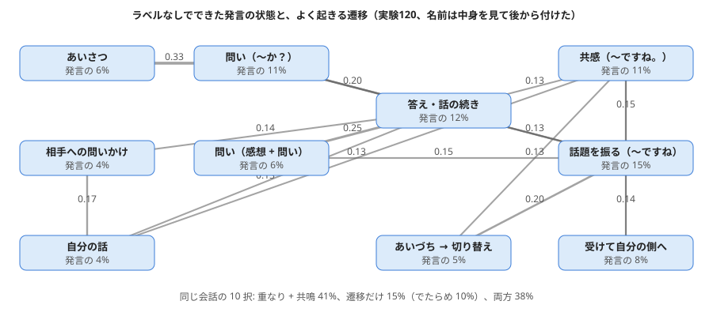

# テストボット02: 返事を選ぶ会話ボット（実験115、2026-11-02）

持ち主との方針: 会話ボットへは、いきなり文を一から作らず「会話の材料の中から返事を選ぶ」から始め、話者関係で尾（文の結び）を合わせ、生成は少しずつ置き換える。
会話の材料: RealPersonaChat（nu-dialogue、CC BY-SA 4.0）・JMultiWOZ（nu-dialogue、CC BY-SA 4.0）。下の例の返事は RealPersonaChat の発言。

## 会話の物差し（実験115）

作り方: experiments/exp115_response_selection.py。本物の会話を途中で止め、正しい次の発言を 10 個の候補から選べるか（でたらめ 10%）。代役の AI も人の採点も要らず、毎回同じに測れる。

| 選び方 | ほかの会話の発言が外れ | 同じ会話の発言が外れ（むずかしい） |
|---|---|---|
| でたらめ | 9% | 11% |
| 語の重なり（話に出た語、実験81 の考え） | 43% | 31% |
| 次の発言の共鳴（「x の次に y が出やすい」を数えた PMI） | 59% | 37% |
| 重なり + 共鳴 | 61% | **38%** |
| + 文脈 3 発言 | 65% | 29% |
| + 口調の合い（丁寧・くだけた） | **66%** | 29% |

- **これまでの部品（数え上げの共鳴と語の重なり）だけで、10 択の 6 割以上を当てた。** 案内の対話（JMultiWOZ）は 83〜88%、雑談（RealPersonaChat）は 55〜63%。
- 同じ会話の中から選ぶ（流れの見分け）と 38% に下がる。文脈を広げるとかえって悪くなる（前の話題に引っ張られる）。**会話の流れ（今どこを話しているか）は、まだ持てていない。**
- 口調の合いは、ほとんど効かなかった（RealPersonaChat はほぼ全員が丁寧に話すため）。話者関係の効き目は、口調が混ざる材料で測る必要がある。

## テストボット02（tools/testbot02.py）

選び方 C（重なり + 共鳴）で、雑談の発言 33 万の中から返事を選ぶ。共鳴の強い「次に出やすい語」から逆引きの索引で候補を絞り（33 万 → 400）、点の順に並べる。点が低いときは「（自信がないけど）」を付ける。

| 人 | ボット（選んだ返事） |
|---|---|
| こんにちは！最近ラーメンにはまってるんだ | 最近韓国の辛いカップラーメンにハマって大量ストックしてしまいました。 |
| 休みの日は何をしていますか？ | 平日1日と、土日のどっちか1日休みがうれしいですね。 |
| 犬を飼っているんですが、散歩が大変で | 昔実家で犬を飼ってました。猫は散歩しなくていいですよね。 |
| 明日から旅行で北海道に行きます | この時期は暑いので、少し涼しい北海道をのんびり旅行したいですよね。 |
| 最近寝不足でつらいよ | 最近は激辛にはまっていて、蒙古タンメンによく行きます。（外れ: 「最近」だけで選んだ） |

（返事は RealPersonaChat の発言、CC BY-SA 4.0。人の発言は試しに書いたもの。）

## 次
1. 会話の流れ: 「今の話題・誰の番・質問されたか」を短期の記憶に持ち、同じ会話の中での見分け（38%）を上げる。
2. 尾の付け替え: 選んだ返事の中身はそのまま、文の結び（です・ます ↔ だ・よ）を話者関係に合わせて替える（中身 + 尾の語板）。
3. 代役のローカル AI を相手役・採点役にした試験（学びには使わない）。

## 実験116: 会話の流れの手がかりを学ぶ（同じ会話の中の見分け）

作り方: experiments/exp116_conversation_flow.py。流れの手がかり 14 個（直前・前の話題・自分の前の発言との 重なり / 共鳴、もう言われた語の割合、質問 → 答えの形、あいさつの位置、長さ、口調、話し方のくせ）の重みを、本物の会話の「正しい次 vs 同じ会話のほかの発言」から学ぶ。

| 選び方（同じ会話の 10 択、試し 3470 問） | 1 位の正答 |
|---|---|
| 実験115 の 重なり + 共鳴（直前） | 36.9% |
| 流れの手がかり 14 個を学ぶ | 37.5% |

- **ほとんど上がらなかった。** 効いているのは「直前との共鳴」（外すと −26 点）と「前の話題には戻らない」（重なり 前の話題 の重みが負、外すと −4 点）だけ。質問 → 答えの形・あいさつの位置・話し方のくせ は、同じ会話の中の見分けにはほとんど効かない。
- 同じ会話の発言は話題が同じなので、語の袋（どの語が出るか）では流れが見えない。「何をしていますか → 〜しています」のような、**発言と発言の関係の形**（問いの種類と答えの種類の対応）を持つ必要がある。これは実験90 の疑問フィルター（疑問の語 → 答えの役割）を会話に広げる所。

## 実験117: 文の結びを話者関係（丁寧・くだけた）に合わせて付け替える

作り方: experiments/exp117_ending_swap.py。文の最後の文節を「中身」と「尾」に分け、尾の意味の印（過去・否定・問い・誘い・望み・言いさし）を保ったまま、丁寧さだけ替える。
よく出る尾を（丁寧さ・印・中身の語 / 品詞）ごとに数えて選び、中身の形（行き・行っ）は数え上げで合わせる。終わりの よ・ね などは元のまま付け直す。

- 往復（丁寧 → くだけた → 丁寧）で元の文節に戻る: **47%**（試し 3155 文節）。印と丁寧さは狙いどおり 100%（ただし、印ごとの表から選んでいるので、ここは作りの上で当たり前）。
- 戻らない多くは、同じ意味の尾が何通りもあるため（ました / たんです / たんですよ、思う / 思っている）。「間違い」ではなく「別の言い方」も多い。

| 元（自分で書いた文） | 付け替え |
|---|---|
| 昨日は駅前のラーメン屋に行きました | 昨日は駅前のラーメン屋に行った |
| 北海道に行きたい | 北海道に行きたいです |
| 犬の散歩は大変だった | 犬の散歩は大変でした |
| まだ食べてない | まだ食べません |
| もう宿題は終わったの？ | もう宿題は終わりましたか？ |
| これは君の本ですか | これは君の本？ |
| 明日は雨が降らないと思います | 明日は雨が降らないと思っている（意味が少しずれる） |
| 一緒に映画を見ましょう | （替えられない: くだけた誘い「見よう」の数が足りない） |

**次:** テストボット02 に組み込み、相手の口調に合わせて選んだ返事の結びを付け替える。尾の「何通りもある言い方」から、話者ごとのくせ（よく使う尾）を覚えるのが、言結いの話者関係につながる。

## 実験118: 会話の始まり用の「見えない会話」（持ち主の案）

作り方: experiments/exp118_hidden_primer.py。本当の会話の前に、相手に見せない会話を履歴として入れ、返事の点を付けるときだけ薄い重み（0.3 または 1.0）で手がかりにする。試しは会話の 1〜3 発言目、10 択。

| 見えない会話 | 外れ = ほかの会話のどこか | 外れ = ほかの会話の始まり（似ていてむずかしい） |
|---|---|---|
| なし | 46.8%（2 発言目 32%） | 31.9% |
| よくある始まり（教えの会話 200 本の始めの 4 発言の袋）、重み 0.3 | **51.4%（2 発言目 44%）** | 30.2% |
| よくある始まり、重み 1.0 | 49.7% | 27.1% |
| 誰かの会話 1 本（人格の種の代わり）、重み 0.3 | 41.0% | 30.0% |

- **よくある始まりを薄く入れると、滑り出しが良くなる**（2 発言目で 32% → 44%）。「始まりらしい返事」を選びやすくなるため。
- ただし、始まりどうしの見分け（どの始まりの返事か）には効かない（31.9% → 30.2%）。重くすると、どの会話にも同じような返事を選ぶ方へ寄る。
- **誰かの会話（関係のない人格）を入れると悪くなる**。この試しでは、正しい返事は別の人の発言なので当然でもある。人格の効き目は、持ち主のプロフィールや持ち主自身の会話で、人格に合った返事を選べるかとして測る必要がある。

## テストボット02 の更新: 感情 → 内容 → 質問 の型（持ち主が調べた会話継続のテクニック）と、結びは基本丁寧

- **バックトラッキング**: 相手の最後の述語（感情の語があればそれを優先）を、くだけた形 + 「んですね」で返す（「感動したよ」→「感動したんですね」、「大変で」→「大変なんですね」、「行きます」→「行くんですね」）。質問には返さない。
- **内容**: 実験115 の共鳴で選んだ返事。結びは基本丁寧（実験117 の付け替え、持ち主「基本に丁寧で大体問題ない」）。
- **質問**: 選んだ返事が短く質問でなければ、上位の候補から質問の形のものを 1 つ足して、話を相手に渡す。
- ※ 結びの表は実験117 の材料（実験だけに使う材料を含む）から作っている。苗として配るときは、ライセンスの分かる材料で作り直す。

| 人 | ボット |
|---|---|
| 昨日、映画を見てすごく感動したよ | 感動したんですね。いいですね。最近観て面白かったドラマや映画はどんなのがありますか？ |
| こんにちは！最近ラーメンにはまってるんだ | はまってるんですね。最近韓国の辛いカップラーメンにハマって大量ストックしてしまいました。 |
| 犬を飼っているんですが、散歩が大変で | 大変なんですね。昔実家で犬を飼ってました。猫は散歩しなくていいですよね。今は犬よりも猫飼っている人の方が多いらしいですね！何歳の子なんですか？ |
| 明日から旅行で北海道に行きます | 行くんですね。北海道もいいですね！北海道は札幌しかまだ行ったことないです。 |
| 最近寝不足でつらいよ | つらいんですね。最近は激辛にはまっていて、蒙古タンメンによく行きます。（内容は外れ） |

（「んですね」の前までと、内容・質問の文は RealPersonaChat の発言から選んだもの、CC BY-SA 4.0。人の発言は試しに書いたもの。）
- 良くなった所: 相手の気持ちを受け止める一言が入り、会話らしくなった。犬の例は「感情 → 内容 → 質問」の型どおり。
- 残る所: 内容は語の共鳴で選んでいるので、話題の中心を外すことがある（寝不足 → 激辛）。犬の例のように、別々の発言をつなぐと少しちぐはぐになる（自分は猫の話をしているのに「何歳の子」と犬のことを聞く）。

## テストボット02 の更新 2: 持ち主の案（2026-11-02）

- **「何に・何が」どうした**: バックトラッキングに、述語のすぐ前の「名詞 + が・を・に・へ・で・と」を付ける（「散歩が大変なんですね」「北海道に行くんですね」）。最近・今日 のような時の語は付けない。
- **重みを揺らした 10 通りの票**: 重なり・共鳴・口調の重みを少しずつ揺らして 10 回選び、票の多い返事を選ぶ。票の割合を「自信」にする。自信が 0.5 未満なら、内容は出さずに話題を続ける質問だけを返す。
- **話題を続ける質問**: 相手の名詞（固有名詞を優先）と同じ発言の中で一緒に出やすい名詞を選び、「〜ですか？」と聞く（属性先の語板の代わり。今は数え上げ）。
- **知らない語**: 教えの会話に出ない名詞は「「〜」って何ですか？ 初めて聞きました。」と聞き返し、そのときに一緒に聞いた語をバッファに残す（語板をリアルタイムに増やす最初の形）。

| 人 | ボット（自信） |
|---|---|
| 犬を飼っているんですが、散歩が大変で | 散歩が大変なんですね。昔実家で犬を飼ってました。猫は散歩しなくていいですよね。公園ですか？（1.0） |
| 明日から旅行で北海道に行きます | 北海道に行くんですね。メロン美味しいですよねー！　旅行に行くなら、北海道はおすすめですね。（1.0） |
| こんにちは！最近ラーメンにはまってるんだ | ラーメンにはまってるんですね。最近韓国の辛いカップラーメンにハマって大量ストックしてしまいました。（0.5） |
| 週末にポポロンタをやったよ | ポポロンタをやったんですね。「ポポロンタ」って何ですか？ 初めて聞きました。（0.0） |

（内容の文は RealPersonaChat の発言、CC BY-SA 4.0。「ポポロンタ」は試しに作った語。）
残る所: 話題を続ける質問は、一緒に出やすい語を数えただけなので、「公園ですか？」のように前の文とのつながりが弱いことがある。語板の属性（北海道 → 場所 → 札幌）で選ぶ形にしたい。開始時の隠された会話（キャラごとの自己紹介の型）は次に入れる。

## 実験119: 格逆算グレインの最初の形（持ち主の案: 格を抜いて学び、逆回しで想定する）

作り方: experiments/exp119_case_recovery.py。会話の中の「名詞 + が・を・に → 動詞」から名詞を消し、会話に出ている名詞（前の 3 発言とその発言の中）の中から当てる。本当の省略に近い場合（消した名詞が前の 3 発言にも出ている）847 問で測る。答えは消す前の元の発言。

| 当て方 | 全体 | を | が | に |
|---|---|---|---|---|
| でたらめ | 14% | | | |
| 近さ（いちばん最近の名詞） | 6% | 5% | 5% | 8% |
| **述語の格の好み P(名詞 \| 動詞, 格)** | **46%** | **57%** | 45% | 35% |
| 近さ + 格の好み | 45% | 57% | 43% | 34% |
| + 発言どうしの共鳴 | 47% | 58% | 45% | 36% |

- **述語の格の好みだけで、消した名詞の半分近くを当てた**（でたらめ 14%）。「を」がいちばん当てやすい（食べる を → 御飯・パン・カレー、飼う を → ペット・インコ、読む を → 漫画・小説）。「に」は意味が広く（電車に乗る・相談に乗る）当てにくい。
- 近さは役に立たなかった。いちばん近い名詞は同じ発言の中の別の語であることが多いため。前の発言だけの近さにするなど、見方を変える必要がある。
- 逆回しの使い道: 本当に省略された発言（「昨日食べたよ」）で、会話に出ている名詞の中から「何を → ラーメンを」と補える。補った格は、返事の選び方（つながりの手がかり）とバックトラッキング（「ラーメンを食べたんですね」）に使える。

## 実験120: 会話の状態遷移グレイン（持ち主の案: 連続する会話文から遷移グレインを作る）

作り方: experiments/exp120_transition_grain.py。発言の「形」（終わり方・あいづち・感情の語・自分の話・相手への問いかけ・前との話題の続き / 切り替え・あいさつ）で、ラベルなしで 16 の状態に分け、本物の会話で 状態 → 次の状態 を数えた。名前は中身を見て後から付けた。

- **状態は、ラベルなしでも読める形に分かれた**: あいさつ（「よろしくお願いします！」）、問い（「今日の天気はどうでしたか？」）、相手への問いかけ（「〜さんはいかがですか？」）、共感（「涼しくなりましたね。」）、自分の話（「私は麺類が多めになります。」）、答え・話の続き、話題を振る、など。
- **遷移も筋が通っている**: あいさつ → あいさつ 45%・問い 33%（始めはあいさつを返して質問）、問い → 答え・話の続き 20〜25%、相手への問いかけ → 自分の話。
- **ただし、同じ会話の 10 択には効かなかった**: 重なり + 共鳴 41% に遷移を足すと 38%。遷移だけだと 15%（でたらめ 10%）。同じ会話の候補は、形（状態）がどれも似ているため、状態では見分けにくい。
- 使い道は「選ぶ」より「次に何をするか決める」方: 相手が問いなら答えの状態の候補から、あいさつならあいさつ + 問い、のように、返事の状態を決めてから中身を選ぶ（テストボット02 の 共感 → 内容 → 質問 を、固定の順でなく遷移グレインで決める）。

## テストボット02 の更新 3: 遷移グレインで「次にどの状態で返すか」を決める（持ち主「次にどの状態で返すかを決める ← いいね」）

- 相手の発言の状態（実験120 の 16 状態）を読み、候補の返事の状態が「そのあとに来やすいか」（log P(返事の状態 | 相手の状態)）を点に足す（揺らした 10 通りの票の手がかりの 1 つ）。
- あいさつ・問いには「〜んですね」で受けない（あいさつ → あいさつ・問い、問い → 答え）。知らない語は共感を付けずに聞き返す（持ち主の案）。

| 人 | ボット（自信） |
|---|---|
| こんにちは、よろしくお願いします！ | こんにちは、今日はよろしくお願いいたします。（0.7） |
| 休みの日は何をしていますか？ | 休みの日はゆっくり過ごしますね。ゲームとかパソコンですか？（0.8） |
| 昨日、映画を見てすごく感動したよ | 感動したんですね。映画やドラマ、漫画などで、おすすめの作品はありますか？（0.7） |
| 犬を飼っているんですが、散歩が大変で | 散歩が大変なんですね。昔実家で犬を飼ってました。猫は散歩しなくていいですよね。公園ですか？（1.0） |
| 週末にポポロンタをやったよ | 「ポポロンタ」って何ですか？ 初めて聞きました。（0.0） |

（返事の文は RealPersonaChat の発言、CC BY-SA 4.0。人の発言は試しに書いたもの。遷移グレインの保存先は非公開の置き場 models/transition_grain_120.pt。）

## テストボット02 の更新 4: 格の逆算を入れ、手元で話せる形に

- **格の逆算（実験119）**: 相手の動詞に「を・に」が無い（または「で・と」だけ）とき、前の会話に出た名詞の中から、その動詞の格に強く合うもの（全体より 5 倍以上来やすい）を補う。
- **自信がないときは「どんな〜でしたか？」**: 補った名詞・言われた名詞について聞く（内容の選択が割れたとき）。
- 話題を続ける「〜ですか？」は、外れやすい普通名詞をやめ、固有名詞（北海道 → 札幌）だけにした。
- 手元で話す: `python tools/testbot02.py --chat`（1 行ずつ話しかける、空行で終わる）。続いた会話の試し: `python tools/testbot02.py --dialog "発言1" "発言2" …`。

続いた会話の例（人の発言は試しに書いたもの、返事の文は RealPersonaChat の発言 CC BY-SA 4.0 から選んだもの）:

| 人 | ボット（自信） |
|---|---|
| 最近ラーメンにはまってるんだ | ラーメンにはまってるんですね。辛いカップ麺ですか！辛ラーメンとかですか？（0.6） |
| 昨日も駅前の店で食べたよ | **ラーメンを**食べたんですね。どんなラーメンでしたか？（0.4） |
| 今度は新しい店に行ってみたい | 店に行ってみたいんですね。おすすめです！是非試してみます（0.6） |
| 来月は北海道に行くんだ | 北海道に行くんですね。メロン美味しいですよねー！　旅行に行くなら、北海道はおすすめですね。（1.0） |

2 行目: 相手は「何を」食べたか言っていないが、前の会話の「ラーメン」を格の好み（食べる を）で補って受けた。3 行目は、選んだ返事が相手の話（新しい店に行きたい）とずれている。

## テストボット02 の更新 5: キャラクタ「秘書: 言結 となり」（持ち主が書いたプロフィール）

プロフィール: [data/characters/secretary_kotoyui_tonari.json](../data/characters/secretary_kotoyui_tonari.json)（持ち主が書いたもの。「バイアスの語」は Claude が 目標・興味・好きな会話 から整理して足した）。
- **始めのあいさつ → 自己紹介**（持ち主の自己紹介 3 つから。名前を聞く形を優先）。名前を聞いたあとの「山田です」を覚えて「山田さん、よろしくお願いします！」。
- **自分についての質問**（名前・好き・嫌い・興味・目標・生い立ち・短所）は、プロフィールの項目を決まった言い回しに入れて答える。ただの話の中の語（「仕事が忙しい」）には答えず、問いかけ（？・あなた・言結）のときだけ。
- **返事選びの軽いバイアス**: キャラの興味・目標の語（考え方・教える・予定・仕事・お手伝い…）を含む候補を少し上げる（強さ 0.2、持ち主「少しバイアスを掛ける程度」）。一人称が 僕・俺 などの候補は選ばない。
- 起動: `python tools/testbot02.py --chat`（別のキャラは `--char=data/characters/〜.json`）。

| 人 | ボット |
|---|---|
| こんにちは！ | こんにちは、本日は私とお話して頂けるとのこと、ありがとうございます。私の名前は言結と申します、お名前をお伺いしてよろしいでしょうか？ |
| 山田です。あなたのお名前は？ | 山田さん、よろしくお願いします！私は言結となりと申します。言結と呼んでください。 |
| 好きなことは何？ | 教えてくれる会話が好きです。色々教えてもらえると嬉しいです！ |
| 最近仕事が忙しくて大変なんだ | 大変なんですね。そうですね。今は仕事変わったので暇もできましたが、すごく忙しかったんです。 |
| 来週の予定を整理したいんだけど | 予定を整理したいんですね。明日からまた3連休ですが何か予定はありますか |
| どうやって生まれたの？ | 青空文庫ほかの会話学習データから構成されているんです。大きなAIさんと少し違う仕組みで動いているので、変化に柔軟なところが自慢です。 |

（4・5 行目の「〜んですね。」のあとは RealPersonaChat の発言、CC BY-SA 4.0。）
残る所: 4 行目の内容は「自分も忙しかった」という別の人の体験談で、キャラ（生まれたばかりの秘書）と合わない。体験談の候補はキャラの生い立ちと食い違うので、下げる工夫が要る。5 行目は秘書なら「どんな予定がありますか？一緒に整理しましょう」が欲しい所（秘書の型の返事）。

## テストボット02 の更新 6: 相手が課題を抱えているかを読む（持ち主の問い「話し相手が課題を抱えている、を今の仕組みから読み取れるかな？」）

- 課題の点 = 困りごとの感情の語（大変・困る・つらい・疲れ・忙しい・悩む・不安…）+ 「〜したいんだけど / のに」+ 「〜できない・終わらない・間に合わない…」+ 言いさし（〜けど。で終わる）。今は手がかりの足し算（重みは材料からはまだ決めていない）。
- 秘書のキャラで課題の点が 1 以上なら、秘書の型で返す: 中身を聞いて手伝いを申し出る。

| 人 | となり |
|---|---|
| 来週の予定を整理したいんだけど | 予定を整理したいんですね。どんな予定がありますか？ よければ一緒に整理しましょう。 |
| 最近仕事が忙しくて大変なんだ | 大変なんですね。仕事のどんなところが一番大変ですか？ 何かお手伝いできることがあれば言ってくださいね。 |
| 資料が全然終わらなくて困ってる | 困ってるんですね。資料のどんなところが一番大変ですか？ 何かお手伝いできることがあれば言ってくださいね。 |
| 昨日は映画を見て楽しかった | 楽しかったんですね。いいなぁー。自分が楽しめる映画を映画館で観るのはごぶさたですね。（課題なし → いつもの選び方） |

次: 手がかりの重みを材料から決める（本物の会話で、課題を言ったあとに相手が気づかい・質問・助言で返した割合を数える）。秘書の型の言い回しは今は決まった文なので、何通りか持ってくじで選ぶ。

## テストボット02 の更新 7: プロフィールと人格グレインを分ける（持ち主「プロフィールとは別に人格グレインがいるね、重みづけをする」）

- **プロフィール**（data/characters/secretary_kotoyui_tonari.json）: 事実と自己紹介の文。持ち主が書く。
- **人格グレイン**（data/characters/secretary_kotoyui_tonari.persona.json）: 返事の選び方の重みだけ。
  課題解決への興味・共感の強さ（「〜んですね」で受ける割合）・質問の多さ・話題を続ける強さ・知らない語を聞き返す強さ・自信のしきい値・興味の語へのバイアス・口調（丁寧 / くだけた）。
  初期値は持ち主のプロフィールと会話の案から置いたもの。話していくうちに、会話の差分（どの返事が続いたか・👍👎）で少しずつ動かし、その記録を「変化の記録」に残す予定。語板への定着はその先。

## テストボット02 の更新 8: 対話者グレイン（持ち主「人格グレインに話し相手の情報を保持する対話者グレインが必要かも」）

- 相手ごとに 名前・好きなこと（〜が好き・〜にはまって）・予定（明日・来週・今度…）・困りごと（課題の点が 1 以上）・口調（丁寧 / くだけた の数）・よく出る話題・会った回数 を覚える。
- 次に話すとき、あいさつされたら名前で呼び、いちばん新しい困りごと（無ければ予定、好きなこと）を聞く。
- 相手の発言は個人の情報なので、**非公開の置き場（Sin-CNN3_private/users/）にだけ保存**する。公開リポジトリには入れない。
- 使い方: `python tools/testbot02.py --chat --user=名前`（--user を付けたときだけ覚える）。

1 回目:
| 人 | となり |
|---|---|
| こんにちは！ | こんにちは、本日は私とお話して頂けるとのこと、ありがとうございます。私の名前は言結と申します、お名前をお伺いしてよろしいでしょうか？ |
| 佐藤です | 佐藤さん、よろしくお願いします！ |
| 最近キャンプにはまってるんだ | キャンプにはまってるんですね。今はまってみているyoutubeのチャンネルがあって、それがきっかけで始めました |
| 来週、新しいテントで湖に行く予定 | 予定なんですね。子どもの時行った夏のキャンプ楽しかったのを覚えています。 |
| でも仕事の資料が終わらなくて困ってる | 困ってるんですね。資料のどんなところが一番大変ですか？ 何かお手伝いできることがあれば言ってくださいね。 |

2 回目（起動し直して）:
| 人 | となり |
|---|---|
| こんにちは、また来ました | 佐藤さん、また来てくださってありがとうございます！前に「でも仕事の資料が終わらなくて困ってる」とおっしゃっていましたが、その後どうですか？ |

覚えた中身: 名前 佐藤、好きなこと キャンプ、予定「来週、新しいテントで湖に行く予定」、困りごと「でも仕事の資料が終わらなくて困ってる」、口調 くだけた 5・丁寧 1。
（試しの人の発言は自分で書いたもの。3・4 行目の返事の文は RealPersonaChat、CC BY-SA 4.0。）
残る所: 前の発言をそのまま引用している（「でも〜困ってる」）。「資料の方は、その後どうですか？」のように、中身（資料）だけを取り出して聞く形にしたい。

## テストボット02 の更新 9: 時計グレイン（持ち主の案「夜・朝・昼の会話、10 分おきに切り替わる時計グレイン、月と年と季節も」）

表: [tools/clock_grain.json](../tools/clock_grain.json)（最初の値は Claude が置いた。持ち主が数字や語を直せる。いずれは日付つきの文章から学んで置き換える。天気はまだ入れない）。
- 時刻を 10 分刻みで持ち、時間帯（深夜・朝・昼・夕方・夜）・月・季節 を出す。
- あいさつを時間帯で替える（自己紹介の「こんにちは」→ おはようございます / こんばんは）。「今何時？」には月・時刻・季節で答える。
- 返事の候補の点: いまの時間帯の語（朝ごはん・おやすみ…）を含めば少し上げ（0.3）、季節外れの語（12 月に 台風・花火・暑・夏 …）を含めば下げる（1.0）。
- 試し: `--now=2026-12-24T21:30` で時刻を決められる。

| 時刻 | 人 | となり |
|---|---|---|
| 8 月 5 日 8:10 | こんにちは！ | おはようございます、本日は私とお話して頂けるとのこと、…お名前をお伺いしてよろしいでしょうか？ |
| 8 月 5 日 8:10 | 今何時？ | 今は8月、8時10分ごろです。夏ですね。 |
| 8 月 5 日 8:10 | 最近は外に出るのが億劫なんだ | 億劫なんですね。外は涼しかったのに、日差しが出てきて家の中が暑いです。 |
| 12 月 24 日 21:30 | こんにちは！ | こんばんは、本日は私とお話して頂けるとのこと、… |
| 12 月 24 日 21:30 | 最近は外に出るのが億劫なんだ | 億劫なんですね。雨の日、外出るのは億劫なので、室内でも運動できるようにしてます。（夏の暑さの話を避けた） |

（返事の文は RealPersonaChat、CC BY-SA 4.0。）

## テストボット02 の更新 10: 前の会話を、選び方と自信に乗せる（持ち主「自信の判定に以前の会話の情報が乗ってないのかも」）

- それまでは、返事の候補の点も 10 通りの票（自信）も、直前の 1 発言しか見ていなかった。
- 前の 4 発言の語（古いほど 0.7 倍ずつ薄く）と、対話者グレインのよく出る話題（薄く）を「前の話題」とし、候補がそれと重なるほど点を上げる（10 通りの票の手がかりにも入れた）。候補の集め方にも前の話題の上位 5 語を足した。
- 「大変だけど楽しみ」のように良い気持ちの語があるときは、困りごととしない。

| 人 | となり |
|---|---|
| 最近キャンプにはまってるんだ | キャンプにはまってるんですね。今はまってみているyoutubeのチャンネルがあって、それがきっかけで始めました |
| 来週、新しいテントで湖に行く予定 | 予定なんですね。夏の間は近場で遊ぶくらいですね。9月に**キャンプ**に行く予定です。（前の話題 キャンプ につながった） |
（返事の文は RealPersonaChat、CC BY-SA 4.0。）
