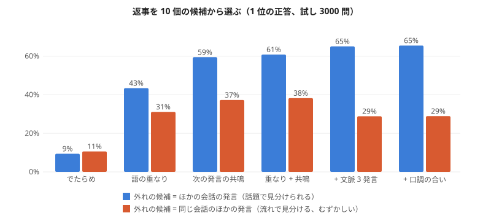

# テストボット02: 返事を選ぶ会話ボット（実験115、2026-11-02）

持ち主との方針: 会話ボットへは、いきなり文を一から作らず「会話の材料の中から返事を選ぶ」から始め、話者関係で尾（文の結び）を合わせ、生成は少しずつ置き換える。
会話の材料: RealPersonaChat（nu-dialogue、CC BY-SA 4.0）・JMultiWOZ（nu-dialogue、CC BY-SA 4.0）。下の例の返事は RealPersonaChat の発言。

## 会話の物差し（実験115）

作り方: experiments/exp115_response_selection.py。本物の会話を途中で止め、正しい次の発言を 10 個の候補から選べるか（でたらめ 10%）。代役の AI も人の採点も要らず、毎回同じに測れる。

| 選び方 | ほかの会話の発言が外れ | 同じ会話の発言が外れ（むずかしい） |
|---|---|---|
| でたらめ | 9% | 11% |
| 語の重なり（話に出た語、実験81 の考え） | 43% | 31% |
| 次の発言の共鳴（「x の次に y が出やすい」を数えた PMI） | 59% | 37% |
| 重なり + 共鳴 | 61% | **38%** |
| + 文脈 3 発言 | 65% | 29% |
| + 口調の合い（丁寧・くだけた） | **66%** | 29% |

- **これまでの部品（数え上げの共鳴と語の重なり）だけで、10 択の 6 割以上を当てた。** 案内の対話（JMultiWOZ）は 83〜88%、雑談（RealPersonaChat）は 55〜63%。
- 同じ会話の中から選ぶ（流れの見分け）と 38% に下がる。文脈を広げるとかえって悪くなる（前の話題に引っ張られる）。**会話の流れ（今どこを話しているか）は、まだ持てていない。**
- 口調の合いは、ほとんど効かなかった（RealPersonaChat はほぼ全員が丁寧に話すため）。話者関係の効き目は、口調が混ざる材料で測る必要がある。

## テストボット02（tools/testbot02.py）

選び方 C（重なり + 共鳴）で、雑談の発言 33 万の中から返事を選ぶ。共鳴の強い「次に出やすい語」から逆引きの索引で候補を絞り（33 万 → 400）、点の順に並べる。点が低いときは「（自信がないけど）」を付ける。

| 人 | ボット（選んだ返事） |
|---|---|
| こんにちは！最近ラーメンにはまってるんだ | 最近韓国の辛いカップラーメンにハマって大量ストックしてしまいました。 |
| 休みの日は何をしていますか？ | 平日1日と、土日のどっちか1日休みがうれしいですね。 |
| 犬を飼っているんですが、散歩が大変で | 昔実家で犬を飼ってました。猫は散歩しなくていいですよね。 |
| 明日から旅行で北海道に行きます | この時期は暑いので、少し涼しい北海道をのんびり旅行したいですよね。 |
| 最近寝不足でつらいよ | 最近は激辛にはまっていて、蒙古タンメンによく行きます。（外れ: 「最近」だけで選んだ） |

（返事は RealPersonaChat の発言、CC BY-SA 4.0。人の発言は試しに書いたもの。）

## 次
1. 会話の流れ: 「今の話題・誰の番・質問されたか」を短期の記憶に持ち、同じ会話の中での見分け（38%）を上げる。
2. 尾の付け替え: 選んだ返事の中身はそのまま、文の結び（です・ます ↔ だ・よ）を話者関係に合わせて替える（中身 + 尾の語板）。
3. 代役のローカル AI を相手役・採点役にした試験（学びには使わない）。

## 実験116: 会話の流れの手がかりを学ぶ（同じ会話の中の見分け）

作り方: experiments/exp116_conversation_flow.py。流れの手がかり 14 個（直前・前の話題・自分の前の発言との 重なり / 共鳴、もう言われた語の割合、質問 → 答えの形、あいさつの位置、長さ、口調、話し方のくせ）の重みを、本物の会話の「正しい次 vs 同じ会話のほかの発言」から学ぶ。

| 選び方（同じ会話の 10 択、試し 3470 問） | 1 位の正答 |
|---|---|
| 実験115 の 重なり + 共鳴（直前） | 36.9% |
| 流れの手がかり 14 個を学ぶ | 37.5% |

- **ほとんど上がらなかった。** 効いているのは「直前との共鳴」（外すと −26 点）と「前の話題には戻らない」（重なり 前の話題 の重みが負、外すと −4 点）だけ。質問 → 答えの形・あいさつの位置・話し方のくせ は、同じ会話の中の見分けにはほとんど効かない。
- 同じ会話の発言は話題が同じなので、語の袋（どの語が出るか）では流れが見えない。「何をしていますか → 〜しています」のような、**発言と発言の関係の形**（問いの種類と答えの種類の対応）を持つ必要がある。これは実験90 の疑問フィルター（疑問の語 → 答えの役割）を会話に広げる所。

## 実験117: 文の結びを話者関係（丁寧・くだけた）に合わせて付け替える

作り方: experiments/exp117_ending_swap.py。文の最後の文節を「中身」と「尾」に分け、尾の意味の印（過去・否定・問い・誘い・望み・言いさし）を保ったまま、丁寧さだけ替える。
よく出る尾を（丁寧さ・印・中身の語 / 品詞）ごとに数えて選び、中身の形（行き・行っ）は数え上げで合わせる。終わりの よ・ね などは元のまま付け直す。

- 往復（丁寧 → くだけた → 丁寧）で元の文節に戻る: **47%**（試し 3155 文節）。印と丁寧さは狙いどおり 100%（ただし、印ごとの表から選んでいるので、ここは作りの上で当たり前）。
- 戻らない多くは、同じ意味の尾が何通りもあるため（ました / たんです / たんですよ、思う / 思っている）。「間違い」ではなく「別の言い方」も多い。

| 元（自分で書いた文） | 付け替え |
|---|---|
| 昨日は駅前のラーメン屋に行きました | 昨日は駅前のラーメン屋に行った |
| 北海道に行きたい | 北海道に行きたいです |
| 犬の散歩は大変だった | 犬の散歩は大変でした |
| まだ食べてない | まだ食べません |
| もう宿題は終わったの？ | もう宿題は終わりましたか？ |
| これは君の本ですか | これは君の本？ |
| 明日は雨が降らないと思います | 明日は雨が降らないと思っている（意味が少しずれる） |
| 一緒に映画を見ましょう | （替えられない: くだけた誘い「見よう」の数が足りない） |

**次:** テストボット02 に組み込み、相手の口調に合わせて選んだ返事の結びを付け替える。尾の「何通りもある言い方」から、話者ごとのくせ（よく使う尾）を覚えるのが、言結いの話者関係につながる。

## 実験118: 会話の始まり用の「見えない会話」（持ち主の案）

作り方: experiments/exp118_hidden_primer.py。本当の会話の前に、相手に見せない会話を履歴として入れ、返事の点を付けるときだけ薄い重み（0.3 または 1.0）で手がかりにする。試しは会話の 1〜3 発言目、10 択。

| 見えない会話 | 外れ = ほかの会話のどこか | 外れ = ほかの会話の始まり（似ていてむずかしい） |
|---|---|---|
| なし | 46.8%（2 発言目 32%） | 31.9% |
| よくある始まり（教えの会話 200 本の始めの 4 発言の袋）、重み 0.3 | **51.4%（2 発言目 44%）** | 30.2% |
| よくある始まり、重み 1.0 | 49.7% | 27.1% |
| 誰かの会話 1 本（人格の種の代わり）、重み 0.3 | 41.0% | 30.0% |

- **よくある始まりを薄く入れると、滑り出しが良くなる**（2 発言目で 32% → 44%）。「始まりらしい返事」を選びやすくなるため。
- ただし、始まりどうしの見分け（どの始まりの返事か）には効かない（31.9% → 30.2%）。重くすると、どの会話にも同じような返事を選ぶ方へ寄る。
- **誰かの会話（関係のない人格）を入れると悪くなる**。この試しでは、正しい返事は別の人の発言なので当然でもある。人格の効き目は、持ち主のプロフィールや持ち主自身の会話で、人格に合った返事を選べるかとして測る必要がある。

## テストボット02 の更新: 感情 → 内容 → 質問 の型（持ち主が調べた会話継続のテクニック）と、結びは基本丁寧

- **バックトラッキング**: 相手の最後の述語（感情の語があればそれを優先）を、くだけた形 + 「んですね」で返す（「感動したよ」→「感動したんですね」、「大変で」→「大変なんですね」、「行きます」→「行くんですね」）。質問には返さない。
- **内容**: 実験115 の共鳴で選んだ返事。結びは基本丁寧（実験117 の付け替え、持ち主「基本に丁寧で大体問題ない」）。
- **質問**: 選んだ返事が短く質問でなければ、上位の候補から質問の形のものを 1 つ足して、話を相手に渡す。
- ※ 結びの表は実験117 の材料（実験だけに使う材料を含む）から作っている。苗として配るときは、ライセンスの分かる材料で作り直す。

| 人 | ボット |
|---|---|
| 昨日、映画を見てすごく感動したよ | 感動したんですね。いいですね。最近観て面白かったドラマや映画はどんなのがありますか？ |
| こんにちは！最近ラーメンにはまってるんだ | はまってるんですね。最近韓国の辛いカップラーメンにハマって大量ストックしてしまいました。 |
| 犬を飼っているんですが、散歩が大変で | 大変なんですね。昔実家で犬を飼ってました。猫は散歩しなくていいですよね。今は犬よりも猫飼っている人の方が多いらしいですね！何歳の子なんですか？ |
| 明日から旅行で北海道に行きます | 行くんですね。北海道もいいですね！北海道は札幌しかまだ行ったことないです。 |
| 最近寝不足でつらいよ | つらいんですね。最近は激辛にはまっていて、蒙古タンメンによく行きます。（内容は外れ） |

（「んですね」の前までと、内容・質問の文は RealPersonaChat の発言から選んだもの、CC BY-SA 4.0。人の発言は試しに書いたもの。）
- 良くなった所: 相手の気持ちを受け止める一言が入り、会話らしくなった。犬の例は「感情 → 内容 → 質問」の型どおり。
- 残る所: 内容は語の共鳴で選んでいるので、話題の中心を外すことがある（寝不足 → 激辛）。犬の例のように、別々の発言をつなぐと少しちぐはぐになる（自分は猫の話をしているのに「何歳の子」と犬のことを聞く）。

## テストボット02 の更新 2: 持ち主の案（2026-11-02）

- **「何に・何が」どうした**: バックトラッキングに、述語のすぐ前の「名詞 + が・を・に・へ・で・と」を付ける（「散歩が大変なんですね」「北海道に行くんですね」）。最近・今日 のような時の語は付けない。
- **重みを揺らした 10 通りの票**: 重なり・共鳴・口調の重みを少しずつ揺らして 10 回選び、票の多い返事を選ぶ。票の割合を「自信」にする。自信が 0.5 未満なら、内容は出さずに話題を続ける質問だけを返す。
- **話題を続ける質問**: 相手の名詞（固有名詞を優先）と同じ発言の中で一緒に出やすい名詞を選び、「〜ですか？」と聞く（属性先の語板の代わり。今は数え上げ）。
- **知らない語**: 教えの会話に出ない名詞は「「〜」って何ですか？ 初めて聞きました。」と聞き返し、そのときに一緒に聞いた語をバッファに残す（語板をリアルタイムに増やす最初の形）。

| 人 | ボット（自信） |
|---|---|
| 犬を飼っているんですが、散歩が大変で | 散歩が大変なんですね。昔実家で犬を飼ってました。猫は散歩しなくていいですよね。公園ですか？（1.0） |
| 明日から旅行で北海道に行きます | 北海道に行くんですね。メロン美味しいですよねー！　旅行に行くなら、北海道はおすすめですね。（1.0） |
| こんにちは！最近ラーメンにはまってるんだ | ラーメンにはまってるんですね。最近韓国の辛いカップラーメンにハマって大量ストックしてしまいました。（0.5） |
| 週末にポポロンタをやったよ | ポポロンタをやったんですね。「ポポロンタ」って何ですか？ 初めて聞きました。（0.0） |

（内容の文は RealPersonaChat の発言、CC BY-SA 4.0。「ポポロンタ」は試しに作った語。）
残る所: 話題を続ける質問は、一緒に出やすい語を数えただけなので、「公園ですか？」のように前の文とのつながりが弱いことがある。語板の属性（北海道 → 場所 → 札幌）で選ぶ形にしたい。開始時の隠された会話（キャラごとの自己紹介の型）は次に入れる。

## 実験119: 格逆算グレインの最初の形（持ち主の案: 格を抜いて学び、逆回しで想定する）

作り方: experiments/exp119_case_recovery.py。会話の中の「名詞 + が・を・に → 動詞」から名詞を消し、会話に出ている名詞（前の 3 発言とその発言の中）の中から当てる。本当の省略に近い場合（消した名詞が前の 3 発言にも出ている）847 問で測る。答えは消す前の元の発言。

| 当て方 | 全体 | を | が | に |
|---|---|---|---|---|
| でたらめ | 14% | | | |
| 近さ（いちばん最近の名詞） | 6% | 5% | 5% | 8% |
| **述語の格の好み P(名詞 \| 動詞, 格)** | **46%** | **57%** | 45% | 35% |
| 近さ + 格の好み | 45% | 57% | 43% | 34% |
| + 発言どうしの共鳴 | 47% | 58% | 45% | 36% |

- **述語の格の好みだけで、消した名詞の半分近くを当てた**（でたらめ 14%）。「を」がいちばん当てやすい（食べる を → 御飯・パン・カレー、飼う を → ペット・インコ、読む を → 漫画・小説）。「に」は意味が広く（電車に乗る・相談に乗る）当てにくい。
- 近さは役に立たなかった。いちばん近い名詞は同じ発言の中の別の語であることが多いため。前の発言だけの近さにするなど、見方を変える必要がある。
- 逆回しの使い道: 本当に省略された発言（「昨日食べたよ」）で、会話に出ている名詞の中から「何を → ラーメンを」と補える。補った格は、返事の選び方（つながりの手がかり）とバックトラッキング（「ラーメンを食べたんですね」）に使える。
