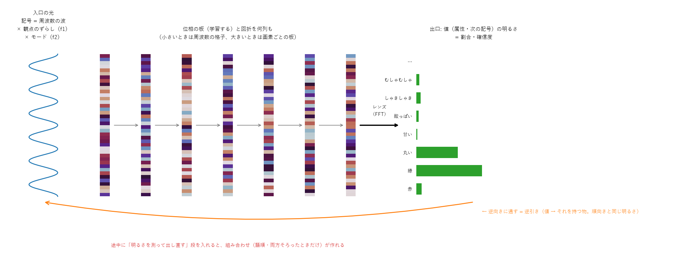
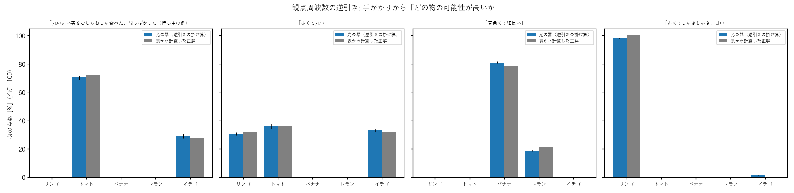
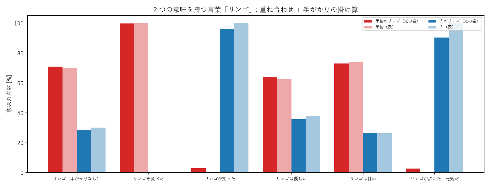
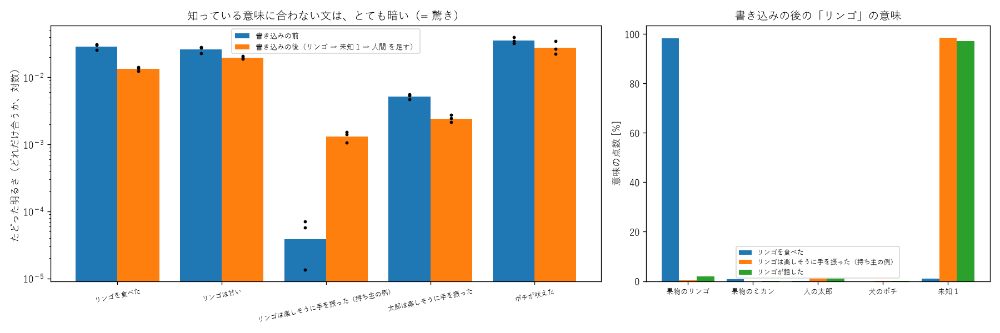
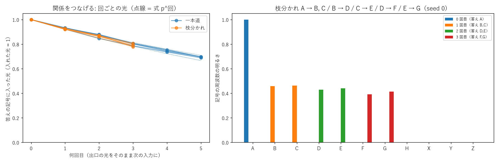
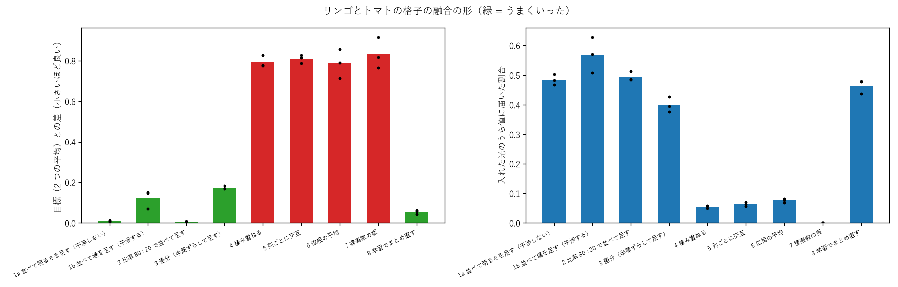

# 既存の AI やシステムにない成果と、そのしくみ（2026-11-02）

Sin-CNN3 の成果のうち、**既にある AI・光の計算の研究で、同じしくみでやった例が見つからなかったもの**を、しくみの説明つきで紹介します。
数字の正本は [NOTES.md](../NOTES.md)、先行研究の調べは [prior_art.md](prior_art.md)。

> **「ない」の範囲について**: 先行研究の調べ（[prior_art.md](prior_art.md)）は 2026-10-27 時点のウェブ検索の範囲で、網羅ではありません。
> 各項目に「調べた」（その調べで似た例が見つからなかった）か「未調査」（調べの後に出た成果で、まだ照らし合わせていない）を付けました。

## 0. 土台のしくみ（ここは既にあるもの）

- **入口**: 記号（リンゴ・「赤」など）を、整数の周波数の波で表します。
- **中**: 学習する位相の板と、板と板のあいだの回折。光は板を通るたびに位相だけが変わり、光の量は保たれます（ユニタリ）。
- **出口**: レンズ（フーリエ変換）で周波数に分け、どこが明るいかで答えを読みます。明るさの割合が、そのまま答えの割合（確信度）です。

この器の形は、回折の深層ネットワーク（D²NN、2018）と同じです。照らし方で働きを切り替える考え（多重化）も 2023〜2026 年に研究があります。
**新しいのは器そのものではなく、この器を「記憶と推し量り」に使う組み合わせ**です（[prior_art.md](prior_art.md) の 1.5 章）。

## 1. 一覧

| 成果（下の章の順） | ひとことで | 実験 | 先行研究 |
|---|---|---|---|
| 観点周波数と逆引きで推し量る | 器を逆に通すと「その値を持つ物」が光り、手がかりの明るさを掛けると推し量りになる | 21・24・25 | 調べた |
| 2 つの意味を重ねて持ち、手がかりで決める | リンゴ（果物）とリンゴさん（人）を光の足し算で持ち、掛け算で片方を消す | 26 | 調べた |
| 知らない意味に暗さで気づき、書き込む | 覚えた道に乗らない文は光が 75〜340 倍暗い。仲間を当てて新しい意味を足す | 27・51 | 27 は調べた、51 は未調査 |
| 「分からない」と「ない」、否定を光の量で表す | 「〜ではない」は、その値に行かなかった残りの光（1 − p） | 23・53 | 23 は調べた、53 は未調査 |
| 関係をつなげてたどり、何段でも濁らない | 出口の光をそのまま次の入口へ。明るさの 2 乗で毎段きれいにする | 17・50 | 17 は調べた、50 は未調査 |
| 1 語 = 1 枚の器、明るさで融合する | 単語ごとに小さな器を持ち、並べて明るさを足すと融合。道具を関数として使える | 31・32・34・64 | 未調査 |
| 光の偏りで「間違っているかも」を知る | 自信の高い 1 割だけ答えると正解率 13% → 43% | 62 | 未調査 |
| 本物の文から作る光の語板 | 名詞 3 万語を光の器で覚え、数えた表との差 0.024 ビット | 55〜58・75 | 未調査 |

## 2. 観点周波数と逆引きで推し量る

**できること**: 「丸い・赤い・むしゃむしゃ食べた・酸っぱかった」から、トマト 70%・イチゴ 29% と推し量ります。デジタルで計算した推し量りとの差は 1 点以内で、板の位相を 4 ビットに丸めても崩れません。

**しくみ**:
1. **観点周波数**: 何を聞くか（色・形・味…）を、入口の波の周波数を少し**ずらす**ことで表します。整数だけずらした波どうしは直交するので、同じ板に「色の答え」「形の答え」を重ねても混ざりません。
2. **逆引き**: 器はユニタリなので、出口から入口へ逆に光を通せます。値（「赤」）の光を逆に通すと、「赤を持つ物」が光ります。しかも**逆向きの明るさは順向きの明るさと同じ**です（確率 P(赤 | トマト) がそのまま出る）。
3. **掛け算**: 手がかりごとに逆引きした明るさを掛けると、確率の掛け算（素朴ベイズ）になります。合わない候補は掛けるたびに 0 に近づきます。

**既存との違い**: 光の多重化は画像の変換・分類に使われてきましたが、観点ごとの逆引きと掛け算で推し量る例は見つかりませんでした。ふつうの AI は、逆引き用に別の表や別の学習が要ります。ここでは同じ器を逆に通すだけです。

## 3. 2 つの意味を重ねて持ち、手がかりで決める

**できること**: 「リンゴ」に果物とリンゴさん（人）の 2 つの意味を持たせ、「むしゃむしゃ」なら果物、「手を振った」なら人、と 1 つに決めます。

**しくみ**: 2 つの意味を**光の足し算（重ね合わせ）**で 1 つの器に持ちます。手がかりの明るさを掛けると、合わない意味の光が消えて片方だけが残ります。曖昧さの解消の式（Gale ら 1992 の素朴ベイズ）と同じ計算を、光の重ね合わせと掛け算でしています。

## 4. 知らない意味に暗さで気づき、書き込む

**できること**: 「リンゴは楽しそうに手を振った」のように、覚えた意味に合わない文では、光が 75〜340 倍暗くなります。この暗さで「知らない使われ方だ」と気づき、仲間（人間の何か）を当てて新しい意味として書き込むと、仲間の属性を受け継ぎます。
知らない**物**に出会ったときも、合う率（属性の明るさの幾何平均）がしきい値 0.4 を下回れば「知らない」と判定し、新しいグレイン（小さな学習器）を作ります。別々のグレインなので、ほかの物を忘れません（実験51）。

**しくみ**: 学習した板は、覚えた入口の光を決まった出口に集めるように位相がそろっています。覚えた道に乗らない光は出口に集まらず、散らばって暗くなります。**暗さ = 驚き**です。追加の判定器は要りません。
新しいグレインを作る判定は、適応共鳴理論の「警戒しきい値」と同じ形です。

## 5. 「分からない」と「ない」、否定を光の量で表す

**できること**:
- 属性が書かれていないとき、「分からない（どれでもありうる）」と「ない」を区別して、推し量りの性格を変えられます（実験23）。
- 「赤くない」「酸っぱくない」を含む文 15 問で全問正解、確信度 54〜95% でした（割り算で表すと 7/15）（実験53）。

**しくみ**: 「分からない」は光を全部の値に**広げる**（拡散）、「ない」は光を**出さない**、と光の配り方を変えます。
「〜ではない」は範囲が広く、1 つの値では表せません。そこで「その値に**行かなかった**光の割合」、つまり **1 − p** で表します。光の量が保たれる器なので、残りの光はいつも測れます。

## 6. 関係をつなげてたどり、何段でも濁らない

**できること**: 「A → B」「B → C」…を、出口の光をそのまま次の入口に入れて何段もたどります。枝分かれは同時に進みます。毎段に雑音と光の減り 7% を入れても、30 段たどって正しい鍵との重なり 0.97〜1.00 を保ちます（何もしないと 10 段で 0.3）。

**しくみ**: 毎段、明るさを 2 乗以上（測って出し直す、または可飽和吸収体のような光の部品）すると、外れの明るさ 1/N が 1/N² 以下に縮みます。デジタルの「0 か 1 に戻す」と同じ役目を、光の明るさの曲がりでしています。
「きれいにする段」という考えは HRR（Plate）にありますが、ここでは光の部品だけで、関係の連鎖そのものを濁らずに運べることを確かめました。

## 7. 1 語 = 1 枚の器、明るさで融合する

**できること**:
- 1 単語ごとに小さな格子（1 KB）を持ち、格子そのものが単語の意味になります（実験31）。
- 2 枚を並べて出口の明るさを足すと、2 つの知識が融合します（差 0.01、比率 80:20 も効く）（実験34・64）。
- 道具を要素の光（圧力・熱・回転…）で入れると、見せていない道具（圧力鍋 = 圧力 + 熱）の結果も推し量り、逆向きに「ジュースにするには圧力・回転」が分かります（実験32）。

**しくみ**: 板の位相を混ぜると壊れますが、出口の**明るさ**は足しても干渉しません。だから「干渉で表し、明るさで混ぜる」と決めると融合が完全になります。
道具は要素の光の重ね合わせで入れるので、答えも要素ごとの答えの重ね合わせになります（線形）。ふつうのニューラルネットの重みを平均すると壊れやすいのと同じ理由で、位相の平均は失敗しました。

## 8. 光の偏りで「間違っているかも」を知る

**できること**: 答えを出すときの光の偏り（どれだけ 1 つの出口に集まっているか）で、当たりと外れを見分けます。自信の高い 1 割だけ答えると、正解率が 13% から 43% に上がりました（実験62）。

**しくみ**: 出口の明るさの割合が、そのまま確信度です。別の確信度の計算や、別の判定器は要りません。光が広く散らばっているときは、器自身が「分からない」と言っています。

## 9. 本物の文から作る光の語板

**できること**: 会話・青空文庫などの本物の文から、名詞 3 万語の「語板」（1 語 = 1 枚の光の器、観点 × 値の割合を持つ）を作りました。学習に使っていない文で数えた表との差は 0.024 ビットで、ほぼ追いつきます（語板 v3）。「を 食べる → ラーメン・パン・御飯」のような逆引きも意味を持ちます。3 万語を GPU 1 枚・9 分で作れます。

**しくみ**: 光の量を保つ器には、「違う入口から同じ出口に集められる光の和は 1 まで」という決まりがあります。よく出る値や「その他」の出口を観点ごとに**ずらす**と、この決まりに当たらなくなり、表に追いつきました（実験56〜58）。器を大きくするなら、縦の広さより**板の枚数**を増やすのがいちばん割に合います（実験75）。

**限界**: 語板が持つのは「同じ文の中での使われ方」だけで、文と文のつながりは数え方の目安に大きく負けます（[一時まとめ](summary_20261031.md) の 4 章）。

## 10. 既にあるものと同じだったもの（正直な一覧）

Sin-CNN3 で作ったけれど、既にある考えと同じだったもの。新しさとしては数えません。

| 作ったもの | 同じ考え |
|---|---|
| 位相の板 + 回折を何枚も重ねる器 | 回折の深層ネットワーク（D²NN、2018） |
| 観点 f1 × f2 で答え方のモードを切り替える（実験41） | 回折ネットワークの多重化（波長・位相の鍵・角度） |
| 鍵と値を結んで重ね書きする記憶、容量の線（実験08） | HRR・FHRR・ベクトル記号アーキテクチャ |
| 構造と時の順を 1 枚の光に畳む（実験103） | HRR・VSA の結びつけと、ずらしで順番を表す方法 |
| 明るさで曲がる処理で「どちらか片方だけ」を解く（実験14・22） | 光の非線形（カー効果・可飽和吸収体）の活性化 |
| 光の注意機構（実験49） | 光のトランスフォーマー、現代版 Hopfield |
| 返事選び・穴埋め・往復の物差し（実験109〜121） | 自己教師あり学習（穴埋め）・返事の選び直し |

## 11. まだ確かめていないこと

- 「未調査」の項目（実験50〜75）は、先行研究との照らし合わせをまだしていません。
- どの成果も、小さな模型か数え上げとの比べです。大規模な言語モデルと同じ課題で比べたことはありません。
- 実際の光の装置では作っておらず、すべて計算機の中の模擬（シミュレーション）です。
